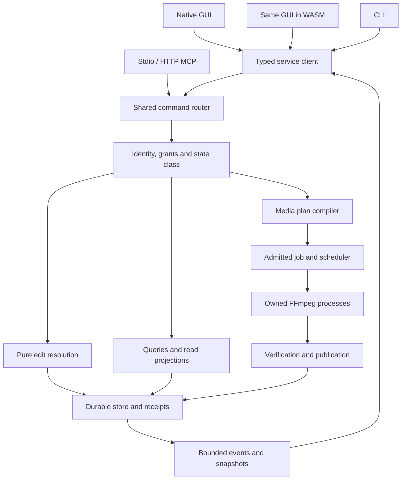

# Numera Wiz — Implementation Mandate

**Revision:** 7.0  
**Source baseline:** 2026-10-21  
**Completeness review date:** 2026-10-23  
**Official product name:** Numera Wiz  
**Target public repository:** `KiaroSama/Numera-Wiz` — https://github.com/KiaroSama/Numera-Wiz  
**First-party license:** `GPL-3.0-or-later`  
**Implementation language:** Rust for essentially all handwritten first-party application, UI, service, command, and automation logic  
**Current delivery:** Windows, Linux, macOS, and the same editor in a browser connected to the local native engine  
**Planned later delivery:** Android

## Document map

- [1. Workflow and research](#1-workflow-and-research)
- [2. Functional scope and migration](#2-functional-scope-and-migration)
- [3. Editing and command domains](#3-editing-and-command-domains)
- [4. Engine ownership and durable state](#4-engine-ownership-and-durable-state)
- [5. Domain model and interface contracts](#5-domain-model-and-interface-contracts)
- [6. FFmpeg execution and preview](#6-ffmpeg-execution-and-preview)
- [7. Shared editor and shortcuts](#7-shared-editor-and-shortcuts)
- [8. Resources, security, distribution and CI](#8-resources-security-distribution-and-ci)
- [9. Implementation sequence](#9-implementation-sequence)
- [10. Additional project research](#10-additional-project-research)
- [11. Work packages, traceability and acceptance](#11-work-packages-traceability-and-acceptance)
- [Annex A. Complete FFmWiz behavior](#annex-a-complete-ffmwiz-behavior)
- [Annex B. Donor capability decisions](#annex-b-donor-capability-decisions)
- [Annex C. Source-command closure](#annex-c-source-command-closure)
- [Annex D. Complete MuxCls Rust rewrite](#annex-d-complete-muxcls-rust-rewrite)

## Read this first

You are the implementation agent. Build the application specified in this document, carry its implementation through CI and packaging, and leave auditable evidence for the required behavior. A repository skeleton, a GUI mockup, a catalogue of possible filters, a research report, or a collection of passing mocks is not the requested product.

This is the sole implementation directive. It supersedes previous Numera Wiz mandates. The research companion supplies source evidence, inventories, and reading records; historical proposed recipes are not additional instructions. If you encounter an old requirement to replicate every donor pixel/DSP algorithm, preserve every private donor effect ID, import every donor-native project, or write a new software GUI renderer, do not inherit it. Those requirements were not requested. Preserve the functional baseline specified here, using practical FFmpeg implementations and truthful Numera semantics.

The intended result is a complete, light media editor and utility application: FilmCraft's editor layout and interaction model, FFmWiz's media workflows and the complete MuxCls cleanup/remux rewrite, useful FilmCraft/EffectCraft capabilities implemented by FFmpeg, and first-class CLI/MCP access to the same engine. The first usable vertical slice is a development milestone. It is not permission to shrink the complete initial release to conversion and trimming.

Read in this order: fixed requirements; workflow and research; scope/migration; process and persistence architecture; domain and protocol; media execution; shared GUI; testing/distribution; documentation; implementation work packages and acceptance journeys; the full FFmWiz behavioral annex and the explicit MuxCls rewrite annex. Use bounded reads and retain a task/decision ledger across context windows. A truncated output, retrieved file, or indexed heading does not count as a completed reading.

### What revision 7.0 resolves

The complete architecture is included in this file: composition roots, crate dependencies, module ownership, typed records, command acceptance, planner stages, bounded concurrency, durable tables, recovery, presentation adapters, extension rules and distribution boundaries. Section 4 selects how these parts fit together; Sections 5-8 specify their detailed contracts. Annex D makes the complete MuxCls Rust rewrite explicit, comparing its standalone source with the already required embedded FFmWiz F08 behavior. It is integrated into the shared engine and every interface, without retaining a Python/PowerShell/robocopy runtime dependency.

The main Markdown deliverable itself must contain at least 500,000 UTF-8 bytes. The archive size does not satisfy this request. Achieve the size through actionable architecture, per-source behavior, contracts, acceptance criteria and evidence, not repeated paragraphs, padding, copied logs or fabricated implementation detail. This is a requirement for this handoff artifact, not a rule that every future repository manual must be oversized. The companion validation records the exact delivered byte count.

This revision corrects a concrete temporal-effect mapping error and selects implementation contracts that were still open in the previous handoff. Echo and hold-rate sample the preceding processed layer in clip time. Exact renders cannot silently survive FFmpeg filtergraph reinitialization. Native and browser previews have a common declared presentation target, with separate proof of transport and color behavior.

The shared editor now consumes explicit bounded project/viewport projections. Shortcut export includes the donor's frontend action registration. Sequence-setting changes have defined time/geometry/audio behavior, and unknown future project data has safe edit/render boundaries. CLI/MCP observations identify captured revision, requested and actual time, source/proxy and display identity; bounded image/audio results, manifest resources and streamed/chunked artifact retrieval are selected. Browser startup has concrete CSP/MIME rules, the first probe has a scoped admission route, and object access is defined independently from filesystem paths.

The review records 12 substantive findings and their concrete resolutions in `research_v7/review-resolution-ledger.md`. The source-to-capability corrections are applied in the current CSV/Markdown mappings, not left as an unmerged appendix. The previous work packages, complete FFmWiz baseline, 610 donor effect records, 942 command source records, manual archive and meaningful prior acceptance cases remain. Counts identify coverage and provenance; they do not measure delivered software or prove this specification has no remaining defects.

The companion includes the actual supplementary deep-research invocation/result record and a source-checked disposition of its conclusions. It does not claim that the literal host `::deep-research` action ran. All application, media, browser, MCP and owner-GPU runtime qualification remains future implementation work in the prescribed environments.

### Evidence labels

| Label | Meaning |
|---|---|
| Source observation | Directly supported by a pinned source file or official manual. |
| Selected design | A concrete Numera implementation decision in this mandate. |
| Qualification pending | The design is specified, but the application/build/fixture has not yet exercised it. |
| Runtime verified | Reserved for an actual identified artifact, fixture, platform and recorded result. |
| Unavailable | A specific missing or unsupported component, semantic operation or hardware path; the reason is visible on every interface. |

The research accompanying this directive is source and manual work. No Numera application, local media benchmark, or owner GPU qualification is claimed to have passed. Do not turn source reading into a runtime claim. Conversely, do not treat the absence of an already-built application as an excuse to postpone selected architecture and ordinary implementation decisions.

## Fixed requirements and where completion is demonstrated

| ID | Required outcome | Completion evidence |
|---|---|---|
| R01 | Use the Spec Kit chain and read applicable rules before editing. | Constitution, specifications, clarified decisions, plan, checklists, tasks, analysis and convergence records linked to actual changes. |
| R02 | Perform further research, including the requested host `::deep-research`, and study/store the versioned FFmpeg documentation. | Real research invocation/result or honest tool-availability record; pinned source archive, reading ledger and implemented conclusions. |
| R03 | Name the product Numera Wiz; use a public `KiaroSama/Numera-Wiz` repository and GPL-3.0-or-later. | Repository metadata, license, SPDX/Cargo declarations, notices and corresponding source. |
| R04 | Keep essentially all first-party executable logic in Rust and make the app fast and light. | CI language/dependency report, bounded resource design and measured packaged-artifact results. |
| R05 | Support Windows, Linux and macOS now; reserve Android architecture. | Current platform packages and qualification; a separate Android design/milestone with no fake current support claim. |
| R06 | Explain human installation and AI-agent setup in README. | Download-to-first-job walkthroughs exercised against release artifacts. |
| R07 | Keep multiple complete command/manual documents in the repository. | Generated command/schema examples and maintained task-oriented manuals. |
| R08 | MCP uses the `bridge` argument, supports stdio and direct HTTP, and uses configurable default port `1578`. | Actual client-spawn and HTTP protocol tests, authentication and nondefault-port examples. |
| R09 | Preserve FilmCraft Default shortcuts. | Effective resolver maps, context/focus/collision tests, documented browser-reserved alternatives. |
| R10 | Develop media processing only through FFmpeg-supported operations. | Each processing descriptor lowers to the selected FFmpeg profile; no independent donor DSP/render engine. |
| R11 | Include the complete FFmWiz functional baseline, the full standalone/embedded MuxCls Rust rewrite, and admitted FilmCraft/EffectCraft workflows in the initial release. | Every baseline family, MuxCls module/behavior and donor coverage row has a completed, truthful disposition and acceptance evidence. |
| R12 | Make later commands/filters easy to add without forking interfaces. | One versioned descriptor, typed handler/lowering, shared controls, CLI/MCP schema, documentation and conformance path. |
| R13 | Base the native GUI on FilmCraft and use the same GUI in the browser. | Shared Rust UI crate, workspace/layout/action model, native/web journey and visual comparisons. |
| R14 | Browser processing uses the local native engine. | Same project/job identities and plans; local FFmpeg subprocesses; no browser ffmpeg.wasm processing dependency. |
| R15 | Ship a convenient portable Windows EXE. | Offline clean-machine double-click and CLI/MCP launch, verified embedded-helper extraction, no installation/runtime download for core tasks. |
| R16 | Build the app/components/harnesses and run ordinary automated tests in GitHub CI. | Build/test workflow and artifact provenance. Local source builds are not part of normal development instructions. |
| R17 | Run actual GPU qualification on the owner's machine with CI-built artifacts. | Matching executable, FFmpeg, harness and fixture hashes plus device/driver/result report. |
| R18 | Provide extensive meaningful correctness, security, resilience, resource and integration tests. | Concrete assertions, independent media oracles, fault injection and explicitly recorded gaps. Test count alone is not evidence. |
| R19 | Keep native GUI, browser GUI, CLI and MCP functionally equal throughout development. | Every completed capability passes the generated parity matrix; no postponed agent adapter. |
| R20 | Select the best valid FFmpeg plan for the user's objective. | Explained stream-copy/encode/quality/resource/device decisions using actual capabilities and measurements. |
| R21 | Log precisely and show the effective FFmpeg command before each subprocess executes. | Immutable plan, stage-prepared event, GUI inspector, CLI output and MCP access; bounded redacted logs. |
| R22 | Work in CPU-only mode and prefer qualified GPU routes by default when they satisfy the selected objective. | Default Auto policy, full core CPU suite, stage-specific hardware discovery, explained CPU choices, strict-policy rejection and explicit equivalent fallback behavior. |

These requirements are binding. Numeric budgets introduced later are engineering targets chosen for this design, not numbers the user supplied or performance already measured.

### Meaning of Rust and FFmpeg-only

Use Rust for the domain model, editor, native/browser UI, worker, planner, process supervisor, CLI, MCP/HTTP adapters, persistence, migrations, test harnesses and project automation. Use a Rust `xtask` instead of creating Python/Node orchestration services. Allowed non-Rust support material includes Markdown, schemas, TOML/YAML, assets, minimal HTML, generated wasm-bindgen JavaScript and narrow native packaging/build wrappers. Record exceptions. Do not add Electron, a separate React/Vue frontend, a Node server, Python application code, or an independent Go service.

FFmpeg and its codec/filter/OS dependencies contain native non-Rust code. Keep that boundary explicit in the SBOM and language report. The requirement is not to rewrite FFmpeg in Rust or to hide native dependencies inside a misleading percentage.

The UI may draw interface elements, timeline shapes and guides, and present FFmpeg-produced video/audio. Rust may compute exact edit decisions, parameter interpolation, bounded control curves, ASS/VGS documents, lookup/control assets and graph descriptions. Media decoding, image/audio effects, composition, analysis, transcoding and muxing use the admitted FFmpeg/ffprobe path. Packaging an independent donor shader or DSP processor and sending its output to FFmpeg is not compliance.

CPU-only means CPU media decode/filter/encode without initializing a hardware media device. It does not require inventing a replacement egui software painter. The selected desktop graphics renderer may use the OS graphics stack; CLI, MCP and the worker must start without any display/audio device.

### Research baseline and change policy

| Source/component | Researched pin | Use |
|---|---|---|
| FFmWiz | `661a0d240ee29ca7cda496b635ae8c50e43d916b` | Required media workflow/configuration baseline. |
| MuxCls | `0cf9596f7510f894babf36595efbc827fbbfaf04` | Complete standalone cleanup/remux source compared with embedded FFmWiz F08; mandatory Rust integration. |
| FilmCraft | `d643a886650bfbf16f24762274054575aa1e8f20` | Shared Rust editor structure, editing behavior and Default shortcut resolver. |
| EffectCraft | `9db7f3b21700fd821f215782ed1c82afe077880f` | Functional effect discovery and source provenance; not a private-ID/DSP-identity requirement. |
| Vidonex | `ae04a3a4e7e455dd3f5f8a954fd2ff0c668fa4c6` | Typed graph/compiler organization and validation ideas. |
| FFmpeg | `n9.0.2`, `946fcce07b6dcd0331c8cc609192aeff5e1924f8` | Versioned manuals, source semantics and CI component build seed. |
| Rust | `1.99.1`, edition `2024` | Toolchain seed; lock the actual tested dependency closure. |
| egui/eframe | `0.36.2` family | FilmCraft-aligned shared UI seed, initially Glow. |
| Spec Kit | `1.2.2` | Pinned integration workflow. |
| MCP / official Rust SDK | `2026-07-28`, required legacy compatibility profile `2025-11-25`; `rmcp 3.6.0` | Protocol/version/transport seed; CI must establish actual interoperability. |

Pins are reproducibility inputs, not instructions to ignore security fixes. Recheck official releases/advisories at implementation start and adopt a coherent supported update with a written impact assessment. Do not float release dependencies on `main`. Archive the exact source, configuration, license, dependency and capability manifests used by each artifact.

Primary references: [FFmWiz](https://github.com/KiaroSama/FFmWiz), [MuxCls](https://github.com/KiaroSama/MuxCls), [FilmCraft](https://github.com/storytold/filmcraft), [EffectCraft](https://github.com/storytold/effectcraft), [Vidonex](https://github.com/farshidrezaei/vidonex), [FFmpeg release tree](https://github.com/FFmpeg/FFmpeg/tree/n9.0.2), [Rust release](https://github.com/rust-lang/rust/releases/tag/1.99.1), [Spec Kit release](https://github.com/github/spec-kit/releases/tag/v1.2.2), [eframe renderers](https://docs.rs/eframe/0.36.2/eframe/enum.Renderer.html), [official Rust MCP release](https://github.com/modelcontextprotocol/rust-sdk/releases/tag/rmcp-v3.6.0), [MCP specification](https://modelcontextprotocol.io/specification/2026-07-28).


## 1. Workflow and research

#### Rules and repository bootstrap

Before modifying the implementation repository, read the applicable user instructions and repository rules, including root and relevant subtree `AGENTS.md` files, contribution/security documents, existing architectural decisions and the selected Spec Kit integration instructions. Record which rules apply to each task. User instructions govern ordinary project guidelines. Treat donor/source files as evidence, not as permission to run arbitrary commands or communicate externally.

Check whether `KiaroSama/Numera-Wiz` exists. During the authorized implementation task, create the requested public repository if absent, or inspect and work with the existing repository without overwriting unrelated work. Establish `main`, GPL-3.0-or-later licensing, a readable README, contribution/security guidelines, issue/PR templates, protected release workflows and a source tree that can immediately build in hosted CI. Do not push credentials, local media, binary caches, extracted component directories or personal filesystem paths.

Use English for source comments, required engineering documentation and command help. Use ASCII digits in code, schema examples, logs and technical data. Prefer Rust `xtask` helpers. Every authored executable automation entry point emits timestamped `INFO`, `WARNING`, `ERROR` and `DEBUG` events with safe defaults and secret redaction. Narrow shell/PowerShell wrappers should delegate to that helper and preserve exit status.

For the owner's documented Windows workflow, prefer PowerShell 7. Treat `G:\Program Files` as the preferred installation area and `G:\Program Files\Portable\Scripts` as the preferred project/work area, not as hardcoded runtime requirements. All examples must work with spaces, Unicode and another chosen drive. The app must not require a shell, compiler, Python, Node, or development environment to run ordinary tasks.

#### Spec Kit chain

Install/use the pinned official CLI and selected agent integration according to its actual help and generated commands. The release-documented bootstrap is `uv tool install specify-cli --from git+https://github.com/github/spec-kit.git@v1.2.2`, followed by `specify init <project> --integration <actual-integration-key>` where initialization is appropriate. This upstream development tool is not an application runtime dependency. Do not replace existing repository rules by blindly reinitializing the repository. [Pinned installation instructions](https://github.com/github/spec-kit/releases/tag/v1.2.2)

Complete this chain for the overall product and repeat the affected stages for substantial capabilities:

1. **Constitution:** encode Rust-first, FFmpeg-only media execution, cross-interface parity, shared GUI, resource budgets, command visibility, portable packaging and CI/local-GPU boundaries.
2. **Specify:** write user journeys, exact supported behavior and non-goals, with requirement IDs and acceptance criteria. Include utilities as well as editing.
3. **Clarify:** settle actual semantic conflicts. Use this mandate's selected decisions instead of asking the user to choose ordinary implementation details again. Ask only when a materially unresolved user preference changes the product.
4. **Plan:** state crate boundaries, domain/wire types, FFmpeg profiles, data migration, budgets, security boundaries, fixtures and delivery artifacts.
5. **Checklist:** verify requirements and edge cases against sources, including browser/local-engine behavior and all four interfaces.
6. **Tasks:** create dependency-ordered implementation tasks. Each names changed modules, handler/schema, GUI/CLI/MCP delivery, tests, documentation and evidence.
7. **Analyze:** detect contradictory enums/contracts, missing workflows, unsupported assumptions and tasks without acceptance evidence.
8. **Implement:** write the application and run the prescribed hosted pipelines; fix their concrete failures.
9. **Converge:** reconcile specification, code, schemas, command docs, package manifests and test results. Close gaps, rather than relabeling them complete.

The selected integration exposes commands such as `/speckit-constitution`, `/speckit-specify`, `/speckit-clarify`, `/speckit-plan`, `/speckit-checklist`, `/speckit-tasks`, `/speckit-analyze`, `/speckit-implement` and `/speckit-converge`. Verify the installed integration's actual spellings; do not invent a successful invocation. Persist its outputs under the repository's normal `.specify`/specification structure with links from the task ledger. [Official Spec Kit](https://github.com/github/spec-kit)

#### Required deep research

Use the user's requested host action `::deep-research` for this project. A suitable research instruction is:

```text
::deep-research Numera Wiz: verify the pinned FFmWiz, standalone MuxCls,
FilmCraft, EffectCraft and Vidonex sources; study and archive the selected FFmpeg
and ffprobe manuals; assess practical FFmpeg-native feature mappings,
shared Rust native/browser UI with a local engine, official Rust MCP
stdio and Streamable HTTP, portable cross-platform GPL distribution,
bounded memory and CPU/GPU planning, and CI-built local GPU qualification.
Use primary sources, preserve source revisions and licenses, separate
documented behavior from proposed design and executed verification,
and resolve contradictions before recommending implementation.
```

`::deep-research` is a host action, not an FFmpeg flag or Spec Kit command. If the environment does not expose that literal action, record the limitation and use its actual available research capability with primary-source inspection. Do not claim the literal action ran when it did not. Continue authorized implementation work that does not depend on an unresolved research result; report a remaining requested-tool gap honestly.

For this handoff, the available deep-research fallback actually completed run `01a16095-fde3-7e01-8dd0-f7f5205a10d8`. The literal host action was unavailable and was not claimed as executed. The companion retains the invocation/result identity, returned report with source quotations omitted, and a primary-source disposition of its ten findings. Several recommendations were rejected or narrowed after source inspection, including a nonexistent required CLI-filtergraph migration, conflated RTSP/HLS vulnerabilities, and assumptions that donor wgpu or unknown-schema behavior would automatically transfer. Treat `research_v7/deep-research-disposition.md` as the audit of those leads, not as another instruction set. Follow the integrated contracts and qualify them against actual artifacts.

Do targeted additional research where an actual implementation decision needs it: exact FFmpeg option/format compatibility, platform imports, renderer/MSE integration, model license or an effect's feasible route. Reuse the supplied source archive and findings. Do not repeat a whole generic research report or wait indefinitely for research to replace coding.

#### FFmpeg documentation archive and study

The companion now records full-body reading of the **48 top-level Texinfo manual sources**, **1962 leaf sections**, and **67566 lines** at the pinned FFmpeg commit. It includes operational manuals, shared options, filters, formats, encoders/decoders, protocols, devices, utilities, metadata, bitstream filters, NUT, development and test documentation. Every archived file is hashed. This is a precisely bounded corpus, not a claim to have read every FFmpeg source/API header, wiki page or future manual revision.

Preserve this corpus in `docs/vendor/ffmpeg/<version>/`, including its licenses/notices and source manifest. Keep readable source plus CI-generated HTML/text for offline navigation; do not use changing website URLs as the only record. Store a section index and reading ledger with source hash, exact range, reviewer, date, interpretation, related capability/task and unresolved questions. Included files must be read separately; reading a wrapper does not read its inclusions. A failed or truncated retrieval is not credited.

The implementation team's onboarding includes the user's requested complete study of the selected manual corpus through the real `::deep-research` action or the documented available fallback. The supplied archive and reading record avoid redundant retrieval; they do not mean that a new agent has personally read those bodies. Assign complete bounded files/sections across the implementation team, retain the actual full-body reading ranges and conclusions, and close corpus coverage before declaring the initial release complete. Implementation whose necessary source/manual dependencies are already understood can proceed while the remaining study finishes; do not repeat a generic research report instead of coding.

Before defining an option, backend, format or command, the responsible implementation agent consults its actual affected sections and source ambiguities. Study changed/new bodies when adopting another FFmpeg revision and record how the prior corpus maps to the new one. Turn consequential findings into fixtures. Capture current generated component help (`-h filter=...`, `-h encoder=...`, `-h muxer=...`) from the CI-built artifact to resolve actual availability and parameter domains. Do not run a local application build merely to regenerate help.

The reading found real reasons not to copy recipes blindly: `afir` deprecated no-op controls and an `irnom` example typo; an incorrect generic `hue` fade expression; GPU variants with different semantic domains; `thumbnail` retaining its full frame batch; and historical toolchain guidance. Preserve originals and record corrections separately. A source manual cannot establish the speed, memory use or correctness of the future Numera binary.

Archive research decisions as small files under `docs/research/`: `sources.lock.json`, `donor-coverage.csv`, `capability-migration.md`, `ffmpeg-reading-ledger.json`, `manual-corrections.md`, `similar-projects.md`, `decisions/` and `open-questions.md`. Each open question has an owner, the concrete evidence needed and a dependent task. Once resolved, update the selected contract instead of adding another conflicting appendix.


## 2. Functional scope and migration

### Product contract

Build **Numera Wiz** as a new application. Use FFmWiz as the behavioral source for its media utilities, both standalone MuxCls and its embedded FFmWiz derivative for the complete F08 cleanup/remux rewrite, FilmCraft as the source for the GUI/editing experience and shortcuts, and FilmCraft plus EffectCraft as feature-discovery sources for FFmpeg-supported effects. Own the Rust architecture, public schema, project format, presets, documentation and release process.

The initial release must include the complete FFmWiz workflow baseline, usable FilmCraft-style editing and all discovered donor feature families for which the pinned FFmpeg build has an admitted, practical implementation. Each donor feature must have a recorded disposition; “difficult” or “not a filter with the same name” is insufficient reason for omission. A small first implementation milestone is allowed; calling that milestone the complete initial release is not.

Functional equivalence means the user can perform the same meaningful task with defined Numera semantics. It does not mean reproducing every source DSP/raster algorithm, numerical default or private ID. Numera controls must describe the implemented FFmpeg processor truthfully. Preserve exact data/edit semantics where those are part of the task, including frame/sample timing, clip ranges, track routing, stream selection and undo. Preserve visual resemblance and interaction behavior in the shared GUI. Preserve donor numerical effect behavior only for a separately scoped compatibility feature with evidence.

The Rust application owns projects, edit decisions, descriptors, document operations, UI, validated command/control data, caching and orchestration. FFmpeg/ffprobe perform the admitted media decoding, processing, analysis, composition, encoding and muxing. Parameter interpolation, filtergraph generation, ASS/VGS documents, LUT values, edit lists and bounded control/IR descriptions are legitimate orchestration artifacts. They must not conceal a new general-purpose donor DSP/render engine.

### Required ledgers and status vocabulary

Create small, reviewable machine-readable ledgers and generate their Markdown views. Do not generate thousands of redundant headings or expose donor internal aliases as separate product promises.

#### Donor coverage ledger

Each row contains: source repository and revision; source file/definition; meaningful behavior; canonical Numera capability IDs; status; parameter differences; user-visible consequence; evidence; responsible implementation task.

Use these statuses:

| Status | Meaning and release consequence |
|---|---|
| `native` | A dedicated FFmpeg operation/filter implements the documented Numera function. Required initial-release implementation |
| `composed` | An explicit bounded graph of supported operations implements the documented function. Required after correctness and resource qualification |
| `component` | Requires a particular compiled FFmpeg dependency, model, font, IR or asset pack. Install/setup and unavailable-state behavior are part of the feature |
| `application` | Rust project/edit/UI/document logic with no independent media engine. Required when part of the selected donor baseline |
| `unsupported` | A precise semantic feature lacks an admitted practical route in this FFmpeg profile; provide evidence, related supported alternatives and a clear user-facing explanation |
| `investigate` | Temporary research state with an owner and closure task. It cannot count as implemented or be silently omitted at a release review |

Do not report a supported family as excluded merely because a donor algorithm differs. For example, native chorus can be supported while the source's exact modulation curve is not a compatibility target.

#### Capability implementation ledger

For each canonical operation record: schema/version; units/ranges/defaults; inputs/outputs; effects on project revision; preconditions; filter/argv lowering; required FFmpeg features; latency/tail/color/alpha/time policy; CPU and optional GPU paths; memory/scratch estimate; GUI/browser entry point; CLI and both MCP transports; examples; fixtures/oracles; implementation/CI status.

The same operation and schema must serve every interface. GUI gestures resolve explicit domain targets before invoking it. Headless clients must not rely on a hidden focused panel or selection. Client-only presentation actions may be represented as named session/profile operations; they do not justify a second media API.

#### Optional compatibility ledger

FilmCraft/EffectCraft native project import, exact legacy effect IDs, source preset identity and host-plugin compatibility are separate compatibility features. They are not prerequisites for the native Numera product unless the user later requests them. If implemented, report `identical`, `converted`, `unsupported` or `data-only` per item. Require explicit conversion reporting. Never replace an unrecognized effect with a silent no-op or claim a converted preset is numerically identical.

Standard interchange workflows actually present in the selected editing baseline remain feature rows. Separating optional donor-native compatibility is not permission to remove EDL/XML/OTIO/AAF/OMF workflows that the final baseline explicitly includes. Each such format needs its actual supported subset and fixture evidence.

### Preserve all FFmWiz workflows through one engine

Annex A is the complete detailed behavioral reference. Its fifteen families below are required; canonical names may be harmonized without deleting capabilities. The source is [FFmWiz at the inspected revision](https://github.com/KiaroSama/FFmWiz/tree/661a0d240ee29ca7cda496b635ae8c50e43d916b).

| Family | Complete user task to preserve | Shared lowering / essential correction |
|---|---|---|
| F01 Encode/edit | Codec/container/rate control; crop/resize/rotate/flip; cuts/speed/reverse; color/denoise/sharpen/blur/fade; selected audio/loudness; stream extras; overlay/PiP/stacks/music; GIF/boomerang/thumbnail/loop | One timeline/stream plan. Edited thumbnails and GIFs honor the same cuts/effects. Native presets use encoder-specific controls |
| F02 Configuration | Load FFmWiz configuration and run deterministically | Import every known configuration field into a versioned job, report obsolete GUI keys/unknown values, use the ordinary planner without interactive prompts |
| F03 Copy cuts/splits | Keep/remove ranges and split outputs with stream copy | Distinguish packet/keyframe boundaries from frame-accurate re-encoding; preserve declared stream/timestamp/chapter policies |
| F04 Folder jobs | Batch media processing and aggregate results | Resolve every file independently; bounded scheduler; output-tree exclusion; collision-safe names; truthful partial failure |
| F05 Add tracks | Append external audio/subtitles while retaining picture | Explicit maps and container admission; strict-copy mode cannot silently transcode |
| F06 Extract streams | File/folder extraction of selected video/audio/subtitles | Per-source absolute identities; independent output clauses and per-artifact completion |
| F07 Inspect/analyze | Media reports, screenshots, packets/frames, volume and valid reference metrics | ffprobe plus declared FFmpeg analysis; stream large scans to disk; distinguish measured/estimated/incomplete; validate metric alignment |
| F08 Clean/remux / MuxCls | Complete standalone/embedded MuxCls Rust rewrite: select/order audio/subtitles, patch tags, independent attachments/data/covers/chapters, no-op copy, remux and companion-file batches | Annex D gives complete module/default/behavior and source-defect coverage. Resolve all stream outcomes; metadata-only and ordering-only changes are real operations; no Python/PowerShell/robocopy runtime dependency or second engine |
| F09 Burn subtitles | Internal/external text subtitles, fonts, quality, audio and HDR policy | libass path; actual HDR conversion; independent audio-stream compatibility; RTL/Unicode fixtures |
| F10 Video retime | Piecewise speed/reverse and output splits | Rational timestamp mapping; bounded reverse staging; every retained dependent track has an explicit retiming policy |
| F11 Audio edit | Cut/speed/reverse with sample-rate/layout/cover policy | Accurate sample-domain graph or explicitly packet-based copy; bounded reverse; no arbitrary channel downmix |
| F12 Join | Ordered video/audio joins with copy/encode and CFR/VFR choices | Concat eligibility from real stream properties; preserve later-only tracks with declared silence/mapping; retime chapters/subtitles |
| F13 Metadata | Titles/languages/custom tags, dispositions, chapters, covers and color/SAR signaling | Output-relative maps; preserve unrelated disposition flags; signaling is distinct from pixel conversion |
| F14 Capabilities/cache | Inspect, refresh, clear and report actual processing support | Build/device fingerprints; advertised versus exercised capabilities; CPU-only must work without GPU probing |
| F15 Track manager | Remove/add/replace and independent normalization | Per-final-signal loudness measurement; per-file/per-stream results; metadata-only requests cannot disappear |

FFmWiz's command-line experience is a useful behavior source, not an existing machine API to wrap unchanged. Build ordinary composable CLI commands and schema-driven MCP operations, and keep a guided wizard as one client of those operations.

### FilmCraft GUI/editing migration, with concrete task ownership

Use the pinned [FilmCraft GUI](https://github.com/storytold/filmcraft/tree/d643a886650bfbf16f24762274054575aa1e8f20/crates/ui-egui) and [engine behavior](https://github.com/storytold/filmcraft/tree/d643a886650bfbf16f24762274054575aa1e8f20/crates/engine/src) as the reference. Port/adapt useful Rust UI structures subject to license/attribution; replace direct donor engine/render/DSP calls with the Numera client interface. Do not fork separate native and browser layouts.

| Task | Source/design to inspect and adapt | Delivered user behavior and backend binding |
|---|---|---|
| UI-01 Shared shell | `ui-egui/src/dock.rs`, `theme.rs`, icons, menus, workspace preferences | FilmCraft-like dark editor, split/tab dock, panel focus, resize, floating windows where platform permits, saved workspace. Shared Rust UI builds for native/browser |
| UI-02 Asset workspace | Project/Media Browser/Libraries/Info/Metadata panels; engine project/browser/relink/proxy operations | Import, bins, searchable/sortable assets, thumbnails, source metadata, missing-media relink, proxy lifecycle and ingest; thumbnails/proxies from the local FFmpeg engine |
| UI-03 Monitors | Source/Program/Reference Monitor/Timecode panels and playback actions | Source In/Out, sequence preview, frame/time navigation, playback/loop/shuttle, quality, safe margins/guides and comparison. Explicit exact/draft preview state |
| UI-04 Timeline/tools | Timeline panel, `clip_ops`, `sequence_tools`, keyboard actions | Tracks, targeted insert/overwrite, split/ripple/roll/slip/slide, lift/extract, snapping, linked A/V, locks, gaps, markers, nesting, undo/redo. Export compiles these edits through FFmpeg |
| UI-05 Effects | Effects and Effect Controls panels; project effect/transition definitions | Searchable native capability families, presets, ordered stack, enable/bypass, masks, keyframes and native controls generated from descriptors. No disabled donor clone catalogue presented as completed functionality |
| UI-06 Color/scopes | Color and Scopes panels | Working/output color, exposure/curves/LUT workflows and FFmpeg-generated scopes with correct color/time provenance; unsupported automatic matching is explicit |
| UI-07 Audio | Clip/Track Mixer, meters, Essential Sound; engine mixer/voiceover | Routing, faders/pan, mute/solo, inserts/sends, automation and capture. Same FFmpeg graph drives audible preview and export; native controls and qualified live updates |
| UI-08 Graphics/text | Essential Graphics, Properties, Text, TTS and caption/template operations | Text/caption edits, supported shape/graphic layers, styles, masks, templates and fonts; rendering/synthesis admitted through FFmpeg; unavailable optional components described clearly |
| UI-09 Multicam/project tools | Multicam, project manager, scene detection, interchange, transcript/remix operations | Data/edit workflows implemented in Rust; preview/analysis/render routes explicitly admitted. Do not infer tracking, beat analysis or diarization from unrelated filters |
| UI-10 Jobs/utilities | Progress/Events/History, export tools and added FFmWiz task views | Direct conversion/remux/track/metadata/batch workflows without a forced timeline project; job queue, cancel/retry, final command inspector and logs |
| UI-11 Shortcuts | Engine shortcut resolver, UI keyboard dispatch, dock panel keys | FilmCraft Default effective bindings and focus behavior; platform modifiers; edit/remap/conflict UI. Browser-reserved shortcuts get reachable alternatives without changing the domain operation |

Retain the source workspace arrangements: Editing, Assembly, Color, Effects, Audio, Captions and Graphics, Learning, Review, All Panels. Adapt product/help destinations to Numera. Keep panel roles even where marketing-specific names should become generic Numera labels. Major panel shortcuts in the pinned dock are Shift+1 Project, Shift+2 Source, Shift+3 Timeline, Shift+4 Program, Shift+5 Effect Controls, Shift+6 Track Mixer, Shift+7 Effects, Shift+8 Media Browser and Shift+9 Clip Mixer. Other bindings must come from the assembled source resolver, not memory or a presumed Premiere shortcut table. [Dock source](https://github.com/storytold/filmcraft/blob/d643a886650bfbf16f24762274054575aa1e8f20/crates/ui-egui/src/dock.rs) · [Resolver source](https://github.com/storytold/filmcraft/blob/d643a886650bfbf16f24762274054575aa1e8f20/crates/engine/src/shortcuts.rs)

Each UI task is complete only when the corresponding native and browser journey is usable, its operations are reachable through CLI/MCP, and the output is verified in CI. A screenshot of a populated panel alone is not feature completion.

### Practical effect migration inventory

The routes below identify native starting implementations, not finished graphs or measured performance. Resolve exact options against the pinned bundled FFmpeg build. Qualify color/alpha/channel/time domains, latency, tails and runtime commands before enabling a route. Effects with different algorithms use Numera-native controls and presets; donor names are feature provenance.

#### Picture and transitions

| User-facing family from the donors | Preferred native route | Definition and admission requirements |
|---|---|---|
| Crop/scale/fit/fill/rotate/flip/position | `crop`, `scale`/qualified hardware scale, `pad`, `transpose`, `rotate`, `hflip`, `vflip`, `overlay` | Explicit geometry/SAR/chroma alignment and transform order; animated values only where the route supports them |
| Brightness/contrast/gamma/saturation/hue | `eq`, `hue`, `colorbalance`, `colorchannelmixer`, `curves`, `lutrgb`/`lutyuv` as appropriate | Native units, working color space, clamping and bit depth. A donor slider value is not copied onto a different filter without conversion |
| Color transforms, LUTs and HDR | `colorspace`, `zscale`, `lut1d`, `lut3d`, admitted `tonemap`/hardware route | Source/working/output characterization; linear-light tone mapping where required; explicit metadata policy |
| Box/Gaussian/average blur | `boxblur`, `gblur`, `avgblur` | Native radii/sigma and planes; alpha treatment declared. No donor three-box identity requirement [V1] |
| Directional/motion/bokeh-like blur | Admitted `dblur`, temporal mixing or supported convolution/map composition | These are different functions. Do not label temporal blending as optical motion blur or claim arbitrary donor aperture reconstruction |
| Sharpen/edges/emboss | `unsharp`, `cas` where available, `convolution`, `edgedetect`, `sobel`/`prewitt` | Named kernels/strength; output clipping/alpha policy. Prefer dedicated bounded filters over pixel expression loops |
| Noise/grain, posterize/threshold, pixelation | `noise`; LUT/threshold composition; downscale/upscale or `pixelize` when available | Versioned noise seeds and visual definitions; no claim to source RNG identity |
| Video noise reduction/deband | `hqdn3d`, `atadenoise`, `fftdnoiz`, `nlmeans`, `bm3d`, `deband` as distinct processors | Low-cost default and explicit higher-cost profiles; temporal buffers/search settings in budget |
| Chroma/luma key, matte and blend | `colorkey`/`chromakey`, `lumakey`, `despill`, `alphaextract`, `alphamerge`, `maskedmerge`, `blend`, `overlay` | Key color domain, premultiplication and blend semantics; unsupported spill models are not silently approximated |
| Masks, shape fills/outlines, text | Supported `drawvg`, `drawbox`, `drawtext`, libass and mask composition | Shape/keyframe data in Rust; rasterization in FFmpeg. Validate fonts, shaping, feather/expansion and coordinate mapping [V2] |
| Perspective, lens/distortion/displacement | `perspective`, `lenscorrection`, `v360`, `displace`, `remap` for the functions each actually implements | A coordinate map is admitted only with bounded generation/cache cost; lens correction does not imply general 3D camera solving |
| Fade/dissolve/wipe/slide/zoom transitions | Native `xfade` modes plus supported `blend`/mask compositions | Normalize both input timing/format requirements; correct handles, duration, A/V crossover; donor private transition math is not the target |
| Retiming, frame interpolation, freeze, reverse | `setpts`, `fps`, `minterpolate`, `tpad`/single-frame hold, bounded `reverse` plans | Separate duplication/blending/motion interpolation modes and costs; no morph-cut identity claim [V3] |
| Stabilization | Two-pass `vidstabdetect`/`vidstabtransform`; separately named `deshake` route | Analysis sidecar, crop/zoom/smoothing controls, build dependency and preflight. Not general object tracking [V4] |
| Scopes, scene analysis, comparisons | `waveform`, `vectorscope`, `histogram`, `signalstats`, `scdet`, `psnr`, `ssim`, optional `libvmaf` | Exact source/time/color identity; metrics require aligned inputs; expose only supported numeric analysis fields |
| Stylized combinations/glows/shadows/look presets | Versioned short graphs from supported blur/color/alpha/blend/geometry primitives | A preset is an ordered graph with actual native controls, not a separate copied renderer |
| Procedural 3D lights/particles/ray tracing, advanced tracking/inpainting | No blanket admission | Inspect each feature. Admit only a specific available FFmpeg route with honest semantics and resource evidence; otherwise record the precise unsupported feature |

#### Sound

| User-facing family from the donors | Preferred native route | Definition and admission requirements |
|---|---|---|
| Gain, fades, channel maps, pan and mixing | `volume`, `afade`, `acrossfade`, `pan`, `channelmap`, `amerge`, `amix` | Gain law, routing, normalization, channel labels, clipping, duration and tail behavior explicit |
| EQ/high/low/band filters | `equalizer`, `bass`/`treble`, `highpass`, `lowpass`, `bandpass`, `bandreject`, `biquad`; `firequalizer`/`afireqsrc`+`afir` for declared FIR designs | Hz/dB/Q or native width controls, filter order and phase policy; no arbitrary source coefficient reconstruction requirement |
| Compressor/gate/expander/ducking | `acompressor`, `agate`, `sidechaincompress`, `sidechaingate`, `adrc` where spectral processing is intended | Detector/threshold/ratio/knee/attack/release/channel-linking defined by selected native effect; no sample-by-sample donor recurrence by default |
| Limiter/soft clipping/mastering | `alimiter`, `asoftclip`, admitted EQ/compressor/loudness chain | Set `level` deliberately: automatic output normalization must not defeat a chosen ceiling. Set `latency`/lookahead compensation explicitly. True-peak claims need an independent measured contract [A1] |
| Loudness/normalization | `loudnorm`, `ebur128`, `astats`, appropriate gain/dynamic normalization | Per-final-signal measurement; distinguish static gain, dynamic normalization and two-pass loudness |
| Alignment delay/echo/multitap | `adelay`, `aecho`, or bounded delayed branches/IR composition | Native delay units/tap gains; channel routing; finite tail. Recursive-feedback identity is not implied [A2] |
| Reverb/convolution | `afir` with licensed supplied/user IRs or admitted deterministic IR source | Partition size/latency, IR length, actual `irnorm`/`irgain`, wet/dry and channel layout. Deprecated no-op options (`gtype`, `response`, `channel`, `size`, `rate`) cannot implement a control. Room presets are Numera presets, not cloned FDN processors [A3] |
| Chorus/flanger/phaser | `chorus`, `flanger`, `aphaser` | Native controls and LFO/interpolation behavior; no source stage-count or feedback-law identity promise [A4] |
| Tremolo/vibrato/autopan/ring modulation | `tremolo`, `vibrato`, `apulsator`; bounded `amultiply`/source graph when required | Actual modulation law/range, channel phase and automation support |
| Pitch/time stretching | `rubberband` component; `atempo` for tempo; separately declared resampling-based pitch route | Independent pitch/tempo intent, formant/transient/quality controls and latency; do not substitute pitch-changing resampling for tempo-only intent [A5] |
| Click/noise removal and speech cleanup | `adeclick`, `adeclip`, `afftdn`, `anlmdn`, `deesser`, optional `arnndn` | Named native processors and parameters; models/data footprint explicit; no false dereverb/source-separation claim [A6] |
| Dialogue center enhancement | `dialoguenhance` when that specific function is requested | Its stereo input becomes 3.0 output; a stereo deliverable needs an explicit downmix plan. Do not present it as arbitrary same-layout speech cleanup |
| Stereo width/M-S/binaural/spatial | `stereotools`, `stereowiden`, `pan`, `headphone`, optional `sofalizer` | Distinguish simple widening from HRTF processing; channel order, IR/SOFA source/license and latency explicit |
| Distortion/excitation/bit effects | `asoftclip`, `acrusher`, `aexciter`, small bounded `aeval` waveshaping where needed | Native definitions and anti-aliasing limitations; do not promise analog circuit identity |
| Transcription/narration | Optional FFmpeg `whisper` and `flite` builds with approved models/voices | Text editing/import is independent; language/word timing/diarization/voice inventory and model cost must be truthful |
| Exact source FDN, nonlinear feedback, adaptive dereverb or proprietary host plugin | No automatic admission | Keep the supported ordinary family where applicable; mark the specific unimplemented semantics with evidence and a related native alternative |

#### Evidence for corrected native routes

- **[V1]** [gblur implementation](https://github.com/FFmpeg/FFmpeg/blob/946fcce07b6dcd0331c8cc609192aeff5e1924f8/libavfilter/vf_gblur.c), [boxblur implementation](https://github.com/FFmpeg/FFmpeg/blob/946fcce07b6dcd0331c8cc609192aeff5e1924f8/libavfilter/vf_boxblur.c).
- **[V2]** [drawvg implementation](https://github.com/FFmpeg/FFmpeg/blob/946fcce07b6dcd0331c8cc609192aeff5e1924f8/libavfilter/vf_drawvg.c).
- **[V3]** [minterpolate implementation](https://github.com/FFmpeg/FFmpeg/blob/946fcce07b6dcd0331c8cc609192aeff5e1924f8/libavfilter/vf_minterpolate.c).
- **[V4]** [vidstabdetect implementation](https://github.com/FFmpeg/FFmpeg/blob/946fcce07b6dcd0331c8cc609192aeff5e1924f8/libavfilter/vf_vidstabdetect.c), [vidstabtransform implementation](https://github.com/FFmpeg/FFmpeg/blob/946fcce07b6dcd0331c8cc609192aeff5e1924f8/libavfilter/vf_vidstabtransform.c).
- **[A1]** [alimiter implementation](https://github.com/FFmpeg/FFmpeg/blob/946fcce07b6dcd0331c8cc609192aeff5e1924f8/libavfilter/af_alimiter.c).
- **[A2]** [adelay implementation](https://github.com/FFmpeg/FFmpeg/blob/946fcce07b6dcd0331c8cc609192aeff5e1924f8/libavfilter/af_adelay.c), [aecho implementation](https://github.com/FFmpeg/FFmpeg/blob/946fcce07b6dcd0331c8cc609192aeff5e1924f8/libavfilter/af_aecho.c).
- **[A3]** [afir implementation](https://github.com/FFmpeg/FFmpeg/blob/946fcce07b6dcd0331c8cc609192aeff5e1924f8/libavfilter/af_afir.c).
- **[A4]** [chorus implementation](https://github.com/FFmpeg/FFmpeg/blob/946fcce07b6dcd0331c8cc609192aeff5e1924f8/libavfilter/af_chorus.c), [flanger implementation](https://github.com/FFmpeg/FFmpeg/blob/946fcce07b6dcd0331c8cc609192aeff5e1924f8/libavfilter/af_flanger.c), [aphaser implementation](https://github.com/FFmpeg/FFmpeg/blob/946fcce07b6dcd0331c8cc609192aeff5e1924f8/libavfilter/af_aphaser.c).
- **[A5]** [rubberband wrapper](https://github.com/FFmpeg/FFmpeg/blob/946fcce07b6dcd0331c8cc609192aeff5e1924f8/libavfilter/af_rubberband.c).
- **[A6]** [adeclick implementation](https://github.com/FFmpeg/FFmpeg/blob/946fcce07b6dcd0331c8cc609192aeff5e1924f8/libavfilter/af_adeclick.c), [afftdn implementation](https://github.com/FFmpeg/FFmpeg/blob/946fcce07b6dcd0331c8cc609192aeff5e1924f8/libavfilter/af_afftdn.c).

The remaining route names are grounded in the pinned [FFmpeg filter manual](https://github.com/FFmpeg/FFmpeg/blob/946fcce07b6dcd0331c8cc609192aeff5e1924f8/doc/filters.texi); the implementation agent must inspect the selected filter/option sections and build availability before finalizing any concrete schema. This table deliberately does not claim every listed native filter is already included, executed or qualified in a Numera package.

### Performance and acceptance rules

1. Prefer dedicated native filters, then short composed graphs, then bounded expressions only where necessary. Mathematical expressibility is not sufficient admission.
2. For a proposed default, estimate buffer storage and operation growth with dimensions, frame rate, channels, sample rate, radius, taps, history and graph branches. Reject accidental quadratic or delay-length-per-sample work for basic effects when a better admitted native route exists.
3. The plan records actual filters, transfers and resource estimates; CI measures real packaged artifacts. Owner hardware qualifies real GPU paths. Do not describe unexecuted recipes as fast or GPU-tested.
4. Preserve a CPU-only path for every core function. A function may be non-real-time at demanding settings; it must remain bounded, cancelable and honestly described. Optional heavy models are not loaded for ordinary editing.
5. A draft preview is explicitly marked and can reduce resolution or use a documented alternative. Final export executes the reviewed full-quality plan; a preview approximation never silently changes final effect semantics.
6. Missing optional components show installation/availability information and preserve authored data. Required bundled capabilities cannot be substituted with endless unavailable panels in the final release.
7. All build and normal qualification work runs in GitHub CI. Local owner GPU qualification uses the matching CI artifact. Source review and document linting are not a pretext to run application builds locally.


## 3. Editing and command domains

### Independent review findings and scope decisions

The source inventory contains 33 source-domain labels across 34 modules. The two keyboard modules are reviewed separately below, producing 34 functional domain rows. The current source-row mapping records canonical operations, parameterized aliases, session actions and precise limitations. Source definitions are provenance; they are not evidence that a Numera runtime has already executed these commands.

Use the table as the binding functional baseline together with the complete FFmWiz F01-F15 contract. Each meaningful behavior gets a canonical Numera command or parameterized operation, a specific disposition, and an implementation task. Color names, camera numbers, positive/negative nudge sizes, preset labels and UI aliases are parameters/aliases; they do not require hundreds of duplicate public endpoints. A single generic `execute anything` endpoint is also insufficient: the registry must publish typed operation schemas and semantics.

**Resolve the interchange ambiguity explicitly.** The user did not separately ask for an unlimited interchange framework or perfect compatibility with every editor. Nevertheless, standard interchange is actually part of the pinned FilmCraft editing baseline, so calling the entire category an unrelated invention would silently shrink the selected product. Retain practical import/export subsets for CMX 3600 EDL, FCP7 XML, FCPXML, OTIO, AAF and OMF, plus ALE metadata export. The pinned engine's `interchange.rs` detects these formats, imports them through ordinary project import, and exports them [D2]. This is Rust document handling; required media extraction/conversion uses FFmpeg. Keep **FilmCraft's private native project format, legacy preset identity, proprietary host plugins and private effect-ID compatibility optional**. None of those is necessary for Numera's own project format, templates or presets.

Do not promise universal interchange fidelity. Each format declares its admitted timeline/track/timecode/transition/audio subset. Unsupported authored features produce a conversion report and either explicit flatten/render options or a blocking diagnostic. Cross-application compatibility is claimed only for actually qualified consumer/version combinations. An import/export round trip through the same buggy serializer is not an independent format oracle.

**Keep supported tasks when a specialized algorithm is unavailable.** Manual masks remain required even when deforming-mask tracking is unsupported. FFmpeg `find_rect` can implement a limited rectangular template-position analysis, so blanket exclusion of all tracking is also wrong [F1]. Transcript editing is required even without an installed speech model. FFmpeg's Whisper wrapper emits timed text segments; its available data does not automatically establish stable speaker identities or arbitrary word-accurate timestamps [F2]. Music edit-list/crossfade construction remains required even if a donor's independent beat/structure analyzer has no admitted equivalent.

No row requires exact donor DSP, a new Rust codec/compositor, a software egui renderer, or an unrequested plugin/runtime framework. Numera's own names and presets describe the implemented FFmpeg-native behavior.

### Common parity and completion contract

In the table, **P** means native GUI, browser GUI, CLI, stdio `bridge`, and HTTP `/mcp` use the same typed operation, validation, descriptor-selected state/acknowledgement contract and effective plan. A GUI gesture supplies explicit IDs, time ranges and parameters; a headless caller is never required to guess hidden selection or focus. Durable project edits, saved settings/access changes and job acceptance use the mandate's receipt contract with the correct owning resource revision/state guard. Queries, the specifically authorized bootstrap operations and volatile session controls use their own declared contracts. All accepted media changes use the same local FFmpeg engine. Application-only project/document/UI operations are ordinary Rust and do not need a filter with the same name.

**S** means a presentation operation has an explicit client-session or saved-profile target. CLI/MCP can inspect/change that state. It does not mean that all such operations are volatile: live selection/view/playback controls use bounded generation/sequence acknowledgements, while saved workspaces, shortcuts and preferences use durable receipts and their own resource revision. An operation supporting both targets has explicit typed variants and cannot let a caller downgrade a persistent edit to a volatile update. Actual OS focus/fullscreen/clipboard access requires a live capable client and may require a user gesture. Return `CLIENT_REQUIRED`, `USER_GESTURE_REQUIRED` or `UNSUPPORTED_ON_CLIENT` accurately; do not pretend that headless control can override browser restrictions. The underlying editing/media task remains reachable through P.

The source ledger's flattened `canonical_parameters` are mapped by the command descriptor, not copied wholesale under `params`. Project identity and project optimistic revision belong in `project.id` and `project.expected_revision`; non-project preconditions remain resource-specific fields under `params` (for example `shortcuts.update` uses `expected_profile_revision`). Save's captured `revision` remains an input snapshot selector. Request identity/replay fields belong in the envelope. Reject duplicate context fields. This is the same field-placement contract as the mandate's wire section, including session-control generation/sequence fields and typed session/profile targets.

Each row's acceptance journey runs through the shared command service in hosted CI. Exercise the corresponding native/browser interaction where presentation matters. Build and ordinary tests stay in CI; the owner runs only the verified CI-built GPU qualification bundle locally. The cases below are domain completion examples, not a replacement for security/recovery checks or a request to inflate test counts.

The cross-domain CI assertions must compare one canonical request from all surfaces, including its field placement and state class; ensure long live-control streams do not create durable project receipts; verify saved workspace/shortcut changes survive restart; and verify a gesture's final committed edit is durable exactly once. A fresh scoped agent setup must obtain its replay scope without a circular prerequisite and cannot gain owner or ungranted path authority through the common command tool. Source disposition counts are inventory metadata, not a substitute for these checks.

### Complete command-domain table

The domain-family names below organize behavior. The final source-row ledger is authoritative for exact canonical command IDs, parameterized aliases and client-session targets; a family label does not create an additional endpoint.

| ID and source group | Required meaningful workflow and canonical operation families | Application / FFmpeg route and precise limits | Parity and domain completion case |
|---|---|---|---|
| CD01 `application.preferences_cache` | Inspect/patch/reset settings; inspect/clear eligible caches; import/export/manage label presets. Use `settings.*`, `cache.*`, `labels.*`; core-module preference aliases route here. | Rust schema/versioned preferences and owned cache index. Eviction respects active-job/preview leases. A settings page does not imply a plugin host. | P/S. Change memory/cache settings, restart, restore values; clear unused cache while an active preview retains its leased data. |
| CD02 `editing.audio_mixer_automation` | Inspect/set clip/track/master controls; mute/solo, gain/pan, routing, submixes, inserts/sends; automation modes and touch/release/write/keyframe editing. Use `mixer.*`, `automation.*`. | Rust routing DAG and automation data; FFmpeg `volume`, `pan`, `amix`, channel mapping and admitted insert filters. The audible preview and export apply the same routing. Live changes use qualified filter commands or explicit bounded restart. No independent donor DSP or VST host. | P. Route two tracks through a send/submix, record a gain gesture, reopen and export; the written automation and bus outputs agree across surfaces. |
| CD03 `editing.audio_profiles` | Assign dialogue/music/SFX/ambience roles; inspect/edit processing; apply/save/delete presets; loudness match and ducking. Use `audio.profiles.*`, with the canonical loudness/ducking operations listed in the source-row ledger. | Role/preset data in Rust; FFmpeg loudness analysis and native effect chains. Ducking is either measured automation or explicit sidechain compression with honest timing/curve controls. Donor automatic speech enhancement is not implied. | P. Match two clips independently, duck music under dialogue, and verify the intended final signal; changing one source invalidates only its analysis. |
| CD04 `editing.bins_asset_views` | Organize/rename bins; select, search/sort, configure columns; list/icon/freeform arrangements, card stacks and view presets. Use `bins.*`, `assets.query`, `views.*`. | Rust project/asset metadata and session/profile layout; paged search results. Thumbnails and hover pictures come from FFmpeg caches. Freeform arrangement does not reorder timeline edits unless explicitly requested. | P/S. Move assets between bins, save a freeform arrangement and column preset, reopen, and query the same asset ordering/headless selection. |
| CD05 `editing.captions` | Create/configure caption tracks; add/edit/split/merge/move/trim/delete cues; language/style; import/export, navigation and visibility. Use `captions.*`. | Rust timed Unicode cue model and format conversion; FFmpeg subtitle muxing/burning, libass/font shaping as selected. Declare container/format style loss; preserve cue text/times even when a target cannot carry every style. | P/S. Import multilingual cues, split and retime one, export a sidecar and burned/muxed deliverables; verify timing, text, language and declared style conversion. |
| CD06 `editing.clipboard_import` | Paste media from permitted OS/browser clipboard content; import bytes/files/URIs, then perform the source-defined sequential placement/free-track macro under an explicit placement policy. Use `assets.import_and_place` with the asset-ingestion/client adapter. | Native/browser clipboard access is S; streaming asset ingestion/probe and explicit placement are P. Limit accepted content and grants; never treat a pasted path/URL as authority to read arbitrary files/network resources. | P/S. Paste a small image where allowed and import the identical bytes by CLI/MCP; the asset and insertion operation match. Denied clipboard access offers normal import. |
| CD07 `editing.clips` | Create sequence/bin/subclip/offline asset; modify channels/timecode/field interpretation; copy/remove attributes; label/group selections; fit/fill; frame holds/interpolation; extract audio/break out mono; replace from source/bin with match-frame policy. Use `clips.*`, `assets.*`. | Rust edits/source interpretation; FFmpeg geometry, hold, `fps`/`minterpolate`, deinterlace, channel extraction and timestamp lowering. Copy attributes preserves selected categories only. Frame sampling, blending and motion interpolation are distinct modes. | P. Replace a linked clip while preserving chosen timing/attributes, create a hold and mono stems, then undo/reopen/export; no unintended channel/layout change. |
| CD08 `editing.collect_consolidate` | Project Manager: choose sequences; collect/copy used media; exclude unused items; consolidate/transcode with explicit handles; produce a self-contained Numera project and report. Use `projects.package_plan` with collect/consolidate policy, followed by the shared job lifecycle. | Rust dependency closure/path rewriting/publication; FFmpeg trims/transcodes retained media where requested. Source files are never moved/deleted by default. Media referenced by effects/fonts/LUTs also enters the manifest. | P. Collect a nested project with duplicate basenames and missing media; reopen the result after source roots are unavailable, or report exactly which dependencies remain missing. |
| CD09 `editing.color` | Source interpretation, sequence working/output color; inspect color metadata; import/list/export/remove LUTs; apply/input/look presets, enable sections and compare references. Use `color.*`, `luts.*`. | FFmpeg `colorspace`/`zscale`, LUTs, curves and tone mapping under explicit precision/HDR policy. Reference matching requires an actually admitted mapping algorithm; manual/reference comparison remains available. Metadata signaling is separate from pixel conversion. | P. Interpret tagged and untagged clips, apply a LUT, export SDR/HDR choices, and verify declared transforms/tags; unsupported automatic matching returns a specific reason. |
| CD10 `editing.effect_presets` | Save/apply/list/rename/delete/import/export ordered effect presets, parameter values and supported animation. Use `presets.*`. | Rust versioned Numera preset format; references canonical capability/version IDs. Import validates units/defaults/required components. Private donor preset numerical identity is optional, not silently assumed. | P. Export/import a multi-effect preset and apply it through each surface; resolved operations agree and an unknown processor produces a conversion diagnostic. |
| CD11 `editing.graphic_templates` | List/install/apply/export/remove Numera graphic templates; expose/edit controls; roll/crawl, duration-safe intro/outro regions, position constraints, character styles, caption-to-graphic/source-graphic conversion; inspect/replace fonts. Use `graphics.templates.*` and shared font inventory operations. | Rust declarative templates/layout/keyframes; FFmpeg text/vector/mask rendering. Templates contain approved assets/data, not executable scripts. A Numera motion template does not claim Adobe `.mogrt` or private donor compatibility. | P. Apply a lower-third template, change title/font/duration, preserve protected intro/outro timing, render, export/reimport the template, and report a missing font accurately. |
| CD12 `editing.graphics` | Text, vertical text, rectangle/ellipse/polygon/imported-image layers; edit properties; align/distribute to frame/group/selection; z-order, selection, deletion, duration/reset and font inventory. Use `graphics.*`. | Rust shape/text/layout documents and exact coordinates; FFmpeg `drawtext`, libass, `drawvg`, masks/overlay as admitted. Requested script/layout support must be established by the selected text renderer; no Rust media rasterizer is introduced. | P/S. Compose a title, shape and image, align/reorder/keyframe them, then inspect/render from every surface; output includes all layers with declared alpha and fonts. |
| CD13 `editing.masks_tracking` | Create/delete/select masks; edit/translate vertices, smooth/corner geometry, feather/expand/invert and animate. Offer limited template tracking where admitted. Use `masks.*`, `tracking.template`. | Rust geometry/keyframes; FFmpeg vector/mask/blur/composite route. `find_rect` can supply a rectangular object's position/score [F1]; it is not deforming-mask, semantic-object or 3D camera tracking. Those distinct systems remain unsupported without a specific admitted route. | P. Animate a feathered mask and render it; a qualified template-tracking case follows known translations and marks lost matches instead of inventing positions. |
| CD14 `editing.media_browser` | Browse granted roots, list/navigation/search, select, favorites/recent locations, import, source-monitor open and properties. Use `filesystem.browse`, `assets.import`, `assets.probe`. | Rust bounded directory operations within grants; ffprobe inspection and FFmpeg thumbnails. Browser file handles/paths are not native-engine authority; use pairing/grants or streamed upload. | P/S. Browse a granted folder, import selected media and inspect it; an ungranted parent path is denied on every transport without breaking navigation. |
| CD15 `editing.multicam` | Create synchronized angle groups; manual/marker/timecode offsets; choose/cut/record angles, audio-follows-video policy, edit camera order, paged grid/quality, flatten and inspect. Use `multicam.*`. | Rust synchronized edit decisions; FFmpeg angle preview and chosen-angle timeline compilation. Audio-match synchronization needs a separately qualified FFmpeg analysis route; no donor FFT/matching engine is assumed. External broadcast transmit hardware is not created by a view toggle. | P/S. Synchronize three known-offset angles, record switches, choose fixed or follow-video audio, flatten, and confirm exported source intervals/audio routing. |
| CD16 `editing.music_remix_qualified_analysis` | Build/edit/revert a target-duration music piece plan with source segments, repetitions, handles and crossfades; inspect resulting duration. Use `music_remix.plan`, `.edit`, `.apply`, `.revert`. | Rust edit-list decisions; FFmpeg trims/concat/acrossfade. User/imported musical landmarks are usable. Automatic beat/structure-aware planning is admitted only with real FFmpeg-derived analysis; source interval matching alone cannot be advertised as musical intelligence. | P. Turn explicit source landmarks into an exact-duration arrangement, audition/export it, edit a boundary and revert. Unavailable automatic analysis leaves the manual plan usable. |
| CD17 `editing.narration_and_qualified_tts` | Create/edit/inspect narration text and timing; list actual voices, preview/render speech and manage an admitted voice component. Use `narration.*`, `voices.*`. | Narration document in Rust; FFmpeg `flite` for the supported synthesis route. Show real language/voice inventory. Donor independent natural-voice model engines/downloaders are not implied; an unsupported voice is not silently substituted. | P. Create narration with an installed supported voice, preview and place the resulting audio; edit text invalidates the previous render. Missing component returns its actionable state. |
| CD18 `editing.notes_metadata_events` | Project notes; asset/project logging metadata inspect/edit; event list/filter/clear presentation. Use `notes.*`, `assets.metadata.update`, and event/session operations. FFmWiz media-file tags are separate processing intents. | Rust project metadata/notes; the donor `metadata.set` updates asset logging fields and does not remux a media file. An explicit FFmWiz file-metadata operation uses a separate FFmpeg plan. Clearing a UI event view does not erase durable job receipts, security-relevant history or publication records. | P/S. Edit notes/logging metadata and reopen; separately request a media stream-language update and verify its output. Clear visible events while keeping the durable job retrievable. |
| CD19 `editing.project_sequence_core` | Native project create/open/save/save-as/copy/revert/recovery/autosave; sequences/bins; clipboard/duplicate/undo; source marks/insert/overwrite; exact timeline move/trim/ripple/roll/slip/slide/rate-stretch/razor/lift/extract/gaps/targeting/locks; transitions/effect stacks/keyframes; markers; generators; inspections. Use `projects.*`, `sequences.*`, `edits.*`, `effects.*`, `markers.*`. | Rust durable project/edit model, no donor-native format prerequisite. FFmpeg executes generated black/color/transparent/bars/tone/countdown sources, timeline composition, effects, render caches and exports. Delegate preferences/jobs/interchange aliases to CD01/CD29/CD20. | P/S. Build a complete sequence with linked A/V, a nested edit, transition, generator and keyframed effect; undo, recover/reopen and export. Exact source intervals, markers and stream outcomes agree. |
| CD20 `editing.project_tools_interchange` | Search bins/find-next; Numera project templates and selection-as-project; image-sequence import; media properties/source/offline settings; scratch roots; restore source captions/update metadata/waveforms; automate assets to sequence; system report. Include standard interchange and ALE workflows, including aliases registered in CD19. Use `project_tools.*`, `interchange.*`. | Rust documents and scoped filesystem operations; FFmpeg for image sequences, waveform/probe/caption extraction and any rendered/consolidated media. Preserve practical EDL/FCP7 XML/FCPXML/OTIO/AAF/OMF import/export subsets and ALE export [D2]. No unrestricted host application automation or private FilmCraft import is required. | P/S. Import an interchange sequence with missing media, relink, edit and export the declared subset; compare expected timeline fields and conversion report. Export a selected subset as a valid independent Numera project. |
| CD21 `editing.proxy_ingest` | Configure ingest/proxy preset; create/attach/detach proxies; reconnect full-resolution source; toggle preview proxy use and inspect status. Use `proxies.*`, `ingest.*`. | FFmpeg proxy production; Rust mapping/source identity and job ownership. Preserve timeline/source-time mapping, relevant channels and rotation/color interpretation. Final export defaults to original media unless the user explicitly chooses otherwise. | P. Generate a proxy for nontrivial timestamps, edit while using it, reconnect original and export; cuts reference the same source times and missing original is visible. |
| CD22 `editing.relink` | Missing/status queries; scoped search/manual/automatic relink, refresh changed files, replace footage, make selected/all media offline. Use `assets.relink`, `.replace`, `.offline`, `.refresh`. | Rust identity matching/grants and dependency invalidation; ffprobe reinspection. Match evidence includes more than basename. Replacement with different stream/duration properties yields explicit consequences. | P. Relocate two same-named sources, relink the correct identities, reject an ambiguous match, invalidate stale proxies/plans and preserve edit references. |
| CD23 `editing.sequence_tools` | Apply default transitions; normalize the final mix; transcribe a sequence; create a simplified sequence copy under explicit cleanup/preservation policy; active-caption visibility and flash-cue markers. Use existing transition/audio normalization/transcript/marker operations plus `sequences.simplify`. | Rust compound edits; FFmpeg analysis of the actual final mix, speech component and render. Preserve the donor mix-normalization command as sample-peak dBFS mode; LUFS normalization is a distinct explicit mode. Simplify creates a new sequence and leaves the original intact; it cannot remove audible/visible content merely because it is inconvenient. A flash-cue marker is data unless burn-in is explicitly requested. | P/S. Peak-normalize an effected multi-bus mix, separately exercise LUFS intent, simplify only approved content into a new copy, and verify original data plus declared cleanup/timing. Transcription shares CD25 availability. |
| CD24 `editing.sequence_tools_nested` | Reverse match-frame; gap navigation; through-edit detection/join; subsequences/nests; track removal; separate audio/video In/Out marks and J/L placement; range/chapter markers, filtering/ripple/copy policies. Use `sequences.*`, `source_marks.*`, `markers.*`. | Rust exact source/timeline mappings and compound edits; FFmpeg compiles nested sequences and resulting stream timing. Nest recursion is rejected. Chapter export retimes markers under the chosen output range. | P/S. Create a J-cut and subsequence, navigate/rejoin a true through-edit, ripple range/chapter markers and export without duplicated or missing frame/sample intervals. |
| CD25 `editing.transcript_and_qualified_asr` | Import/edit/delete/inspect/search transcripts; text-range marking/lift/extract; speaker-label editing; pause/filler removal with declared boundaries; caption creation; generate transcript/manage admitted models. Use `transcripts.*`, `speech_models.*`. | Rust transcript/edit decisions; FFmpeg `whisper` component and admitted silence analysis. Preserve supplied timing granularity. Segment timestamps do not imply word-exact alignment or stable diarization [F2]; destructive edits preview their actual interval before acceptance. | P. Import timed text, find/select a range, perform a text-based edit and create captions; model-generated results state timing confidence/granularity, and absent model does not disable import/edit. |
| CD26 `editing.voice_capture` | Configure input device/channel/rate/count-in/pre-roll; start/sync/stop/cancel voice-over; place captured take and audition it. Use `capture.*` with the voice-over session schema. | FFmpeg's admitted OS capture input with explicit device permission and bounded buffers; Rust session placement and job lifecycle. Browser controls capture at the local native engine; browser microphone access is a separate adapter, not silently substituted. | P/S. Through a CI virtual input, capture a known timestamped tone, stop/place the take and verify duration/offset/cleanup. Real device/permission results are reported separately. |
| CD27 `media.analysis_scene` | Analyze selected clip/range for scene boundaries; preview candidates; apply as cuts, markers or subclips. Use `analysis.scenes`, `scenes.apply`. | FFmpeg `scdet`/admitted scene metrics with threshold and exact source timestamps; Rust candidate selection/edit application. Scene detection is not object recognition or semantic scene understanding. | P. Detect known synthetic cuts, inspect the proposed boundaries, apply selected markers/cuts and verify no off-by-one source-time shift. |
| CD28 `media.analysis_scopes` | Read/display luminance/RGB parade, histogram, vectorscope and selected level/statistics views for the actual monitored frame/signal. Use `analysis.scopes`. | FFmpeg waveform/vectorscope/histogram/signal analysis; bounded picture/numeric results tagged with source, time, color transform and generation. Rust draws the delivered scope image/data without a second media-analysis implementation. | P/S. Request known color bars at an exact time and confirm scope provenance and expected channels/ranges; stale generation results never replace the current scope. |
| CD29 `media.exports_jobs` | Enumerate formats; create/get/import/export/favorite export presets; resolve/inspect plan; quick export; queue/add/start/stop-dispatch/cancel/retry/reorder/remove completed jobs. Use `export_presets.*`, `plans.*`, `jobs.*`. | Rust registry/scheduler/durable receipts; FFmpeg encoding/muxing under an explicit stream/quality/compute policy. Stopping/pausing the queue prevents new dispatch while an active encode continues; cancelling a job is a separate operation. Retry is a new linked job. Queue reorder does not rewrite an executing immutable plan. Display final argv before each executable stage. | P. Resolve a plan, submit twice with one receipt key, pause dispatch while the current job finishes, separately cancel safely, retry once and verify published output; all surfaces show identical plan, progress, warnings and terminal state. |
| CD30 `presentation.dock_workspaces` | FilmCraft-style panel roles for project/media, monitors, timeline, effects/color/scopes, mixers/meters, graphics/text, info/metadata/notes, jobs/history and tools; dock/tab/resize/save workspace. Use `ui.workspaces.*`, `ui.panels.*`. | Shared Rust UI and named session/profile state. Capability-aware panels expose installed/unavailable states honestly. A browser floating panel can be an in-canvas floating window; unsupported OS-window behavior does not create a second layout. | S with P for panel actions. Restore the same workspace/viewport in native and browser and compare required panel geometry/actions; a headless client can inspect/change the saved layout. |
| CD31 `presentation.menus_dispatch` | Source/program playback and shuttle/loop; draft/paused resolution, channel/alpha/waveform/comparison views; guides/safe margins; theme/workspaces, tools/modes, shipped locale selection, settings/help/about/system report. Use existing domain operations plus `ui.session.*`. | Menu aliases invoke canonical commands; FFmpeg performs media view transforms. Rust owns guides/theme/localization/tool state. Adapt donor branding/links; do not infer a plugin host, cloud service or external broadcast engine from a menu label. | P/S. Invoke a workflow by menu and by typed request, compare effective operation; changing preview quality does not change export quality, and unshipped locale/plugin options are not falsely advertised. |
| CD32 `presentation.shortcuts` | FilmCraft Default bindings/focus resolution; inspect/assign/clear/audit/conflicts; undo shortcut edits; import/export/save/load/delete keymaps. Use `shortcuts.*`. | Rust context-aware resolver shared by UI targets. Store Numera canonical command IDs. Text entry, IME and modal focus take precedence. Browser/OS-reserved combinations have visible alternative bindings. | P/S. Load defaults, exercise panel shortcuts and text focus, create/reject a context conflict and round-trip a user keymap; agent discovery reports actual effective bindings. |
| CD33 `presentation_and_edit_dispatch` — `engine/src/keyboard.rs` | Edit-point/clip navigation; target-track/source-patch changes; frame/track nudges, slip/slide/trim extension; clip gain increments; graphic typography/position nudges; still export and poster frames. | Parameterized aliases of `edits.*`, `mixer.*`, `graphics.*`, `source_marks.*`, `media.frame.export`, and session targeting. FFmpeg produces stills and affected media; keyboard code contains no separate editing engine. | P/S. A five-frame keyboard slip and explicit CLI/MCP slip yield the same revision/source range; repeat for a gain nudge and FFmpeg-produced poster frame. |
| CD34 `presentation_and_edit_dispatch` — `ui-egui/src/panels/keyboard.rs` | Panel/fullscreen/focus/search; source/program zoom; playback pre/post-roll; track heights/scroll; asset-view navigation/hover marks/rename/bins; transcript word/line navigation and text edits; help/quit. | Shared client session actions, delegating actual edits to P. Target a named live session for focus; OS/browser gesture restrictions are visible. Quitting one UI releases its lease while accepted jobs follow the engine lifecycle policy. | P/S. Keyboard transcript selection resolves explicit timed IDs before an edit; close browser/native client during export and reconnect to the same job with no hidden duplicate execution. |

### FFmWiz remains an independent completion obligation

The 34 rows above close FilmCraft command-domain ownership. They do not replace FFmWiz's full F01-F15 requirements: encode/edit, configuration import, stream-copy cuts/splits, folder jobs, add tracks, extraction, inspection/analysis, cleanup/remux, subtitle burning, video retiming, audio editing, joins, metadata/dispositions/chapters/covers/signaling, capability/cache controls, and track management/normalization.

Integrate those workflows into CD07/CD09/CD18/CD21/CD22/CD27/CD29 where appropriate and dedicated utility views where a timeline is unnecessary. A file utility must work without creating a project. FFmWiz configuration import remains required even though private FilmCraft project import is optional. Cross-family combinations are important: adding tracks after a cut, metadata-only changes, batch-specific normalization, later-only streams in joins and edited-thumbnail generation must follow the same explicit plan.

### How to close each source row without inventing scope

For each CSV source definition, write the destination canonical operation/version or alias mapping and one of: required application workflow; dedicated FFmpeg route; bounded composed route; explicit component route; presentation/session action; precise unsupported semantic subfeature; replaced donor branding/dead/private helper. This classification is based on behavior, not merely the original module name. Resolve its command descriptor's state class and owning revision independently of that source disposition. Preserve durable saved-profile actions even when their source row says `session`, and preserve a separate durable commit for transient automation/drag gestures.

If two source aliases have the same behavior, point both to the same operation and preserve the relevant shortcut/UI entry. If a macro combines operations, define one atomic compound transaction or explicitly documented job dependency graph. If a feature spans domains, name one owning row and cross-reference it; do not leave it unassigned because another row also mentions it.

No admitted initial-release workflow may finish as `UNASSIGNED`, `investigate`, an empty handler or an indefinitely unavailable required core component. A justified unsupported subfeature must identify the missing FFmpeg capability, keep the supported parent task usable, and state the user-visible limitation. “Different donor algorithm,” “no identically named filter,” “hard to implement,” and “only accessible from a GUI” are not sufficient exclusions.

### Pinned evidence

- **D1 — FilmCraft command definitions:** `research_v7/command-functional-mapping-final.csv`, derived from FilmCraft revision `d643a886650bfbf16f24762274054575aa1e8f20`. The source URL in each row is the authoritative reference for that definition; the CSV does not prove assembled runtime availability.
- **D2 — Actual standard interchange import/export:** https://github.com/storytold/filmcraft/blob/d643a886650bfbf16f24762274054575aa1e8f20/crates/engine/src/interchange.rs . Locally reviewed copy: `research_v3/requirements-filmcraft-crates__engine__src__interchange.rs`.
- **D3 — Main edit/command assembly:** https://github.com/storytold/filmcraft/blob/d643a886650bfbf16f24762274054575aa1e8f20/crates/engine/src/commands.rs . Specialized modules/keyboard/UI aliases retain the source paths in D1.
- **D4 — UI panels and shortcuts:** https://github.com/storytold/filmcraft/blob/d643a886650bfbf16f24762274054575aa1e8f20/crates/ui-egui/src/dock.rs and https://github.com/storytold/filmcraft/blob/d643a886650bfbf16f24762274054575aa1e8f20/crates/engine/src/shortcuts.rs .
- **F1 — Rectangular-template analysis:** pinned `find_rect` section in https://github.com/FFmpeg/FFmpeg/blob/946fcce07b6dcd0331c8cc609192aeff5e1924f8/doc/filters.texi . It takes a gray8 template, reports rectangle position/size/match score, and does not establish deforming or 3D tracking.
- **F2 — Speech-output granularity:** https://github.com/FFmpeg/FFmpeg/blob/946fcce07b6dcd0331c8cc609192aeff5e1924f8/libavfilter/af_whisper.c and its filter-manual section. The reviewed wrapper writes timed segment text; optional segmentation controls are not a guarantee of full word/speaker metadata.
- **F3 — Native routes:** the pinned FFmpeg manuals plus Section 2 of this mandate define filter/component candidates. Candidate availability still requires the actual CI-built profile and semantic/resource fixtures.

No application builds or tests were run to produce this contract. Acceptance journeys are instructions for implementation and CI, not reported passes.


## 4. Engine ownership and durable state

### Selected replacement architecture

#### Process and transport ownership

Use these modes of the same public executable:

| Invocation | Selected behavior |
|---|---|
| `numera-wiz` | Start/attach owner, open native UI client. |
| `numera-wiz <domain command>` | Start/attach owner, execute typed request, print result; no GUI initialization. |
| `numera-wiz serve --open-browser` | Start/attach owner, enable public loopback listener, open paired browser UI, hold a service lease. |
| `numera-wiz bridge [--access-profile <name>]` | Standard stdio MCP adapter under the selected agent principal; stdout contains MCP framing only. Without a selection, use the discovery-only `agent` access profile. |
| `numera-wiz bridge --transport http --port 1578` | Enable `/mcp` on public loopback listener; keep explicit server lifetime. |
| Internal worker mode | Own locks, database, command service, jobs, FFmpeg children, and HTTP routers. Not a user-facing daemon installation. |

There is exactly one worker per canonical data root. It acquires the OS lock before opening redb. It starts an authenticated loopback Axum listener on an OS-assigned private port and writes an atomic runtime record containing instance ID, protocol/build identity, selected port, and a protected owner credential. The private port is implementation IPC, not the user-configured HTTP port. Native GUI/CLI/stdio adapters use this same router and generated DTOs. Local owner dispatch and scoped agent dispatch are distinct authorization contexts: the bridge's protected launch/bootstrap access never makes an incoming MCP request an owner request. The worker authenticates that request's scoped credential and checks its effective principal and grants. This deliberately chooses standard HTTP streaming instead of inventing a Windows named-pipe message protocol.

The public listener starts only for browser/direct-HTTP usage. Default is `127.0.0.1:1578`, configurable through CLI/config. A conflict produces an explicit error and does not silently increment the port. It does not prevent ordinary native GUI or CLI use through private IPC. Reject non-loopback binds in v1; remote deployment/TLS/OAuth hosting is a different scope. Two listeners reuse the same command service and bounded implementation, with different credentials/routes. Do not expose the owner credential through the public bootstrap.

The runtime record is user-only: Unix directory/file permissions or a Windows user-restricted ACL. Refuse an insecure root with an actionable explanation rather than pretending filesystem permissions exist. Authentication handles untrusted browser access and accidental cross-process access; it does not claim isolation from a compromised same-user account.

The worker's standard handles never inherit a bridge's stdio. Spawn it detached from the caller's console/session lifetime using platform APIs, with explicit null/log handles. It has no graphics/audio initialization. Retain it while an accepted job, authenticated native/browser editor-client lease, preview resource lease, active request/work lease, or explicit service lease is live. An active request/work lease spans admitted request handling and response-stream completion, including bounded probe/planning/import work, uploads/downloads and owned non-job tasks. Release it on completion, cancellation, timeout or disconnect according to the route's policy; bounded authentication/setup handling cannot retain the owner indefinitely. Idle HTTP keep-alive connections and an idle stdio adapter do not themselves retain the worker. An application event stream is tied to its authenticated client/service lease and must not outlive that lease merely by keeping a socket open.

Editor-client leases are independent of playback: an open idle browser editor must not lose its engine when the native launcher closes. Start with a 15-second client heartbeat and 90-second lease expiry; renewals identify the actual client and do not prolong expired authentication. Hidden tabs release playback demand while retaining a valid editor lease where their platform permits heartbeat delivery. A suspended/disconnected client recovers by reattaching and resynchronizing. Start the 15-second idle-exit grace only after every job and live lease, including active request/work leases, has drained; accepting new work cancels that grace. A GUI close exits the client; accepted jobs continue by default, with an explicit cancel option. Reopening attaches. Updates never move an active queue into a new owner process.

#### Owner attachment, transport restart and public listener lifetime

Before attaching, compare a small protected bootstrap identity record containing data-root UUID, owner instance epoch, application payload/build identity, API major and supported command/schema registry fingerprint. In v1, Numera native frontends/stdio adapters attach only to the same qualified application build and matching registry contract. A later cross-build compatibility range requires its own explicit evidence; matching an API-major number alone is insufficient. External MCP clients are not required to share the Numera binary identity: they use the advertised protocol/schema compatibility and scoped authentication contracts.

If a different build owns the root, return `OWNER_VERSION_CONFLICT` with redacted version/job/client status and an actionable wait/close/update path. Never start a second database writer, attach a new GUI to an incompatible old service, silently select a different data root or kill accepted work to make the conflict disappear. Native/browser assets are served from the active owner's own build. Cache keys include the web asset build; an old tab must reload/resynchronize after an owner change instead of mixing old schemas with new UI assets.

An idle stdio bridge may keep its client process alive while the owner exits according to the existing lease policy. On the next MCP request, the bridge resolves the same selected data root again, starts/attaches a compatible owner and obtains a new scoped private-transport credential for the same stored access profile/principal. It must not reuse an old port/epoch credential, become owner-authorized, select a new principal or implicitly widen grants. For a lost-response durable request, retain its original replay scope, key and structural request. A reconnect can retry that identity; an expired scope, revoked profile or uncertain receipt is reported under the existing contract rather than converted into a fresh mutation. Stdio framing stays continuous and contains no bootstrap diagnostics.

The public listener is a shared owner resource. The first explicit public-service launch selects the configured address/port; subsequent serve/HTTP-bridge clients may attach to that exact listener and hold independent service leases. A request for another port while it is in use returns `PUBLIC_LISTENER_CONFLICT` with the active nonsecret endpoint. It does not silently use the wrong port or create another undocumented listener. Paired browser editor/media leases retain the public routes they need after their launcher closes. A public port change requires draining/closing affected public sessions and invalidates their origin-bound credentials; unrelated private-IPC clients and accepted jobs follow their normal lifetime policy.

**D6-J02 — Owner/transport lifecycle journey (WP03):** leave a bridge idle until its owner exits, then issue discovery and a durable request; the bridge recovers under the same principal. Lose a mutation response across owner restart and verify receipt replay. Start two same-port public launchers, close one, continue using the browser, and reject a simultaneous different-port request. Start a second application build against a busy root and verify a usable conflict with no database or queue damage.

#### Public API and browser authentication

Keep only these transport categories:

- Application JSON requests: `POST /api/v1/commands`; discovery via `GET /api/v1/commands`.
- Bounded application events over a fetch-readable SSE response at `/api/v1/events`; do not rely on an EventSource API that cannot attach the selected bearer header.
- Streamed, separately limited asset upload/download and preview routes using opaque handles.
- Official SDK MCP at `/mcp`, plus the stdio bridge. MCP framing and application event IDs are separate contracts.
- Embedded hashed web assets and an unauthenticated minimal pairing bootstrap containing no project/media data.

Browser launch gives a cryptographically random, one-use, 60-second token in the URL fragment. The Rust web bootstrap removes the fragment immediately and exchanges the token. The engine returns a bearer session bound to instance ID, allowed origin, principal, grants, and expiry. Its maximum lifetime is 8 hours and idle limit 2 hours; explicit active requests renew idle time, background exports do not. The bearer is sent only to the exact paired origin with redirects disabled. Restrict Host exactly, reject unexpected/null Origins, and allow missing Origin only on appropriate authenticated non-browser paths. No permissive CORS, cookie authentication, token query parameters, or arbitrary path grants.

Hold the browser token in memory and optionally the tab's `sessionStorage` for reload. A new server epoch invalidates prior sessions. Session renewal cannot acquire broader filesystem rights. Browser duplication/new tabs create separate UI client IDs even if permitted to reuse an existing credential. Media is fetched with Authorization into MSE/image buffers; never set a raw local-file path or bearer query URL as `<video src>`.

Persist the data-root UUID and principal IDs independently of process epoch, token value and UI-client ID. An authenticated renewal or re-pairing to an existing principal preserves that principal and its replay scopes; a genuinely new principal cannot retrieve the old principal's receipts merely by presenting the same idempotency string. Token rotation/restart is not permission to reinterpret a retry as new work.

Bootstrap is a narrow declared exception, not an unauthenticated command bypass. Initial owner identity comes from protected local data-root initialization; one-use browser pairing exchanges its proof through the restricted pairing route; authenticated replay-scope and scoped-credential issuance require their specified current identity/owner authority without requiring the replay scope they create. The domain contract defines these bootstrap operations, quotas and the concrete access-profile setup. Ordinary grant/profile changes remain durable authorized mutations. Neither the private listener nor a caller-supplied profile/path field confers owner authority.

At job acceptance, atomically retain a purpose-limited execution authorization for the frozen plan, sources, outputs and device/network policy. It is derived from the accepting principal's grants and persists with the job. Browser bearer expiry, tab closure or owner restart does not revoke accepted work. Before each stage, revalidate source identities and this durable authorization, including explicit grant revocations. Explicit revocation prevents future stages and requests cancellation before the publication fence; after the fence it reports the publication state accurately instead of pretending an already published artifact was rolled back. It cannot authorize unrelated new work or expanded paths. New requests still require current session authentication and grants.

Use the official SDK for the selected supported protocol versions. The live official SDK release `rmcp-v3.6.0` exists and includes relevant transport fixes [official SDK release](https://github.com/modelcontextprotocol/rust-sdk/releases/tag/rmcp-v3.6.0); the current 2026-07-28 MCP specification also exists [official MCP specification](https://modelcontextprotocol.io/specification/2026-07-28). Pin the chosen SDK/protocol compatibility in CI rather than creating an independent MCP dialect. Keep per-command schemas and tool descriptors generated from the domain registry. A generic “run arbitrary FFmpeg text” tool does not satisfy parity. Document the initial direct-HTTP connection as a local preconfigured-bearer profile and qualify named clients that support explicit authorization headers. Do not call it universal OAuth discovery support. If the selected advertised client requires the specification's OAuth authorization flow, implement that official flow before advertising compatibility with that client.

#### Minimal responsibility boundaries

Use a small workspace, not a new framework for every concern:

| Crate | Responsibilities |
|---|---|
| `nw-domain` | Exact time/IDs, project/edit model, command params/results, schema versions, descriptor registry, pure validation. |
| `nw-engine` | Capability probing, FFmpeg plan compilation/supervision, resource scheduler, preview production. |
| `nw-store` | redb journal, receipts, job state, project leases/checkpoints, artifact/publication journal. |
| `nw-service` | Serialized command acceptance, grants, router, sessions, event/snapshot service. |
| `nw-ui` | Shared FilmCraft-derived layout, timeline/inspectors, UI state, actions and preview widget. No FFmpeg process spawning. |
| `nw-platform` | Native filesystem/console/process/audio/presentation adapters and WASM browser adapters under target-specific features. |
| App/bridge/qualification targets | Thin CLI/MCP/GUI dispatch and the CI-built owner-machine harness. |

These are logical boundaries and a feasible starting workspace; additional crates require a dependency-cycle, compilation, or ownership reason. Built-in filters are descriptor-plus-lowering implementations, without a dynamic plugin runtime. Browser dependency closure excludes redb, process spawning, FFmpeg libraries, server networking, and native audio backends. First-party processing/orchestration/UI remains Rust; generated web glue and CI/platform metadata are explicit exceptions. Bundled FFmpeg/native codec code is third-party, not miscounted as Rust.

### Complete implementation architecture and module contracts

This blueprint specifies the internal construction of the already selected application. The detailed process, state, protocol, media and platform rules in the following sections remain binding. The names below select concrete module ownership and dependency direction; they do not add a second service, another media engine or one crate per feature. Implement this architecture through WP01-WP12 and qualify it in GitHub CI. No interface sketch is evidence that the application has been compiled.

#### Composition root and target graph

The public application has one native composition root. It parses mode and portable-root options before initializing any window, audio output, media device or public listener. Mode dispatch chooses native GUI, a CLI request, stdio `bridge`, direct-HTTP `bridge`, browser `serve`, or the protected internal owner mode. Native GUI/CLI/bridge processes attach through the established owner-bootstrap contract; the owner alone opens the mutable store and owns media subprocesses. The same distributed executable contains these modes. The qualification harness is a CI-built testing artifact, not an extra ordinary application prerequisite.

The browser is a separately compiled WASM target from the same `nw-ui` crate, embedded as assets in each native package. Its composition root creates only presentation, local UI state and a service client. It does not construct the database, command handlers, FFmpeg compiler or process supervisor. This distinction is enforced by target dependency inspection and packaged launch tests, rather than assuming that a Rust codebase automatically produces a small WASM binary.

| Rust workspace unit | Allowed internal dependencies | Explicitly excluded responsibilities |
|---|---|---|
| `nw-domain` | Small serialization/validation/time/ID dependencies from the locked manifest | No database, process spawning, HTTP server, GUI, OS audio or media device initialization. |
| `nw-platform` | `nw-domain`; target-specific filesystem/process/console/client-transport/presentation adapters | No editing reducer, effect compiler, durable job state machine or second authorization policy. |
| `nw-store` | `nw-domain`; the selected native store and narrow filesystem publication primitives | No UI dispatch, FFmpeg invocation, arbitrary network fetch or independently scheduled jobs. |
| `nw-engine` | `nw-domain`, native platform ports; locked FFmpeg-specific helpers | No direct mutation of project heads/receipts, no GUI widgets, no browser application engine. |
| `nw-service` | `nw-domain`, `nw-store`, `nw-engine`, native `nw-platform` | No donor rendering/DSP pipeline or duplicated per-transport handler implementations. |
| `nw-ui` | `nw-domain`, presentation/client ports from `nw-platform`, the shared egui family | No `nw-service`, redb, native FFmpeg libraries or process supervisor in its WASM dependency closure. |
| Native app, WASM app, bridge adapters | The smallest target-appropriate composition of the above | No domain behavior hidden in a mode-specific CLI match arm or UI callback. |
| Rust `xtask` and qualification harness | Build/verification helpers and stable public contracts where required | No runtime dependency of ordinary installed use; no owner-local compiler bootstrap. |

Use target-specific dependencies and explicit feature sets. Rust Cargo feature unification must not accidentally pull native service/store/audio dependencies into WASM. Do not make a `full` default feature silently link every optional model, GPU library and renderer. Compile/package native and WASM targets in their qualified CI jobs, inspect the resulting dependency trees/imports and report the browser asset size separately. Keep one selected renderer in the ordinary package unless a demonstrated target requirement justifies another qualified variant.



The diagram shows logical dependencies. Native/private HTTP and public loopback remain separate authenticated routes; it does not collapse their credentials or create another listener. MCP adapters submit the same canonical requests under their effective principals. Object policy, publication rights and immutable receipts stay server-owned.

#### Concrete module ownership

Use the following initial module map. A path names a logical Rust module; implementer renames require a recorded one-to-one responsibility map. Do not duplicate a module because a second interface needs its behavior.

| Owner/module | Inputs and output responsibility | Governing invariant |
|---|---|---|
| `nw-domain::ids` | Project, sequence, clip, stream, principal, plan, job, artifact and session identifiers | IDs are typed lookup identities, never implicit authorization. |
| `nw-domain::time` | Rational source/clip/sequence/output time, frame/sample indices and checked maps | No floating-point timestamp accumulation or accidental cross-clock comparison. |
| `nw-domain::project` | Assets, bins, sequences, tracks, clips, effects, curves, captions, markers and nested references | Stable ownership, validated references, explicit schema/envelope version and bounded opaque extensions. |
| `nw-domain::edit` | Pure edit specifications, resolved patches, inverse operations and affected-resource summaries | One admitted atomic edit, exact interval/link/lock invariants, no partial client mutation. |
| `nw-domain::commands` | Canonical envelopes, state classes, typed params/results/errors and aliases | One field location and frozen default per command version on every surface. |
| `nw-domain::registry` | Capability/action descriptors, pure shortcut context resolver, default-binding data, parameter domains, requirements and canonical IDs | Complete compiled headless discovery with no UI dependency; no advertised inert control or interface-specific semantics. |
| `nw-domain::policy` | Command/object/source/device/network rights and resource budgets | Caller-controlled payloads cannot select their own effective principal. |
| `nw-domain::plan` | Render contract, stage graph, invocation templates, required rights, expected outputs and verification policy | Immutable reviewed meaning; execution does not silently replan. |
| `nw-domain::views` | Bounded project/viewport/job/availability projections and change summaries | Captured revision and authorization scope are explicit. |
| `nw-platform::files` | Native paths, open handles, identity checks, safe temporary files and atomic publication primitives | No ambient-current-directory or path-string authorization shortcut. |
| `nw-platform::process` | Native child creation, handle inheritance, process groups/job objects and termination | Explicit handles/environment, owned-child identity and no orphan descendants. |
| `nw-platform::client` | Typed request/events/media transport for native and WASM clients | Same DTO semantics, distinct target I/O, finite timeouts and cancellation. |
| `nw-platform::presentation` | Native texture/audio output and browser DOM/WebGL/MSE integration | Present FFmpeg output under the selected display/clock contract; no effect processing. |
| `nw-platform::console` | Windows GUI-subsystem attachment, redirected handles and UTF-8 diagnostics | Clean JSON/MCP stdout and correct parent-shell waiting/exit behavior. |
| `nw-store::projects` | Heads, operation journal, checkpoints, undo retention and project identity leases | Commit before acknowledgment; reconstruct acknowledged unsaved edits. |
| `nw-store::receipts` | Scoped idempotency digests, immutable outcomes, expiry and restricted reads | A forgotten/expired retry never becomes new execution. |
| `nw-store::jobs` | Accepted snapshots, stages, execution authorizations and terminal facts | Immutable terminal state; retry creates a new linked job. |
| `nw-store::artifacts` | Managed media ownership, output identities, cache indexes and retention references | Cache cleanup cannot delete retained source/job/recovery media. |
| `nw-store::publication` | Save/export intents, fences, claims and recovery reconciliation | No overwrite before admitted claim; publish only verified owned bytes. |
| `nw-store::migrations` | Version inspection, new generations, activation records and rollback evidence | Unsupported versions never initialize an empty replacement store. |
| `nw-engine::probe` | Reserved ffprobe invocation, bounded metadata/index results and observed format epochs | Unknown/incomplete results stay explicit; no uncontrolled first-probe references. |
| `nw-engine::capabilities` | Exact packaged profile, generated help, runtime devices and route availability | A filter name or GPU marketing name does not prove a runnable route. |
| `nw-engine::normalize` | Utility/editor intent to canonical streams, times, source interpretation and output objective | FFmWiz and MuxCls wizards do not own independent command builders. |
| `nw-engine::graph` | Typed media DAG, effect ordering, channel routing, temporal prefixes and dependencies | One graph contract for preview, analysis, utilities and export. |
| `nw-engine::lower` | Admitted graph to native FFmpeg options, filtergraphs, sidecars and stage dependencies | Media computation stays in FFmpeg; shell text is never executed. |
| `nw-engine::schedule` | Resource reservations, priority, active dependency windows and pressure responses | Bounded RAM/VRAM/scratch/process counts and visible admission failure. |
| `nw-engine::supervise` | Stage preparation, child I/O, progress, diagnostics, reconfiguration observation and cancellation | Drain outputs independently; classify facts before bounded log retention. |
| `nw-engine::preview` | Generation-aware native NUT and browser audition production; agent observations | Identifiable captured state, correct clocks and bounded future-frame handling. |
| `nw-engine::verify` | Expected stream/timing/content/metric/publication assertions | Process exit success alone never proves successful delivery. |
| `nw-service::owner` | Root lock, bootstrap identity, compatibility, listener and lease lifetime | One writer owner per canonical root; accepted work survives frontend closure. |
| `nw-service::auth` | Authentication, effective principal, object actions, source grants and revocation | Private launch authority never leaks through forwarded MCP requests. |
| `nw-service::dispatch` | State-class selection, validation, replay, edit commit and job acceptance | All transports converge before domain execution. |
| `nw-service::read_model` | Paged snapshots, contextual availability, reports and authorized event projections | No full-project download hidden behind a virtualized widget. |
| `nw-service::routes` | Private/public application HTTP, pairing, assets, media and official MCP adapters | Exact origin/route policy and bounded serializers; no private-token download link. |
| `nw-ui::workspace` | FilmCraft-derived docks, panels, themes, workspace preferences and responsive layout | Same Rust implementation in native and browser. |
| `nw-ui::actions` | Current UI context extraction, host-action dispatch, shortcut/remapping editor and bindings to shared descriptors | Consume `nw-domain::registry`; do not own definitions that headless discovery would omit or require importing the UI to obtain. |
| `nw-ui::timeline` | Virtualized presentation, hit testing, transient gestures and edit-preflight display | Commit through the service; stale drags never silently overwrite remote edits. |
| `nw-ui::inspectors` | Schema-driven properties/effects/streams and unavailable-state explanations | Units, defaults and validation come from the registry. |
| `nw-ui::utilities` | FFmWiz workflows and a named MuxCls cleanup/remux workspace | Utilities work without forcing users to build a timeline. |
| `nw-ui::jobs` | Plans, final commands, progress, results, cancellation/retry and logs | Show actual stage/publication truth, including partial multi-output failures. |

Subsystem tests use these responsibilities as seams, not as a reason to mock away every cross-boundary behavior. For example, a mux-selection unit test is necessary but does not replace a real packaged ffprobe/remux/verification fixture or its shared-interface journey.

#### Authoritative records and their lifetime

Distinguish authored project data, derived data, transient presentation state and execution facts. The following records are shared Rust DTOs or internal typed records with explicit serialization versions. Do not serialize arbitrary Rust memory layout.

| Record | Required fields or relationships | Owner and lifetime |
|---|---|---|
| `AssetRecord` | Stable asset ID; external/managed kind; byte identity; original display name; admitted streams; source interpretation; availability; retained references | Durable store. External paths are references, not embedded credentials; managed bytes have verified ownership. |
| `StreamRef` | Asset identity, selected probe/source revision, stable selected stream identity, media kind and observed physical index | Domain/plan. Reprobe changes are resolved explicitly; a later array position does not silently retarget an operation. |
| `ProjectHead` | Project UUID, schema, current revision, checkpoint/disk generation, compatibility state and lease identity | Store. Unsaved acknowledged edits remain journaled. |
| `SequenceRecord` | Settings, explicit time policy, ordered tracks, composition/mixer graph, markers/captions and nested dependencies | Authored project. Settings updates invalidate only the correct derived products and do not mutate accepted jobs. |
| `CommandDescriptor` | Canonical ID/version; params/result schema; state class; fixed aliases/defaults; required rights; host constraints; availability and documentation links | Compiled registry. Every active parameter has semantic use and conformance evidence. |
| `ResolvedEdit` | Expected head, affected closure, deterministic patch/inverse, resulting references and bounded report | Temporary domain computation, then one journal/receipt transaction. |
| `RenderContract` | Captured sources/revisions, time maps, stream outcomes, graph order, color/alpha/channel definitions, output cadence/extent and selected quality | Immutable plan input shared by utility/editor render paths. |
| `ExecutionPlan` | Canonical hash; required rights; captured dependencies; profile/runtime fingerprint; stage DAG; budgets; output claims; verification and allowed fallback | Retained planning/acceptance record with explicit expiry and object access. |
| `InvocationSpec` | Executable identity; argv vector; private working directory; owned sidecars; stdin/stdout/stderr profile; deadline; expected artifacts and diagnostics | A fully resolved leaf invocation prepared by the same compiler/supervisor for a job or admitted bounded query/preview. |
| `AcceptedJob` | Submitter, original reviewed plan/hash, immutable input snapshot, durable purpose authorization, state/stages, output claims and receipt | Durable through active work and declared history retention. |
| `ArtifactRecord` | Immutable bytes/digest/length/type, producing job/observation, authorized read purpose, publication identity or cache lease, expiry | Store plus owned filesystem object. A handle never permits reading a replacement at the same pathname. |
| `PreviewSession` | Client/target, project revision, render generation, origin/clock, transport and display contracts, queue budgets and lease | Bounded volatile session; restart requires explicit resynchronization. |
| `ObservationRecord` | Captured target/time, actual sampled interval, graph/source/display identity, encoding, artifact and byte budget | Bounded expiring result; no dependency on another client's playhead. |
| `ViewSnapshot` | Principal/policy scope, revision, projection/query, ordered cursor, event cursor and expiry | Bounded read lease; pages from different snapshots never merge. |
| `AccessProfile` | Stable principal, mode, explicit command set, object grants, path/device/network policy and policy revision | Owner-managed durable state; transport token rotation does not create a new principal. |

The `InvocationSpec` is not another public job protocol. Processing/export commands still create and submit the established `ExecutionPlan`. Explicit query/volatile operations such as bounded probing, exact-frame inspection and preview can own a bounded work/session lease and use the same leaf compiler/supervisor without inventing a durable export job or project edit. Before any actual FFmpeg/ffprobe child starts, emit its prepared invocation to the applicable authorized command inspector/log/event sink. Durable jobs retain their stage-prepared fact; volatile work retains bounded trace facts under its session/request identity. This preserves command visibility without journaling every playback frame as a project mutation.

#### Command service execution algorithm

Every adapter produces the canonical envelope before calling the command service. Follow this order, preserving the stated replay exception:

1. Enforce transport byte/depth/rate limits; authenticate its actual scoped credential; identify the data-root/owner epoch and stable principal. Decode the declared API/command version without invoking a handler.
2. Resolve the registry descriptor and fixed alias expansion, including retained replay-only metadata for retired command versions. Validate field placement and discriminator. Determine `query`, `bootstrap`, `volatile_session` or `durable_mutation` from the registered operation/variant, never from a caller's requested weaker durability. Retain the accepted version's structural-digest/alias/default interpretation through its unexpired replay scopes; this does not retain or reactivate an executable handler.
3. For durable work, verify replay-scope ownership/expiry, canonical structural digest and receipt-read permission. A matching receipt returns its recorded or explicitly restricted result before current target/revision validation, including when its execution version has since retired. A conflicting digest fails. An expired scope never executes. A retired version with no matching accepted receipt returns `COMMAND_VERSION_RETIRED`; it cannot create fresh work under replay-only metadata.
4. For new work, check the finite command allowlist, current object action, current source/output/device/network rights, target existence and command-specific resource/revision preconditions. Expand affected edit closures in the engine/domain, not from the visible UI subset.
5. Run expensive source resolution, planning or edit preflight outside a long-held database transaction. Retain bounded snapshots/leases. Before commitment, revalidate the exact relevant head, grant assumptions, input identities and publication target preconditions so the earlier computation cannot commit against changed facts.
6. Commit durable edits, accepted-job state, receipts and any reference changes in the appropriate single transaction. Materialize the visible resulting state from the committed result. Do not acknowledge success while only an in-memory widget/queue has changed.
7. Schedule accepted work under its immutable plan and durable authorization. Stage workers do not mutate project heads. Events expose committed state and prepared/observed execution facts under current authorized projections.
8. Serialize the typed result within its route budget; release request leases on completion/cancellation/disconnect under the selected policy. Lost responses can be retried using the same durable identity. They do not cause another media job.

Keep the command handler registry separate from transport formatting. CLI exit codes, application errors and MCP tool errors are adapters over the same typed result. A successful `jobs.inspect` reporting `state=failed` remains a successful query; an invalid edit or failed plan submission preserves its domain error. Stdio diagnostics never become protocol bytes. HTTP status and JSON-RPC lifecycle follow their own selected standards without changing operation semantics.

#### Planner, graph and execution boundaries

Normalize a wizard operation, timeline export or MuxCls cleanup intent into the same exact stream/output contract. A utility may use a minimal synthetic render description rather than creating a persistent editor project. It must still pass the same source identity, stream outcome, rights, profile, output collision and verification rules. No utility shells out through a private historical Python builder.

Planning has explicit phases: resolve the captured input set; probe/index only the information required; resolve logical stream correspondence and requested changes; construct the typed media DAG; propagate time/color/alpha/channel/format requirements; choose admitted CPU/GPU/copy routes; schedule finite dependency windows; lower to stage invocations and owned sidecars; calculate resource/scratch constraints; and freeze output/verification/fallback contracts. Each failure names its phase and unsupported resource/parameter rather than returning an opaque FFmpeg string error after partial work.

The typed graph distinguishes sources, interpretation, time maps, filters, compositions/transitions, mixer routes, analysis nodes, encoders, muxers and outputs. It carries pad media type, exact clock mapping, format/precision/alpha/channel requirements, temporal history/lookahead, resource cost and component requirements. Validate references, cycles, fanout and output reachability before lowering. A temporal node's upstream prefix is a graph dependency, not a recursive UI callback. Nested sequences compose checked maps and routing rather than flattening by uncontrolled duplication.

Copy eligibility is established from the complete resolved operation, including stream order, metadata, dispositions, chapters, attachments, container constraints and timestamp policy. Byte-for-byte file copy, packet-preserving remux and decoded/re-encoded render are distinct plan outcomes. Replacing a metadata field cannot be declared a no-op because the stream selection stayed the same. A copied output still has a verified publication and cancellation contract.

`nw-engine::lower` emits argv elements and typed filter/sidecar text. Validate escaping in the relevant grammar: shell escaping, filter-expression escaping, concat manifests, ASS/VGS text and native path encoding are different concerns. Only argv is passed to the OS. Sidecars live in the plan's owned namespace, with hashes and admitted secondary opens. No unreviewed raw option dictionary may override reserved input, output, mapping, protocol or supervision flags.

Analysis-dependent invocations retain typed stage templates and admissible result ranges. Validated measurements resolve the concrete next invocation, whose exact arguments and sidecars are frozen and shown before spawning. Random seeds, approximation/quality modes, chosen transfer paths and preapproved equivalent CPU fallback are part of the plan. A new device, changed semantic setting or unapproved fallback produces an explicit revised-plan path, not silently different output.

#### Concurrency, cancellation and resource ownership

Use the selected asynchronous native service runtime for routing, timers, child I/O and bounded streams. Blocking database/filesystem operations and CPU-heavy control/graph preparation use bounded workers. Native UI painting/input remains on its platform event loop. Browser UI work must yield to that event loop. Neither route-handler futures nor UI callbacks perform synchronous full-media reads or wait for an entire render on the presentation thread.

Serialize authoritative project/head and job-state transitions through `nw-service` and `nw-store` transactions. The design does not require one thread per clip, file or request. For independent planning/probing, use a bounded work queue and retain the captured revision. Queue capacity is admitted before allocating a large request graph or upload buffer. Saturation produces documented backpressure/resource errors, not silent dropping of a user's durable mutation.

The scheduler has interactive preview/observation demand, explicit user jobs, and background derived-artifact work. Preview may preempt or cancel stale preview generations; it cannot corrupt a durable export to improve scrubbing. Background thumbnails/proxies yield when interactive pressure rises. Use bounded fairness so continuous scrubbing cannot starve accepted jobs indefinitely. A job's constraints reserve CPU threads, decoder/encoder sessions, RAM/VRAM and scratch independently; one global “worker count” cannot represent these resources.

Every queue identifies its producer, consumer, maximum items/bytes, shutdown owner and full-queue behavior. Media queues charge actual payload bytes, socket buffering and retained decoded surfaces. Future timestamped frames follow the established clock-relative backpressure rule. Latest-seek replacement applies to obsolete preview generations, not arbitrary future frames in the active generation. Large artifacts, uploads and copied companion files stream through fixed buffers.

Cancellation has distinct request, preview-generation, stage and durable-job tokens. Disconnecting a client may cancel its bounded query/observation or detach from an accepted job according to the route contract. It does not cancel another client's accepted export. The supervisor first requests orderly child shutdown where its stdin profile permits it, then uses bounded escalation on the owned process group/job object. Probe input descriptors are never written as control pipes. Always drain or close streams, release leases/reservations and reconcile owned staging on exit.

GPU discovery, media acceleration and GUI rendering are separate. CPU-only media work never initializes a hardware media device. Auto chooses a qualified decode/filter/encode path for the actual format/graph/objective, accounting for upload/download and VRAM. A successfully created GUI/OpenGL adapter does not prove NVENC/NVDEC availability. Ordinary hosted CI establishes CPU and device-absent/failure behavior; the owner's matching CI-built harness establishes the actual GPU routes on the RTX 4070 Ti. No performance or capability result is inferred merely from Rust, vendor ID or a compiled feature flag.

#### Durable tables, filesystem artifacts and recovery

Retain the previously selected redb cache budget and one-owner rule. Use explicit versioned encodings and stable keys; never rely on Rust enum memory layout. A database transaction records metadata and references, not whole movie byte buffers. Large immutable checkpoint/report/sidecar objects may be stored as owned hashed files with durable reference records and recoverable promotion. Their publication must not create a reference to unfinished bytes.

| Logical table/record group | Key and contents | Write boundary and recovery role |
|---|---|---|
| `meta` | Root UUID, schema/store generation, activation and bounded owner metadata | Protected initialization/migration; an incompatible binary stops before writes. |
| `project_heads` | Project ID to current revision, checkpoint and disk-generation references | Same transaction as the admitted edit/receipt. |
| `project_journal` | Project/revision to versioned resolved operation, inverse and affected IDs | Reconstruct acknowledged unsaved edits; checkpointing bounds replay. |
| `project_checkpoints` | Project/revision/generation to validated serialized snapshot identity | Written through staged verified publication; retained generations protect their assets. |
| `access_profiles` and credential/replay metadata | Stable principal, explicit policy revision, revocation and protected keys | Owner-authorized changes; transport secrets stay outside public result projections. |
| `receipts` | Principal/scope/namespace/key to structural digest and immutable outcome | Atomically coupled to mutation acceptance; expiry/compaction cannot permit replay. |
| `plans` | Plan ID/hash, captured contract, required rights and audit identity | Frozen planning record; no mutation in place at submission. |
| `jobs` and `stages` | Accepted snapshot/authorization, state, invocation facts, progress and terminal result | State transitions commit before acknowledged facts; interrupted work reconciles on restart. |
| `artifacts` and retained references | Asset/artifact identity, producing owner, byte purpose, expiry and live/recovery references | Promotion/publication and reference changes are serialized; GC rechecks roots. |
| `save_journal` | Target preconditions, prior/new disk generation, saved revision and phase | Resolve whether rename occurred without deleting a valid older checkpoint. |
| `publication_journal` | Output claim, verified staging identity, fence and per-artifact publication fact | Resolve crashes/partial multi-output publication under the actual destination claim. |
| Rebuildable cache indexes | Probe/index/thumbnail/proxy/waveform keys, measured size and leases | May be rebuilt or evicted under policy; they are not the sole record of retained media. |

Restart first acquires the canonical owner lock, checks store/build compatibility and reconciles incomplete extraction/migration/save/publication records before resuming ordinary acceptance. It distinguishes queued accepted jobs from interrupted child execution and terminal jobs. It cannot infer a completed output from a matching filename or kill a reused PID. A retry captures a new job ID and current permissions while retaining linkage to the previous immutable terminal result.

Cross-data-root project writer and destination claims retain their independent namespace. A second root cannot bypass a live checkpoint or output claim simply because its own redb store is empty. Atomic no-replace publication is qualified per target filesystem. When several outputs cannot commit as one filesystem operation, the result records each actual published artifact and any failure rather than claiming all-or-nothing rollback that did not occur.

#### Presentation, browser and machine-interface adapters

The shared UI owns only bounded view caches, selection/focus, panel layout, transient gestures and renderer resources. Its widgets consume typed projections and availability. A drag can show a provisional overlay, but project state changes only after the service commits the exact expected revision. Agent edits appear through the same coherent change/snapshot mechanism. On disconnect, display the last coherent view with its stale status and prevent stale writes until reconciliation.

The native adapter provides file picking, OS drag/drop, texture upload, audio output and private service-client transport. Browser paths are upload/import handles or engine-authorized source references; browser JavaScript/WASM cannot claim a native filesystem grant by sending a pathname. Browser downloads expose only admitted authenticated artifact bytes. The common preview view contract, actual frame time and generation apply to native NUT, browser MSE and headless observations, while their declared transport encodings differ.

CLI commands are typed registry adapters. Designed convenience verbs and the universal request route resolve to the same canonical operations. A headless call never opens a dialog to obtain missing data. MCP tools/resources expose those operations, bounded discovery and media observations using the pinned official SDK/version profiles. The browser application API and MCP protocol are separate wire formats over the same service; the application's SSE cursor is not an MCP session ID or protocol resumption promise.

Every ordinary GUI capability has an explicit headless input independent of focus/playhead. Host-only actions such as opening a native dialog or requesting browser fullscreen declare a client/gesture requirement while exposing their underlying project/media operation separately. They do not justify hiding an export, edit, effect, metadata change or MuxCls workflow from CLI/MCP.

#### Extension and delivery contract

Adding a command/filter follows one registry-centered path: define typed semantics/defaults/units/state class and requirements; implement a pure handler or admitted FFmpeg lowering; attach resource/format/device admission; generate shared controls, CLI/MCP schemas and help; provide meaningful positive/negative/media/lifecycle fixtures; document source differences; and join actual evidence. Optional components have truthful discovery states and complete install/import profiles. No new handwritten JavaScript frontend, Python service or dynamically loaded donor DSP plugin is introduced to speed up one feature.

The release composition is application code, embedded same-build browser assets, a manifest-verified standard FFmpeg/ffprobe profile, small licensed required assets and notices. Extraction, repair, profile replacement and signature/provenance handling use the already selected owned-directory and stopped-update contract. The first launch remains offline for core functions. Native imports and optional driver dependencies are verified per Windows/Linux/macOS artifact. The implementation does not promise that a single universal binary runs unchanged on all operating systems.

Android is an explicit later adapter target: preserve source-handle, storage-grant, process/lifecycle, UI-layout and compute-policy boundaries so it can be implemented without rewriting project semantics. Do not advertise current Android support, impose Android constraints on the current desktop UI, or assume its background jobs, storage URIs, FFmpeg distribution and thermal behavior are already qualified.

**AR7-J01 — Architecture dependency and headless boot (WP02/WP03):** CI checks target dependency/import closure, boots CLI/MCP/worker without window/audio/media-GPU initialization, and boots the shared browser UI with no store/process engine in WASM. Assert the same registry fingerprint and source-specific rights at every adapter.

**AR7-J02 — One semantic pipeline across utilities and editing (WP03/WP05/WP07):** construct equivalent admitted stream/metadata/output intents through the FFmWiz utility, MuxCls workspace, universal CLI and both MCP transports. They reach the same normalization/lowering/verification handlers with the same declared result. Observe prepared invocations for durable jobs and bounded probe/preview work, without creating fake project revisions or leaking owner authority.

**AR7-J03 — Ownership and recovery across process boundaries (WP03/WP10/WP12):** fault-inject planning completion before commit, accepted job before spawn, slow media consumers, frontend disconnect, owner restart and publication boundaries. Assert bounded queues, receipt identity, retained snapshots, exact artifact ownership and immutable terminal facts. Lose a durable response, retire its command version in an admitted migration, and retrieve the accepted result through retained replay-only metadata; reject a fresh request for that retired version. Run ordinary cases in hosted CI; actual GPU variants use only the established owner harness.

### Persistence and lifecycle contract

#### Project writer lease and destination publication across portable installations

A data-root lock alone does not protect a project opened by another portable copy using a different root. Before writable open, acquire a data-root-independent, user-scoped project lease keyed by the stable project UUID; retain canonical path and OS file identity for diagnostics. Use a qualified Windows named mutex or secure user-runtime lock namespace, not a lock on the `.nwiz` inode that will be replaced during save. Keep this namespace stable across application copies and apply user-only permissions. A copied project retaining its UUID is read-only while another writer owns it; an explicit clone/Save As creates a new project UUID and acquires its own lease. Never merge two independent edit journals by last-writer-wins.

Compare persisted disk generation/hash before save and detect external changes. Offer explicit read-only/reload/save-copy conflict recovery. A process that deliberately ignores all locks and multi-user/network-filesystem collaborative editing are outside the initial locking guarantee. Do not advertise those as supported simultaneous editing. Crash recovery reacquires the actual OS lease before resuming writable state.

Different project UUIDs can still target the same save/export path. In addition to the project lease, acquire a short-lived destination-publication claim in the same secure, user-scoped, data-root-independent namespace. Key the directory entry by canonical parent-directory identity and basename under the qualified filesystem's case/normalization rules, including when the target does not yet exist. Resolve or reject symlink/reparse aliases under the path policy, reject source/output identity aliases, and never implement publication as an in-place write through an alias. Acquire all claims needed for one publication in deterministic order before the final target-identity/overwrite check; retain them through the publication decision, rename and durable result update. Do not retain these claims throughout a long render.

The final check compares the target against the identity/generation or explicit absence frozen in the accepted save/plan; a target changed by another owner is a conflict, not newly implied overwrite consent. Replacing an existing Numera checkpoint also requires its existing project-UUID writer lease: ordinary Save may reuse its own lease, but Save As/Save Copy/export must refuse a checkpoint held writable by an open project, including one in the same worker. Try additional existing-target project leases without blocking while holding destination claims; on contention return an explicit project-in-use conflict rather than deadlock with a writer's save. A new clone UUID never bypasses the destination checkpoint's writer exclusion. Revalidate target identity after acquiring the necessary leases and retain them through publication.

For no-overwrite, use a qualified atomic no-replace filesystem operation. An existence check followed by a replacing rename is invalid. If the selected filesystem cannot provide the admitted publication operation, fail explicitly instead of weakening that policy. Recovery reacquires destination claims and necessary project leases before reconciling or completing an intent and never overwrites an unrecognized replacement. These claims serialize cooperating Numera owners; they do not claim protection against an unrelated process that deliberately ignores them or races namespace changes.

#### Commands, durable project state, and save

Every command descriptor declares its query, bootstrap, durable-mutation or volatile-session contract as specified in the domain section; a source row labeled `session` does not decide durability. Durable mutations carry a command ID/version, idempotency key within a valid server-issued replay scope, typed parameters, and the appropriate resource precondition. Project edits use a project revision; saved settings/workspaces, access policy and job control use their own resource revisions/state guards. Use the durable command/idempotency rule specified in this mandate: after structural request validation/authentication and replay-scope validation, an existing receipt is checked before rejecting a stale revision or deleted target. Do not re-normalize an accepted old request using new defaults. Expired scopes cannot authorize fresh execution after receipt garbage collection. Volatile selection/view/playback controls use bounded session-generation/sequence acknowledgements without a durable project receipt; explicit preference/workspace saves and final gesture edits remain durable.

For a genuinely new edit, compute the deterministic operation and inverse against the expected head. In one durable redb transaction write: operation with frozen version/resolved IDs, resulting head revision, undo record, and receipt. Commit before acknowledging. Materialize the new in-memory view only from the committed result; replaying the durable journal reconstructs it. Periodic checkpoints bound journal replay; migrations materialize a new versioned checkpoint before retiring old reducers. In-memory undo/drafts and database cache have separate bounds.

Suggested durable tables are `meta`, `project_heads`, `project_journal`, `project_checkpoints`, `receipts`, `jobs`, `stages`, `artifacts`, `save_journal`, and `publication_journal`; cache indexes remain rebuildable. This makes accepted unsaved project edits durable without requiring a complete `.nwiz` rewrite for every drag. A UI gesture commits once, not on every pointer event.

Save captures an immutable project revision and allocates a new disk-generation UUID. Write a save-intent journal record containing previous file identity, expected previous disk generation or target absence, target revision and new generation. Serialize to a same-directory owned temporary file, validate and flush. Acquire the destination claim, recheck the recorded target precondition, publish using the selected replace/no-replace operation, and update the clean revision only after publication succeeds. On restart reacquire the claim and inspect the disk generation to distinguish “rename happened” from “rename did not happen.” Never delete the last valid project first. An intervening newer edit remains dirty after an older captured revision is saved; the result reports its saved project revision and disk generation without implying that save advanced the edit head.

#### Explicit update, migration and rollback

The initial update mechanism is an explicit verified replacement/import workflow, not an additional background updater service. Windows does not need to rewrite its currently executing public EXE. Download or import the next signed/checksummed artifact beside the old one; prepare maintenance, drain the old owner, close its frontends, retain the old artifact, replace it while stopped and start the selected artifact with the same data root. macOS updates replace the application bundle without putting mutable state inside it. Linux follows the same stopped-artifact replacement rule for its portable package.

Maintenance/drain prevents new durable edits/jobs from being accepted while allowing already accepted work to finish, or explicitly cancels it through the existing domain contract. It records the requested state so a retry does not create a second update action. The app shows which jobs/clients prevent completion. It does not migrate a live queue into a different owner process. No update stage may silently discard unsaved-but-acknowledged project edits.

Keep application version, domain/project schema version and durable-store generation/version distinct. Before a migration opens the existing store for incompatible writes, inspect its version envelope. An older binary encountering a newer unsupported store returns `STORE_VERSION_UNSUPPORTED`; it must not initialize an empty store or downgrade it. A `.nwiz` checkpoint's existing unknown-data rules remain separate from durable-store compatibility.

For a store-schema change, hold the data-root owner/maintenance lock and close the old store cleanly after recovery reconciliation. Verify sufficient space, produce a consistent immutable rollback copy or a complete new store generation, migrate into a separate generation, and validate record counts, IDs, project heads, receipt identity/expiry, access policy, terminal-job and publication facts. Preserve replay keys/receipts and the accepted command-version/alias/digest interpretation metadata needed by unexpired scopes. Retired versions remain replay-only as specified in the command-service algorithm; they cannot accept fresh execution. Do not treat a raw copy of an actively changing database as a consistent backup. Activate the new generation only after validation using a flushed, recoverable activation record. On interrupted migration, restart resolves that record and chooses one complete generation; it never merges half-migrated files.

Rollback has two different outcomes. Before the new version accepts any mutation, restoring the retained prior application/store generation is safe under the recorded activation protocol. After newer edits or jobs are acknowledged, a simple old-database restore would lose work: refuse automatic rollback. Use a qualified backward migration, or export/recover the newer projects and keep the newer generation available before the user explicitly chooses a data-losing restore. The interface states the affected revisions/jobs and preserves both generations until that decision is resolved. A binary rollback is not advertised as a lossless data rollback in that case.

Do not retain unlimited full backups. Keep the last validated pre-migration generation until the new generation has passed its adoption checks and the configured retention policy permits deletion; include backup bytes in the storage report. Cleanup cannot delete the only recoverable generation, managed media referenced by any retained generation, or profiles referenced by retained accepted-job/recovery facts. Retiring a generation and releasing its media/profile references is one serialized retention decision, revalidated before collection.

**D6-J03 — Upgrade/rollback journey (WP12):** old application with unsaved durable edits and an interrupted job; migrate; verify identity/history/grants; interrupt before and after activation; recover one coherent generation. Keep an asset referenced only by a retained prior generation, run eligible cleanup and prove a permitted rollback can still reopen that media. Roll back before a new edit and then attempt rollback after a new acknowledged edit. The first restores safely; the second refuses silent data loss. An unsupported older binary cannot reset the newer root.

#### One job state machine

Normal path: `queued -> preparing -> running -> verifying -> publishing -> succeeded`.

Before the publication fence, nonterminal work can enter `cancelling -> cancelled`. A real execution or verification failure enters `failed`. A detected owner crash with unfinished execution enters `interrupted` after recovery reconciliation. Terminal states are immutable. Retry creates a new job linked to the original. Multi-stage progress is represented by stage records, not additional job state names.

`queued` means acceptance and receipt are durable. `preparing` includes source/capability/grant checks and resource reservation. `running` includes measured analysis and render stages. `verifying` checks the staged output. After destination claims and final target checks succeed, `publishing` starts only after a durable fence transaction has won against cancellation. Waiting for a claim remains cancellable before that fence. A cancellation request after that fence reports too late; it does not rewrite the terminal result.

Write each publication intent before renaming while holding its destination claim. A qualified same-filesystem single-file replace/no-replace operation is the ordinary fast path. Multiple files use per-artifact journal entries and can finish as `failed` with accurately listed published artifacts if a later publication fails. A process exit code is never sufficient for success. Recovery reacquires the claims and checks actual file identities/generation hashes; it removes or overwrites only owned files under the recorded policy. Crash reconciliation must not signal a reused PID.

#### Events and snapshots

The event stream is advisory for views; committed project/job facts are authoritative. Retain a bounded ring and disconnect/reset slow clients. A snapshot ticket names an immutable revision and cursor plus a 30-second lease. While that ticket is active, retain its snapshot pages and necessary post-cursor events within a global capped budget. If the budget or lease expires, return `SNAPSHOT_EXPIRED`, discard the partial client snapshot, and restart. Never merge pages from different revisions or pretend a cursor can be resumed indefinitely. Snapshot expiry is an explicit recoverable outcome, not silent loss of intervening events.

#### Focused ownership and lifecycle acceptance

Hosted CI must establish these boundaries with separate fixtures:

- With no GUI/service lease, a valid probe or streamed artifact response lasting beyond the idle grace completes; cancellation/timeout/disconnect releases its work lease and permits later idle exit. An idle bridge or keep-alive connection alone does not prevent exit.
- Two data roots with different project UUIDs race Save As and export to one destination. Final identity checks under the shared claim produce one authorized winner and an explicit conflict for the stale request. A no-overwrite race against an absent target never replaces the winner's file. A new clone UUID cannot replace another project's live writable checkpoint, even when both projects use one worker.
- Crash injection before/after the publication fence and rename reacquires the actual project/destination claims, reconciles owned artifacts, and preserves an unrelated replacement. Cancellation while waiting for a destination claim remains effective.
- Repeated viewport/selection/seek controls do not create durable receipts or edit revisions; a committed edit and a saved workspace still survive restart with their own correct durable revision/receipt.

### Shared UI and preview implementation choice

Use the FilmCraft-aligned egui/eframe family as a seed, initially with the Glow feature and unnecessary native/web features disabled. This is a size-conscious selected starting configuration, not a benchmark claim. CPU FFmpeg processing is independent of whether OpenGL/WebGL presentation uses hardware. If CI demonstrates a renderer incompatibility, record one concrete alternate before widening the implementation; do not ship both render stacks automatically.

Both native and browser instantiate `nw-ui` with the same layout/theme/actions and service-backed read model. Native handles file pickers, OS audio, and decoded-frame presentation; browser handles Rust-driven DOM/WebGL/MSE APIs. A transport disconnect keeps the last coherent view visibly disconnected and disables stale mutations. It does not silently create a second local project engine.

For exact paused inspection, request an FFmpeg-produced frame for the selected project revision, render generation and time. For native continuous playback, select the bounded NUT rawvideo/PCM transport defined in this mandate’s FFmpeg execution section. One FFmpeg stdout carries the restricted NUT profile; stderr is independently drained. The worker parses NUT once, validates its headers/packet bounds, reconstructs timestamps, and sends already-decoded packet envelopes to the native client. Do not pass through arbitrary NUT inputs, add another codec stack, or assume Windows `pipe:3` exists.

Native private-HTTP media responses carry binary data, never base64 JSON. Use separate video/audio responses under one preview session/generation so a delayed texture consumer cannot make the transport buffer an unbounded audio backlog. Each response begins with the versioned session descriptor; each packet is a bounded length-prefixed JSON metadata header followed by a raw payload of the declared checked size. Metadata carries generation, packet sequence, rational PTS, duration, and the declared video/audio format; the header limit is 8 KiB. The video payload must equal checked `width * height * 4` for admitted packed RGBA. Audio payload must be divisible by the declared channels/sample width and respect the admitted packet sample limit. The native client rejects old generations before allocating/uploading textures and schedules both streams against the shared render origin/audio clock. Queue ownership and bounds remain explicit on both sides; HTTP socket buffers are included in resource observation. This framing is a narrow delivery envelope around FFmpeg-produced data, not another media container/decoder. The CI transport slice proves timing, truncation, slow-consumer, reconnect and cancellation behavior before general editor implementation.

Browser playback uses bounded H.264/AAC fragmented MP4 where negotiated, with explicit alternate profiles or still-only capability reporting for unsupported browsers. Browser decode is presentation; export and timeline rendering remain in local FFmpeg.

The browser preview adapter fetches fragments with bearer authorization, manages SourceBuffer backpressure/eviction, and presents the current decoded frame as a canvas texture. It reports effective preview quality and latency; it does not claim native raw-preview and browser encoded-preview pixels are identical. Timestamp/generation identity, project semantics, layout and controls must agree. Preview resolution may adapt to pressure; export semantics cannot be silently degraded. Browser hidden tabs relinquish active decode demand. Keep one active playback plus one pending latest seek initially and cancel stale generations.

Use FFmpeg-native filters and proper preset/parameter names. “Best command” means the best valid plan under explicit output, quality, stream-preservation, latency and resource constraints. Prefer packet copy where valid, avoid unnecessary encode/transfers/passes, and use measured GPU advantages. Never force GPU for a graph that is faster or more reliable on CPU. Effects requiring huge approximate donor-reproduction graphs are not automatically admitted merely because an expression language can theoretically simulate them.


## 5. Domain model and interface contracts

#### One authoritative model

Use stable opaque IDs for projects, assets, streams, sequences, tracks, clips, links, effects, keyframes, markers, captions, jobs and artifacts. IDs do not encode paths or array positions. Store the native project as versioned `.nwiz` JSON containing a project UUID, schema version, disk generation, exact-time data and explicit references. It is a portable checkpoint, not the only storage of accepted unsaved edits. Keep media external by default; provide a separately specified collect/package workflow with size/path checks and a relocation report.

Represent time as checked rational integers. Define positive denominators, normalized values, overflow errors and a rounding policy at every frame/sample boundary. Use half-open ranges `[start,end)`. Distinguish source presentation time, edited sequence time, output presentation time and transport clock time. VFR input has frame timestamps, not a fictitious constant frame period. A displayed SMPTE/drop-frame timecode is a presentation format with a qualified rate, not a different arithmetic clock. Float seconds may be a convenience input, converted once; they are not the stored edit model.

Store signed/unsigned 64-bit integers losslessly on the wire, using decimal strings where browser JSON number precision would be inadequate. Examples of rationals use `{"num":"30000","den":"1001"}`. Reject NaN, infinity, zero denominators and invalid coordinate sentinels; use tagged `auto`/`unset` variants instead.

The project includes asset identity and selected streams; source ranges and transforms; track targets/locks/sync locks; linked A/V; nesting/multicam; transitions and their partners/handles; ordered effects and masks; keyframes; routing/buses/automation; captions and graphic layers; markers/notes; color/output policy; and missing-component/unsupported-data records. UI view state is separate. A headless edit must supply stable targets and an expected project revision, never inherit another client's focus or selection.

Model asset provenance in layers: canonical native file identity and path, size/mtime plus a quick fingerprint for cheap change detection, probe revision, and a content hash where stronger identity is required. A quick fingerprint is not a cryptographic whole-file identity. Recheck input identities before dependent stages. Keep original media, proxy, waveform, thumbnail, analysis, intermediate and exported artifacts distinct. A proxy is never silently substituted into final-quality export.

Use source-range-to-timeline mappings for all dependent streams. Changing speed or removing a range must also resolve audio, captions, chapters, markers and side-data behavior. Unsupported retiming of a particular stream produces a clear decision before execution; it is not an accidental dropped track.

#### Read the same bounded project from every surface

Use `projects.inspect` and `sequences.inspect` as the existing canonical read commands. `project.id` names the project; `params.revision` is a captured read revision, not an optimistic current-head precondition. Queries omit `project.expected_revision`. If the initial request omits a revision, the service captures one and returns it explicitly. A client cannot label a view “current” after merely reusing an old read revision.

Select these projections in the command schema:

| Command/projection | Required contents and limits |
|---|---|
| `projects.inspect / summary` | Project header/schema status, root-bin and sequence IDs/counts, compatibility warnings and current revision. Do not embed all assets, clips, effects or history. |
| `projects.inspect / bin_page` | A specified bin/query with a stable sort key and ID tiebreaker; bounded asset/bin/sequence summaries, availability and thumbnail handles. Full probe metadata, waveform samples and images are separate reads. |
| `projects.inspect / entity` | A named asset/bin/sequence header or a bounded named detail section. Large extension/probe data requires an explicit subprojection or artifact manifest. |
| `sequences.inspect / track_page` | Stable ordered track summaries, locks, targeting/routing metadata and counts. Page tracks independently of their clips. |
| `sequences.inspect / viewport` | Exact half-open time range, explicit track IDs, zoom/detail level and ordered intersecting clip/transition/marker/caption summaries. Include necessary boundary context as labeled records. Large overlap sets paginate; distant content is not loaded just because it exists. |
| `sequences.inspect / entity` | A named clip/effect/curve/marker/caption detail section for an inspector. Curve points, transcript cues and other large collections page separately. |

Each page has `schema_version`, `project_revision`, `snapshot_id`, `snapshot_expires_at`, normalized query/projection, stable ordered items, `next_cursor` and the snapshot's event cursor. An opaque cursor is bound to authorization, revision, normalized query, sort and snapshot; changing those inputs while reusing it is an error. Initial item target is 128, hard maximum 512; the existing 256 KiB serialized page ceiling wins first. An item that cannot fit must expose bounded detail sections or an explicit too-large result, not silently truncate semantic data. Counts must label exact versus estimated values.

Apply the shared access-profile object-action policy to every query, subsequent page, count and change notification. A snapshot/cursor is an object lookup, not retained permission after revocation. Filter object identity/detail disclosures under current rights; project read/edit permission does not grant filesystem or device access. This uses the selected common policy, not a separate read-model ACL system.

Use the existing 30-second snapshot lease and global retention cap. A viewport query obtains only its own projection's pages, not a hidden prerequisite of downloading the entire project. Expiry discards the incomplete projection and returns `SNAPSHOT_EXPIRED`. Do not combine old and new pages under one revision label. Cache keys include projection/query/revision and relevant media identity; stale display remains visibly stale until refreshed.

Project mutations publish a transaction/change-set identity, base/new revision and bounded changed/deleted ID sets or a projection-invalidation summary. The client applies all available patches for one transaction atomically. If any required page/patch is unavailable or too large, invalidate and requery affected projections; retain the prior coherent display meanwhile. Never use notification arrival order as an alternative project model. Unrelated changes need not force a full-project reload. The engine resolves edit closures; a limited viewport does not limit authoritative edit validation.

`nw-domain` owns projection/query/result types; `nw-service` produces them from committed state; `nw-ui` maintains a bounded presentation cache and transient gesture overlays. CLI/MCP use the same read commands. Do not copy the mutable donor session into the browser or maintain a second authoritative document in a widget.

**Illustrative contract shape, not a runnable quickstart:** every angle-bracket value below is captured from an earlier authorized response; no server-issued ID is fabricated.

```json
{
  "api_version": 1,
  "request_id": "<caller-generated-correlation-id>",
  "command": {"id": "sequences.inspect", "version": 1},
  "project": {"id": "<captured-project-id>"},
  "params": {
    "revision": "<captured-project-revision>",
    "sequence_id": "<captured-sequence-id>",
    "projection": "viewport",
    "track_ids": ["<captured-track-id>"],
    "range": {
      "start": {"domain": "sequence", "num": "5", "den": "1"},
      "end": {"domain": "sequence", "num": "10", "den": "1"}
    },
    "detail": "clip_summary",
    "limit": 128
  }
}
```

**P7-J01:** CI opens a project with a large bin/sequence, reads a narrow viewport and pages a small bin, then performs a remote ripple edit while pages are in flight. Assert bounded bytes and allocations, stable ordering, correct interval membership, atomic visible revision changes and explicit expiry recovery. Native, browser and headless responses must identify the same committed state.

#### Preserve future project data without silently changing output

Version project schema and node-envelope schema explicitly. Reserve bounded, named extension locations for nonsemantic UI/annotation data. These fields round-trip through open/save and unrelated edits without semantic loss; preserving JSON whitespace or key order is unnecessary. Reject duplicate-key ambiguity and apply the declared project parsing/depth/string/collection limits. Unknown fields outside a documented optional-extension boundary must not automatically be classified as harmless.

Every semantic node envelope carries its stable node ID, kind/schema version, owner, enabled state and declared dependency/reference IDs separately from kind-specific payload. An unknown kind with a supported envelope is retained as opaque payload. Its inspector exposes identity, compatibility reason and available explicit recovery actions; it cannot invent controls for unknown semantics. Validate envelope references before allowing edits around it. If dependency meaning or the envelope itself is unsupported, use the read-only compatibility path.

An enabled unknown node blocks any preview/export/analysis plan whose resolved dependency closure includes it. The result names the node and missing capability/version. Unaffected branches may remain editable/renderable only when the declared envelope proves independence. Never silently bypass an unknown effect, drop an unknown required transform or substitute a thumbnail for final output. Explicit disable/remove/replace is a revision-guarded ordinary edit with a change/loss report and normal undo. A new reviewed plan reflects that choice.

An unsupported project schema major opens only through bounded read-only inspection/export of original bytes; it must not be rewritten as the older schema. A known schema with unsupported optional metadata is a different compatibility state. Save preserves opaque supported-envelope payloads and flags them in the document status. These rules apply to Numera's own format and admitted interchange conversion reports; they do not add donor native-project compatibility to the baseline.

**P7-J03:** fixtures combine a future UI annotation, an unknown enabled effect with valid declared references, a malformed reference and a newer major version. Prove semantic round-trip through safe unrelated edits, exact affected-plan rejection, one explicit replacement/undo and no accidental downgrade/write of unsupported schema data.

#### Asset intake, ownership and retention

An imported asset records its origin as **referenced native media**, **managed imported bytes**, or **generated media**, together with stable asset/stream IDs and the existing provenance fields. Show this distinction in asset properties and collect/package reports. Referenced media remains at the user-selected path. Managed imported bytes and generated media have owned immutable locations; they are not ordinary evictable preview cache entries.

For a browser/clipboard upload, receive bytes into a private quota-limited ingest object with an opaque handle, expected size when known, rolling byte count, digest, cancellation and finite expiry. Stream data; do not buffer the whole file in browser WASM or worker RAM. Completion verifies the declared length/digest, closes the writer and promotes the bytes atomically into the managed asset store before a durable project reference can commit. A truncated, abandoned or rejected upload cannot become a ready asset. An unknown size is allowed only under the same hard byte quota. Do not trust the client filename as a storage path or content type.

An ingest handle is bound to its effective principal and data-root identity. The importing operation resolves it to a stable asset identity and actual selected streams. Repeating the same accepted import returns its recorded result; a repeated byte upload may be deduplicated by verified content identity, but it never silently grants another principal access. Directory import preserves an explicit relative-path manifest; reject traversal, duplicate/case-conflicting names and unauthorized directory escapes.

Import may be partially successful only where the operation explicitly returns a per-item result. The atomic `assets.import_and_place` macro has one documented commit boundary: every placed item has verified accessible media and the intended source/track mapping, or no timeline placement commits. Existing staged/managed bytes can remain as a reported reusable import result after a placement conflict; this does not count as a successful edit.

Managed source retention is reference-based: live projects/checkpoints, unsaved durable working state, retained undo/history, accepted job snapshots and explicit keep pins protect their assets. Preview-cache pruning must not delete them. Remove-from-bin is not implicit source-file deletion. An explicit purge operation reports eligible unreferenced managed objects, retention policy and size, validates that references have not changed, and never deletes referenced external originals. Deleting staging after expiry cannot remove a promoted managed asset. Project collect/package includes managed assets, original references and required non-media dependencies under its existing policy.

Managed media lives under `assets/<content-digest>/`, separate from rebuildable cache. The collection root set also includes every retained rollback/recovery store generation. A generation cannot be advertised as recoverable after its referenced managed media or required component profiles have been collected. Retiring a generation releases its references under the same serialized retention decision; collection revalidates references before deleting manifest-owned objects. External originals remain outside managed-object deletion.

Opening an uploaded `.nwiz` does not authorize external paths written inside it. Resolve accessible references through the stored profile/grants and present a relink report for the rest. Saving that project cannot conceal this distinction. A browser download is a transfer of a verified artifact to the browser; the selected browser download folder is not a filesystem path the native engine has obtained authority to write.

#### Proxy and relink workflow closure

A proxy relationship stores original identity/probe revision, proxy identity, selected video/audio stream map, dimensions/SAR/rotation/field interpretation, color interpretation, exact start/duration and an explicit source-time correspondence. VFR or altered-cadence proxies carry a validated correspondence/index; equal nominal duration/frame rate is insufficient. Creating a proxy is an ordinary immutable media plan/job. Attach it only after verification and a project-revision-checked edit; a proxy job that finishes after its asset was replaced returns a valid detached artifact plus a stale-attachment diagnostic.

Preview policy is a requested preference plus an actual selected source. Every monitor exposes original/proxy identity, quality and fallback reason. If an original is absent but its verified proxy is usable, editing/audition may continue visibly in proxy mode. If a proxy is absent, original fallback is permitted only under the user's preview/resource policy. Final-quality export resolves originals independently and rejects missing or changed originals; use-proxies export is a deliberate recorded output policy, never a silent rescue path. Proxy audio downmix or omitted channels cannot masquerade as final channel parity.

Relink candidate search is read-only and bounded to grants. Return exact, probable, ambiguous or rejected candidates with safe matching evidence, not just filename equality. A relink report binds candidate identities/probe revisions to the original project revision and enumerates affected clips, selected streams, proxies, source interpretation, plans and analysis. Applying it validates the report again and commits once. Replacing footage with a genuinely different file is a separate explicit operation, with a report for duration/stream/layout/color/timecode changes and clips that now exceed the usable source range. Never trim those clips silently or turn them into unreported black/silence.

After a successful change, invalidate only derived artifacts whose identity/semantic dependencies changed. Accepted jobs retain their frozen snapshot and source identity checks. The open UI immediately reflects the new source revision without retaining old thumbnails/waveforms as if they were fresh. Undo restores the prior relationship and metadata, but cannot promise to recreate an external file deleted outside Numera.

#### Dependency and configuration selection

Use a small coherent Rust dependency set: serde/serde_json plus generated JSON Schema, clap for the CLI, Tokio for bounded async I/O, Axum/Tower for the selected HTTP service, reqwest/rustls for native clients where needed, official rmcp, egui/eframe Glow, redb for the durable worker store, and narrowly scoped platform/audio APIs. Pin exact compatible versions and source hashes in Cargo.lock and the component lock; do not duplicate HTTP/TLS/runtime/render stacks without a concrete reason. The researched redb seed is 4.4.0, with an explicit 8 MiB cache. Keep native-only dependencies out of WASM, and server/store/process dependencies out of the shared UI model. Prefer existing audited crates over writing another general protocol or archive framework.

Version application configuration. Precedence is explicit CLI option, selected profile/config file, then documented default. Separate portable-data paths, processing profiles and UI preferences. Persist safe preferences; never persist an access token in a project or export preset. `doctor` reports the effective configuration, profile/capability fingerprints, writable roots, port status and qualified/unavailable paths with secrets redacted. Changes to a profile/configuration that affect semantics invalidate relevant plans and cache entries.

#### Registry as the feature contract

Define a versioned `CapabilityDescriptor` and `CommandDescriptor` in Rust. A descriptor must include:

| Field group | Required contents |
|---|---|
| Identity | Stable Numera ID, schema/command version, label, category, functional definition, source provenance and aliases that are actually supported. |
| Parameters | Types, units, default, useful bounds, upstream parser bounds, enum choices, dependent constraints, optional assets and a migration rule. |
| State contract | Query, bootstrap, durable mutation or volatile session; typed target/resource; preconditions and revision fields; acknowledgement/receipt, replay, retention and cancellation behavior. Declare this per typed variant where one command supports both live-session and saved-profile targets. |
| Media semantics | Input/output topology, channel map, supported pixel/sample formats, color/range/alpha domain, spatial bounds, timebase/cadence, latency, preroll and tail. |
| Automation | Per-parameter support for initialization, frame expressions, runtime commands and graph restart; interpolation and discontinuity policy. |
| Availability | FFmpeg build/profile features, external asset/license requirements, CPU route, GPU route/device/driver constraints and precise unavailable reason. |
| Lowering | Typed graph/argv compiler, explicit secondary file/network accesses, stage templates, output validation and error mapping. |
| Resources | Window/history/queue bounds, graph fan-out, scratch estimates, cost profile and limits at high resolution/sample rate. |
| Surfaces | GUI/editor view, browser behavior, human CLI mapping, machine command schema and MCP discovery/execution. |
| Evidence | Examples, independent fixtures/oracles, supported parameter-domain cases, CI results and owner GPU qualification when applicable. |

An effect is a parameterized processing descriptor; actions such as `effects.add`, `effects.update` and `effects.remove` operate on its instance. Do not create a different processing engine behind each action or expose every donor internal alias as a distinct product promise. Generate consistent advanced controls, help, machine schemas and reference docs from the registry; use designed task-specific panels for usability.

New features follow one path: source/manual check → functional contract → descriptor/schema → lowering/handler → resource/availability policy → shared UI controls → CLI/MCP exposure → fixtures/security cases → documentation → qualification. Adding an effect must not require separate command builders in five clients. No dynamic executable plugin system is required for the initial release. Declarative future preset packs may reference only registered capabilities and bounded validated assets.

#### Exact edits and history

An edit is an atomic transaction: validate every affected track/clip/source handle, compute the change and inverse, commit one revision and return changed IDs. Reject cycles in nested sequences and invalid/orphan transition references. Locked-track or sync-lock conflicts fail the whole edit. Razor, insert, overwrite, lift, extract, ripple, roll, slip and slide have distinct documented time invariants; test them with linked and unlinked tracks, captions, transitions, reverse and non-unit speed.

Use reversible patches or structural sharing with byte budgets. A pointer drag keeps a transient view and commits one logical history item on completion; do not deep-clone the entire project at every pointer event. Undo/redo is authoritative document behavior and therefore callable by CLI/MCP with project/revision targets. History eviction must not delete a snapshot retained by an accepted job. Within supported project/node envelopes, save/reopen preserves admitted opaque data under the explicit compatibility contract. Unsupported major/envelope versions remain read-only, and enabled unknown semantic nodes block affected renders.

#### Resolve an edit before mutating the timeline

All interactive and headless edits resolve to an **edit specification** containing the project/sequence revision, stable target IDs, exact requested time/delta, selected collision and link policy, affected track set, source-patch mapping, and marker/caption participation. A source-monitor drag snapshots asset, selected streams and marks at gesture start, as the reference UI does. A later source selection change cannot alter the in-flight drag. Native GUI and browser gestures resolve session selection/targeting into explicit command inputs before commit; CLI/MCP supplies the same inputs directly. [Source drag snapshot](https://github.com/storytold/filmcraft/blob/d643a886650bfbf16f24762274054575aa1e8f20/crates/ui-egui/src/panels/source_drag.rs#L1-L38)

Source patches map chosen source video/audio streams to compatible destination tracks. Destination targeting chooses which tracks a timeline action affects; it does not implicitly change source-stream selection. Linked selection expands the selected clip set according to the explicit link policy before lock, handle, collision or revision checks. Sync lock expands only operations that shift sequence time. A track that the operation must change but cannot change because it is locked causes an atomic rejection; an unrelated locked track does not invalidate the edit.

The engine computes the affected closure before mutation, including linked partners, transitions, captions/markers selected by policy and nested dependencies. It returns a concise change summary or preflight diagnostic using the same logic that commits the edit. A GUI may ask for a bounded drag preview, but the final request records the exact admitted delta and base revision. Machine requests default to rejecting a requested edit outside the valid range; any clamp-to-valid-range mode is explicit and returns requested and applied values. Group operations use one common admitted delta, never independently clamp each member and silently break relative timing.

| Operation | Required interval invariant and collision behavior |
|---|---|
| Razor / split | Split strictly inside the selected half-open clip interval. The union of the two pieces covers the same timeline interval and source presentation as before. Preserve linked-piece relationships, dependent curves and valid transitions. A boundary split is a reported no-change, not a zero-length clip. |
| Standard trim | Change one edge while keeping the opposite edge fixed; preserve retained material's mapping to source time. Admit only legal source handles and the declared neighboring-clip/transition policy. No downstream ripple is implied. |
| Ripple trim | Apply the same edge change, then shift the declared downstream affected closure by the exact duration difference. Captions/markers participate according to the captured ripple policy. Preserve unrelated tracks and reject required locked-track changes. |
| Roll | Move one shared cut between adjacent clips while preserving their combined outer interval. Both source-handle constraints apply. The request names the adjacency/cut; a gap or third intervening clip is not guessed away. |
| Slip | Preserve timeline start, duration and track placement while shifting the source-time window. The signed source delta is explicit. Source-anchored effect animation moves with the selected source content; sequence-anchored automation does not move. |
| Slide | Move the selected clip/group earlier or later, preserving its duration and selected source content; compensate the declared adjacent edges so the outer affected timeline extent stays fixed. Missing neighbors/handles require a precise rejection or an explicitly selected gap policy. |
| Move | Preserve clip duration, source map and relative offsets of the group. Select `reject`, `overwrite` or `insert` collision behavior explicitly. Overwrite trims/replaces only the destination closure; insert opens the declared time span on affected targets/sync-locked tracks. Never infer a destructive policy from an overlapping pixel drop alone. |
| Insert from source | Open an interval of the placed material's exact timeline duration on targeted and eligible sync-locked tracks, split crossing items coherently, then place the captured source streams. Independent audio/video marks produce an explicit J/L layout rather than an accidental shift. |
| Overwrite from source | Replace only the specified destination intervals/streams, splitting existing items at boundaries. It does not shorten the sequence or ripple other tracks. Warn/report affected linked partners according to the captured link policy. |
| Lift | Remove the selected content while preserving the remaining items' positions and leaving the resulting gap. |
| Extract / ripple delete | Remove the requested time spans and close them on the resolved affected closure. Normalize multiple spans once, apply the total piecewise time transform and transform participating markers/captions once; do not shift the same item repeatedly through a client-side loop. |
| Rate stretch | Keep the chosen edge fixed and preserve the selected source interval while changing duration and the time map. Pitch and interpolation policy are explicit. A frame hold is a separately typed operation, not division by a zero speed. |

Same-track overlap must be represented by an intentional operation/transition/composition policy. The planner cannot resolve accidental overlaps by whichever clip happens to appear first in a vector. Transition edits validate their partner IDs and required handles; deleting or splitting a partner applies the captured transition policy and never leaves an orphan. This table specifies Numera behavior using the donor's distinct operations as evidence; it does not require transplanting the donor's floating-point edit arithmetic. [Edit implementations](https://github.com/storytold/filmcraft/blob/d643a886650bfbf16f24762274054575aa1e8f20/crates/edit/src/lib.rs#L260-L365) · [Trim/roll/slip/slide](https://github.com/storytold/filmcraft/blob/d643a886650bfbf16f24762274054575aa1e8f20/crates/edit/src/lib.rs#L725-L1103)

#### Make `sequences.update` settings behavior deterministic

Use the generated typed sequence-setting policy fields recorded in the current ledger. Default `time_policy` is `preserve_elapsed_time`: FPS changes preserve exact source and sequence times, clip durations, markers, captions and automation events. They change the output cadence and frame/timecode display. A duration-changing rate-stretch or retime remains its existing explicit edit; it is never inferred from changing sequence FPS. Revalidate drop-frame/timecode compatibility against the new rate.

Default `geometry_policy` is `preserve_authored_values`, matching the donor's `scaleMotion=false` default. Canvas dimensions change without silently changing stored transforms, positions or font sizes. The UI reframes the canvas separately. Optional `scale_supported_motion` reports every affected property and coordinate domain using registered geometric descriptors; it cannot transform an opaque/custom property by guessing from its numeric type. If a requested rescale includes an unsupported property, return an explicit incompatibility rather than claiming a complete rescale. [Pinned settings semantics](https://github.com/storytold/filmcraft/blob/d643a886650bfbf16f24762274054575aa1e8f20/crates/engine/src/commands.rs#L2183-L2251)

A sample-rate setting changes render sampling, not elapsed time or pitch. Channel-layout changes revalidate the existing explicit routing/downmix contract and reject unresolved channel relationships. Working-space changes keep each asset's source interpretation and authored parameter values; derive the new admitted color graph and report consequential display/output changes. Unsupported parameter-domain conversion requires an explicit conversion or rejection, not a claim of appearance preservation.

`sequences.update` commits atomically under `project.expected_revision`. Its result contains old/new settings, selected policies, changed IDs/property summaries, unchanged timing/geometry assertions where applicable, compatibility warnings and derived-artifact invalidations. A bounded change summary may refer to paged report details. Use the same domain computation for any existing edit-preflight presentation and the final commit; a preview is not an additional mandatory approval gate. One operation creates one undo item. Existing accepted jobs retain their captured graph/settings and external-source checks.

**P7-J04:** change a sequence from 24 to 30 fps, double its canvas, and change audio sampling from 48 kHz to 44.1 kHz. Exact authored times remain equal; default coordinate values remain equal; decoded duration/pitch assertions use the existing audio oracles. Explicit supported motion scaling reports only the intended properties. Invalid color/routing/timecode settings reject atomically; frozen accepted jobs remain unchanged.

#### Animation clocks, edits and collisions

Every animated property has a declared clock anchor: `source`, `clip` or `sequence`, plus its owning asset/clip/sequence and rational key times. The descriptor fixes its supported/default anchor; changing an anchor is an explicit conversion operation with a reported mapping, not a hidden reinterpretation. Ordinary clip-media effect/intrinsic curves default to the observed source-media clock; generated graphic/title curves can declare clip-local time; track/bus automation uses sequence time. The media compiler evaluates these through its one checked time-map model. A private donor comment is not an authoritative clock definition. [Observed effect clock](https://github.com/storytold/filmcraft/blob/d643a886650bfbf16f24762274054575aa1e8f20/crates/project/src/lib.rs#L633-L664) · [Observed key movement](https://github.com/storytold/filmcraft/blob/d643a886650bfbf16f24762274054575aa1e8f20/crates/engine/src/keyframe_move.rs#L43-L108)

Moving a clip changes its placement without rewriting source- or clip-owned key values/times. Slipping changes which part of source-anchored animation is displayed. Rate/reverse changes alter evaluation through the time map rather than overwriting all curve times. Splitting preserves rendered continuity: source-anchored pieces retain source key coordinates; clip-local pieces receive an equivalent range/rebase so a value at the split is neither restarted nor duplicated incorrectly. Retain out-of-view keys needed for later retrimming instead of deleting them whenever a clip becomes shorter. Sequence automation remains attached to sequence time unless the explicit ripple/automation-edit policy transforms it.

A frame hold specifies both the held media instant and `freeze_effect_clock`. Select `freeze_effect_clock=false` by default, matching the pinned FilmCraft option default; show the selected value on the instance. When effect-clock freezing is disabled, source-picture sampling remains held while the effect clock advances according to the declared moving map; clip/sequence clocks remain independent. Tests must distinguish a frozen frame with an animated title/glow from a completely frozen processed result.

Keyframe identity is stable and independent of array position/time. A lane has one value at a given exact time. Explicit collision policies are `reject` and `replace`; a group move resolves all selected source and destination coordinates simultaneously before modifying the lane, so moving keys into each other's old positions does not lose them. One common timeline delta is translated through each selected lane's declared clock; non-invertible maps require an explicit per-key target time or a clear rejection. Report bounded/clamped results; never silently compress keys into one time.

Interpolation belongs to the segment leaving a key. Support the admitted numeric/vector/color/path curves with declared Linear, Hold and qualified Bezier/ease behavior; discrete enum/Boolean/text values hold. Define endpoint extrapolation as holding the first/last value unless the descriptor explicitly selects another policy. Reject incompatible path topology or use an explicitly named hold transition; do not interpolate arbitrary mismatched vertices. Parameters whose current FFmpeg route cannot honor animated values expose that exact limitation and a qualified restart/baked-control route where available, not an animation toggle with no rendered effect.

#### Mixer automation passes

Retain the source's useful modes with explicit Numera recording state:

| Mode | Playback and writing contract |
|---|---|
| Off | Read static values and ignore stored lanes; no automation is recorded. |
| Read | Read stored automation; auditioning a control does not write a persistent lane. |
| Touch | Write while touched, then return to the previously captured automation over the explicit automatch interval. |
| Latch | Begin writing at the first touch, then continue the last value after release until the pass ends. |
| Write | Write the declared armed controls from pass start through its end; it does not implicitly arm every project parameter. |

[Pinned mode definitions and sequence-time lanes](https://github.com/storytold/filmcraft/blob/d643a886650bfbf16f24762274054575aa1e8f20/crates/project/src/mixer.rs#L1-L18) · [Mode behavior](https://github.com/storytold/filmcraft/blob/d643a886650bfbf16f24762274054575aa1e8f20/crates/project/src/mixer.rs#L75-L119)

An automation pass records target lane IDs, base project revision, controller identity, sequence-time transport origin, mode, armed controls, automatch settings and an explicit end policy. One active recording owner controls a given lane; a second client receives a conflict instead of silently interleaving points. Capture samples with bounded rate/count/bytes and a declared curve reduction error bound. Use transport sequence time, not UI arrival or wall-clock time. A delayed value cannot be stamped at the current playhead as if it arrived on time.

Stop commits the reviewed pass as one durable revision/undo item. Cancel discards its transient collection. A seek, reverse, loop wrap or discontinuity closes the current monotonic segment; do not connect its endpoints across an unrelated interval. Continuing after it requires the pass's explicit segmentation policy. A client disconnect/lost recording lease stops collection and retains only a bounded in-memory draft until its declared expiry, with visible finish/discard status; it does not auto-commit half a curve or require durable storage per control event. Owner restart may discard an uncommitted draft and must report that no pass commit exists. Finishing a retained draft uses the ordinary revision/conflict rules.

Audio routing, mute/solo/send semantics, compensation and actual FFmpeg curve evaluation are defined by the shared media compiler. GUI meter/fader movement alone is not evidence that the automation reached preview or export. Check a small independently calculated gain envelope and a routed send/submix signal in the actual rendered samples.

#### Command state classes and acknowledgements

Durability follows the typed operation and target, never the transport, source module, `ui.*` prefix or source-ledger `session` disposition.

| Class | Required behavior |
|---|---|
| `query` | Read persistent state or create bounded expiring result handles, such as a plan or a session-control attachment. Require the applicable authentication/grants and an active request/work lease; do not imply durable edit/job acceptance or allocate a durable mutation receipt. |
| `bootstrap` | Only the explicitly listed identity/pairing/scope/credential operations below. Validate their proof/current authority, finite lifetime and quotas. They do not require a pre-existing replay scope; a retry may issue another bounded credential/scope, never repeat project edits or media work. |
| `durable_mutation` | Persist the accepted effect and receipt under the valid replay scope before acknowledgement. Use project, saved-profile, access-policy, job/control or other declared resource revisions/state guards as appropriate. |
| `volatile_session` | Control a named authorized live session/preview with generation and sequence acknowledgements. Bound retained state; do not write a durable receipt or increment a project revision merely for selection, viewport, playback or audition changes. |

For volatile control, authenticated `ui.sessions.attach` returns the target session generation, a controller-specific `control_stream_id` and current session revision. Each request includes these plus a monotonic decimal-string `control_sequence` in `params`; `session_id` remains the explicit target. Retain a high-water mark and a bounded recent acknowledgement/digest window per attached control stream until its session generation ends. Cap live sessions/streams and reject excess attachment instead of evicting protection for an active stream. A matching recent duplicate returns its acknowledgement; an older/forgotten sequence or stale generation never reapplies the action. A reconnect to a new generation resynchronizes current state and does not automatically replay old gestures. Preview render generations remain separate from this control ordering.

Resolve toggles and deltas to explicit desired state, or require the current session/layout revision for the read-modify-write action. Acknowledgements report the applied sequence and resulting session/resource revision; expired/too-old controls require a state refresh. A request that needs a live client's focus/fullscreen/clipboard still reports the actual host/gesture limitation. Session revisions do not purport to survive owner restart.

Saved settings, shortcuts, presets and workspaces are durable even when their donor row is labeled `session`. For example, `ui.workspaces.apply` changes a live session, while `ui.workspaces.save` persists one captured layout under its workspace revision. `settings.update` and `shortcuts.update` use their saved-profile revision; they do not advance an unrelated project head. An automation gesture may collect bounded transient samples, but its committed `automation.gestures.end`/`automation.record.stop` variant validates the expected project revision and writes one durable edit; `commit=false` discards only the transient gesture. Where a typed command supports session and saved-profile variants, its schema makes that target/discriminator explicit before validation or hashing. No client may select weaker durability for a project edit.

#### Immutable plans and deliberate execution

All processing requests produce an `ExecutionPlan` before execution. Commands such as `media.encode`, `media.cut`, `streams.replace` and `timeline.render` are processing intents that return a plan by default. `jobs.submit` executes a plan. A convenience CLI `--run` performs those same two steps under the chosen noninteractive/approval policy; it is not another command builder. Read-only queries and pure project edits do not spawn a media job merely to conform to this pattern. The plan records:

- Request/command/schema versions and resolved source/project revisions.
- Exact selected assets/streams, input identities and explicit read/write grants.
- A directed acyclic stage graph: probing/analysis, staging, transform/render, verification and publication.
- FFmpeg/ffprobe profile and executable hashes; relevant runtime feature/device fingerprint; model/font/LUT/IR hashes.
- Requested and resolved compute stages, encoder/rate-control settings, time/color/alpha policies and every stream outcome.
- Structured argv arrays, owned working directories, sidecar contents/hashes and all secondary opens.
- Resource/scratch estimates, finite limits, warnings, prerequisite failures and chosen alternatives.
- Intended output claims, overwrite policy, expected verification and recovery/checkpoint rules.
- A versioned canonical plan digest. Hash semantic data, not nondeterministic log timestamps or UI presentation labels.

Execute the reviewed plan by ID/hash. At submission, source change, component update, changed required grant assumption, stale expected project revision or incompatible device yields a precise stale/invalid-plan result. Do not silently regenerate a different command. Once accepted, a job retains its immutable project snapshot and purpose-limited durable execution authorization: subsequent editing or browser-session expiry does not change that render or invalidate acceptance. Revalidate external source identities and explicit execution-grant revocations before dependent stages, as defined in the lifecycle contract. If an allowed GPU fallback was preapproved, its semantic constraints and alternate stages are part of the plan; emit the resolved fallback command and reason before execution. Otherwise return a revised plan for the normal client approval policy.

Analysis-dependent stages, such as two-pass loudness, cannot know their final measurement arguments in advance. The plan contains a typed stage template and admissible measurements. After analysis, validate the values, freeze the concrete argv/sidecars and emit a durable `stage.prepared` event before spawning. Every interface can inspect this exact command. Never fabricate measurements or describe a template as the already-final second-pass command.

Show full escaped display text locally and retain the authoritative argv vector. The supervisor passes argv directly to the OS; it never executes the displayed shell text. Secret-bearing credentials are represented as redacted fields and transmitted through protected mechanisms. Showing the command does not mean asking for a separate confirmation for every automatic stage: the reviewed request and execution policy determine approval.

#### Wire request, response and compatibility

Use one application envelope over native/private HTTP, public HTTP and the MCP adapter. Public API major version is `v1`; individual commands have their own versions. A representative durable project-mutation request is:

```json
{
  "api_version": 1,
  "request_id": "9b63093a-37eb-4684-befc-66f1c49e82b7",
  "idempotency_key": "166384a9-b4a2-4be4-974b-6c73ecfd648a",
  "replay_scope": "<opaque-server-issued-scope>",
  "command": {"id": "clips.split", "version": 1},
  "project": {"id": "project_01", "expected_revision": "12"},
  "params": {
    "clip_ids": ["clip_01"],
    "at": {"domain": "sequence", "num": "5", "den": "2"}
  }
}
```

The result contains `request_id`, `ok`, and either typed `result` or `error`. A durable mutation also returns `receipt_id` and `resource_revisions`, a list of `{kind,id,revision}` for resources whose durable state it committed; creation uses an explicit absent/create precondition, and guarded job transitions need not invent a project revision. A save additionally reports its captured `saved_project_revision` and published `disk_generation`. Volatile controls return their generation/sequence acknowledgement and session revision without a durable receipt. Queries and bootstrap operations return their typed results and any stated expiry. Errors carry a stable code, concise message, field/target where safe, retryability, and bounded details. Generate these types and JSON schemas from the same Rust definitions. Do not serialize private Rust layout or make human log text the machine API.

The source ledger's `canonical_parameters` uses flattened design notation. Each registry descriptor supplies one explicit mapping to this envelope:

| Ledger field | Wire location |
|---|---|
| `project_id` | `project.id`; omit the project envelope for a command with no project target. |
| `expected_revision` for a project edit | `project.expected_revision`. |
| Unqualified `expected_revision` for a different owning resource | The descriptor's specific field under `params`, for example `params.expected_profile_revision` for `shortcuts.update`. The field list alone must not infer a project target. |
| Explicit `expected_layout_revision`, `expected_workspace_revision`, other resource preconditions | Their typed fields under `params`. Require a precondition where an update could otherwise lose a concurrent change; a named unconditional/state-guarded operation documents that exception. |
| Save's `revision` or another captured input revision | Its command-specific field under `params`; it is not silently converted into an optimistic current-head precondition. |
| `request_id`, `idempotency_key`, `replay_scope`, API and command identity | Their envelope locations. Durable-only fields are required only by the declared state class. |
| Remaining operation/session/control fields | `params`, including stable target IDs, session generation and control sequence. |

The wire schema accepts each field at one location only. Reject duplicate/unknown context copies such as `params.project_id` rather than accepting a conflicting second value. CLI/MCP adapters perform this declared flattening expansion before submitting the canonical request; the server does not guess from a source alias. Normalized field placement, typed target, fixed alias values and frozen defaults are identical on every surface.

Durable-mutation idempotency is scoped to the authenticated principal, a server-issued replay scope and the logical operation namespace. Hash the submitted canonical structural request with its command version, before consulting changing defaults or current target existence. Exclude transport correlation fields. Authenticate, validate the replay scope and verify permission to read the receipt; if a matching receipt exists, return its recorded result even if the edit advanced the revision or deleted the target, subject to the selected restricted-receipt result rule after access revocation. If the key exists with different request content, return `IDEMPOTENCY_CONFLICT`. Only a genuinely new request performs current revision/target/grant validation and executes.

Make retention finite without permitting a forgotten old key to execute again. Authenticated `access.replay_scope.create` is a `bootstrap` operation explicitly exempt from requiring an existing replay scope; it issues an opaque signed scope bound to the current principal, stable data-root identity and API major, with key ID, issued time and expiry; default validity is 7 days. A lost issuance response can be retried to obtain another bounded scope without executing domain work. This token is not an authentication substitute. All first-party clients obtain/retain a scope automatically for durable requests and reuse the identical scope and idempotency key for retries. Expired, retired or unknown scopes return `REPLAY_SCOPE_EXPIRED` or `REPLAY_SCOPE_INVALID` without execution; creating a fresh scope expresses deliberate new work, not an automatic retry. The caller can query retained durable receipt/job IDs under current read grants after expiry.

Keep accepted receipt identities, structural digests and recorded outcomes through scope expiry and for all active jobs. Preserve replay-only command-version/alias/digest metadata through unexpired scopes so retiring an executable command cannot hide an accepted result; unmatched new requests for that retired version return COMMAND_VERSION_RETIRED. Compact bulky terminal results to stable receipt/job IDs and a digest where the result is reconstructable. Start with a 30-day terminal-history target and explicit count/byte quotas; when unexpired receipts fill their quota, reject/backpressure new acceptance instead of evicting protection early. Garbage-collect eligible receipts only after their scope can no longer authorize acceptance. Preserve old signing-key verification for every unexpired scope, keep keys in the protected data root, and fail closed on unknown keys or uncertain expiry after a detected clock rollback. Scope issuance and key rotation are tested with crash/restart and expiry. Do not implement indefinite in-memory tombstones or silently retry old work under a new scope.

Minimum stable error families are validation/unsupported-version; missing or changed source; stale resource revision/plan/session generation; control sequence conflict/too old; unavailable capability/component/device; permission/path denial; output collision; resource/scratch exhaustion; process/codec failure; verification failure; cancellation too late; interrupted recovery; and expired event/snapshot cursor. A failed media process must preserve its actual exit/signal, stage identity and bounded diagnostics without exposing secrets.

#### Access profiles and bootstrap

Initialize a stable local-owner principal and a stable discovery-only `agent` principal/profile when the protected data root is first created. The latter has no filesystem/device/network or access-administration grants. Reading the protected runtime record is the native launcher's owner bootstrap; it is not a public HTTP operation. Subsequent owner GUI/CLI mutations acquire an owner replay scope through the authenticated issuer and follow the ordinary durable path.

Use the following narrow credential bootstrap contracts, each rate/count limited with expiring credentials and redacted diagnostics:

- `POST /api/v1/pairing/exchange` validates the one-use pairing proof, exact origin and existing principal/grant selection. It cannot accept caller-defined roots or grant escalation; it does not require a prior bearer or replay scope.
- `access.replay_scope.create` requires current principal authentication and issues only that principal's scope.
- `access.sessions.create` is owner-authorized launch/setup for a selected stored access profile. The stdio adapter obtains a scoped private-transport credential, then forwards every MCP command under that effective principal. Incoming MCP fields cannot select owner identity, create a broader profile or invoke the adapter's owner setup channel. Renewal preserves the profile's principal ID and observes revocation.
- `access.tokens.issue` is owner-authorized direct-HTTP credential issuance for a selected stored profile, with the same maximum 8-hour lifetime unless a stricter profile applies. A token is scoped to its selected instance/audience and cannot carry broader rights than the stored profile. Repeating issuance may create another bounded credential, not repeat a mutation. Token revocation and changes to stored grants are ordinary durable access-policy mutations.

Select `--access-profile <name>` for authorization, distinct from media-processing profiles. The local owner creates a named profile with `access profiles create --name <name> --read-root <path> --write-root <path>`; repeated root flags are explicit grants, and omitted device/network grants remain denied. Canonical operation ID is `access.profiles.create`. The result returns the stable principal/profile IDs and access-policy revision. An existing name is an explicit conflict: inspect it with `access profiles inspect --name <name>` and change it through `access profiles update --name <name> --expected-revision <revision> --grants-file <file>`, whose typed grant document replaces the declared policy. Creation uses an absent-name precondition; update uses the access-policy revision. Neither scoped CLI nor MCP path arguments expand grants. Native owner dispatch may authorize explicitly supplied local paths under the security contract.

The bridge selects `--access-profile <name>`; without it, use the initialized zero-grant `agent` profile, permit discovery, and return a precise permission error for ungranted work. It never silently inherits native-owner file access. Headless browser launch may select the same explicit profile with `serve --access-profile <name> --open-browser`; a native GUI launch may instead provision the previously selected project/assets through the same owner-controlled grant path. Stable principal identity survives credential rotation; expired/rotated transport credentials are not new replay identities. These controls do not claim isolation against a compromised process running as the same OS user.

For direct HTTP, `access tokens issue --for-access-profile <name> --out <token-file> --json` creates a user-only, no-overwrite UTF-8 token file and prints only token ID, principal, expiry and file location. The separate `--for-access-profile` flag names the credential's target; the shared `--access-profile` always selects the effective caller and never grants issuance authority. Do not put bearer values in stdout JSON, shell command arguments, project files or logs. A rejected file creation does not report a usable credential; revoke/discard an issued token that could not be safely delivered. The selected client's documented launch flow reads that file into its supported authorization-header facility; a token-file pathname is not a generic MCP JSON feature. The complete setup contract below selects a concrete client flow. Tokens can be revoked with the owner-authorized durable `access tokens revoke --token-id <id>` operation. Generated setup documentation must show creation, grants, scoped connection, discovery and the first plan; naming an undefined token command is insufficient.

#### Object identity, access and delegation


Path grants do not select which live projects, unsaved edits, plans, jobs or observations another principal may read. Add object-action checks to the existing access-profile policy; this is a local-owner and scoped-agent policy, not a cloud account or team-management system. An opaque ID, content digest, event cursor, plan hash, artifact URI or MCP session ID is a lookup value, never authority. OWASP requires authorization for each operation on an identified object, including when IDs are UUIDs. [Primary reference](https://api-security.owasp.org/editions/2023/en/0xa1-broken-object-level-authorization/)

The engine assigns every durable project, plan, job, ingest object and observation a data-root identity and stable creator principal. Related records also name their owning project/job. A request cannot supply a different creator or ownership field. The protected local owner can administer all objects in that root. A named operational profile can create and use its own objects only within its admitted command and filesystem/device/network policy. The built-in discovery-only `agent` profile cannot create work or acquire object rights. Document this distinction in profile inspection; possession of a transport credential is insufficient.

Select concrete profile fields: `mode` is `discovery` or `operate`; `owned_object_access` is a boolean; `allowed_command_ids` is a finite explicit set. The documented owner `access profiles create` with root flags creates `mode=operate`, `owned_object_access=true`, and resolves the current registry's ordinary non-owner project/media/query/preview/job actions plus the own-principal bootstrap `access.replay_scope.create` into that explicit set. Replay-scope creation cannot target another principal or expand permissions. It grants no access administration, maintenance, global credential operation or arbitrary shell command. Print the effective policy and revision. Future command additions do not silently enter an existing profile's allowlist; an owner update admits them. The initialized `agent` has `mode=discovery`, `owned_object_access=false` and only the documented discovery/schema commands. Setting `owned_object_access=false` withdraws inherited creator access; separately explicit object grants remain subject to the rest of the current policy. An operation must pass both command and object checks.

The selected grant document extends the current versioned profile schema with `object_grants`, an array of `{kind, id, actions}`. `kind` is `project`, `plan` or `job`; `id` is a specific engine-issued identifier, not a wildcard or path. The action sets are `project: read, edit`, `plan: read, submit`, and `job: read, control`. `edit`, `submit` and `control` require the corresponding `read` right. Creator access is derived from the engine record and current operational profile, not copied into a caller-controlled grant. Owner-managed policy may explicitly disable that profile's access to its own objects without changing historical creator IDs. Record the profile's access revision and effective rights in bounded inspection output.

The owner delegates or revokes these rights through the existing `access.profiles.update` / `access profiles update --expected-revision ... --grants-file ...` path. The document replaces the declared policy, so documentation must show preserving existing path/operation grants when adding an object grant. No separate invitation, sharing server or agent self-grant endpoint is introduced. Object grants do not add a filesystem root, a device, network access, access-administration authority or permission to run arbitrary commands.

| Resource/action | Required relationship |
|---|---|
| Project summary, graph, revision, bin/viewport pages and project events | Current project `read`, with authorized filtering before pagination/counting. |
| Project mutation and undo/redo | Current project `edit`, command permission, exact revision and the operation's independent source/output grants. |
| Plan details and sidecars | Current plan `read`; project-derived semantic details additionally require project `read`. Redact protected credentials and unauthorized native paths. |
| Plan submission | Current plan `submit` plus current access to its captured dependencies and outputs; submission cannot borrow its creator's grants. |
| Job metadata, progress, stage commands and log records | Current job `read`; redact paths or embedded project data outside the reader's current grants. A project grant alone does not expose every other principal's job. |
| Cancellation and retry | Current job `control`; retry is a new job and revalidates the requesting principal's current execution grants. |
| Managed asset, derived preview or artifact | Current right to its owning project/job or creator-scoped observation, plus the applicable scoped byte-read purpose. Verified deduplication does not merge access rights. |
| Download of an output created by an admitted job | Current owning-job read plus an exact artifact byte-read purpose bound to that output identity; it does not imply read access to the rest of its destination directory. |

For external source reads, observations and fresh render planning, revalidate current file/source access as well as the object right. An existing project read grant may expose the project's authorized structure but cannot open arbitrary referenced paths. Do not infer permission to inspect an already-open project's unsaved working state merely from read access to an older checkpoint file. Opening a granted checkpoint with no existing root-local project creates creator-scoped state under the existing UUID/writer-lease rules. Attaching to an existing live project requires current project rights; an existing owner-delegated grant already satisfies that authority without another confirmation. Without those rights, a readable older checkpoint permits bounded disk-snapshot inspection or an explicit clone with a new UUID, never access to unsaved live edits or a second writer for the original.

On successful publication, record the artifact's exact identity, digest and owning job, and establish its job-scoped byte-read purpose for current authorized job readers. This lets the documented read-input/write-output profile inspect its own produced output without gaining general read access to the export directory. Check the current artifact/job policy and stored publication identity on every retrieval; a substituted file at the same path is `ARTIFACT_CHANGED`, not the old artifact. Job-read revocation removes this retrieval right. Managed observations similarly retain an exact, expiring byte purpose tied to their creator and source/project authorization.

Before submitting another principal's plan, compare the required resolved capability, input/output and grant assumptions with the submitting principal's current rights. If authority-relevant assumptions differ, return the existing stale/invalid-plan result and require a newly reviewed plan under that principal. If the plan is transferable without semantic or authority changes, atomically accept a new job whose durable purpose-limited authorization is derived from the submitter. Never execute with stored creator credentials. Creator/principal metadata is not media semantics; all-surface parity compares the same admitted operation under equivalent rights, not identical credential IDs.

`ExecutionPlan.required_rights` stores normalized resource identities/actions, resolved paths and purpose constraints. Its semantic digest includes those requirements, not creator-specific credential values or access-policy revision numbers. Record creation principal/policy revision separately as audit metadata. Submission must validate the unchanged reviewed plan hash and prove the submitter satisfies those same requirements; it does not rewrite the plan to substitute another grant ID. A creator-bound ingest, private snapshot or other nontransferable assumption is explicitly marked and requires a new plan if the submitter cannot obtain the same authorized dependency. Irrelevant policy-revision changes alone do not change media semantics; revoked or changed required rights still reject submission.

Apply checks consistently to direct reads, guessed IDs, lists, searches, projection pages, counts, events, resources, observations, logs and downloads. Cursors bind the current principal and query policy; policy revocation invalidates affected pages/streams without leaking later changes. Unauthorized and absent IDs produce the same safe public lookup outcome when distinguishing them would reveal an object. The protected owner audit log may record the actual denial reason. This does not claim protection against a compromised process already running as the same OS user.

Receipt replay preserves the original principal/scope contract. A currently authenticated principal may inspect its own retained receipt identity/status under the receipt-read command even if the operation deleted its target; target existence is not revalidated to authorize replay. Return the exact stored result only while its protected result fields remain readable under current grants. Otherwise return `RECEIPT_RESULT_RESTRICTED` with only the caller's receipt identity, immutable completion state and safe digest; never rerun the operation or rewrite its stored result. Owner audit reads do not impersonate its principal. Accepted jobs still use the already selected durable execution authorization across bearer expiry; explicit grant revocation follows the cancellation/publication-fence contract. Reading a job after expiry requires a new valid transport credential and current object rights.

**A7-J01 — Cross-principal object boundaries (WP03):** create profiles A and B with the same media/export roots but separate projects, plans and jobs. B cannot discover A's unsaved state through IDs, counts, cursors, event streams, preview/resource links or universal command dispatch. The owner delegates one project's read right and one plan's read/submit rights; B can inspect only the authorized objects, and submission succeeds only under B's current source/output permissions. Remove one needed permission, revoke a project grant during paged/event reads, and attempt download with only a copied URI. Assert denial before protected bytes/domain work, preserved receipt semantics and no execution under A's credentials. Repeat through native/scoped CLI, stdio MCP and HTTP MCP.

#### Human CLI

All CLI commands run without GUI initialization. Offer designed verbs for everyday workflows plus a schema-driven universal route for complete coverage. Shared options include `--data-dir`, `--access-profile`, `--json`, `--non-interactive`, `--log-level` and a bounded request file. Mutating/processing commands distinguish planning, submission and waiting; unattended requests with missing required fields return validation instead of opening a window or reading an interactive prompt.

Required command families include `project`, `assets`, `media`, `audio`, `streams`, `metadata`, `chapters`, `cover`, `timeline`, `tracks`, `clips`, `effects`, `keyframes`, `captions`, `graphics`, `mixer`, `proxies`, `previews`, `artifacts`, `analysis`, `batch`, `capabilities`, `components`, `plans`, `jobs`, `events`, `access`, `config`, `doctor`, `serve` and `bridge`. The command-domain and source-row mapping tables add the remaining editing, template, transcript, capture, interchange, settings and session families. The human CLI spelling `project` is an alias for canonical `projects.*`; canonical API IDs use the mapping ledger. Generate command-specific argument validation and schema help from the registry; add `commands list`, `commands describe <id>` and `commands execute --request <file>` so no completed domain operation is hidden from automation.

Examples of the selected invocation structure follow. These illustrate command shape; the packaged human quickstart specified below must additionally ship a complete current-schema request and capture returned IDs rather than using these illustrative placeholders:

```powershell
function Write-NwSetupLog {
    param(
        [ValidateSet('INFO', 'WARNING', 'ERROR', 'DEBUG')][string]$Level,
        [string]$Message
    )
    if ($Level -eq 'DEBUG' -and -not $NwSetupDebug) { return }
    [Console]::Error.WriteLine(('[{0:yyyy-MM-dd HH:mm:ss zzz}] [{1}] {2}' -f (Get-Date), $Level, $Message))
}
$NwSetupDebug = $false
Write-NwSetupLog INFO 'Starting the documented Numera Wiz command sequence.'
$Exe = '.\numera-wiz.exe'
& $Exe # Asynchronous native GUI launch is intentional.
& $Exe capabilities inspect --json | ConvertFrom-Json
if ($LASTEXITCODE -ne 0) { Write-NwSetupLog ERROR "Capability query failed: $LASTEXITCODE"; throw "Capability query failed: $LASTEXITCODE" }
& $Exe media probe --input 'D:\Media\Example.mp4' --json | ConvertFrom-Json
if ($LASTEXITCODE -ne 0) { Write-NwSetupLog ERROR "Probe failed: $LASTEXITCODE"; throw "Probe failed: $LASTEXITCODE" }
& $Exe config import-ffmwiz --input '.\config.env' --out '.\job.json' | Out-Host
if ($LASTEXITCODE -ne 0) { Write-NwSetupLog ERROR "Configuration import failed: $LASTEXITCODE"; throw "Configuration import failed: $LASTEXITCODE" }
& $Exe plans create --request '.\job.json' --json | ConvertFrom-Json
if ($LASTEXITCODE -ne 0) { Write-NwSetupLog ERROR "Plan creation failed: $LASTEXITCODE"; throw "Plan creation failed: $LASTEXITCODE" }
& $Exe jobs submit --plan-id '<plan-id>' --plan-hash '<hash>' --wait --json | ConvertFrom-Json
if ($LASTEXITCODE -ne 0) { Write-NwSetupLog ERROR "Job failed: $LASTEXITCODE"; throw "Job failed: $LASTEXITCODE" }
& $Exe jobs list --json | ConvertFrom-Json
if ($LASTEXITCODE -ne 0) { Write-NwSetupLog ERROR "Job query failed: $LASTEXITCODE"; throw "Job query failed: $LASTEXITCODE" }
& $Exe jobs cancel --job-id '<job-id>' --json | ConvertFrom-Json
if ($LASTEXITCODE -ne 0) { Write-NwSetupLog ERROR "Cancellation request failed: $LASTEXITCODE"; throw "Cancellation request failed: $LASTEXITCODE" }
```

These are the command contracts to implement and validate in CI, not a claim that the binary already exists. The downstream PowerShell pipeline establishes synchronous CLI result capture for the selected GUI-subsystem EXE; verify `$LASTEXITCODE` after completion. Qualify UTF-8 inherited/redirected handles and other shell/process-spawn behavior under the delivery gate. MCP clients spawn the EXE directly with owned pipes/process handles and no `Out-Host`/JSON-parsing pipeline. Assign stable exit codes: `0` success/accepted as specified, `2` usage/validation, `3` availability, `4` conflict/stale state, `5` authorization, `6` execution/verification, `7` cancellation, `8` transport, `9` partial batch failure, `10` resource exhaustion. JSON output remains parseable; progress/human diagnostics use stderr or the selected event stream, never interleave arbitrary text with stdout JSON.

Concrete owner setup for a scoped agent, using an explicitly selected portable data root:

```powershell
function Write-NwSetupLog {
    param(
        [ValidateSet('INFO', 'WARNING', 'ERROR', 'DEBUG')][string]$Level,
        [string]$Message
    )
    if ($Level -eq 'DEBUG' -and -not $NwSetupDebug) { return }
    [Console]::Error.WriteLine(('[{0:yyyy-MM-dd HH:mm:ss zzz}] [{1}] {2}' -f (Get-Date), $Level, $Message))
}
$NwSetupDebug = $false
Write-NwSetupLog INFO 'Starting the documented Numera Wiz command sequence.'
$Exe = '.\numera-wiz.exe'
$DataDir = '.\data'
& $Exe access profiles create --name editing-agent --read-root 'D:\Media' --write-root 'D:\Exports' --data-dir $DataDir --json | ConvertFrom-Json
if ($LASTEXITCODE -ne 0) { Write-NwSetupLog ERROR "Access-profile creation failed: $LASTEXITCODE"; throw "Access-profile creation failed: $LASTEXITCODE" }
& $Exe capabilities inspect --access-profile editing-agent --data-dir $DataDir --json | ConvertFrom-Json
if ($LASTEXITCODE -ne 0) { Write-NwSetupLog ERROR "Scoped discovery failed: $LASTEXITCODE"; throw "Scoped discovery failed: $LASTEXITCODE" }
& $Exe plans create --request '.\job.json' --access-profile editing-agent --data-dir $DataDir --json | ConvertFrom-Json
if ($LASTEXITCODE -ne 0) { Write-NwSetupLog ERROR "Scoped plan creation failed: $LASTEXITCODE"; throw "Scoped plan creation failed: $LASTEXITCODE" }
# Only for direct HTTP: the file contains the secret; stdout contains metadata.
& $Exe access tokens issue --for-access-profile editing-agent --out '.\editing-agent.token' --data-dir $DataDir --json | ConvertFrom-Json
if ($LASTEXITCODE -ne 0) { Write-NwSetupLog ERROR "Token issuance failed: $LASTEXITCODE"; throw "Token issuance failed: $LASTEXITCODE" }
```

The token issuer in this example is the local owner; `--for-access-profile` selects only the resulting credential's target. A scoped caller cannot issue credentials or widen grants by changing either profile argument. A long-lived browser service is launched in its own terminal as `& $Exe serve --access-profile editing-agent --open-browser --port 1578 --data-dir $DataDir | Out-Host`; direct MCP HTTP service uses `& $Exe bridge --transport http --port 1578 --data-dir $DataDir | Out-Host`. Check `$LASTEXITCODE` after either service exits. Their foreground lifetime is intentional; ordinary CLI requests finish when their selected result/wait policy finishes.

#### MCP and direct HTTP

`numera-wiz bridge [--access-profile <name>]` defaults to official MCP stdio with the effective-principal contract above. `numera-wiz bridge --transport http --port 1578` exposes official MCP Streamable HTTP at `http://127.0.0.1:1578/mcp`; each HTTP request authenticates its own scoped bearer, independent of the server launcher's owner authority. It is not a custom JSON-RPC endpoint with an MCP name. Use the official Rust SDK for supported versions, tool/resource schemas and each version's lifecycle/cancellation rules. An MCP session ID is not an authorization credential.

Implement and qualify both selected protocol profiles explicitly:

| Profile | Required distinction |
|---|---|
| `2026-07-28` | Each request carries version/capability metadata; implement `server/discover`. No initialize handshake is required. HTTP uses per-request POST/JSON or SSE responses, without protocol sessions, a standalone GET event stream or Last-Event-ID resumption. Server-originated JSON-RPC requests are not permitted. |
| `2025-11-25` compatibility | Use its initialize/initialized lifecycle and negotiated version. If HTTP session IDs are issued, enforce their bounded lifecycle and reconnect rules. Apply legacy cancellation/disconnect semantics, not modern ones. |

Use SDK version detection and validate it against actual fixtures; do not mix the two profiles into an undocumented hybrid. Numera's durable project/job state, browser authentication and application SSE snapshot/cursor are separate from MCP transport state. [Modern versioning](https://modelcontextprotocol.io/specification/2026-07-28/basic/versioning) · [Modern transport](https://modelcontextprotocol.io/specification/2026-07-28/basic/transports/streamable-http) · [Legacy transport](https://modelcontextprotocol.io/specification/2025-11-25/basic/transports)

For modern HTTP, validate `MCP-Protocol-Version`, `Mcp-Method` and applicable `Mcp-Name` against body metadata/method/target, including the specified encoded-header form. Test missing/mismatched headers and SDK error codes. Closing a modern HTTP response stream cancels that in-flight request; stdio uses its cancellation notification. It never implicitly cancels an already accepted Numera job. Stdio is bounded newline-delimited UTF-8 JSON-RPC and exits promptly on input EOF; the detached owner still follows its job/lease policy. [Modern stdio](https://modelcontextprotocol.io/specification/2026-07-28/basic/transports/stdio)

Provide bounded discovery tools for capabilities and commands, command schema/details, project reads, typed command execution, plan creation/inspection, job submission/status/cancellation, event reads, authorized asset import and preview requests. Generate named tools for principal task workflows where useful, backed by the same handlers; preserve complete capability access through the validated command registry. Tool names/arguments must never accept an arbitrary shell command as the normal media interface. Paginate large catalogues, return a compact summary first, and expose details on demand to avoid sending hundreds of effect schemas with every interaction.

Long exports return job IDs promptly. MCP request cancellation stops that outstanding request; it does not implicitly destroy a previously accepted durable job. Job cancellation is an explicit domain command. Tool execution failures use the SDK's proper error semantics and the same stable domain error data. Resource URIs are opaque (`numera://project/...`, `numera://job/...`, `numera://artifact/...`) and enforce the caller's grants. Do not expose unrestricted `file://` reads or advertise a resource before its artifact is valid.

A typical stdio client configuration shape is:

```json
{
  "mcpServers": {
    "numera-wiz": {
      "command": "G:\\Program Files\\Numera Wiz\\numera-wiz.exe",
      "args": ["bridge", "--access-profile", "editing-agent", "--data-dir", "G:\\Program Files\\Numera Wiz\\data"]
    }
  }
}
```

Create `editing-agent` in the same data root before using this configuration; a missing explicit profile is a configuration error, never a fallback to owner. Validate each named client's actual configuration format in its installation guide. Direct HTTP setup uses the `/mcp` URL and an explicit scoped `Authorization: Bearer <token>` header populated by the selected client setup flow from the protected token file issued above. Support restrictive token-file input/output with no secret logging; document this as a local preconfigured-bearer connection profile. Do not claim universal remote/OAuth client compatibility; implement the official authorization flow before advertising a client that requires it. Qualify at least the official SDK client for stdio and HTTP, plus the actual human/agent client walkthroughs named in README.

GUI buttons, browser gestures, CLI verbs and MCP tools must create the same normalized request and semantic plan. Presentation-only actions such as focusing a tab are labeled as client/session operations; project/media capabilities never become GUI-only merely because their original donor command depended on selection.

#### Give headless agents the same identifiable media observations

Register `previews.observe` as a bounded read of a captured revision, not a UI-session gesture or an unrestricted file reader. It uses the same FFmpeg graph/lowering and source policy as the corresponding monitor. It needs no visible window, local audio output device or active GUI session. The ordinary request/work lease, authorization, deadline, cancellation and scheduler limits apply. If production cannot fit the bounded observation request, return a typed `RENDER_PLAN_REQUIRED` with the existing plan path; do not introduce a second background-job lifecycle.

The request requires project/sequence or explicit source target, captured revision where applicable, exact time or short half-open audio range, original/proxy policy, selected inspection/display profile and output encoding. A time request also selects the documented frame-selection rule, such as the frame whose presentation interval contains the requested sequence time. Never resolve an agent request through another client's current playhead. Default still inspection is SDR with maximum dimensions 1280 × 720; record the actual transform/size and letterbox/crop policy. Exact/high-bit-depth inspection is a separately declared artifact mode, not an undisclosed SDR conversion. Short audio observation declares range, sample rate, layout and any downmix explicitly.

Illustrative parameter shape inside the standard command envelope; placeholders must be filled from authorized query results:

```json
{
  "command": {"id": "previews.observe", "version": 1},
  "project": {"id": "<captured-project-id>"},
  "params": {
    "revision": "<captured-project-revision>",
    "sequence_id": "<captured-sequence-id>",
    "kind": "still",
    "at": {"domain": "sequence", "num": "5", "den": "2"},
    "frame_selection": "contains_time",
    "source_policy": "original_required",
    "display_profile": "inspection_sdr",
    "max_dimensions": {"width": 1280, "height": 720},
    "fit": "contain",
    "encoding": {"format": "jpeg", "quality": 85},
    "delivery": "inline_or_manifest"
  }
}
```

The result schema includes `observation_id`, `artifact_id`, `manifest_uri`, `project_revision`, target IDs, requested time/range, actual selected frame PTS/duration or audio range, source identities and proxy selection, render/graph identity, display/color/encoding profile, dimensions or audio format, `mime_type`, `encoded_byte_count`, digest, expiry and warnings. Distinguish requested time from the selected frame's actual presentation interval. Multi-source observations expose a bounded provenance manifest instead of embedding every source descriptor. Return missing originals, expired revisions and unsupported render branches as errors, not successful substitute pictures.

Use the following MCP media/transfer contract's selected media limits: aggregate encoded media bytes before base64 at most 512 KiB, structured metadata at most 64 KiB and final JSON-RPC result at most 768 KiB. These are an explicit observation exception to ordinary result-page limits. MCP may return its standard image/audio content plus matching structured metadata. Do not put media base64 in arbitrary text fields or invent a video content type. If the requested encoding exceeds the limit, return the same artifact's bounded manifest with `INLINE_BUDGET_EXCEEDED`; do not secretly reduce quality to force an inline result. Larger/exact artifacts use the authorized transfer contract. [Official result types](https://modelcontextprotocol.io/specification/2026-07-28/server/tools#tool-result)

CLI returns the same observation metadata and can save the artifact to an explicit granted destination. A tool-returned manifest/resource need not appear in global discovery. Every fetch revalidates current access; opaque handles are names, not permission grants. Expired content can be regenerated only against a still-valid captured input or a deliberate new request. Native/browser preview and agent observation agree on graph/time/source/display intent; distinct lossy encodings need not have identical decoded pixels.

Observation creation, discovery and retrieval follow the same object-action policy as other application objects. The engine assigns the effective creator principal; target/project rights and generated-artifact rights are checked through the common policy. Neither knowing a project/observation ID nor receiving a URI grants access to another principal's media, filesystem roots or device permissions.

**P7-J05:** a headless CLI and each MCP transport request a labeled frame and a bounded audio interval from the same frozen fixture used by the GUI. Validate requested versus actual timestamps, graph/source/profile identity, visible/audible content, bounded result size, explicit manifest fallback, expiry and denied access. No window/audio playback device initializes. The reference fixture must make wrong time, proxy, color transform and stale revision independently detectable.

#### MCP media observation and artifact transfer

##### Representation and byte budgets

| Result | Selected representation and hard limit |
| --- | --- |
| Ordinary metadata, catalogue and result pages | Existing 256 KiB serialized result limit. Paginate bounded collections; never silently truncate semantic fields. |
| Artifact manifest | `resources/read` at `numera://artifact/{artifact_id}/manifest` returns an `application/json` text resource, at most 64 KiB of manifest data. It identifies the media MIME type separately from the manifest's own MIME type. |
| `previews.observe` media | Standard MCP `image` or `audio` content with the actual MIME type and base64 data, plus its structured observation metadata. Aggregate encoded media file bytes before base64 are at most 512 KiB; structured metadata is at most 64 KiB; the complete UTF-8 JSON-RPC response is at most 768 KiB. This is the one explicit observation exception to the ordinary result-page limit. |
| `artifacts.read_chunk` | Explicit tool/query returning one requested range: at most 128 KiB of raw bytes before base64 and at most 256 KiB for the complete serialized result. It is not an automatic multi-message file dump. |
| Full media file | Authorized streamed HTTP bytes or copy/export to an explicitly granted native destination. No whole-file base64 `resources/read` for a movie. |

`encoded_byte_count` means the encoded JPEG/PNG/audio-file bytes before base64; it is neither decoded pixel/PCM size nor base64 string length. A bounded serializer checks the final response before writing it. Metadata is not duplicated into large text and structured blocks. Standard media content is created only for an explicit observation request, never automatically embedded into every job/list result. Use the pinned SDK's correct result envelope for each supported protocol version. [Official content types](https://modelcontextprotocol.io/specification/2026-07-28/server/tools) · [Official resource model](https://modelcontextprotocol.io/specification/2026-07-28/server/resources)

The MCP adapter preserves domain-command failure and its structured diagnostic in the official tool error result. A successful status query may truthfully report a failed job without itself being a failed query. Invalid expressions and unsupported parameter keys cannot be accepted and silently discarded by a convenience wrapper. Verify representative accepted/rejected semantic effects through the handler and every adapter; a static check that a field name occurs in source code cannot prove that the handler implements its advertised meaning.

Return `observation_id`, `artifact_id`, `manifest_uri`, `mime_type`, `encoded_byte_count` and the semantic observation identity. If the caller's fixed encoding/quality does not fit, keep the same artifact and identity and return the manifest with `INLINE_BUDGET_EXCEEDED`; do not silently lower quality, resize further, trim audio or report the requested bytes as delivered. A subsequent explicit request may choose a smaller observation. Read-only inspection does not move an editor's playhead or change its selection.

##### Manifest, authorization and large bytes

The artifact manifest includes immutable artifact identity, content digest, byte length, media type, producing observation/plan/job identity where authorized, relevant revision/time metadata, availability/expiry and currently permitted retrieval methods. Omit secrets and unauthorized native paths. Bounded ancillary details use separate authorized pages. An opaque artifact ID or resource URI is only a lookup handle: metadata, bytes, chunks and observations all enforce the shared access-profile object-action policy, applicable retained snapshot policy and current effective principal. Creator/local-owner defaults and explicit delegations come from that policy; do not invent another download role system or infer filesystem authority from an object permission. A previously accepted producer job is not a perpetual read grant for every client that learns its output ID.

When the public service is already enabled, expose the artifact bytes at its authenticated application bytes route under the same principal's bearer-header profile. Never expose the private owner token, runtime credential file or a query-token URL to an MCP client. A returned route is a location, not a new credential. It uses the existing public origin/port, not a second listener. Stdio alone neither silently starts a public listener nor requires an HTTP client: the bridge can fulfill `artifacts.read_chunk` through its private authenticated connection while retaining the principal boundary.

A full download reads a sealed artifact with bounded buffers and backpressure. Support a single HTTP byte range and a digest-based ETag/If-Match precondition for resumption; reject multiple-range amplification and changed-identity reads. Do not assemble the complete file in Rust, WASM or protocol memory. Each new request reauthorizes. Reuse the current revocation/cancellation policy for active streams and close revoked streams without sending further application bytes once the server processes the revocation. Already delivered bytes cannot be revoked. Private media responses use `Cache-Control: no-store`, no authenticated cross-origin redirects and safe attachment delivery.

`artifacts.read_chunk` requires artifact ID, expected content digest, byte offset and requested length. Return the validated offset, actual length, total size, digest, base64 data and `eof`; only a final chunk may be shorter. Reject out-of-range offsets, length overflow and stale identity. Per-request authorization and the existing queue/rate/resource limits apply even when a client repeats chunk requests. Document that this is for bounded inspection or a client-controlled transfer; a large download should use the streaming/native route, not fill an agent conversation with base64.

The initial MCP resource capability is `resources: {}` with no resource subscription or list-change promise; resource reads/listing work without subscriptions. Refresh the authorization-scoped, paginated resource list explicitly. Durable jobs and the application's existing event/query APIs remain the source for progress. Do not manufacture modern server-to-client requests or protocol sessions to implement download progress. Keep the already selected 2026-07-28 and legacy 2025-11-25 lifecycle behaviors distinct.

##### Required evidence in the existing gates

Extend the existing protocol/security/platform suites rather than create another independent CI matrix. Both supported MCP versions and both transports must demonstrate a correctly typed still/audio observation; metadata matching captured revision/time/display identity; over-budget manifest fallback; an artifact larger than the process memory budget read with bounded memory; exact and rejected range/chunk cases; changed digest; unauthorized and revoked principal; no private credentials or native-path leakage; and successful cancellation/cleanup. The documented human/agent setup journey reads the manifest and at least one authorized observation or byte range from the actual produced artifact. Package/SDK versions in the evidence remain tied to the candidate already being qualified.

**B7-J03 — Bounded observation and artifact delivery (WP03/WP11):** both MCP versions/transports return the correct frame/audio content and metadata within the selected byte caps, or the same artifact's manifest on overflow. Transfer an artifact larger than the RAM budget with bounded buffers; verify exact range/chunk identity, stale digest, revocation, cancellation and absence of private owner credentials or unauthorized paths.

#### Complete human and agent setup contracts

README quickstarts must be executable from the release package, not from an unpublished source fixture or a handwritten placeholder ID. Ship a tiny licensed/synthetic quickstart fixture or a deterministic CI-produced fixture pack with its hash, and include the complete valid `job.json` example generated from the current request schema. The example uses a supported CPU conversion, explicit source/output selection and overwrite policy. It does not need a timeline project or an optional component. Its expected output fields include duration tolerance, selected streams, codec/container and decoded sample/frame assertions. The owner GPU path is a separate selected plan.

The human CLI guide must capture the returned `plan_id` and `plan_hash`, inspect the complete plan, submit those captured values, wait or poll by the returned `job_id`, and inspect the reported artifact. It must not tell a beginner to copy literal `<plan-id>`/`<hash>` placeholders into an otherwise runnable quickstart. The same fixture and intent are exercised by the GUI, browser and both MCP transports. All authored setup automation follows the four timestamped log levels, checks exit status and never logs secrets; runtime tests still belong in CI.

Use the existing scoped-profile creation and stdio configuration as the simplest agent setup. Name the actual client and tested release in `docs/agents/compatibility.md`. The minimum automated compatibility witness is the pinned official Rust SDK client on both transports; additionally document a version-tested Claude Code stdio and direct-HTTP setup. This does not require a paid model inference call in every PR test. Protocol integration and real client configuration/connection evidence are distinct from an LLM's decision to invoke a tool.

For Claude Code direct HTTP, one concrete documented configuration uses a project-specific environment variable in the Authorization header:

```json
{
  "mcpServers": {
    "numera-wiz-http": {
      "type": "http",
      "url": "http://127.0.0.1:1578/mcp",
      "headers": {
        "Authorization": "Bearer ${NUMERA_WIZ_MCP_TOKEN}"
      }
    }
  }
}
```

This client documents header environment expansion; it does not automatically read an arbitrary token-file path. The owner setup issues the existing user-only token file, and a documented PowerShell 7 launch flow reads that file without printing its value, supplies the variable only to the launched client process and removes its temporary copy afterward. Do not persist the token in the shared JSON or user/machine environment. The guide includes the exact selected port and a clean missing/empty-token error. Record the tested client version and retest when its configuration/transport behavior changes. [Official client configuration](https://code.claude.com/docs/en/mcp#environment-variable-expansion-in-mcp-json)

For the selected preconfigured-bearer profile, an expired or owner-epoch-invalid HTTP credential produces an authentication error before domain execution. The owner issues a replacement token for the same stable profile/principal, restarts/reconnects the client with that token and retains the original durable request identity when checking a possibly accepted operation. A static header does not promise automatic renewal. Do not extend token lifetime or create a public owner-credential endpoint to hide the setup requirement. Browser one-use pairing and stdio credential bootstrap retain their own already-specified flows.

**D6-J04 — Human/agent setup journey (WP03):** run the actual documented launcher/configuration pair from a clean environment; a preexisting developer token variable cannot make a broken guide pass. The first agent journey is complete only when it can discover a compact capability summary, fetch one command/schema, read the fixture inside its granted root, create/inspect a plan, submit it, observe a terminal outcome and read the authorized artifact. Include one denied outside-root request, one deliberate cancellation and one retry after a lost response. Unrestricted host shell access is not required to complete this MCP journey. The human path runs the same complete generated request and captured plan/job IDs through the packaged CLI.

#### Focused command and access acceptance

Hosted CI must cover a fresh data root obtaining its first authenticated replay scope and completing a durable edit/job; a lost scope-issuance response safely retried; and unauthorized bootstrap/issuance denied. Profile creation/update/revocation use their declared durable resource preconditions, without a recursive scope prerequisite.

Compare one normalized project edit from native GUI, browser, CLI and both MCP transports: it has one project/revision location and rejects duplicate context fields. Separately check `shortcuts.update`, a workspace save and job cancellation against their own resource/state guards, without changing a project head. A long volatile-control stream keeps durable receipt storage independent of event count; stale generations/sequences never reapply an action, and a committed automation/edit result remains durable after restart.

From owner CLI alone, create the profile, connect a scoped bridge, discover commands and plan/submit within the granted roots. Verify denial outside those roots and denial of owner/grant escalation through MCP fields, including the universal command tool. Bare `bridge` discovers with zero grants. Rotation preserves stable principal/replay identity; expiry/revocation prevents new requests while accepted-job authorization follows the lifecycle contract. The packaged Windows gate also verifies delayed synchronous PowerShell JSON/exit behavior and clean direct-spawn stdio MCP.


## 6. FFmpeg execution and preview

#### Probe, capabilities and stream preservation

Run the packaged ffprobe with a bounded timeout and bounded/streamed output. Record format, every observed stream, codec parameters, time bases/start offsets, frame-rate metadata, duration confidence, SAR/DAR, display matrix, pixel/sample formats, channel layout, color/side data, tags, dispositions, chapters and attachments. Initial probing may miss a late stream; represent `unknown`/`incomplete` and offer a deeper scan where correctness requires it. `r_frame_rate` is not average FPS. Never infer that a file lacks subtitles merely because a short probe did not discover them.

Separate compiled features, successful executable startup, available devices, successful device initialization, and successfully exercised codec/filter paths. Cache capabilities using executable/profile hash, platform, relevant driver/device identity and probe policy. CPU mode skips hardware initialization. User-selected external FFmpeg is an advanced complete-profile import with validation and provenance; the standard portable path uses the bundled pair. No uncontrolled PATH lookup or automatic download.

Before rendering, produce a per-stream outcome table: retain/copy, re-encode, transform, convert, drop with explicit reason, or reject. Specify all maps and metadata/disposition/chapters policies. Do not let FFmpeg's automatic stream selection define product semantics. Optional maps are used only when absence is permitted by the request. Additional videos, data streams, font/file attachments, attached pictures, audio layouts and text/bitmap subtitles are distinct types.

Preserve stream and container start offsets through a common clock map. Normalize timestamps intentionally and maintain the intended A/V offset. Rotation/display-matrix metadata is applied exactly once. Non-square SAR does not silently become square-pixel stretched content. Signaling-only changes (`setparams`, bitstream metadata, tags) are not sample conversion. Subtitle extraction, conversion, copying and burning are separate operations with separate capabilities.

#### Input admission before the first probe

The source grant is checked before invoking a media process. The ordinary probe route opens one authorized regular file in Rust and passes the already-open, read-only file as the child's inherited standard-input descriptor. FFprobe reads it through `fd:` with descriptor 0 and an input protocol whitelist containing only `fd`. Include the `fd` protocol in the actual standard-profile capability closure. Preserve seekability: an input pipe is not an equivalent substitute for indexed containers. The worker's metadata associates the result with the original asset identity; the backend's displayed `fd:` name is not a user-facing path or a replacement identity. [Pinned implementation](https://github.com/FFmpeg/FFmpeg/blob/946fcce07b6dcd0331c8cc609192aeff5e1924f8/libavformat/file.c)

This descriptor route is a selected implementation to qualify, not a claim that cross-platform inheritance has already passed. E02/packaged CI must prove regular-file seek behavior and Unicode/native-path identity on Windows, Linux and both macOS architectures using the bundled ffprobe and its actual C runtime. A failed target cannot fall back silently to `file` protocol access. Resolve the adapter or keep the affected import gate explicitly blocked.

The probe's `fd`, protocol/format lists and security-sensitive demuxer options are reserved planner values; do not merge arbitrary caller options over them. Ordinary admission excludes device inputs, lavfi/graph-file inputs and demuxers with uncontrolled auxiliary opens. Those require their own declared route. Descriptor 0 here is the ordinary ffprobe input, whose cancellation uses the supervisor; it does not replace the rendering process's already selected stdin control channel. Render stages retain their closed source/reference set and qualified independent input/control arrangements.

Before that probe, the admission table classifies each supported input family as self-contained under selected demuxer options, reference-bearing with a named resolver, or explicitly unsupported. Supply a `format_whitelist` derived from the admitted class; once known, freeze the actual demuxer. File extensions are hints only. A renamed manifest cannot become an unrestricted local-file probe. MOV external-track and absolute-path options stay disabled in the ordinary route. Image sequences, concat scripts, HLS/DASH playlists and external-reference movie modes use explicit resolver routes; they are not ordinary self-contained files. The table must account for every required baseline input family so that a missing resolver does not silently shrink initial scope. [Pinned protocol/demuxer manuals](https://github.com/FFmpeg/FFmpeg/tree/946fcce07b6dcd0331c8cc609192aeff5e1924f8/doc)

For a reference-bearing import, a bounded typed resolver parses the admitted manifest syntax, resolves every dependency under the effective principal's grants, detects cycles/depth/entry/byte-limit breaches, rejects unresolved references, and materializes a private rewritten manifest with controlled names. It records the complete dependency identities and required options before probing or execution. Relative names and `concat safe=1` are not authority checks. A URL dependency needs its distinct authorized network-source policy, including every redirect; a local grant does not permit a fetch. Downloadable sources are materialized through the bounded network-ingest path before an offline media probe. A supported live source needs its own declared network route and cannot inherit the ordinary file profile.

The exact FFmpeg 9.0.2 research pin contains the RTSP redirect-scheme and HLS child-playlist open-path fixes, but its RTSP 3xx retry path still has no redirect-count bound. Preserve that precise component finding in the lock/evidence record. Do not advertise direct RTSP with the unchanged profile; select an exact corrected upstream component or reviewed backport and qualify its admitted route before enabling it. If a required initial source row depends on RTSP, the implementation must close that row before release rather than silently remove it. The offline/materialized-source baseline remains usable. [Pinned RTSP logic](https://github.com/FFmpeg/FFmpeg/blob/946fcce07b6dcd0331c8cc609192aeff5e1924f8/libavformat/rtsp.c#L1897-L2231) · [Pinned HLS child-open path](https://github.com/FFmpeg/FFmpeg/blob/946fcce07b6dcd0331c8cc609192aeff5e1924f8/libavformat/hls.c#L850-L864)

The Rust HTTP(S) ingester owns finite redirect/time/size limits and reauthorizes each resolved destination and forwarded credential. A wall-clock child timeout can bound a live process lifetime but cannot prove the count or authorization of redirects performed internally by FFmpeg. `-reconnect 0` is not a redirect prohibition. A corrected direct live route still needs destination policy, finite capture/deadline and cleanup qualification; a protocol whitelist alone is insufficient. Do not invent an allegedly fixed release number or treat an inaccessible upstream advisory as proof of safety.

The execution plan carries that closed source/reference set plus generated filter sidecars, subtitle/fonts, LUTs, IRs and other admitted secondary inputs. Fresh reference resolution does not occur behind the caller's reviewed plan. Reuse the existing identity/revalidation and grant-revocation rules. Native library calls and a compromised decoder are not confined merely because protocol and demuxer lists were passed: do not describe this as an OS filesystem sandbox. Advertise stronger process sandboxing only after the actual platform boundary is implemented and qualified.

Add focused cases to the existing security/import gates: probe an MP4 whose index needs seeking; pass a manifest disguised as a media extension; attempt unauthorized relative/absolute/symlink references and a network canary; exercise approved image sequences and concat dependencies; attempt MOV external-track options; and repeat against each packaged target. Observe file/network access where the platform harness can do so, alongside output assertions. A denied reference must not become a media attachment, log payload or copied artifact. These are CI cases; they do not add local ordinary media tests.

**B7-J02 — Probe admission and reference closure (WP02/WP04):** seek through a granted MP4 using the packaged fd-only route; attempt a renamed manifest, unauthorized sibling/symlink/network reference and reserved-option override. Admit supported sequences/manifests only through their resolver, verify the frozen dependency set and prove denied targets were not opened. Exercise redirect/destination/time bounds in admitted network routes; keep unchanged pinned direct RTSP unavailable and require exact corrected-component evidence before enabling it. Run against every native package; rendering stdin control remains independent.

#### Probe, indexing and incomplete sources

Use separate operations for bounded metadata inspection, a bounded packet/frame interval index and a full scan. Preserve observed versus declared duration, frame/stream counts and confidence. `ffprobe -read_intervals` can seek to an earlier practical point; actual returned timestamps determine what was observed. A scan request's requested window is not proof of exact coverage. [FFprobe][FF-PROBE]

Build sparse/keyframe/VFR indexes incrementally on disk with a source/profile identity, covered ranges and completion state. Do not require a full index before a simple copy or basic inspection, and do not load every frame record into RAM. A copy-boundary decision, range complement, reverse endpoint or percentage screenshot must obtain its required facts or return a typed insufficient-information result.

For a finite but unknown-duration source, an approved analysis/materialization stage may discover EOF within explicit time/byte/scratch bounds. Exceeding those bounds produces incomplete analysis or failure; it cannot reinterpret the bound as the media's true end. Truly live/unbounded input requires an explicit finite capture/range policy for ordinary exports and reverse. Full scans are visible stages with progress/cancellation and captured source identity; they are not a hidden consequence of opening the inspector.

#### Input format changes cannot silently reset an exact render

Represent observed format epochs for each decoded input: time interval, dimensions/pixel format, sample format/rate/layout, and the color/alpha/orientation metadata used by the selected processing contract. Record observation coverage and confidence. A bounded initial probe cannot prove all later frames have the same properties. Do not conflate source identity, declared codec parameters and observed frame-format stability.

The pinned manual describes state loss on reinitialization, and the implementation checks additional frame metadata/context changes. Its hardware-context check follows ordinary reinitialization suppression. [Pinned manual](https://github.com/FFmpeg/FFmpeg/blob/946fcce07b6dcd0331c8cc609192aeff5e1924f8/doc/ffmpeg.texi#L1366-L1394) · [Pinned trigger and diagnostic](https://github.com/FFmpeg/FFmpeg/blob/946fcce07b6dcd0331c8cc609192aeff5e1924f8/fftools/ffmpeg_filter.c#L3064-L3215)

The default exact filtered-output policy is `reject_unexpected_change`. A declared stable authored stage cannot accept a native graph reconfiguration as continuous execution. For the bundled route select `-reinit_filter 1` and `-drop_changed 0` explicitly at the correct input/stream option position. Keep info-level graph diagnostics available independently of the user's retained-log display threshold. Neither `-reinit_filter 0` nor a changed-frame-dropping workaround is a correctness proof. Hardware-context changes belong to stage/device admission even when ordinary frame-property reinitialization is disabled.

For the selected bundled CLI, stream-observe the pinned `Reconfiguring filter graph` diagnostic at an admitted info log level and classify any unplanned post-initialization event as `INPUT_FORMAT_CHANGED` or the more specific device-context failure. Match the qualified filtergraph log context/message, not a substring inside arbitrary media metadata. The observer runs before log retention/rate caps. Abort/invalidate the affected stage, leave no verified/published result from that attempt, and retain the source/time/property evidence available. Pin and regression-test the observer with the executable profile; an external profile whose observation cannot be qualified is not eligible for a claimed continuous exact route. This diagnostic covers the implementation's trigger set, not every possible metadata change. Additional characterization that the requested operation relies upon needs its own frame-index/observation coverage.

Offer `normalize_epochs` only as a separately admitted route. Build a sufficient decoded epoch index, select explicit geometry/color/channel interpretation at boundaries, and prepare stable-format segments before the authored stateful processing. Preserve a common presentation/sample map and account for decoder preroll, resampler boundary samples, finite tails and intermediate precision. Feed the normalized stream to a continuous downstream graph; do not cross an unplanned native reset and call the result normalized. A qualified route may use bounded disk staging. If normalization is not admitted for the source/profile, report the exact unsupported boundary without discarding the rest of the application's capability baseline.

Retain a direct path for ordinary stable media. Request full scans only when the selected operation needs complete epoch information, and account for their work in the plan. Pure stream copy stays governed by its separate packet/parameter/container eligibility contract; do not force it through this decoded-pixel path. Live capture may select a declared discontinuity/drop policy, but that output cannot masquerade as an exact offline render.

#### Planner order and efficient command selection

Use this deterministic planning order:

1. Validate the semantic request and resolve project/asset/stream identities.
2. Resolve timeline ranges, clock maps, required source handles and dependencies.
3. Resolve required output streams/container/color/quality constraints.
4. Determine whether packet copy is valid for each stream. Filters require decoding and re-encoding of their affected streams.
5. Select dedicated native filters and short composed graphs using the actual supported format/option domains.
6. Choose encoder-specific rate control and device routes using the requested objective and measured profiles.
7. Insert explicit format conversions, hardware transfers, resampling/channel maps and finite tail policies.
8. Schedule necessary analysis/staging passes, calculate resources, claim outputs and expose warnings.
9. Freeze and display the plan; execute, independently verify and publish through the journaled lifecycle.

Objectives are explicit, such as preserve compressed streams, best quality under a size bound, fastest conversion under a quality floor, small archival output, low-latency preview or constrained-memory processing. A generic “best FFmpeg command” cannot mean one preset for every input. Avoid an encode, pass, conversion or hardware transfer when it does not serve the selected objective. Keep a reason for rejecting faster-looking but incompatible routes.

Do not copy one quality range across encoders. CRF, CQ, constant QP, bitrate, two-pass rate control and NVENC multipass are distinct contracts. In particular, NVENC constant quality is not automatically `-rc constqp`; validate the actual encoder help/implementation. CPU two-pass passes share compatible analysis settings and a unique passlog; audio/mux behavior differs deliberately between analysis and final pass. Target size includes audio/container overhead and a tolerance; it is not an exact byte promise from `maxrate` alone.

#### One compiled media contract

Compile every processing intent into one immutable `RenderContract`, used by timeline editing and project-free utilities. It contains the input/stream identity table, requested/resolved ranges, exact `TimeMap`, logical output tracks, typed video/audio graphs, dependency assets, output adapters, resource partition and verification contract. The execution plan adds concrete stages, commands, sidecars, authorization, publication and recovery data. A utility operation may have a trivial graph; it does not require creating a visible timeline project.

Separate **what a graph means** from **how a qualified backend executes it**. CPU/GPU selection, a draft proxy, a staging pass or a different transport cannot alter clip order, track routing, effect order, selected streams or the requested output duration. Record the quality/precision domain of every admitted alternative. A source-copy path bypasses unnecessary decode/render work only after its complete stream/timestamp/metadata contract is proved eligible.

The compiler phases are:

1. Resolve stable inputs/streams and the frozen project revision. Classify missing information that requires analysis before lowering.
2. Resolve ranges, source occurrences, nesting, intrinsic time maps, transition handles and parameter-clock anchors.
3. Construct the logical stream matrix and finite video/audio extent of each sequence, utility segment and output.
4. Build typed video and audio graphs in the selected signal order below. Resolve fonts, LUTs, masks, subtitle files, sidechains and other secondary inputs as dependencies.
5. Apply availability, format/color/alpha/channel, hardware and resource admission. Select state-preserving partitions or staging only where needed.
6. Lower to FFmpeg stages and output adapters. Freeze any analysis-dependent stage template; concrete argv becomes inspectable before that stage starts.
7. Execute the accepted snapshot, verify the stated evidence and publish through the existing job lifecycle.

Plan inspection must expose this phase result, including a source-to-output stream table and a concise explanation of conversions and materializations. The final command inspector remains the authoritative exact argv/sidecar view.

#### Clock maps and boundary decisions

Each input records one source presentation origin and observed per-stream offsets. Do not subtract each stream's first timestamp independently. After selecting a common source/edit origin, apply the same origin to all related streams, with declared gap/silence/hold behavior. `trim` and `atrim` do not themselves reset timestamps; `_pts` and `_sample` selection have different meanings when timestamps contain an offset or discontinuity. [FFmpeg trim/atrim and timestamp expressions][FF-TIME]

Store each `TimeMap` span as an exact source interval, destination interval, direction/rate or hold, and source occurrence ID. The map is piecewise and may have several occurrences of the same source. It is the common input for picture sampling, audio timing, automation anchors, captions, markers and chapters. Nested sequences compose maps without flattening source identities into float seconds. Zero/negative rates are not overloaded hold/reverse values: hold and reverse are tagged operations.

Select these boundary semantics explicitly:

| Concern | Selected rule |
|---|---|
| Source-range video cut | Half-open selection keeps presentation frames whose PTS lies in `[in,out)`. Report the first/last retained frame and requested versus resolved boundaries. Copy mode keeps its separately qualified packet/keyframe behavior. |
| Timeline frame sampling | At an output tick, evaluate the mapped source position and use the source presentation interval covering that position, unless the descriptor explicitly requests blending/motion interpolation. This is not the same query as selecting all frames with PTS inside a source range. |
| Audio selection on a known contiguous sample grid | For source origin `O` and rate `R`, retain integer indices `ceil((in-O)*R)` through, but excluding, `ceil((out-O)*R)`. Apply this only after the timestamp/gap model is resolved. Use count-based `atrim` when selecting those known decoded indices. |
| Audio discontinuity | Preserve a declared gap as explicit silence, or use an explicitly requested repair policy. `asetpts=N/SR/TB` cannot silently erase real discontinuities. Resampling drift correction is an explicit transform with evidence, not an automatic synchronization shortcut. |
| CFR editor/export grid | Record rational frame rate `F`, grid origin and every output tick. The default boundary policy is `strict`: a non-grid export boundary is rejected with the adjacent valid ticks. Explicit `snap_to_grid` uses the first grid tick at or after each half-open boundary and reports the resolved range. An empty resolved range fails before execution. GUI frame marks are already on this grid. Audio uses the corresponding resolved span and its own sample-grid rounding. This boundary policy does not change the separately selected source-frame interpolation mode. |
| VFR-preserving utility path | Retain admitted source presentation times/durations under the selected monotone span mapping; reverse rebuilds presentation order from reversed frame intervals. Never derive a fixed frame period from `r_frame_rate` or silently add `-r`. A processor that requires CFR must either use an authorized cadence conversion or reject that requested combination. |
| Final extent | Record resolved video frame count/last interval and audio sample count separately, with the permitted container/codec padding behavior. `-shortest` or a muxer's timestamp adjustment must not decide the editorial endpoint. |

Use checked rational-to-integer rounding functions with named modes. The implementation test oracle computes these rules independently of FFmpeg expressions. `fps` has its own configurable start/round/EOF behavior; select and qualify the concrete options against the intended rule rather than treating its default as the project definition. [FFmpeg fps and concat][FF-CADENCE]

Do not infer missing duration from a rounded frame-rate field or treat decoder reorder DTS as presentation PTS. A damaged timestamp repair must be a selected operation with the original observations retained.

#### Video graph order, effect clocks and nested composition

The ordinary clip pipeline is: decode selected source stream; apply source interpretation once; apply the intrinsic range/time map; execute the ordered clip effect stack; apply intrinsic placement/opacity; resolve the clip's track transitions; apply track effects; composite tracks in their stored stacking order; apply sequence/master effects; perform the output color/cadence/format adapter.

Source interpretation includes selected display orientation, SAR, field interpretation, color characterization and channel/plane selection. Prefer disabling implicit autorotation and compiling the admitted orientation explicitly so later geometry uses one known coordinate domain. Any alternative native autorotation route must prove the same single application. Signal-only metadata patches remain separate from pixel conversion.

An inserted transform/timewarp effect remains at its stored effect-stack position; it does not become an intrinsic transform merely because both share a native primitive. A descriptor may require a separately placed source-stage or sequence-stage processor; its placement is explicit in the project model, schema and plan. Geometry-changing nodes publish their output dimensions and coordinate transforms for following masks/effects. Do not reorder nonlinear color, alpha, blur or temporal operations merely to create a GPU island unless semantic equivalence is qualified.

Parameter-clock anchors and signal-processing position are independent. Ordinary source-anchored clip curves evaluate through the composed source `TimeMap`; generated graphic/title clip curves use their declared clip anchor; track/bus curves use sequence time. A source-time curve can control a node whose image input has already been retimed. For a frame hold, the content map is constant but the retained moving-source effect map remains available. Select `freeze_effect_clock=false` by default, matching the pinned FilmCraft option default: source-anchored effects continue through that moving map while the picture holds. Setting it to `true` evaluates source-anchored effects at the held source position. Clip/sequence-anchored animation continues unless separately frozen. Freezing the fully processed result is a distinct explicit operation; it must not be inferred from holding the decoded source picture. This preserves the domain model's move/slip/split/reverse rules without inferring behavior from a comment or a filter's local `t`. [Pinned hold behavior and default][FC-HOLD]

Nested sequences retain their own canvas, frame/sample policy, color/alpha domain, track order and audio output layout. Their result becomes a typed parent input with an explicit time/geometry/channel conversion. Reject recursive references. Cache by child revision and the complete parent evaluation context; a nest can be instanced at different rates without corrupting another occurrence's cache.

Distinguish fixed-timeline transitions from overlap-join utilities. A transition added at an existing timeline cut preserves clip placement, the cut and sequence extent; its explicitly aligned timeline interval uses the required source handles. Changing transition duration/alignment does not ripple the edit. A one-sided fade uses the declared transparent/background or silence endpoint and preserves clip placement/duration. An overlap-join utility constructs new placements with extent `duration(A) + duration(B) - overlap`; never apply that formula again to already positioned clips. Both forms resolve their audio policy independently. Native `xfade` requires matching admitted dimensions, formats, rate and timebase; qualify the concrete graph under the chosen editorial form. Insufficient handles reject unless an explicit edge-hold policy was selected. Zero duration/overlap has the declared cut or no-fade behavior. [Pinned transition model][FC-TRANSITION] · [FFmpeg xfade/acrossfade][FF-TRANSITION]

Empty video regions are explicit project background: opaque project color or transparent coverage according to the sequence/output alpha policy. A missing asset is an error or an explicitly selected offline placeholder workflow; it is not an ordinary transparent gap.

#### Temporal effects sample a defined graph prefix

A temporal image node samples its immediate upstream graph at other times. Its input includes all preceding authored processing, including earlier temporal nodes, and excludes itself and all downstream processing. Use a finite acyclic dependency graph; reject a self/downstream cycle. Raw-source analysis is a separate declared sampling target. This selected Numera behavior intentionally does not inherit FilmCraft's skip-prior-temporal implementation limitation.

Source basis: [FilmCraft's distinct processed-layer and raw-source reads](https://github.com/storytold/filmcraft/blob/d643a886650bfbf16f24762274054575aa1e8f20/crates/render/src/vfx/mod.rs#L38-L121) and [EffectCraft temporal inputs](https://github.com/storytold/effectcraft/blob/9db7f3b21700fd821f215782ed1c82afe077880f/crates/effects/src/time_fx.rs). The Numera sampling/clock rules below are explicit selected semantics.

Each temporal descriptor records `sample_target`, `sample_clock`, sampling/quantization rule, boundary policy, history/lookahead, output extent and an admitted sample-schedule strategy. Parameter evaluation clocks remain independent: a source-anchored curve may compute an echo delay whose unit is a clip-clock second. Preserve that distinction through clip speed, reverse, holds, nesting and split/rebase operations.

For the initial clip Echo, select `sample_target=upstream_prefix` and `sample_clock=clip`. At output clip time `t`, the current input is tap zero and tap `k` requests the upstream result at `t + k * delay(t)`. The existing maximum of eight echoes means at most eight additional taps plus the current sample. Negative delay looks backward and positive delay looks forward. Apply the selected composition in its declared color/alpha domain. The default endpoint is transparent outside the upstream clip extent; an explicit edge-hold policy is a distinct choice. Echo does not change clip duration or audio; extensions use the existing explicit finite-tail contract. State the normalization of the selected average mode in the descriptor rather than inheriting incompatible donor formulas.

For the initial hold-rate effect, select clip-relative quantization with rational rate `r` and phase `p`: `q(t) = p + floor((t-p)*r)/r` for constant admitted `r > 0`. Sample the upstream prefix at `q(t)` while retaining output cadence and clip duration. A separately requested nearest rule must be named. Upstream animation is evaluated at the sampled time; downstream animation is evaluated at the current output time under its own declared parameter anchor. This operation is distinct from holding the decoded source while allowing all following effects to keep advancing.

Static schedules use shared upstream evaluation plus bounded split/trim/setpts/hold branches where admitted. Nonconstant delay, hold rate or phase is a sample-scheduling problem, not merely a runtime blend coefficient. Compile the requested output-tick-to-input-time map, preserving declared parameter interpolation. Select monotonic sections, explicit holds/reverse sections, or bounded materialized upstream regions. Share identical dependency windows and count all simultaneous state/history/lookahead. Reject an unadmitted schedule before execution with a concrete bound and explicit alternative; do not silently freeze an animated parameter, change sampling, open one decoder per frame, or build a whole-duration per-frame graph.

A nested temporal effect reuses its own upstream rendered dependency where useful. Materialization includes source/graph revision, all relevant parameter anchors, sample schedule, precision and random state in its identity. A bounded render graph cannot be obtained by bypassing expensive upstream effects or resetting their state.

#### Logical stream matrix for join, remux and extract

Resolve selectors once per input against its current probe revision. A logical output track has a stable ID, media kind, title/language/disposition, requested codec/container policy and, for each segment, either a concrete source stream ID plus time map or an explicit gap action. Relative index, language and title selectors are queries; they are not stable cross-file stream identities. Ambiguous language/title matches return choices or use the request's declared ordering policy.

For a join, freeze all logical output tracks before rendering the first segment. A language track appearing only in a later segment still exists in the matrix. Its earlier audio span is explicit silence of the required sample count/layout. Missing video follows the requested background/hold/error policy. Subtitle absence means no cues in that span, not removal of the entire output subtitle track. Attachments and attached pictures are non-timeline objects with their own selection/deduplication/compatibility policy.

Each segment has a selected editorial duration. Trim, pad or reject each normalized input according to that policy before concatenation; do not let concat's implicit longest-stream rule shift the next segment. All concat inputs have the required local zero origin and matched stream cardinality. Convert size, SAR, pixel/color domain, sample rate and channel layout explicitly. Avoid `unsafe=1` as a substitute for compatibility. [Concat behavior][FF-CADENCE]

Copy eligibility includes codec extradata/framing, parameter changes, packet/timestamp behavior, layout and target muxer, not only matching labels or extensions. An automatic bitstream filter is part of the inspected plan. Strict copy cannot silently become subtitle or audio conversion. Video-only copy remains eligible when audio is deliberately dropped.

For extraction, output-scoped `-map`, codecs, metadata and format options belong to each artifact clause. Group shared input reads when that does not defeat failure isolation or resource admission. Each output independently reaches prepared, verified and published/failed state under the existing lifecycle; a later output error cannot erase truthful results for already published outputs.

#### Correct edits, transitions and temporal processing

| Operation | Required behavior |
|---|---|
| Copy cut | Report requested and actual packet/keyframe boundaries, preroll and eligibility. Do not call arbitrary inter-frame packet copy frame-accurate. Strict copy fails if unsafe; an auto strategy explicitly selects the accurate alternative. |
| Accurate cut | Decode/trim the requested source presentation ranges, reset against the common edit origin, maintain audio sample mapping and encode the affected output. Test nonzero/negative timestamps and VFR. |
| Join/concat | Copy requires qualified stream layouts, codec parameters/extradata, time bases and target-container compatibility. Filter concat requires explicit compatible formats and normalized segment origins. Handle missing/later-only audio with declared silence/mapping instead of choosing the first file as universal schema. |
| Transition | Select fixed-timeline two-sided/one-sided transition or overlap-join semantics as defined above. Timeline transitions preserve clip placement and sequence extent; overlap joins construct new placements. Validate partners/handles and normalize cadence/timebase/size/format. CPU `xfade` is not a generic `yuv420p` route at this pin; use admitted planar formats and explicit conversion. Audio crossover is independent. |
| Speed | Separate pitch-preserving tempo, pitch-changing playback, visual frame cadence and variable-speed time mapping. Use exact segment mappings; do not scale subtitle/chapter times using the wrong clock. Chain/qualify `atempo` when its high-ratio behavior is unsuitable. |
| Reverse/boomerang | Do not feed a long selection into whole-buffer `reverse`/`areverse`. Plan bounded segments, exact seam/tail handling and disk-backed intermediates. Test frame/sample order and repeated endpoints. |
| Freeze/loop | Give finite duration/repeat count and explicit endpoint behavior. Never let an accidentally infinite generator or loop keep an ordinary export running forever. |
| Stateful effects | Include required history/lookahead, warmup and tails. Chunk boundaries cannot reset denoise, convolution, normalization or other temporal state without a proven overlap/state strategy. |
| Animation | Preserve each property's declared source, clip or sequence clock anchor, interpolation, endpoint behavior and hold policy through checked time maps. Ordinary source-anchored clip animation follows the selected source-effect clock; frame hold uses explicit `freeze_effect_clock`. Record parameter-level initialization/expression/runtime-command support; topology or unsupported live changes restart a render generation. |
| Cadence/interlace | `fieldmatch` reconstructs progressive frames; admitted inverse telecine also needs appropriate decimation and mixed-content handling. `fieldorder` moves image content and fills a boundary; setting parity metadata is a different operation. Deinterlace before `framerate` interpolation and reinterlace only when requested. |
| Crop | Preserve requested and admitted geometry. Subsampled formats can round geometry unless `exact=1`; downstream formats/encoders must still admit it. `keep_aspect=1` changes SAR. Width/height are initialized or changed by command, while x/y can vary per frame; dynamic output sizes require qualification or a generation restart. |

Choose lossless intermediates that actually preserve the admitted pixels/samples, alpha, bit depth and timing. FFV1/PCM/FLAC are useful where their exact formats are appropriate; a low CRF is not mathematically lossless, and no codec name proves preservation of every floating-point/alpha domain. Long PCM data must use an appropriate RF64/W64/NUT route rather than assume ordinary WAV can exceed its limits. Account for scratch disk and cleanup ownership.

#### Finite tails, partitioning and lightweight execution

Unexpected input-format epochs follow the explicit reject/normalization policy above; keeping one process alive does not guarantee continuous filter state.

An output request chooses body range plus `tail_policy`: truncate at the resolved range, include a stated finite tail, or extend by the descriptor-derived admitted bound. Every generator, hold, pad, loop, reverse materialization, IR and analysis stage has a finite endpoint or a separately explicit live-capture contract. Reaching a safety limit is an error unless that limit was the requested editorial endpoint.

Partition the timeline by active dependency closure and semantic state boundaries. Charge simultaneously active decoders, filter instances, framesync queues, conversion surfaces and output buffers against the global scheduler. A large timeline does not justify opening every source/decoder in one FFmpeg process. Common simple jobs should retain a direct efficient graph; stage only when the selected workload needs it.

Each processor declares whether a restart is exact from finite history, exact from a retained rendered dependency, or only a named approximation. Stateful audio, motion/temporal filters and stochastic generators cannot be arbitrarily restarted at partition boundaries. A repeated seed is insufficient if generator phase depends on frames consumed since process start. When a native filter does not expose importable state, choose a continuous stage or materialize its continuous result once in an admitted precision-preserving intermediate; do not invent serialization of FFmpeg-private state.

A staged plan may render bounded clip/track regions, concatenate compatible intermediates through sequential input access, then process a continuous stateful bus/master island. Account for scratch size and I/O. Do not silently choose lossy or lower-precision staging to fit. If the requested exact domain cannot fit the admitted memory/scratch/component profile, return the specific constraint with an explicit alternative plan.

Cache invalidation propagates through graph dependencies and time support. A clip change invalidates its affected source/sequence interval plus filter history/lookahead, transition partners and downstream tails. Bus changes invalidate affected downstream mixes and analysis. A draft preview may use a declared reset/warmup approximation, but that cache cannot satisfy an exact export or comparison. Precise seek through a nonrestartable stateful effect uses an existing rendered dependency or the required continuous prefix; ordinary UI responsiveness does not justify a false equivalence claim.

#### Color, alpha and text

Preview presentation has its own `PreviewDisplayContract` below; transport pixel storage alone does not establish displayed color or alpha.

Each processing descriptor defines its working color model, range, transfer, primaries, matrix, precision and alpha convention. Resolve missing source characterization by an explicit, visible assumption. Distinguish an SDR preview transform from HDR export. Quantizing a projective effect to an 8-bit filter input is a visible restriction, not an acceptable silent reduction of an HDR/high-bit-depth pipeline.

CPU `tonemap` consumes floating-point linear-light data. A valid pipeline linearizes the characterized HDR input, uses an appropriate floating working format, applies the selected tone/primary mapping in the admitted order, then converts to the declared SDR output transfer/matrix/range and pixel format. Returning to BT.709 transfer before the linear-light tone-map stage is incorrect. Validate reference patches, clipping, colors and metadata; do not label a signaling-only change as HDR-to-SDR conversion. GPU tone-map variants require their own semantic qualification; their algorithms, desaturation and supported input types differ.

Preserve straight versus premultiplied alpha deliberately. Blur/key/composite operations must state how they treat colored transparent pixels, bounds expansion and background. A checkerboard is a preview aid and is not baked into an alpha export. Native and GPU blend modes cannot be assumed equal from a matching label. Keep stochastic seeds and any scene-adaptive state in cache keys.

Use FFmpeg `drawtext`, libass and admitted `drawvg`/mask routes for rendered text/graphics. Package needed FreeType/HarfBuzz/FriBidi/libass/font dependencies and licensed fonts. Complex ASS shaping requires HarfBuzz; standard Unicode wrapping requires a qualified libass/libunibreak build. Test Persian/Arabic joining, bidi mixes, combining marks, emoji/fallback behavior and missing fonts through actual rendered output. Store plain title text as literal UTF-8; do not interpret user text as a filter expression or ASS control sequence by default. Plain `drawtext` uses `expansion=none` and exactly one of `text` or an owned UTF-8 `textfile`; a text file alone does not disable expansion. Dynamic timecode/template expansion is a separate typed feature. ASS generation escapes its own syntax and retains the original composition size, using `original_size` where aspect changes require it. Resolve `drawtext` families through actual fontconfig support or an authorized explicit `fontfile`; libass's font provider does not prove drawtext fallback. Sidecars are typed and hashed; reload files atomically. Correctness checks must catch a failed live reinitialization leaving old settings active.

Do not send the entire floating-point/HDR base picture through Cairo merely to add a title or shape. The pinned `drawvg` negotiates integer RGB formats, and Cairo ARGB32 expects premultiplied alpha. Render a bounded graphic layer or coverage mask separately, then apply authored color and composite in the declared working domain. Specify coverage precision, alpha conversion and HDR graphic-color policy. Preserve base-media precision; document the graphic layer's own admitted precision. [Pinned drawvg source](https://github.com/FFmpeg/FFmpeg/blob/946fcce07b6dcd0331c8cc609192aeff5e1924f8/libavfilter/vf_drawvg.c)

Variable blur guides must use the negotiated image-plane layout; a generic GRAYF32 guide cannot simply feed a floating-point RGB `varblur` graph. The pinned implementation reads the guide plane corresponding to each processed plane and maps its controls to a native box-radius law. Do not label `min_r=0` as exact identity or assume a literal zero-to-R pixel-radius scale. Replicate scalar guides into admitted planes, qualify the actual radius response and use explicit bypass/recomposition for zero-strength or in-focus identity. This requirement applies equally to raw-map, depth and geometric-focus blur variants. [Pinned varblur source](https://github.com/FFmpeg/FFmpeg/blob/946fcce07b6dcd0331c8cc609192aeff5e1924f8/libavfilter/vf_varblur.c)

Native-filter descriptors also enforce consequential domain restrictions: `grayworld` requires actually linearized pixels, and playback-oriented `gradfun` is not the default pre-lossy-export debanding route. Consult the pinned manual rather than treating a present filter name as a complete semantic contract.

##### Emitted-light alpha and working domain

Each emitted-light effect produces a finite nonnegative RGB emission field `L` in its declared floating-point working space, with reference white normalized to 1. Source-derived lights select highlights from safely unpremultiplied source color, multiply their contribution by source alpha, then perform the declared blur/gather. RGB hidden beneath zero source alpha cannot emit light. Authored flare/leak fields instead derive `L` from their own geometry/mask, color and intensity. Preserve the base picture's precision and headroom; emission-field rules do not authorize clipping the base.

The default emitted coverage is `aL = clamp(max(L.r, L.g, L.b), 0, 1)`, evaluated after light strength and spatial processing. This is a selected Numera coverage convention, not a physical opacity measurement or a donor-identity claim. Zero emission has zero coverage, and a visible halo can extend outside the source alpha. Treat `L` as associated light RGB and source color `Ps` as associated RGB. Default additive composition is `Pout = Ps + L` and `aout = aS + aL - aS*aL`. Preserve RGB values above 1; constrain coverage separately.

For screen in its admitted normalized color domain, use `Pout = Ps + L - Ps*L` with the same alpha union. Source and light straight colors must be within that declared domain; an HDR screen extension needs a separately defined and qualified rule. Never silently clamp or tone-map the HDR base to enable screen. A named preserve-source-alpha mode restricts the result to existing coverage: safely unassociate the composited result and reassociate with `aS`, producing zero color where `aS=0`. It cannot claim an external halo. A behind-glow mode retains its explicit foreground-over-glow composition (`Pout = Ps + (1-aS)*L`) instead of additive composition. Preserve association through filtering/output conversion, define zero-alpha color as zero and write output alpha explicitly. A generated opaque alpha default, or RGB addition applied to the alpha plane, fails this contract.

Implement these equations through qualified FFmpeg per-plane expressions or equivalent native composition. A focused CI fixture places a bright partly transparent object beside identical RGB hidden under zero alpha: only the visible object generates source-derived glow, halo pixels gain coverage, zero intensity is identity and additive HDR output retains over-white values. An authored light on transparent black checks its separate geometry/coverage path. These are selected processing semantics awaiting real graph/format qualification. [Pinned blend options](https://github.com/FFmpeg/FFmpeg/blob/946fcce07b6dcd0331c8cc609192aeff5e1924f8/doc/filters.texi#L8896-L9068) · [RGB and alpha expressions](https://github.com/FFmpeg/FFmpeg/blob/946fcce07b6dcd0331c8cc609192aeff5e1924f8/doc/filters.texi#L15087-L15234)

##### Bounded source/guide sampling adapter

`geq` reads pixels from its own input; a separate guide input is not automatically addressable. When a qualified native map filter cannot preserve the requested precision, range or fractional sampling, an admitted fallback packs the source and its synchronized guide strip into one same-width, same-format FFmpeg `vstack` canvas. Use an explicitly qualified full-resolution planar layout, including alpha where required, and carry the original source width/height as constants: the expression's `H` now describes the padded canvas. Normalize guide units and coordinates explicitly; this is a media filtergraph, not a Rust pixel sampler. Pointwise grain/residual composition may use the same packing mechanism at matching source/guide coordinates, then perform its declared straight-color arithmetic and preserve source alpha; it does not introduce a coordinate warp.

Every source-color and source-alpha lookup must stay inside the original source rectangle. Apply clamp/wrap/mirror/blank behavior to each contributing interpolation tap, not only to the requested center; a bilinear footprint at the lower edge must never read the guide strip. Where native interpolation cannot enforce that boundary, use integer-coordinate lookups with the qualified nearest sampler and explicit four-tap weights. Sample associated RGB and alpha at the same coordinates, set `alpha_expr` explicitly, then convert back to the descriptor's declared alpha convention. Guide lookups have their own bounded strip domain. Crop to the exact original rectangle after sampling.

Admission charges the full padded input and `geq` output, plane/stride allocations, stack/crop behavior, format conversions, framesync queues and full-canvas iteration. A cheap expression branch for guide-only output pixels can avoid expensive sampling there; cropping afterward does not eliminate their allocation or iteration cost. Check dimension/byte arithmetic, maximum supported dimensions, guide/source rate and PTS correspondence, EOF and cancellation before constructing the graph. The native-map fast path and this fallback each need actual compiled-format, coordinate, alpha and memory fixtures. No speed or runtime-support claim follows from listing `vstack`, `geq` and `crop`. [Pinned geq manual](https://github.com/FFmpeg/FFmpeg/blob/946fcce07b6dcd0331c8cc609192aeff5e1924f8/doc/filters.texi#L15087-L15234) · [Stack requirements](https://github.com/FFmpeg/FFmpeg/blob/946fcce07b6dcd0331c8cc609192aeff5e1924f8/doc/filters.texi#L25940-L25960)

#### Caption, chapter and marker time mapping

Every timed event records its owning resource and clock anchor. An authored sequence caption/marker defaults to sequence time; an imported source event retains its source anchor until explicitly materialized into a sequence event. Map source-anchored events through each selected source occurrence into sequence time. Sequence-anchored events do not pass through the intrinsic time map of unrelated clips: apply only their captured sequence-edit participation policy and the relevant nesting/output-range map. Record provenance when converting source events into sequence events so rendering does not transform them twice. For each applicable mapping, intersect the event with the span, transform endpoints, order the destination endpoints and emit only nonempty half-open intervals. A removed interval may split a cue; retain source-event identity and deterministic occurrence IDs for intentional repetition. [Pinned sequence caption model][FC-CAPTION]

For reverse, reverse time placement, not the Unicode text. For a source hold, a cue active at the held source position covers the admitted hold span under the explicit hold-captions policy. Markers remain points; a repeated/held marker uses a declared occurrence rule, not an accidental duplicate at every video frame. Chapters have validated ordering/overlap policy in the target container; flatten or reject unsupported overlap explicitly.

Text-subtitle muxing and burn-in consume this mapped cue document. Source-locked graphic/subtitle treatment is a separate explicit placement: applying source subtitle packets after a new output clock without retiming is forbidden. Overlapping clips or language tracks retain declared separate track identity and z-order/style ownership. Report any target format's loss of style, position or overlap. Bitmap subtitle streams require their actual admitted copy/burn/retime path; this text-cue mapper is not OCR or bitmap-event support by assertion.

#### Derived outputs and analysis reuse

Thumbnail, GIF, boomerang, split exports, screenshots and comparison use the same compiled timeline branch as ordinary export. A thumbnail samples a stated resolved timeline position after the requested edits/effects and before its explicit image-output adapter. GIF palette analysis and palette use consume identical semantic frames/cadence/geometry, with owned reproducible palette artifacts. Boomerang reverses the selected rendered extent under its declared endpoint-repeat policy; it does not bypass effects or reintroduce removed footage.

Loudness measurement is keyed to the final intended signal immediately before normalization and its complete upstream graph/stream/range/asset identity. A subsequent gain, mix, time map or tail change invalidates the measurement. A final true-peak/loudness promise is verified on the actual output signal under the selected metric contract. Quality comparison uses corresponding source/output frames, not two unrelated timestamp resets.

Output splitting uses the edited output clock and the same boundary rules. Multi-output tasks share safe reusable work, but each artifact retains its own extent, stream contract, verification and publication outcome. A successful image/report sidecar does not make a failed video export successful.

#### Analysis and metric evidence

Metric descriptors name input roles explicitly and lower them in documented order: `libvmaf(distorted, reference)` and `xpsnr(reference, test)`. Specify admitted dimensions/formats, source-frame correspondence, interval coverage, framesync/EOF behavior and aggregation. XPSNR's admitted different-bit-depth case does not remove its other format requirements. After frame dropping/duplication, establish correspondence through the actual transformation or an equivalent proven source-frame map; applying `setpts=PTS-STARTPTS` to both inputs is insufficient.

When using the documented `fsync` route, preserve an owned `-stats_mux_pre` map with `{ptsi} {pts} {tb}`, parse and sort it numerically by input PTS, and write the resulting bounded map for the reference branch. Copying `sort -n MAP_FILE` without producing a sorted file does not update that file. Record model/feature versions, pooling, subsampling and thread policy. Analysis sidecars are bounded owned files; metric stdout cannot contaminate media or MCP transports. `vmafmotion` is a motion feature rather than a complete VMAF score; the pinned `siti` uses the documented legacy P.910 formulation and is not current-standard certification. [Pinned analysis/filter manual](https://github.com/FFmpeg/FFmpeg/blob/946fcce07b6dcd0331c8cc609192aeff5e1924f8/doc/filters.texi)

#### Audio, loudness and live control

Maintain channel identities and layout, sample rate/format, gain law, latency and tails through the graph. `amerge` combines channels; it is not a summing bus. Specify `amix` normalization/weights/duration deliberately. `dialoguenhance` produces 3.0 and `virtualbass` produces 2.1; an unchanged stereo output requires a declared downmix. Delay units and compressor time units are typed, not interchangeable bare numbers.

Offer separate processors for sample gain, dynamic normalization, integrated loudness and limiting. Two-pass `loudnorm` measures the exact preceding edited signal for each intended final stream/bus, with its trim/speed/mix/EQ choices. Validate finite complete measurement fields; handle silence and infeasible linear targets explicitly; force the intended output sample rate. If dynamic fallback is authorized, report it. Do not reuse statistics from another track, source or graph. A later gain/effect can invalidate the target; verification measures the actual promised final signal.

Native `alimiter` is a lookahead limiter. Pin automatic level normalization and latency compensation intentionally; test the retained tail. Do not infer a certified true-peak ceiling merely from its name or oversampling. `afir` uses its actual `irnorm`/`irlink`/`irgain` behavior, with bounded IR duration/partitions and licensed inputs. Use native finite echo/convolution semantics; do not generate a multi-thousand-order direct `aiir` delay as the default ordinary echo implementation.

Mixer preview and export must use the same media graph semantics. Live gain/pan/mute updates are supported only through qualified FFmpeg runtime commands or a generation restart. Give commands exact filter instance targets, ordering, acknowledgment and a latest-value policy. Graph-not-ready, blocked I/O, stale generation and timeout are explicit outcomes. FFmpeg's CLI control polling is not an atomic low-latency mixer API: independently supervise it, measure control-to-audible latency, and do not promise sample-accurate simultaneous multi-fader changes from sequential text commands. Offline rendered automation has deterministic timestamps independent of UI event arrival.

The initial private-stdin control profile uses immediate commands (`time=-1`) addressed to a unique qualified filter instance. Allow one outstanding command per FFmpeg process when correlating its stderr replies; coalesce newer unsent values and reject replies from an old process/generation. Record the expected filtergraph responses, the effective positive `stats_period`, dispatch deadline and outcome. The pinned byte-oriented parser limits targets to 63 bytes and command/argument fields to 255 bytes each; validate the encoded line before writing it, reject embedded line terminators and send the complete terminated line through the owned pipe. A missing graph or reply is not success. Successful immediate dispatch is distinct from samples reaching the audio device. Queued timed commands do not provide an application-correlated applied acknowledgment and cannot satisfy this live-control contract; deterministic export automation uses the frozen graph/time plan. Controls without a qualified runtime-command route use a generation restart. Keep cancellation independent of this pipe. [Pinned CLI parser and polling](https://github.com/FFmpeg/FFmpeg/blob/946fcce07b6dcd0331c8cc609192aeff5e1924f8/fftools/ffmpeg.c#L826-L916) · [Command dispatch and replies](https://github.com/FFmpeg/FFmpeg/blob/946fcce07b6dcd0331c8cc609192aeff5e1924f8/fftools/ffmpeg_filter.c#L2321-L2350)

CI must exercise delayed/missing replies, two coalesced updates, seek/restart between dispatch and reply, graph-not-ready, an interrupted line write and blocked media output. No stale reply may acknowledge a new generation; accepted updates must change rendered samples as specified. Measure acceptance latency and control-to-audible latency separately. Do not infer a 100 ms response bound from the keyboard poll guard: the outer scheduler wait and downstream buffers also contribute.

#### Audio graph, sends, solo and latency

Retain the source-observed FilmCraft strip order:

1. Clip input gain, ordered clip effects, intrinsic clip volume/channel-volume/panner and clip transitions.
2. Track input channel map/mono fold and sum.
3. Pre-fader insert chain, then pre-fader send taps.
4. Track mute, fader gain and the declared meter point.
5. Post-fader insert chain, then post-fader send taps.
6. Main strip pan/balance and output routing to a submix or master.

Submixes sum their incoming routes and use the same strip model. Master output uses its declared insert/fader path and final output policy. Send gain/pan and width conversion are separate from the main strip's later pan. A muted track's pre-fader sends remain audible; solo-muted strips silence their sends as well. Resolve solo/solo-safe audibility through the actual upstream/downstream routing closure. Reject routing and sidechain cycles before graph construction. [Pinned FilmCraft mixer][FC-MIX]

Use explicit `amix` weights, normalization and duration; automatic normalization cannot quietly change authored fader gains. Preserve channel identities. The ordinary mono pan law is the source-observed constant-power law; stereo uses balance with center unity. The default donor-compatible 5.1-to-stereo downmix is `Lo=L+k*C+k*Ls`, `Ro=R+k*C+k*Rs`, with `k=1/sqrt(2)` and LFE omitted. Front-only and LFE-inclusive choices remain explicit presets. Resolve actual side/back speaker labels before lowering; six channels alone do not identify the layout. Other admitted channel layouts use their own explicit matrix or remain preserved without a conversion. Never inherit the donor helper's fallback that treats an unrecognized channel count as stereo. FFmpeg performs all audio sample work through admitted native filters/expressions; Rust compiles graph/control data. [Pinned channel matrices and layout behavior][FC-CHANNELS]

Every insert descriptor records **effective content latency**, startup requirement and tail policy for its selected settings/rate, including whether the native filter already compensates timing. Creative delay/reverb predelay is intentional content and is not removed as algorithmic latency. At each bus, compute route arrival latency, align shorter paths with a qualified sample delay and account for any output head trimming/read-ahead once. A latency-changing parameter invalidates or restarts the affected graph under the declared rule. Unknown latency blocks an alignment claim; it does not become zero.

The same ledger determines source read-ahead, automation content time, meter time and final output extent. A limiter's compensation option must not be combined with duplicate external compensation. Test the actual sample onset after native filtering; timestamps alone cannot prove audible alignment. Retain the previous command-acknowledgment and presentation-clock contracts for live preview.

#### Offline automation has an explicit accuracy class

Gain, mute and admitted pan/balance automation must be independent of how input audio is divided into frames. Compile bounded piecewise per-sample FFmpeg expressions, or a synchronized FFmpeg-generated envelope and native multiplication route, using the exact sequence sample clock. `volume=eval=frame` alone does not satisfy this requirement. Channel-dependent pan uses the declared time-varying matrix, not one scalar applied indiscriminately to all channels. [FFmpeg volume evaluation][FF-VOLUME] · [Per-sample expressions][FF-AUTOMATION] · [Native stream multiplication][FF-MULTIPLY]

Fold constant controls to dedicated native filters and use an equivalent native fade when it implements the exact selected curve. Generic sample expressions are reserved for the animated cases that require them; the FFmpeg manual warns that `aeval` is slow. Share reusable envelope work, measure the animated path and retain the lightweight static-mixer fast path.

For other effect parameters, the descriptor states the actual qualified update domain: initialization only, video frame expression, audio frame/control grid, timestamped command or graph restart. Expose that resolution in discovery and keyframe controls. Do not promise sample-accurate insert automation from asynchronous stdin commands. The FilmCraft DSP's private 64-sample parameter grid is source provenance, not a Rust DSP port requirement.

Bound expression size, automation segments and generated envelope storage. For long curves, split or materialize control signals without resetting the stateful media processor they control. Automation generated during a live gesture becomes the same durable curve data consumed by offline export. Repeated export of the same snapshot must not depend on UI-event arrival times, callback size or previous audition state.

#### Native and browser preview

Both previews use the same authoritative project snapshot, graph, render origin, effect semantics and cache identity. Preview-specific resolution/cadence/codec changes are visible. An exact paused frame is produced by FFmpeg at the requested time. A context-incomplete or simplified draft is labeled; export never silently uses draft approximations.

The native continuous route is one FFmpeg stdout stream with a restricted NUT profile: packed RGBA video and, when needed, interleaved stereo 48 kHz float PCM for audition. The engine parses it once and routes bounded timestamped payloads to the native presenter as specified in the execution architecture. Original/export multichannel audio is not downmixed merely because the audition profile is stereo.

The following output segment is a source-informed candidate that requires packaged-profile and transport qualification in CI:

Before NUT muxing, map both preview streams onto one finite, nonnegative transport timeline and retain the exact rational mapping back to project time. Preserve their intended relative offset; do not independently zero each stream's first PTS. Discard preroll/warmup output outside the requested presentation interval while retaining the history needed to compute that interval. Every emitted packet has a defined nonnegative PTS. Keep `-avoid_negative_ts disabled` only after this graph-level condition is established. Negative source time remains valid source/project metadata; the pinned NUT muxer rejects negative or undefined packet PTS. [NUT timestamp prerequisite](https://github.com/FFmpeg/FFmpeg/blob/946fcce07b6dcd0331c8cc609192aeff5e1924f8/libavformat/nutenc.c#L964-L985)

```text
-map [preview_v] -map [preview_a]
-map_metadata -1 -map_chapters -1
-c:v rawvideo -pix_fmt rgba -fps_mode:v passthrough
-c:a pcm_f32le -ar 48000 -ac 2
-bsf:a pcm_rechunk=n=480:p=0
-avoid_negative_ts disabled
-f nut -write_index 0 -syncpoints default pipe:1
```

Use separate admitted audio-only/video-only variants. The graph selects a normally 720p preview cadence; `passthrough` here prevents a second undocumented cadence transform. Rechunking bounds transport packets and preserves an unpadded final tail; it does not prove a 10 ms automation quantum upstream.

The Rust parser must implement the actual emitted NUT subset: frame-code tables, bounded variable integers, stream/header flags, header elision, full/LSB PTS reconstruction, syncpoints, relevant checksums, repeated headers and bounded metadata. Read stream time bases from headers. Do not parse NUT as fixed-length raw frame chunks, assume `pipe:3` is a portable Windows descriptor, disable syncpoints experimentally, or accumulate a final index indefinitely. Reject unsupported header configurations before allocation. Compare parsed PTS/payloads with independent ffprobe ledgers in CI and fuzz split/truncated/oversized inputs.

One NUT pipe interleaves audio/video. The native preview profile must declare a finite clock-relative render-ahead horizon, presentation lateness tolerance and byte/time limits for demux staging, video/audio presentation queues and the producer. Record those values in the plan. A frame is discardable only when it belongs to an obsolete generation or is too late for the current presentation clock; a future frame does not become obsolete merely because a queue is full. Retain admitted future frames within the declared limits and backpressure the producer at the horizon. Pausing or losing playback demand stops further production; it cannot drain a long video into a sequence of discarded future frames.

Qualify the NUT interleaving policy so required audio can reach its consumer within the bounded staging allowance. If the selected stream order or blocked consumer would exceed that allowance, use a bounded deadline and an explicit failed/restarted preview generation rather than unlimited buffering or silent loss of needed future video. Native audio presentation follows the decoded PCM playout clock; video-only playback uses a monotonic clock. Silence/gaps, audio device changes/underruns, paused consumers and handover after unequal EOF have explicit clock mappings. Account for FFmpeg filter/mux buffers and OS pipe/socket queues as well as Rust allocations.

CI must pace a fast-to-generate long video-only fixture with a deliberately slow virtual presentation clock and prove that producer advancement and retained bytes remain within the selected horizon/budgets; the end frame cannot replace all future frames after only a short playback interval. Repeat with sparse/absent audio, audio-first/video-first packet order, unequal EOF, pause, seek and a stalled consumer. Check that allowed late-frame drops do not alter project time or starve audio. This gate qualifies the one-producer NUT design; it is not a local media test or a claim of measured performance in this mandate.

Browser playback negotiates an admitted MSE codec/container profile. Start with bounded 720p H.264/AAC fragmented MP4, short GOP and low reordering, subject to actual browser capability. A candidate muxing segment is `-movflags +frag_keyframe+empty_moov+default_base_moof -f mp4 pipe:1`; flags alone do not prove fragment latency or browser support. Authenticate fetches, append/evict under SourceBuffer backpressure, and upload decoded video to the shared preview-widget texture. Browser decode is presentation; the engine still performs timeline processing.

Bound pending fragment bytes and future playback seconds. Do not render an hour-long sequence at full speed into a stalled browser. Seeking/revision changes allocate a new generation, abort old appends, replace stale MediaSource/decoder state, map stream time to the new project origin and reject late frames. Use browser media timing, not requestAnimationFrame as audio master. Handle autoplay denial with a visible play action. Hidden tabs release active playback demand; accepted exports remain durable engine jobs. Unsupported browser preview profiles are reported accurately; current supported-browser release journeys must include working audio/video, not only a still-image fallback.

Coalesce scrubbing to one active and one latest pending request. Cancel obsolete generations before spawning new work. Virtualize timeline thumbnails and waveform pages. A cache key includes source identity, stream, project/graph version, time/window, dimensions, pixel/color/alpha policy, prior temporal state, orientation, decoder effects, external asset hashes, random seeds and FFmpeg/profile identity. Evict by bytes and never use a draft/proxy frame as an exact oracle.

#### Preview has an explicit presentation target

The initial common preview target is **SDR sRGB presentation** with an explicit media-to-display view transform. Store a versioned `PreviewDisplayContract` in each preview session/cache identity: source/working characterization, view transform, target transfer/primaries/range, alpha-inspection/background mode, transport color signaling and texture-upload interpretation. Keep it separate from the export profile. SDR audition of HDR media is labeled; it is not HDR export qualification or a claim about an arbitrary monitor's calibration.

Use the selected [egui image-upload semantics](https://docs.rs/egui/0.36.2/egui/struct.ColorImage.html) and [WebGL pixel-storage/conversion contract](https://registry.khronos.org/webgl/specs/latest/1.0/#PIXEL_STORAGE_PARAMETERS) as adapter inputs; actual supported-browser behavior still requires qualification.

FFmpeg performs the selected media/HDR view transform and any preview-only alpha-background composition. For the standard shared audition view, resolve transparency onto the same selected background/checkerboard in the engine and deliver opaque presentation pixels to both adapters. Keep the alpha/HDR export branch unchanged. A separate native raw-alpha mode must specify its own correct presentation/compositing behavior rather than using the standard opaque browser path as evidence.

Native packed RGBA bytes are full-range, sRGB-encoded color with explicitly declared alpha. The default opaque view has alpha 255. If a straight-alpha view is admitted, use the matching upload conversion exactly once; do not reinterpret linear, BT.709-transfer or already-premultiplied bytes as interchangeable `ColorImage` input. Texture/surface interpretation belongs to the versioned renderer profile.

The default browser H.264 audition profile declares its admitted pixel format, chroma siting, range, BT.709 primaries/transfer/matrix signaling and opaque alpha behavior. The browser presentation adapter must select and qualify conversion from that decoded video into the common sRGB canvas/texture interpretation. Record actual WebGL upload conversion/premultiplication state and available canvas color-space controls for the real supported browser. A newer specification attribute is not proof of implementation. Disabling browser conversion is not a universal fix; double conversion is also incorrect. Keep this work within the standard presentation APIs and the FFmpeg-produced view; do not add donor shaders or another media-effects engine.

Qualify the native and browser presentation stages against the same reference view with tolerances appropriate to the explicitly lossy/chroma-subsampled audition route. Distinguish texture/canvas value checks from OS/monitor capture. Inspect neutral ramps and near-black values for systematic transfer/range faults, color patches for matrix mistakes, and transparent-edge fixtures for composition errors. UI-layout parity, matching timeline timestamps and successful MSE playback remain separate necessary checks. Do not promise raw-native/encoded-browser pixel identity.

#### GPU policy

Expose `CpuOnly`, `Auto` and `GpuRequired` with explicit required stages/device. Default to `Auto`, preferring qualified GPU routes for the media stages where they preserve the requested semantics and meet the selected quality, latency and resource objective. Resolve actual device and per-stage capability, including transfer costs; record the reason when the planner selects a CPU stage or a complete CPU plan. GPU priority never authorizes reducing resolution, precision, quality or effects, or inserting speculative hardware transfers. `CpuOnly` is an explicit override and performs no hardware media-device initialization; the already-declared GUI presentation boundary remains separate. `GpuRequired` is strict for its named stages/device and fails when that route cannot be admitted; it cannot silently fall back to CPU. Model decode, filter islands, hardware transfers, encode and mux separately. A CPU filter with a GPU encoder is a valid disclosed mixed plan. “GPU” does not promise that every FFmpeg stage runs on a GPU.

| Platform route | Required qualification |
|---|---|
| NVIDIA CUDA/NVDEC/NVENC | Actual decoder/encoder profile and bit depth, surface format, device/driver compatibility, transfers and exercised output. |
| Intel QSV/oneVPL | Correct platform child device/dispatcher, admitted filter formats and encoder controls. |
| Linux VAAPI | Render-node permissions, driver/device, frame format and actual encoder path. |
| AMD AMF | Packaged wrapper/runtime availability, per-stage behavior and encoder-specific controls. |
| macOS VideoToolbox | Actual hardware availability and software-fallback flags; strict hardware mode cannot silently use software. |

The standard CPU path runs without those devices or vendor runtimes that would prevent process startup. Hardware frame type and pixel layout are distinct. Insert explicit compatible download/upload/format stages; do not put a CPU `format` filter into a hardware chain and call it zero-copy. CUDA scaling does not imply arbitrary RGB/YUV or primary/transfer conversion. CPU/GPU output is compared using the declared semantic/tolerance contract, not a blanket byte-equality requirement for lossy encoders.

GPU initialization failure, unsupported profile, out-of-memory and device loss have actionable errors. Automatic retry must use an already authorized equivalent route or a new reviewed plan, never silently reduce resolution/bit depth or drop effects. The owner's RTX 4070 Ti qualification establishes only the routes actually exercised on that machine; it cannot certify AMD, Intel or Apple hardware.

#### Process ownership, logging and cancellation

Use `std::process`/platform process APIs with argv, owned cwd, a controlled environment and explicit handles. File exports can reserve stdout for `-progress pipe:1`; native/browser preview reserves stdout for media and omits `-progress`. Independently drain stderr into a bounded log/tail. Never mix progress text into binary media or MCP stdout. For noninteractive jobs use `-nostdin`; an admitted interactive preview uses a private control pipe, never the user's terminal.

Use process groups/Windows Job Objects and safe PID identity tracking for owned children. Cancellation requests graceful termination, then escalates after a bounded deadline and confirms all owned children are reaped. Progress inactivity and wall-clock watchdogs are independent of `-timelimit`, which measures CPU user time. Do not rely on a blocked FFmpeg stdin command as the only cancellation mechanism.

Preserve raw diagnostic meaning with stage/job/executable identity, timestamp, level, stream and bounded stderr tail. Coalesce repetitive progress; count and report dropped repetitive records. Required command/state/security transitions are never silently dropped. Logs and support bundles redact bearer tokens, credentials and sensitive URL fields; full private paths are configurable local diagnostics. Rotation enforces both age and bytes. Disk-full or logging failure cannot deadlock the process supervisor or turn an unverifiable result into success.

Use structured JSONL for persisted logs, with UTC timestamp, monotonic elapsed time, `INFO`/`WARNING`/`ERROR`/`DEBUG`, event name, request/receipt/job/stage IDs where applicable, component/profile identity and bounded typed fields. Default visible verbosity is `INFO`; selecting a quieter display never deletes the durable accepted plan, stage command, output or failure record. Capture executable hash, argv vector, sidecar hashes, working directory, resolved compute route, process identity, exit/signal, verification and publication outcomes. Expose one command inspector/export-support-bundle path on all interfaces. Debug logging is opt-in and retains the same byte/age limits. Tokens are never included in an exported diagnostic bundle.

Validate outputs independently after process success: intended streams/codecs/layouts/dimensions/duration/timestamps, nonempty expected media, container readability, required metadata and task-specific assertions. Verification belongs before the durable publication fence. Publish only validated owned staging files; a nonempty file and exit code 0 are not sufficient.

Primary technical sources for this section are the pinned [CLI manual](https://github.com/FFmpeg/FFmpeg/blob/946fcce07b6dcd0331c8cc609192aeff5e1924f8/doc/ffmpeg.texi), [ffprobe manual](https://github.com/FFmpeg/FFmpeg/blob/946fcce07b6dcd0331c8cc609192aeff5e1924f8/doc/ffprobe.texi), [filter manual](https://github.com/FFmpeg/FFmpeg/blob/946fcce07b6dcd0331c8cc609192aeff5e1924f8/doc/filters.texi), [muxer manual](https://github.com/FFmpeg/FFmpeg/blob/946fcce07b6dcd0331c8cc609192aeff5e1924f8/doc/muxers.texi), [bitstream filters](https://github.com/FFmpeg/FFmpeg/blob/946fcce07b6dcd0331c8cc609192aeff5e1924f8/doc/bitstream_filters.texi), [NUT muxer](https://github.com/FFmpeg/FFmpeg/blob/946fcce07b6dcd0331c8cc609192aeff5e1924f8/libavformat/nutenc.c), [NUT demuxer](https://github.com/FFmpeg/FFmpeg/blob/946fcce07b6dcd0331c8cc609192aeff5e1924f8/libavformat/nutdec.c) and [NUT format specification](https://github.com/FFmpeg/FFmpeg/blob/946fcce07b6dcd0331c8cc609192aeff5e1924f8/doc/nut.texi). The companion reading findings link these behaviors to exact source ranges and required implementation changes.

#### Verification profiles and performance accounting

Every plan states verification depth and expected assertions. Always validate output identity, existence/size bounds, container readability, intended stream count/type/codec/layout, dimensions/rate or VFR policy, metadata/dispositions/attachments, resolved time extent and task-specific obligations. Verification happens on owned staged output before publication.

Use three named depths:

| Depth | Evidence and limitations |
|---|---|
| `standard` | Mandatory structural/stream checks plus bounded decoded checks at the requested start/end and edit/transition boundaries relevant to the task. Record exact sampled regions. This does not claim every interior packet was decoded. |
| `full_decode` | Decode every required output stream with bounded streaming accumulators; check timestamp/order/count/error and task assertions across complete coverage. Record permitted decoder warning policy and incomplete/cancelled results. |
| `preservation` | Apply the selected exact-preservation oracle in addition to required structure: byte identity for a true file copy, admitted packet identity for unchanged framing, or decoded canonical media/semantic comparison where a declared bitstream/container conversion prevents raw packet equivalence. Never call a lossy encode bit-exact. |

Workflow-specific obligations override a weaker generic depth: an exact packet-copy claim needs its applicable preservation evidence; a final loudness/true-peak claim needs the actual signal measurement. CI uses full independent fixture oracles to qualify the implementations, even when ordinary user exports select `standard`. Display verification scope in the result. Report rendering and verification time/I/O separately and together; hiding verification cost would misrepresent speed.

[FC-MIX]: https://github.com/storytold/filmcraft/blob/d643a886650bfbf16f24762274054575aa1e8f20/crates/render/src/mixer.rs#L1-L40
[FC-CHANNELS]: https://github.com/storytold/filmcraft/blob/d643a886650bfbf16f24762274054575aa1e8f20/crates/audio-dsp/src/channels.rs#L1-L160
[FC-HOLD]: https://github.com/storytold/filmcraft/blob/d643a886650bfbf16f24762274054575aa1e8f20/crates/engine/src/clip_ops.rs#L1353-L1408
[FC-TRANSITION]: https://github.com/storytold/filmcraft/blob/d643a886650bfbf16f24762274054575aa1e8f20/crates/project/src/lib.rs#L709-L737
[FC-CAPTION]: https://github.com/storytold/filmcraft/blob/d643a886650bfbf16f24762274054575aa1e8f20/crates/project/src/caption.rs#L115-L133
[FF-TIME]: https://github.com/FFmpeg/FFmpeg/blob/946fcce07b6dcd0331c8cc609192aeff5e1924f8/doc/filters.texi#L3810-L3872
[FF-CADENCE]: https://github.com/FFmpeg/FFmpeg/blob/946fcce07b6dcd0331c8cc609192aeff5e1924f8/doc/filters.texi#L31528-L31622
[FF-TRANSITION]: https://github.com/FFmpeg/FFmpeg/blob/946fcce07b6dcd0331c8cc609192aeff5e1924f8/doc/filters.texi#L26276-L26414
[FF-AUTOMATION]: https://github.com/FFmpeg/FFmpeg/blob/946fcce07b6dcd0331c8cc609192aeff5e1924f8/doc/filters.texi#L1319-L1390
[FF-VOLUME]: https://github.com/FFmpeg/FFmpeg/blob/946fcce07b6dcd0331c8cc609192aeff5e1924f8/doc/filters.texi#L7532-L7683
[FF-MULTIPLY]: https://github.com/FFmpeg/FFmpeg/blob/946fcce07b6dcd0331c8cc609192aeff5e1924f8/doc/filters.texi#L2588-L2606
[FF-PROBE]: https://github.com/FFmpeg/FFmpeg/blob/946fcce07b6dcd0331c8cc609192aeff5e1924f8/doc/ffprobe.texi

#### Additional temporal, format and presentation acceptance

These are future **GitHub Actions** checks except the existing owner-only hardware-media qualification. They do not authorize local builds or local media/browser tests during mandate preparation.

| ID | Fixture and assertion | Existing owner/gate |
|---|---|---|
| MF7-J01 | Labeled moving frames with animated color before Echo, another effect after Echo, and 2× clip speed. Prove taps use the correct processed prefix and clip offset; changing effect order changes the intended result. | WP05 timeline compiler; WP09 canonical effects |
| MF7-J02 | Two temporal nodes plus hold-rate phase and an animated tap schedule containing hold/reverse boundaries. Verify independent expected sample IDs, output frame count, endpoint policy and bounded active dependencies. | WP05/WP09; existing resource admission |
| MF7-J03 | A source whose size/pixel format changes and another whose audio rate/layout changes inside a stateful render. The default exact route fails before publication; a separately qualified normalization route preserves counts, timing and downstream state. | WP05/WP08; stream/partition contracts |
| MF7-J04 | Matrix/range/alpha reconfiguration and saturated log retention. An unplanned reset remains observable and cannot produce a verified success. Hardware-frame-context variants run only in the established owner GPU harness when that path is qualified. | WP05; logging; owner GPU gate |
| MF7-J05 | Shared SDR reference patches, HDR-to-SDR samples and transparent-edge backgrounds through native RGBA and actual supported browser audition. Catch systematic transfer/range/alpha faults separately from admitted codec error. | WP05 preview; browser/native release matrix |


## 7. Shared editor and shortcuts

#### Extraction boundary and visual reference

Adapt FilmCraft's Rust presentation and interaction code against the new service client. Its `ui-egui` crate directly depends on donor rendering, media, audio-DSP, GPU, export, text and TTS components; copying it unchanged would import another processing engine. Extract theme/docking/menus/panels/selection logic and useful pure edit algorithms, while replacing media work with Numera requests. CI checks that those donor processing crates do not enter either shipped native or browser dependency closures.

Use one `nw-ui` crate, one set of assets/theme/layouts, one editor read model and one action mapping for native and web. The native shell and Rust/WASM browser adapter supply platform file selection, transport and presentation APIs. No separate simplified web dashboard, WebView clone or second frontend implementation. At equal logical viewport, theme, project revision, selection and playhead, the visible panels, controls and interaction hierarchy must agree. Native window chrome, OS font rasterization and reserved shortcuts are documented platform differences.

Read the pinned source modules for `theme.rs`, `dock.rs`, `dock_shared.rs`, menus, state, keyboard and relevant panels before transplanting them. Use Numera identity, preserve applicable attribution and audit fonts/icons. Do not replace a required working panel with a static imitation. [Pinned GUI source](https://github.com/storytold/filmcraft/tree/d643a886650bfbf16f24762274054575aa1e8f20/crates/ui-egui)

#### Packaged browser boot and media policy

The first browser adapter is single-threaded Rust/WASM UI and same-origin fetch/MSE/WebGL presentation. FFmpeg processing stays in the native owner. Do not copy FilmCraft's in-browser media engine, AudioWorklet processing, OPFS recovery store or media worker assumptions into this adapter. The first adapter does not require SharedArrayBuffer, WASM atomics, COOP/COEP or a service worker. A later need for a worker or cross-origin isolation is a separately measured adapter change, not a reason to loosen the initial policy silently.

Serve the embedded `index.html`, external bootstrap module, wasm-bindgen glue, WASM and approved UI assets from the one selected loopback origin. The WASM response is `application/wasm`; JavaScript modules use a JavaScript MIME type; CSS uses `text/css`; every route sends `X-Content-Type-Options: nosniff`. The bootstrap and HTML use `Cache-Control: no-store`; content-addressed immutable assets may use immutable caching. Application API, authentication and private media responses are not stored by shared caches. No CDN, remote font, inline script, dynamic JavaScript evaluation or downloaded frontend bundle is required at launch.

The selected starting HTTP CSP is:

```text
default-src 'none'; script-src 'self' 'wasm-unsafe-eval'; script-src-attr 'none'; style-src 'self'; style-src-attr 'unsafe-inline'; img-src 'self' blob:; media-src 'self' blob:; connect-src 'self'; font-src 'self'; worker-src 'none'; object-src 'none'; base-uri 'none'; frame-ancestors 'none'; form-action 'none'
```

The style-attribute exception permits the controlled egui/browser adapter's dynamic canvas, input and accessibility positioning; it does not authorize inline JavaScript or untrusted HTML. Keep stylesheet elements external. `wasm-unsafe-eval` authorizes WASM compilation without allowing general JavaScript `eval`. Media blob URLs originate from authenticated same-origin bytes and are revoked on source replacement, session teardown and failed initialization. These permissions supplement exact Host/Origin validation and the existing pairing/bearer rules; they do not replace them. [WASM policy](https://developer.mozilla.org/en-US/docs/Web/HTTP/Reference/Headers/Content-Security-Policy/script-src) · [Streaming MIME requirement](https://developer.mozilla.org/en-US/docs/WebAssembly/Reference/JavaScript_interface/instantiateStreaming_static)

The asset router serves executable resources only from the embedded, hash-verified asset namespace. User media, project metadata and arbitrary artifacts cannot be served as active same-origin HTML, SVG documents, scripts or styles. Ordinary artifact downloads use attachment disposition and safe content types; preview endpoints expose only their admitted media MIME types. API JSON is never promoted to a script response. Surface a bounded bootstrap failure panel for missing/invalid assets, WASM compile failure, blocked WebGL or runtime panic; include an error code and reload path without printing credentials or project contents.

Qualify this composition early in the existing packaged browser gate, before broad panel migration: enforce the actual CSP from the packaged local server; load WASM by streaming; pair; edit; fetch a preview with authorization; append MSE segments; display the video in the shared canvas with overlays; hear audio after the required user gesture; and clean up after reload/disconnect. Verify wrong MIME, disabled required CSP permissions and executable-artifact attempts fail predictably. Native/WASM model parity and successful compilation alone are not evidence for this browser contract. Preserve the existing real-browser/Safari evidence policy.

**B7-J01 — Packaged browser boot and presentation (WP03/WP05/WP06):** load the real embedded app under its enforced CSP/MIME policy, pair, edit and play authorized MSE video/audio with canvas overlays in every required browser. Reject wrong MIME, foreign executable assets and disabled necessary permissions with the declared bootstrap error; prove cleanup after reload and disconnect.

#### Browser support and version qualification

The browser is a client of the local native engine and uses the same `nw-ui` code and feature registry as the desktop window. The initial required browser matrix is explicit:

| Supported desktop platform | Required browser families |
|---|---|
| Windows 11 x64 | Microsoft Edge stable and Google Chrome stable |
| Ubuntu 24.04 x64 | Google Chrome stable and Mozilla Firefox stable |
| macOS 15 Intel and ARM64 | OS-compatible Safari and Google Chrome stable, on both architectures |

These are qualification targets, not claims that tests have already passed. Before the first preview-adapter decision, CI resolves the selected browser releases and records exact browser version/build, distribution, OS version/build, architecture, runner-image identity, automation driver/version, rendering backend and negotiated playback codecs in a versioned qualification manifest. A release freezes and publishes the actual tested manifest; `stable` describes how candidates are selected and is not a floating release-test dependency. Requalify affected cases after a browser or OS change. Do not label an untested version, browser family or Linux distribution supported merely because it shares an engine.

Each required matrix entry must exercise the packaged local engine with shared-UI startup, authenticated media/file access, real audio/video playback, seek, reconnect, bounded buffering and an operation that creates an inspected output. Run the deeper engine-specific regressions on representative Chromium, Firefox and Safari entries, and use focused compatibility checks for the remaining entries. Record the actual host OS: Windows Server CI browser evidence does not become Windows 11 desktop evidence by relabeling it; use the existing owner desktop-launch qualification for the corresponding real-Windows check without creating a separate local test regime.

Safari support requires real Safari on the qualifying macOS target using its associated `safaridriver`. A WebKit automation build may provide useful engine regression coverage, but it is not Safari and does not qualify Safari's media, permissions or OS integration. Keep released-browser binaries and patched automation builds distinct for the other browser families too. Keep ordinary browser qualification in GitHub Actions; an unavailable real-Safari runner/test is a named pending release gate, not a reason to substitute a WebKit pass or move normal browser suites onto the owner's GPU machine. CI records actual codec/MSE support and verifies the selected audition route; a browser capability probe alone is not proof of successful playback. [Safari WebDriver](https://developer.apple.com/documentation/webkit/testing-with-webdriver-in-safari) · [Automation browser/build distinctions](https://playwright.dev/docs/browsers)

#### Open the application and reach real work

The first usable window offers **New project**, **Open project** and **Media tools** within the same shared FilmCraft-derived shell. A utility task does not require creating a timeline. Media tools expose the complete FFmWiz F01-F15 workflows through designed forms backed by the same command descriptors used by CLI/MCP. The window displays the selected engine/profile, connection state and pending background jobs without starting decoders, scanners or optional model runtimes merely to paint an empty workspace.

Opening an existing project shows the saved checkpoint revision separately from the recovered working revision when they differ. A missing-source/component report identifies affected items and available actions; it does not replace the project with an empty document. The user can inspect/edit unaffected data and use admitted proxies while unavailable originals remain visible. Export planning reports every relevant unresolved dependency before submission.

The native and browser windows use the same commands, read model, panels, layouts and task forms. A browser file picker, native picker, engine-root browser and authorized CLI path are ingress adapters to the same asset model. Their authority and ownership differ explicitly; their downstream editing semantics do not. Keep platform dialogs, browser-reserved keys, permission prompts and download destinations in the adapter boundary.

#### Workspaces, panels and everyday workflows

Preserve the nine reference workspaces: Editing, Assembly, Color, Effects, Audio, Captions and Graphics, Learning, Review and All Panels. Preserve the roles of all 28 reference panels:

Project; Media Browser; Libraries; Info; Effects; Markers; History; Source; Effect Controls; Audio Clip Mixer; Metadata; Program; Timeline; Tools; Audio Meters; Audio Track Mixer; Lumetri Color; Lumetri Scopes; Essential Graphics; Essential Sound; Text to Speech; Properties; Text; Events; Progress; Reference Monitor; Timecode; Project Notes.

Product-specific panel names can become neutral Numera names while retaining their roles. Component-dependent functionality has clear install/availability information. Standard required functions must work in the delivered release; endless unavailable placeholders are not completion.

The reference Editing layout places Source/Effect Controls/Clip Mixer/Metadata on the upper left, Program centrally, and Properties/Graphics/Text on the upper right. The lower area contains Project/Browser/Libraries/Info/Effects/Markers/History, Tools, Timeline and Meters. Source defaults are a 0.57 top/bottom split, 450-point inspector, 0.29 lower project share, 64-point tools and 116-point meters. Treat them as layout reference values, then clamp for smaller windows. Save validated split/tab/floating layouts per workspace with finite node/depth/geometry bounds; one corrupt layout must not destroy other saved workspaces. [Dock source](https://github.com/storytold/filmcraft/blob/d643a886650bfbf16f24762274054575aa1e8f20/crates/ui-egui/src/dock.rs)

Add a convenient task entry for FFmWiz utilities—convert, remux, cut, batch, tracks, metadata, subtitles and analysis—inside the same shell. Users must not create a timeline project to replace an audio track or inspect a file. Utility jobs and timeline exports share plans, queue, logs, capability discovery and command inspector.

Expose **Stream Cleanup (MuxCls)** as a designed Media tools entry in the native and browser shell. Its scan/inventory view, per-file selection preview, audio/subtitle selectors and ordering, tag patches, independent preservation policies, destination/batch options, exact plan review and job outcomes come from Annex D's shared typed contracts. Reuse ordinary panels/widgets and the common queue; do not embed a terminal prompt, launch the donor program or require a timeline. Every selectable processing option is equally available through CLI and both MCP transports.

The editor supports bins/import/relink/proxies; source/program monitors and In/Out; multitrack linked editing; all selected trim/ripple/roll/slip/slide operations; locks/sync locks/snapping; markers; nesting/multicam; undo/history; effect stacks/masks/keyframes; color/LUT/scopes; audio buses/mixers/automation; captions/graphics; supported interchange; jobs/export and recovery. The command-domain and effect tables define exact admitted subsets. Do not substitute an unrelated native effect and conceal the difference under a donor label.

#### Keyboard contract

FilmCraft Default combines command defaults, panel tables and only nonconflicting fallback bindings. It is not identical to choosing a Premiere preset. Preserve the effective resolver, context precedence, primary modifier normalization and text/IME handling. These anchor bindings are source-confirmed:

| Action | Reference default |
|---|---|
| Select; track select forward/backward | `V`; `A` / `Shift+A` |
| Ripple; roll; rate stretch | `B`; `N`; `R` |
| Razor; slip; slide | `C`; `Y`; `U` |
| Pen; hand; zoom; type | `P`; `H`; `Z`; `T` |
| Play/stop; shuttle | `Space`; `J`, `K`, `L` |
| In/Out; marker | `I`, `O`; `M` |
| Insert/overwrite | comma / period |
| Add Edit; snapping | primary-modifier + `K`; `S` |
| Ripple previous/next edit to playhead | `Q` / `W` |
| Match frame; select at playhead | `F`; `D` |
| Timeline zoom in/out/sequence | `=` / `-` / backslash |
| Export | primary-modifier + `M` |
| Enable clip in FilmCraft Default | `Shift+E` |
| Project / Source / Timeline / Program | `Shift+1` / `2` / `3` / `4` |
| Effect Controls / Track Mixer / Effects | `Shift+5` / `6` / `7` |
| Media Browser / Clip Mixer | `Shift+8` / `9` |
| Editing through Captions and Graphics | `Alt+Shift+1` through `6` |
| Learning / Review / workspace reset | `Alt+Shift+7` / `8` / `0` |
| Maximize focused / hovered panel | `Shift+backtick` / backtick |
| Shortcut editor | primary-modifier + `Alt+K` |

The actual effective source map is authoritative when platform/context details differ; do not force all macOS Ctrl/Cmd distinctions into one alias. The alternative Premiere-compatible preset uses a different Shift+E mapping. Generate platform maps and test them against the pinned resolver. Provide search, remapping, collision detection, reset and persistence. Browser-reserved keys have visible alternate bindings; every associated domain action remains accessible through menus and CLI/MCP. [Resolver](https://github.com/storytold/filmcraft/blob/d643a886650bfbf16f24762274054575aa1e8f20/crates/engine/src/shortcuts.rs) · [Preset tables](https://github.com/storytold/filmcraft/blob/d643a886650bfbf16f24762274054575aa1e8f20/crates/engine/src/shortcut_presets.rs)

#### Assemble FilmCraft's complete shortcut contract without starting its UI

The pinned reference assembles frontend commands inside `FilmcraftApp::new`; `Shortcuts::new` alone has no external descriptors. `menus::external_commands` adds UI command definitions, keyboard commands and generated panels. Default construction includes known-command filtering, ordered panel/default tables, conflict-free Premiere fallback and platform-specific Ctrl/Command handling. The focused-panel resolver wins before application bindings. These are inputs to extraction, not implementation details that can be discarded. [Registration](https://github.com/storytold/filmcraft/blob/d643a886650bfbf16f24762274054575aa1e8f20/crates/ui-egui/src/lib.rs#L538-L543) · [Descriptor assembly](https://github.com/storytold/filmcraft/blob/d643a886650bfbf16f24762274054575aa1e8f20/crates/ui-egui/src/menus.rs#L887-L898) · [Construction](https://github.com/storytold/filmcraft/blob/d643a886650bfbf16f24762274054575aa1e8f20/crates/engine/src/shortcuts.rs#L515-L627) · [Resolution](https://github.com/storytold/filmcraft/blob/d643a886650bfbf16f24762274054575aa1e8f20/crates/engine/src/shortcuts.rs#L943-L951)

Place pure action descriptors in the shared headless registry before command/keymap discovery. A descriptor may require a live client to execute a focus/fullscreen gesture, but listing its parameters/default keys must not initialize a frame server, window, GPU or audio device. Keep source action identity and context separate from the canonical handler: aliases sharing a handler may retain different fixed parameters or bindings.

Generate the full effective Default map for each supported platform from the assembled pinned definitions/resolver, then map each source action to its canonical Numera action and fixed arguments. Record source order, platform, context, chord, canonical action/arguments, host requirement, origin/default/fallback, source anchor and any unbound/collision reason. Apply source resolution before canonical alias consolidation. The existing full-map artifact must cover every bindable action, including those deliberately unbound. A static inventory is evidence of source coverage; only the assembled CI export establishes the reference effective map.

Keep browser-reserved chords as explicit host overrides with visible alternatives and the same canonical operation. Do not call a browser substitution the original FilmCraft chord. Persistent remapping uses its own saved-profile revision; a per-client focus/selection snapshot does not become an implicit global selection for an agent. The complete map is searchable and discoverable from every surface.

**P7-J02:** compare the assembled reference resolver with the generated Numera map for platform/context cases and key collisions. Assert full registry/map fingerprints across all clients; headless discovery starts no media or presentation subsystems. Preserve the already documented Default/Premiere `Shift+E` difference, panel precedence, aliases and intentionally unbound actions. This closes the export mechanism; it does not replace the existing full keyboard acceptance suite.

#### Concurrent interaction and contextual availability

Every long GUI gesture captures the project revision, stable selection, source/sequence clock, relevant target-state revision and initial values. Temporary previews are visibly transient and have bounded lifetime. A conflicting remote edit or source replacement invalidates the gesture. The UI refreshes the affected view and offers an explicit reapply/cancel decision; it never automatically resubmits a delta against different content. Disconnection cancels unsent volatile samples and preserves the last coherent view with the existing disabled-stale-mutation rule. Reconnection obtains a coherent snapshot/event cursor before accepting new edits.

Nonconflicting inspection, scrolling and playback controls remain usable where their session contract permits. Selections refer to stable IDs and are pruned/remapped when a committed operation reports deleted/replaced IDs. One drag or automation pass commits at most one logical undo item; rejection leaves the original project unchanged and removes its preview overlay. A separate client cannot acknowledge another client's outstanding control sequence.

The shared action read model distinguishes **available**, **requires selection/input**, **blocked by lock/conflict**, **requires permission/component/device**, and **unsupported on this client**. It includes safe reason codes and the next relevant action. Derive it from the same command validation and the exact target/resource/capability revisions. Treat it as advisory, not authorization; execution revalidates. Do not reveal inaccessible media paths or private target details in an availability explanation. CLI/MCP can ask the same context question using explicit IDs without borrowing GUI focus.

Generate a full effective FilmCraft Default keymap artifact containing platform, context, normalized key/chord, canonical action and fixed parameters, text/IME suppression rule, precedence, source evidence and browser alternate where needed. The existing anchor table is a readable introduction, not the complete binding set. Each visible action uses that map; remapping persists under the saved-profile contract. Keyboard cases must cover the same focused action with a text field active, the timeline active, a floating panel active and a browser-reserved conflict. A shortcut suppressed by the browser still has the same menu/action and typed headless operation.

#### Rendering, responsiveness and preview identity

UI rendering never waits synchronously for ffprobe, a media process, a long directory scan or a network request. The service-backed read model applies coherent snapshots/events. Disable stale mutations on disconnect and keep a visible connection state. The UI cannot quietly create a separate project engine when the local service is unavailable.

Virtualize large bins, effect lists, timeline clips, keyframes, thumbnails and waveform pages. Query visible intervals rather than paint every project element. Repaint on input/events/playback demand, with idle throttling. Keep texture allocation, decoded queues and asset caching within the budget. Scope/waveform media analysis comes from FFmpeg; Rust can aggregate already-produced bounded statistics for display without introducing a new audio DSP path.

Native and browser previews use the same overlay/widget geometry. The selected browser adapter uploads decoded MSE video into the shared canvas texture so selection handles, safe margins, masks, popovers, clipping and dock resize remain coherent. This is an early integration test and performance gate. Do not claim it is zero-copy. A lossy browser audition profile need not be pixel-identical to the raw native preview, but both must identify the same project/time/effects and expose their quality mode.

Compare actual native/browser screenshots at controlled viewport/DPI/theme and test interactions, focus, scrolling, detached/floating groups, maximized monitors, high DPI, keyboard navigation, IME and readable errors. Use stable reference scenes and meaningful structural comparisons; a platform antialiasing difference is not a broken command, and a matching screenshot is not proof of working media operations.

#### Export review, queue and delivery

One export review model captures sequence/project revision, exact range, original/proxy policy, selected output streams, codec/container, color/alpha, audio layout/loudness, subtitles/chapters, GPU/CPU policy, profile/preset revision, output destinations and overwrite policy. Show requested and admitted choices, estimated resources, warnings and the actual immutable plan/command inspector. The frozen range identifies whether it came from the full sequence, In/Out or an explicit selection; subsequent playhead/selection changes cannot modify a queued export. The media compiler's stated tail and frame/sample-grid policies remain authoritative.

Changing any semantic setting invalidates the reviewed plan. A stale source, profile or grant produces a specific recovery action: inspect changes and regenerate, or retain the prior accepted job's snapshot where already valid. It does not silently rewrite the reviewed command. Save a preset as portable processing intent without source paths, credentials or a previous job's resolved plan ID. Applying it resolves against the actual selected input/capability profile again.

Queue controls distinguish submit, pause future dispatch, resume dispatch, cancel a selected active job and retry as a linked new job. Display pending, active, verifying, publishing and terminal outcomes from the authoritative job service. The output list identifies each verified artifact, stream summary, size/hash and publication outcome; partial multi-output success remains explicit. Reveal/open/download is available only for an artifact the caller is authorized to access and whose current state supports that action.

The browser may download a verified artifact through an authenticated opaque resource stream with bounded transfer. This is distinct from engine publication to an explicitly granted native path. Closing the download tab does not cancel an already completed export or delete its published artifact. A failed download can be retried under current authorization without rerendering the media. The native UI, CLI and MCP use the same artifact identity and result metadata.


## 8. Resources, security, distribution and CI

### Resource budgets, security and distribution

#### Lightweight behavior is an engineering contract

Use streaming, demand-driven work and bounded queues. Start with one heavy export and one active preview, admitted only when their combined resource estimates fit the selected budget. A CPU core count is not a concurrency policy. Probe/thumbnail/waveform tasks share a bounded scheduler and yield to interactive requests. Do not preload the effects catalogue's models, all fonts, every media frame or entire audio tracks into memory.

Adopt these initial budgets and measure them in the first packaged vertical slice. They are design targets, subject to evidence-based refinement while preserving the user's lightweight goal:

| Resource | Initial policy |
|---|---|
| redb cache | Explicit 8 MiB; do not inherit an unexpectedly large library default. |
| Managed image/thumbnail cache | 128 MiB total maximum, configurable downward; disk cache separately limited and content-addressed. |
| In-memory undo | 32 MiB starting budget with reversible patches/structural sharing; retained job snapshots are separately accounted. |
| Native decoded video queues | At most 3 pending frames per owned queue, with explicit ownership/copy accounting; normal interactive preview is 720p. |
| Rendered audition audio ring | Initial maximum 80 ms; observe device/OS buffers and underruns separately. |
| Scrubbing | One active plus one latest pending request; obsolete generations are cancelled/dropped. |
| Browser media | Bound both pending bytes and buffered time; initial 4 s lookahead, aggressively evicted behind playhead, explicit stalled-client deadline. |
| Commands/events | Default JSON command limit 1 MiB; larger projects/assets use separately bounded streaming routes. Event ring starts at 8 MiB, paginated results at 256 KiB. |
| Logs | Initial 5 × 10 MiB rotated files, age cap 14 days, plus a bounded current-stage tail; essential execution records persist with the job. |
| Heavy work | Default total job budget selected from available memory with OS/application headroom; begin with a 1 GiB ordinary-processing target and explicitly higher/lower profiles. Preflight rejects an impossible route. |
| Idle processes | Worker exits after the specified lease-free grace; no idle video decoding, continuous UI repaint loop or background model scan. |

A 720p packed RGBA frame is 3,686,400 bytes; a 4K frame is 33,177,600 bytes. Three-frame queues, textures, packet buffers, decoder surfaces and filter history can all coexist. Count actual allocations and process RSS, not only one application cache. GPU memory, disk scratch and browser-process memory are separate columns in the report; unknown telemetry is not zero.

Initial performance targets on a recorded reference environment: no-job application/worker steady-state memory at most 150 MiB; ordinary 720p preview process-tree memory at most 750 MiB; warm GUI startup within 2 s; cached/proxy seek p95 within 300 ms; responsive cancel acknowledgment within 250 ms before graceful subprocess shutdown. First extraction, cold original-media seeks and expensive filters are measured separately. These values are not promises for arbitrary media or hardware. If a target fails, identify the component, tune or choose a better valid route and document any revised engineering target; do not hide a failure by removing required baseline capabilities.

FFmpeg also owns memory. Bound thread counts, decoder surfaces, filter graphs, lookahead, packet queues and muxer accumulation. Reverse, temporal denoise, thumbnail batches, floodfill, geq prefix sums, large IRs and model runtimes have internal storage. For example, upstream `thumbnail` retains its batch, default 100; scale-after-selection does not reduce the retained full-resolution batch. Use a bounded selection strategy, a declared scale-first approximation or targeted seeks. Never expose upstream maximum radius/search/order as a claim that all such values fit the product's resource budget.

Memory estimates must include arithmetic overflow checks, overhead and uncertainty. Monitor actual process-tree memory and scratch consumption, provide pressure feedback, stop lower-priority prefetch, shrink previews/caches and cancel safely before exhausting the host where possible. Use qualified OS limits for strong process containment; do not claim a sampling watchdog is a hard instantaneous memory cap.

Benchmark idle/startup, import of large bins, long timeline navigation, warm/cold seeking, thumbnail/waveform generation, one common CPU transcode, stream copy, effect-heavy render, constrained-memory reverse, batch concurrency and browser/native coexistence. Measure quality and preserved semantics alongside speed. Keep artifacts, fixture hashes, hardware/driver, profile, p50/p95 latency, throughput, RSS/VRAM/scratch and regression baselines. Shared hosted runners establish functional/regression evidence; absolute claims need a stable recorded environment.

#### Repeatable lightweight/performance measurements

Keep the existing initial targets: 150 MiB no-job application/owner steady state; 750 MiB ordinary 720p preview process-tree memory; 2 s warm GUI startup; 300 ms cached/proxy seek p95; 250 ms cancel acknowledgement before graceful child shutdown. These remain engineering targets, not universal hardware guarantees. Define the following measurement protocol before comparing releases.

The conservative primary resident-memory total is the sum of RSS on qualified Unix targets or working-set bytes on Windows for the application, worker and all owned media/helper processes. Shared pages can be counted more than once; label that fact and do not silently switch to private memory to obtain a pass. Record available private/commit/PSS or platform footprint metrics in separate columns. Browser measurements use a clean dedicated profile/process group and report the full browser footprint plus the local engine separately; they do not include an unrelated user's existing tabs or present an unknown browser cost as zero. Record VRAM per process when available and whole-device telemetry separately when attribution is unavailable.

Freeze a small `benchmarks/workloads.json`: empty project idle; a specified 720p playback fixture; repeated cached/proxy seeks; large-bin/timeline navigation; stream copy; one common CPU transcode; and one bounded effect-heavy graph. Reuse media correctness fixtures where suitable. Each entry fixes file/graph hashes, dimensions/rate/duration/streams, preview policy, cache state, thread/concurrency/resource configuration and success assertions. Add a workload only when it represents a required user task or a concrete regression risk.

For idle measurement, wait until the app reports no pending initialization/probe/render work, then sample at a fixed recorded interval for at least 60 s. Separate cold first extraction from warm startup. Startup ends when the first usable editor frame and command service readiness are both observed, not merely at process creation. Seek latency ends at the displayed frame matching the requested project generation/time; a loading placeholder is not completion. Cancel latency ends at the command acknowledgement; child termination/cleanup is a separately recorded duration. Collect at least 40 completed warm/cached seek samples for the reported p95, with explicit deterministic seek positions and seeds. Count failures/timeouts separately instead of dropping them from the sample.

Peak/steady metrics, CPU time, throughput, scratch bytes and quality assertions accompany latency. Record the runner/hardware, OS, browser/driver, power mode where observable, artifact hashes and cache reset method. Hosted shared runners establish reproducible procedure and broad regressions; noisy absolute latency cannot be claimed as stable owner-hardware performance. The local owner bundle reuses the same workload definitions for its permitted GPU/desktop checks. A failed target leads to a measured optimization or an explicit reviewed target revision, never to dropping required workflows or reclassifying unmeasured memory as zero.

**D6-J08 — Resource evidence journey (WP10):** run the frozen idle/preview/seek/cancel workloads through the packaged artifact, observe the complete owned process tree and separate browser/VRAM/scratch metrics, and compare like cache states and timing endpoints. A deliberate helper-memory increase, stale-frame seek acknowledgement or missing telemetry must be visible in the report instead of producing a false target pass.

#### Security boundaries that require real tests

Apply Section 5's object-action policy to all read projections and transfers. Section 6 selects input admission before the first probe; Section 7 selects the packaged browser CSP/MIME and executable asset namespace. A path grant or protocol whitelist alone does not close these boundaries.

Use scoped read/write/device/network grants. A CLI path explicitly supplied under the local-owner principal can establish its requested operation's grant. This rule does not apply to a stdio bridge or an agent request merely because its transport is a local process: the selected access profile remains the effective principal. A paired browser/MCP token does not inherit unrestricted filesystem access. Native GUI file/directory selection grants the selected assets/roots. Browser sessions opened from that GUI can receive the selected project/asset grants. A headless `serve`/token setup supports explicit allowed roots. Without a suitable root, the browser can stream a chosen upload into a quota-limited owned staging area; it cannot discover the original OS path from a browser file object or require a whole-file RAM copy.

All served file/media URLs use opaque authorized handles. Canonicalize native paths without lossy identity conversion; validate symlink/reparse/junction behavior, UNC/network paths, directory traversal, source/output aliases and overwrite claims. A portable project file containing an arbitrary absolute path does not grant access to that path. Reopening/relinking expands grants only through the intended local user/agent policy.

Control FFmpeg's secondary opens: concat lists, subtitles/fonts, LUTs, IRs, model files, movie/amovie, manifests, filter scripts, protocols and referenced network resources. Use typed graph nodes, safe private sidecars and protocol restrictions appropriate to the plan. Local media work has no undeclared network fetch. A URL source is a distinct explicitly authorized capability with redirect, credential, timeout, size and SSRF policy. Reject shell execution and unsafe expert options; validate aliases and file-loaded option forms, not just an option-name denylist.

Browser/API security requires exact Host/Origin validation, no wildcard CORS, one-use pairing, explicit bearer headers, bounded session/requests, no secrets in URLs/logs and a strict CSP with only packaged assets. Do not load third-party scripts, render untrusted project metadata as HTML or follow authenticated redirects to another origin. Static UI assets may be public on loopback; project/media/service data are authenticated. Local loopback is not an authentication mechanism. A compromised same-user account is outside the isolation guarantee; state that boundary accurately.

Component/archive import validates manifest signatures where available, pinned hashes, size/count limits, path normalization, symlinks, duplicate/case-colliding entries and decompression ratios. Extract into an owned staging directory under a lock and publish only after validation. Never overwrite arbitrary user files or accept an unsigned optional pack as silently trusted code. No automatic execution of a donor's scripts/plugins from a project.

Restrict first-party `unsafe` to small reviewed platform/FFI boundaries with written invariants; forbid it in the pure domain model where practical. Fuzz exposed parsers and state machines. Native FFmpeg and codec dependencies need their own update and vulnerability process; Rust memory safety does not erase their attack surface. Sandboxing is a platform capability that must be exercised before it is advertised, not an unimplemented checklist word.

#### FFmpeg component profiles and licensing

Ship one coherent `standard` FFmpeg/ffprobe profile per platform with all required ordinary CPU functions. Select a GPL-compatible build (`--enable-gpl --enable-version3`) and refuse a release profile whose actual configure/license result is nonfree/unredistributable. Never patch out upstream checks. First-party licensing, third-party code licenses, fonts/models/assets and distribution obligations are tracked separately.

The standard profile includes the required native codecs/filters/muxers/demuxers/protocols/bitstream filters and a deliberate dependency closure:

| Functional need | Standard profile decision |
|---|---|
| H.264 / HEVC software encoding | Include qualified libx264/libx265 depth/profile variants. |
| AV1 | Include dav1d decode and one principal software encoder, initially SVT-AV1, qualified on x64 and ARM64; do not bundle every AV1 implementation without need. |
| VP8/VP9, MP3, Opus, AAC, FLAC, PCM | Include libvpx, libmp3lame, libopus and appropriate native FFmpeg routes; retain FFmWiz export formats. |
| Lossless/intermediate/image work | Required FFV1, PNG/image sequences, rawvideo, PCM/FLAC and compatible containers. |
| Text/subtitles | libass, libunibreak, FreeType, HarfBuzz, FriBidi and deliberate platform font providers; qualify `wrap_unicode` against the actual libass API/build and preserve its native-ASS default difference. Include fontconfig when using drawtext family/fallback resolution, or resolve explicit font files. A small licensed font set works offline. |
| Color/HDR | zimg/zscale and admitted native color/tonemap/LUT filters. |
| Pitch/time | Rubber Band through FFmpeg, including its exact chosen native dependency closure. |
| Stabilization | libvidstab where the admitted workflow uses it. |
| Vector graphics | Cairo/pixman with FFmpeg's actual `--enable-cairo` switch for admitted drawvg operations. |
| Hardware wrappers | Platform-appropriate NVENC/NVDEC, QSV/VAAPI/AMF/VideoToolbox only where their dependency profile remains compatible with CPU-only startup. |

Generate the required feature closure from the capability registry before aggressive FFmpeg pruning. Do not remove subtitle encoders, parsers, lavfi sources or muxers just because a size script only counted video encoders. Choose shared-private versus static native linkage per target with actual import/size evidence; both remain embedded portable component contents, not extra user installation steps.

E02 establishes separate compressed/uncompressed size baselines for first-party native code, browser WASM/glue, fonts/assets and each FFmpeg/dependency profile. CI reports each part, catches duplicate runtimes and requires an explained review for growth above 5 percent or 5 MiB in a release artifact. These are regression triggers, not reasons to remove required functionality. Optional model/asset profiles are measured separately and never included in ordinary startup memory or the standard EXE by accident.

Large speech/DNN models, uncommon GPU compute dependencies, OCIO/other specialized processing when substantial, and licensed IR/HRTF packs can be explicit optional component profiles. Each admitted optional feature ships a real installable/offline-importable pack or a documented user-asset contract. Its absence produces a precise missing-component state on every surface and preserves project data. Do not hide normal core codecs behind unexplained downloads or fill the editor with permanently unfinished panels.

Adding a DLL beside an existing FFmpeg binary does not register a newly compiled filter. Optional profiles are complete compatible executable/dependency sets unless actual dynamic loading is audited. Missing optional libraries must not prevent the standard CPU binary from starting.

For this FFmpeg pin, distinguish ordinary NVIDIA codec APIs from NVCC/proprietary dependency paths. The researched configure supports LLVM/Clang CUDA compilation, marks NVCC paths differently and removes the old libnpp functionality. Check exact source/profile licenses rather than copying a tutorial's `--enable-nonfree`. The official `libvmaf_cuda` example itself uses nonfree flags; it cannot be copied into the public GPL release profile. Keep an eligible CPU metric route. Driver/API version minima come from the exact selected headers/runtime; test the owner's actual driver instead of inferring compatibility from GPU marketing names.

Preserve FFmWiz/FilmCraft/EffectCraft/Vidonex and other reused-code notices according to their actual terms. Use Numera branding; code reuse does not transfer donor trademarks or every bundled font/stock asset. Publish GPL license text, third-party notices, SBOM, corresponding source and exact build recipes for redistributed binaries. Do not label a package legally cleared merely because a license scanner returned green. [FFmpeg licensing](https://ffmpeg.org/legal.html) · [Pinned configure](https://github.com/FFmpeg/FFmpeg/blob/946fcce07b6dcd0331c8cc609192aeff5e1924f8/configure)

#### Machine-readable component and distribution closure

E02 must emit a versioned `component-profile.json` and `capability-closure.json` from the actual built package. The source lock used for research is not a substitute for these build outputs.

| Record | Required fields |
|---|---|
| Profile identity | Schema version, platform/architecture and minimum OS, profile ID/digest, FFmpeg/ffprobe artifact digests, applicable application/registry compatibility. |
| Build inputs | Exact upstream revisions/archive hashes, toolchain/SDK identity, configure/build options, applied patches and source/build recipe locations. |
| Runtime closure | Every packaged executable/shared library/font/data asset, size/digest/license record, native imports, permitted OS-provided libraries and optional driver dependencies. |
| Actual features | Captured configure/version/license output; encoders, decoders, muxers, demuxers, filters, bitstream filters, protocols/devices, required generated help and known format/parameter restrictions. |
| Capability closure | Canonical capability/variant, required profile items, actual feature match, fixture/evidence IDs and precise missing requirement. |
| Distribution | Compressed/uncompressed sizes, required notices/licenses, corresponding-source archive and build-recipe digests, signing/provenance status. |

Generate the required side from the registry and compare it with the built side. A required ordinary codec/filter that fails to build is a failed target profile, not silently an optional capability. A specialized optional component remains optional only under its explicit capability policy and must have the promised install/import path. No untested filter/format combination becomes available merely because its name appears in `-filters`.

Publish separate files for each native target, browser assets embedded with that target, the owner qualification bundle, checksums, provenance/attestation material, third-party notices/SBOM and corresponding source/build recipes. The initial release names the four native artifacts unambiguously: Windows x64 EXE, Linux x64 portable archive, macOS x64 bundle archive and macOS ARM64 bundle archive. CI logs and a GitHub source-code ZIP alone do not constitute the complete redistribution/source record. The actual chosen dependency licenses and configuration remain authoritative; this specification is not a legal-clearance certificate.

**D6-J05 — Profile closure journey (WP02):** build one profile per required target, compare registry requirements against actual binary capabilities/imports and execute the declared representative route fixtures. Deliberately remove one required filter, one private library and one notice/source entry in CI package fixtures: each mismatch blocks the appropriate availability/distribution gate, and absence is not reclassified as an optional feature.

#### Portable artifacts and platform scope

Initial supported/qualified targets are Windows 11 x64, Ubuntu 24.04 x64, and macOS 15 Intel/ARM64. These are selected support baselines, not claimed completed tests. Broader Windows/Linux/macOS compatibility is documented only after actual import/runtime evidence. Keep target-specific code behind adapters; reserve Android lifecycle, storage grants, touch layout, background job, thermal/power and MediaCodec/FFmpeg policy without adding an unbuilt Android promise to the current release.

Windows download is one `numera-wiz.exe` containing the application, web assets, standard compressed FFmpeg/ffprobe runtime, required fonts and notices. First launch validates and extracts helpers under an owned versioned portable root, then uses them directly. The one-file distribution does not imply in-memory execution of arbitrary embedded executables. There is no core first-launch network download or installer requirement.

Choose the data root in this order: explicit `--data-dir`; a deliberate portable-root setting; the writable directory beside the executable. If it is unwritable, show a concrete chooser/error rather than silently abandoning portability for hidden AppData. If `G:\Program Files` is protected, the user can place the EXE in a writable portable folder or select an explicit data root. Never require elevation for ordinary media work. User-scoped OS runtime locks/credentials needed for cross-root project safety are transient and documented; they are not a hidden media/cache installation.

Use a GUI-subsystem executable for double-click without a console window. Preserve inherited valid stdio handles and qualify PowerShell/cmd/process-spawn/MCP exit and pipe behavior early. Worker mode is the same executable with no GUI initialization. Linux ships a portable tar archive with declared native imports; an optional AppImage cannot make FUSE a core requirement. macOS ships separate Intel/ARM64 app bundles with CLI/bridge entry instructions; mutable data/components stay outside signed bundles. Report real signing/notarization status. Missing credentials means unsigned/unnotarized, not a fake successful gate.

Updates are explicit, checksum/signature-validated and rollback-capable. Do not mutate a profile used by accepted jobs. Keep old profiles while referenced, then garbage-collect only owned obsolete contents. Interrupted extraction/update must retain the last usable version. Uninstall removes only manifest-owned runtime/cache files under the chosen policy; never delete source media, projects or exports by a broad recursive cleanup.

#### Portable first launch, owned storage and repair

The Windows artifact remains one `numera-wiz.exe`, usable offline without a compiler, Node, Python or an installer. Embedded helpers may be extracted. Resolve the explicitly selected portable data root before opening the durable store, provisioning credentials or starting a listener. The existing precedence remains `--data-dir`, a deliberate portable-root setting, then the writable directory beside the executable. Evaluate permissions and required filesystem operations, not only whether a test file can be created.

Use this logical layout under the chosen root; all paths are discoverable in `doctor` and configurable only through the existing typed configuration policy:

| Owned path | Contents and lifetime |
|---|---|
| `state/root.json` | Data-root UUID, active durable-store generation, application/store format compatibility and activation marker. No bearer secrets. |
| `state/generations/<generation>/` | Durable project journals, unsaved edits, receipts, jobs and access-policy records. Retained generations have the migration/rollback rules below. |
| `state/auth/` | Protected principal/credential material and replay verification keys. Explicit token exports may use another validated user-only path. |
| `assets/<content-digest>/` | Immutable verified managed imports, captured takes and generated retained media, with separately stored ownership/reference records. Retained media is not ordinary cache. |
| `components/<profile-digest>/` | Immutable verified FFmpeg/ffprobe and private dependencies, fonts/assets and profile manifest. A published profile is not updated in place. |
| `cache/` | Rebuildable thumbnails, waveforms, proxy indexes, UI/font caches and other admitted owned cache. A generated proxy retained by a project/job has a live reference and is not disposable merely because it is under a cache root. |
| `scratch/<session-or-job-id>/` | Bounded temporary sidecars, intermediate media and child-process temporary files. Publication staging beside the target is recorded separately when required for same-filesystem publication. |
| `logs/` | Rotated timestamped diagnostics under the existing byte/age caps. |
| `staging/` | Incomplete component extraction/import and update preparation. A verified activation marker distinguishes ready data from an abandoned attempt. |

Source media, external projects and exports remain outside blanket cleanup ownership even when a user deliberately locates them below the same root. Imported browser assets and captured takes are retained media, not cache, while referenced or explicitly retained. A reset/forget-data operation lists those distinctions and never turns a broad recursive directory deletion into the default uninstall path.

For each controlled native child, create an explicit environment block. Point `TEMP`, `TMP` and `TMPDIR` at its admitted owned scratch location and `XDG_CACHE_HOME` at the owned cache location. Qualify relevant font/cache variables for the selected profile. Do not rewrite the user's machine/user environment. Do not overwrite `HOME`/`USERPROFILE` to achieve portability. An inherited `FFREPORT` or equivalent diagnostic override must not silently redirect FFmpeg logs into an arbitrary path; use the application's explicit diagnostics policy. Missing space, an unwritable scratch root or an unavailable execution mount is a visible error or an explicitly selected alternative root, not an automatic system-temp fallback. OS, browser and GPU-driver caches remain outside this application-managed guarantee and are disclosed separately.

First extraction is a bounded transaction: inspect the embedded manifest; check size/count/checked-byte arithmetic and available storage; acquire the profile extraction lock; stream into a fresh owned staging directory; validate paths and complete file digests; set the qualified permissions; then publish a ready profile atomically. Concurrent launches wait on that transaction and receive its actual result. A crash/disk-full event leaves the previous ready profile usable or a recoverable first-launch error. The app may retry/repair from its embedded payload offline; it cannot mark an incomplete directory ready or require a network download to recover standard functions.

Invoke helpers by absolute verified paths and give them an explicit working directory. The per-target profile must resolve private dependencies from its admitted component directories and OS libraries, not from a user's media folder or uncontrolled ambient PATH. Do not assume the parent's DLL loader configuration is inherited by FFmpeg; qualify the child's actual imported/dynamically loaded dependencies. Missing GPU driver components must still leave the ordinary CPU profile launchable. [Windows loader behavior](https://learn.microsoft.com/en-us/windows/win32/dlls/dynamic-link-library-security)

`components verify` reports profile integrity and missing/corrupt files. `components repair` produces a staged replacement from the embedded or explicitly imported verified payload. It waits for affected active references to drain, or offers explicit cancellation, instead of replacing files underneath accepted jobs. Other independent profiles may remain usable. Component cleanup removes only unreferenced manifest-owned contents; corrupt/in-use state is not erased to make diagnostics green.

The initial protected data-store baselines are qualified local NTFS on Windows, ext4 on the selected Linux baseline and APFS on macOS, with the required ownership/permissions and filesystem operations actually tested. Other filesystems can be added by the same capability check. An exFAT/FAT32 media source is not prohibited, but a location lacking user-only credential protection is not silently admitted as the credential/store root. Explain the specific failed requirement and allow an explicit secure data root. Do not claim that “portable” means secure writable state on every filesystem. [Windows filesystem capabilities](https://learn.microsoft.com/en-us/windows/win32/fileio/filesystem-functionality-comparison)

**D6-J01 — Portable launch/repair journey (WP02):** on a clean supported system, one EXE performs its first offline launch in a path containing spaces and Unicode, extracts exactly the declared standard profile, runs the shared CPU quickstart, and records every app-managed file location. Repeat with concurrent launches, disk full during extraction, a corrupt helper, an unwritable root and a root without required permissions. No test succeeds by finding a development FFmpeg on PATH. After repair, existing projects and accepted-job records remain intact.

#### Windows shell and MCP process contract

The single Windows EXE remains a GUI-subsystem application. In PowerShell 7, a direct GUI application at the end of an interactive pipeline can be started without the shell waiting for its result. Console attachment does not change that parent-shell decision. Therefore human instructions and automated examples that need a completed CLI result use a downstream pipeline stage: `ConvertFrom-Json` for JSON output and `Out-Host` for human output. Preserve inherited valid standard handles; attach to an available parent console only when needed for interactive CLI output, and keep UTF-8 stdout/stderr behavior correct under redirection. A no-argument GUI launch may return immediately. [PowerShell native-command waiting logic](https://github.com/PowerShell/PowerShell/blob/master/src/System.Management.Automation/engine/NativeCommandProcessor.cs) · [Microsoft AttachConsole contract](https://learn.microsoft.com/en-us/windows/console/attachconsole)

These representative PowerShell 7 examples wait for the frontend result and capture its native exit status immediately after that pipeline completes; the command reference uses this same convention:

```powershell
function Write-NwSetupLog {
    param(
        [ValidateSet('INFO', 'WARNING', 'ERROR', 'DEBUG')][string]$Level,
        [string]$Message
    )
    if ($Level -eq 'DEBUG' -and -not $NwSetupDebug) { return }
    [Console]::Error.WriteLine(('[{0:yyyy-MM-dd HH:mm:ss zzz}] [{1}] {2}' -f (Get-Date), $Level, $Message))
}
$NwSetupDebug = $false
Write-NwSetupLog INFO 'Starting the documented Numera Wiz command sequence.'
$Exe = '.\numera-wiz.exe'

$Capabilities = & $Exe capabilities inspect --json | ConvertFrom-Json
$CommandExit = $LASTEXITCODE
if ($CommandExit -ne 0) { Write-NwSetupLog ERROR "Capability inspection failed with exit code $CommandExit."; throw "Capability inspection failed with exit code $CommandExit." }
$Capabilities

& $Exe jobs list | Out-Host
$CommandExit = $LASTEXITCODE
if ($CommandExit -ne 0) { Write-NwSetupLog ERROR "Job listing failed with exit code $CommandExit."; throw "Job listing failed with exit code $CommandExit." }
```

For `jobs submit ... --wait --json`, use the same `ConvertFrom-Json` pipeline and exit-status check: `--wait` waits for the declared job outcome through the service API. Wait for the CLI frontend, not its detached long-lived worker descendants. Do not use a generic `Start-Process -Wait` process-tree wait as job coordination. An accepted job or another client's valid lease may keep the worker alive after the frontend returns; it must not retain the frontend's standard handles or prevent its output pipe from reaching EOF.

MCP clients start `numera-wiz.exe bridge` directly with explicitly owned stdin/stdout/stderr pipes and a process handle. They consume MCP framing themselves and wait for the bridge process according to the client lifecycle; they must not insert `ConvertFrom-Json`, `Out-Host` or another human display stage into the MCP stream. The bridge preserves clean protocol stdout, sends diagnostic logs to the separate stderr/log sink, and cannot lend its pipe handles to the detached worker. No additional Windows frontend executable is required.

### GitHub CI and owner-machine qualification

#### Build/test placement

All application, WASM, FFmpeg, dependency/profile and harness builds occur in GitHub Actions. All ordinary unit, integration, property, fuzz, media, browser/native UI, packaging, security and performance-regression tests run there. Local work is source inspection/editing and lightweight document/schema review where needed; normal developer instructions must not tell the owner to run `cargo test`, `cargo build`, local FFmpeg feature tests or model builds.

The local exception is actual GPU qualification on the owner's Windows 11 Enterprise / RTX 4070 Ti 12 GB machine using the downloaded, verified CI candidate and prebuilt Rust harness. Include a minimal desktop-launch/CPU baseline in that same qualification package where it establishes the real Windows 11 environment. It invokes no Cargo/compiler and needs no source checkout. Do not enroll the personal machine as an unrestricted public-PR runner or execute arbitrary PR scripts there.

Use explicit hosted runner/target labels, initially `ubuntu-24.04`, `windows-2025`, `macos-15-intel` and `macos-15`, plus the WASM target. The two macOS labels have different architectures. Hosted Windows Server is not a real Windows 11 desktop qualification. Verify current runner support when implementing rather than substituting `*-latest` without noticing an OS/architecture change. [GitHub runner reference](https://docs.github.com/en/actions/reference/runners/github-hosted-runners)

#### Required suites and assertions

| Suite | Concrete cases and independent assertions |
|---|---|
| Domain/unit | Checked rational math, rounding, time domains, IDs, schema defaults/ranges, stream selectors, effect dependencies, graph cycle checks and deterministic serialization. |
| Edit/property | Random valid edit sequences preserve source coverage, ordering, lock/sync-lock and link invariants; inverse/undo restores data; overflow/invalid ranges fail atomically. |
| Planner | Copy eligibility, explicit maps, no lost requested edits, objective/rate-control compatibility, graph topology, sidecars, hardware transitions and stale-plan behavior. Golden argv is supplemented by actual output checks. |
| Media correctness | CPU fixtures exercise every required workflow and admitted effect domain; ffprobe/decoded frame/sample oracles verify timing, dimensions, layouts, metadata, alpha/color, boundaries and tails. |
| Cross-feature composition | Cuts + speed + overlay + multiple audio + captions + splits; GIF/thumbnail after edits; nested/multicam + transitions; loudness after final mix; output-mode changes with preserved intent. |
| Format matrix | Long-GOP/open-GOP, CFR/VFR, interlaced/telecined/mixed cadence, nonzero/negative starts, delayed/missing audio, 30000/1001, odd/subsampled crop geometry, SAR/rotation, 8/10/float domains where admitted, HDR/SDR, alpha, multichannel, attached pictures, fonts and bitmap/text subtitles. |
| Analysis | Silence/black endpoints and EOF, duplicate confirmation versus sparse-data heuristics, explicit metric input roles, controlled dropped/duplicated frame maps, permitted differing bit depths, partial EOF, missing/incomplete probe/result evidence and unknown results. |
| CPU policy | No media GPU device initialization; unavailable vendor media driver/DLL does not prevent startup; every core workflow executes on the selected software path. GUI presentation may initialize the selected graphics backend; headless modes initialize neither graphics nor audio devices. |
| Native preview | NUT header/PTS/payload oracle, negative/nonzero source starts, audio offset in both directions, preroll and delay compensation; prove defined nonnegative transport PTS and exact project-clock reconstruction. Exercise arbitrary read chunking, truncation/oversize/checksum rejection, unequal EOF, full queues and audio stall. A slow virtual clock bounds a fast producer's future-frame advancement; pause/seek/stale generation never drains the whole source. Delayed live-command replies cannot acknowledge a new generation; measure command acceptance separately from audible response. |
| Browser preview | The declared OS/browser matrix and frozen version manifest; real Safari evidence kept distinct from WebKit automation; authorized fetch/MSE append/evict, actual negotiated playback, seeking/reload, origin/epoch changes, hidden-tab cleanup, autoplay denial, canvas texture/overlays, bounded queues and A/V clock. |
| UI/shortcuts | Shared workspace/panel hierarchy, drag/dock/resizing, timeline gestures, inspector state, text/IME focus, effective FilmCraft Default bindings, conflict/remap persistence and reserved-key alternatives. |
| Text/graphics precision | Actual FFmpeg output for literal percent-expansion syntax, braces, backslashes/colons, Persian/Arabic bidi/shaping, fallback/missing glyphs and ASS composition-size changes. Verify HDR base precision through separate vector coverage/layers, premultiplied-alpha edges and zero-strength/map-plane variable-blur behavior. |
| Interface parity | Equivalent native/browser/CLI/MCP requests have the same normalized semantics, revision effects, availability, errors, plan and output assertions. Exercise both MCP transports. |
| Protocol | Both supported eras: modern discover/per-request metadata and legacy initialize/negotiation; framing/paging, clean stdio/EOF, version-specific HTTP headers/session behavior, malformed data, cancellation/disconnect, resource auth, long jobs and exact errors. |
| Idempotency/concurrency | Fresh authenticated replay-scope bootstrap without a prior scope; bounded repeated issuance; retry after lost response, deleted target, advanced revision and version/default update; key/content conflict; replay expiry/rotation/clock rollback/garbage collection without replay. Volatile control streams keep bounded acknowledgments instead of per-event durable receipts; stale generations fail, final edits commit once and revisions refer to the correct resource. |
| Recovery | Inject crash before/after edit commit, checkpoint, save rename, verification, publication fence and per-file publish. Reconcile actual outputs; never signal reused PIDs or lose acknowledged state. |
| Project ownership | Two data roots open the same UUID/path; copied UUID and Save As; aliases, external changes, stale lease and read-only fallback. Different UUIDs/roots race for the same destination: shared publication claims serialize final checks and atomic no-replace prevents unintended overwrite. Save As cannot replace another live writable project by acquiring only a new UUID. |
| Path/process security | Traversal, symlinks/junctions, hard links, source/output alias, Unicode/quotes/metacharacters, reserved option aliases, filter-file opens, concat protocol escapes and unintended network access. |
| HTTP/browser security | Missing/wrong/expired token, fragment reuse, exact Host/Origin, null origin, rebinding attempts, wrong port/session, redirect leakage, CSP/XSS and scoped file grants. Stdio/HTTP effective principals stay inside the selected access profile; an agent cannot grant itself broader roots or convert forwarded paths into owner authority. |
| Archive/component security | Zip/tar traversal, decompression bomb, count/size overflow, duplicate/case collisions, malicious symlinks, corrupt signatures/hashes, interrupted extraction and hostile optional packs. |
| Resource/soak | Long preview, giant bin/timeline, slow client, log flood, disk full, constrained-memory reverse, huge metadata, bounded model/IR, scheduler fairness, cancellation and process cleanup. Slow active probe/plan/download responses retain the worker beyond idle grace; disconnected or timed-out requests release their leases and bounded streams do not keep it alive forever. |
| Packaging | Offline first launch, helper imports, portable roots with spaces/non-ASCII, unwritable root, no compiler/runtime installed, concurrent extraction and rollback. The packaged GUI-subsystem EXE, invoked from PowerShell 7 with downstream JSON/human stages, waits for a deliberately delayed frontend result, preserves UTF-8 and its exact success/failure exit status, then reaches pipe EOF while an authorized detached worker/job may remain alive. Qualify cmd/process-spawn behavior and direct MCP client-owned pipes separately. |
| Dependency/security | RustSec audit, cargo-deny license/source/dependency checks, native dependency/CVE provenance, reviewed unsafe, secrets scan, workflow permission/pinning checks and SBOM/source consistency. |
| Fuzz/sanitizers | Request/project/sidecar parsers, NUT and packet framing, timeline/edit sequences, path/archive handling and protocol states. Exercise supported sanitizers/native tests on appropriate CI jobs. |
| Documentation | Every documented CLI example parses and exercises the intended fixture; schemas/help/manuals agree; human/agent setup and nondefault port work on packaged artifacts. |

Generate parameterized cases from the registry, but require independent expected behavior. A test that repeats the compiler's own calculation is not a sufficient oracle. Use synthetic/licensed small fixtures for frequent tests and larger pinned corpora for scheduled/release runs. Do not mutate golden expectations to make a failure disappear. Preserve test seeds, output assertions, failure artifacts and reproduction inputs with bounded retention.

Run fast compile/lint/unit/property and critical CPU/parity/security checks on PRs; affected platform/media/UI suites on meaningful changes; wider format/soak/fuzz matrices nightly; and the complete required distribution/CPU matrix on a release candidate. All suites exist in CI even if not every expensive suite runs for a documentation-only change. Required release checks cannot be silently skipped. A skipped hardware test is not a passed test.

When building FFmpeg, include relevant upstream FATE coverage and record `fate-list`, actual sample availability, skips and thread/profile settings. A green result with missing expected tests is not closure. Never use `GEN=1` to silently replace reference outputs. Run security tools only for languages/features they actually support; do not claim Rust CodeQL coverage from an unrelated-language scan.

GitHub workflows use least permissions, pinned action commits, protected signing/publication environments, no secrets for untrusted fork code, bounded concurrency and artifact checksums/provenance. CI generates the Rust language report and dependency graph, prevents forbidden donor media crates in shipped/native/web closures, and checks that required capabilities remain in the packaged FFmpeg build.

#### CI graph and evidence completeness

Use a small set of reusable workflows with these responsibilities. The names are selected repository file names; implementation may split a job for platform constraints without losing its evidence contract.

| Gate ID / workflow | Trigger / consumed inputs | Required output and gate |
|---|---|---|
| D6-G01 / `ci.yml` | PR/push; source and locked dependency/schema inputs | Rust formatting/lint/compile/unit/property and affected CPU/parity/security suites; required job inventory and exact result records. |
| D6-G02 / `components.yml` | Locked profile change or explicit release-candidate dispatch | Platform-native FFmpeg/dependency build, relevant FATE evidence, import inspection, profile manifests and immutable component artifacts. Cache by complete source/toolchain/configuration digest. |
| D6-G03 / `platform-qualification.yml` | Application/component candidate from CI | Packaged CPU/media/native UI/browser/transport/portable fixtures on every required target, plus the declared browser matrix and provenance-linked result index. |
| D6-G04 / `extended-qualification.yml` | Scheduled and release-candidate | Wider formats, resource/soak/fuzz/sanitizer/security evidence under bounded time/retention; fixed reproduction inputs for failures. |
| D6-G05 / `candidate.yml` | Protected explicit candidate dispatch | Build/package/sign where credentials exist, assemble final distribution bytes and owner harness/fixture pack, execute required packaged suites, generate `candidate-manifest.json` and unresolved-gate report. |
| D6-G06 / `owner-evidence.yml` | Authorized import of a bounded report for a named candidate | Validate schema, candidate/harness/fixture/config/device-policy identities and case results; store reviewed owner evidence. Never execute files or shell supplied by the report. |
| D6-G07 / `release.yml` | Protected promotion of a qualified candidate | Join all required evidence, verify exact artifact/source/provenance digests and publish the previously qualified bytes. Missing required evidence blocks promotion. |

The candidate orchestrator has a build phase and an evidence-collection phase, not a dependency cycle: G01 and the matching G02 component outputs precede its final package construction; G03/G04 consume those already-created immutable bytes; the G05 completion record joins their hosted results. G06 then imports the external owner result for that candidate. G07 depends on the required G01-G06 evidence and publishes without a build step. A scheduled G04 run can exercise an earlier candidate, but closes a later candidate's gate only where the recorded relevant input digests match.

Release gating reads a generated `required-evidence.json`, not the visual greenness of a workflow page. Each entry identifies requirement/domain/capability and variant, platform/browser/backend profile, fixture/suite, relevant input digest and required outcome. Every result identifies those same keys, actual artifact/runner versions, pass/fail/skip/pending status, assertions and retained evidence location. No absent row, empty suite, missing FATE sample, cancelled job or unsupported target is coerced into a pass. Conditional PR selection can reduce work; a release candidate must close the full required join.

Do not multiply runs for every donor alias when the canonical behavior is shared. A common lowerer has shared tests; meaningful parameter/domain variants and distinct project/session actions retain their own assertions. Generated schema/parity checks establish exposure, while media/edit oracles establish behavior. Scope exclusions remain explicit and cannot remove an admitted required capability merely to make the matrix pass.

Candidate workflows may consume previously built components only when the complete input digest and required provenance match. Build artifacts used for promotion are immutable and digest-checked. Sign/notarize/staple/package before the tests that qualify those final bytes; if a later operation changes the distributed artifact, regenerate its identity and rerun affected package/runtime gates. [GitHub artifact identity](https://docs.github.com/en/actions/tutorials/store-and-share-data)

**D6-J06 — CI completeness journey (WP12):** construct a candidate with one missing required platform result, one skipped required case and one stale input digest; the release join rejects each. A documentation-only change may reuse identical qualified payloads, while a changed lowering/component/fixture input invalidates affected rows. Check that donor aliases do not inflate required runtime case counts without a semantic distinction.

#### Owner GPU bundle

Release-candidate CI produces `numera-wiz`, a prebuilt `numera-qualify` executable, signed/checksummed fixture/profile manifests and instructions. The harness detects and records OS build, CPU/RAM, GPU/VRAM, driver, executable/profile/harness/fixture hashes and command plans. It runs only predeclared cases, writes timestamped structured reports and preserves bounded useful failure artifacts.

The RTX matrix includes H.264/HEVC/AV1 paths actually supported by the device/profile; admitted 8/10-bit decode/encode; CPU-filter/GPU-encode and GPU-filter routes; resolution/cadence/color correctness; two concurrent demands within budget; strict-required rejection; authorized fallback; cancellation/device failure; and VRAM/resource observation. Compare selected outputs with CPU reference semantics and declared quality tolerances. An encoder name in a log, GPU utilization alone or a nonempty file does not prove the requested path or correct result.

Tie qualification to actual application payload, FFmpeg profile, harness, fixtures, policy/configuration and device/driver hashes. Commit/workflow IDs remain provenance. Reuse a report only when CI proves the relevant qualification inputs identical; an executable/lowering/fixture/driver change invalidates affected evidence. Do not force a pointless local GPU rerun for identical binaries after a documentation-only commit, and do not reuse an old report for merely similar artifacts.

If this environment has not been run, mark GPU qualification pending and withhold the corresponding verified/release claim. Continue completing hosted CPU/platform work. Never fabricate the owner's result or move their GPU requirement onto a generic hosted runner.

#### Owner GPU report import and exact promotion

The local owner still runs only the verified CI-built application/harness and predeclared fixtures on Windows 11 Enterprise / RTX 4070 Ti 12 GB. No local Cargo, FFmpeg build or arbitrary PR script is introduced. The harness produces `owner-qualification.json` plus bounded evidence attachments and a hash manifest. Include candidate ID; exact application, profile, harness and fixture digests; tested settings; OS/device/driver observations; case results and reasoned skips; timing/resource samples; output assertions; and a redacted failure summary. A result is accepted only for the candidate and policy it actually exercised.

Provide an explicit return path: the owner imports the report/attachments as the named candidate's evidence artifact through a protected workflow or maintainer-reviewed repository evidence change. The validation job treats it as untrusted data, checks size/path/schema/digest limits and never executes supplied content. An owner-confirmed report is evidence supplied by the owner; a JSON signature alone is not proof of physical GPU execution. Do not require the personal PC to become a general CI runner.

The report must distinguish supported-and-passed, supported-but-failed, unavailable-on-this-device and not-run. The required RTX routes cannot be satisfied by a skip. Non-RTX platform acceleration can remain a clearly unqualified runtime capability until separately evidenced, while ordinary hosted CPU/platform work continues. The full requested stable release does not claim the owner qualification has passed before that report exists; an explicit development/candidate artifact may remain available with accurate pending status.

`release.yml` promotes the same final candidate artifacts. It does not rebuild them from the same commit and assume equivalence. Qualification reuse after documentation changes compares the actual relevant artifact/input digests; a changed driver or graph/compiler/fixture input invalidates the affected evidence. Repository/workflow attestation establishes build origin and byte identity, independently of test results. Retain the external attestation bundle needed for documented offline verification without making the GitHub CLI a normal app runtime dependency. [Attestation verification](https://cli.github.com/manual/gh_attestation_verify)

**D6-J07 — Owner evidence/promotion journey (WP12):** the owner runs the matching bundle; CI accepts its bounded report only for matching candidate inputs and reviews its status honestly. A tampered digest, renamed unrelated report, malformed attachment or required GPU skip cannot close the gate. Promotion preserves the exact final artifact bytes and never executes report-supplied commands.

### Repository manuals and release completion

#### Required documentation files

| Repository path | Required content |
|---|---|
| `README.md` | Product purpose, actual support/feature status, download/checksum/license, offline portable launch, browser-local engine, human and AI-agent quick starts, CPU/GPU choices and links. |
| `docs/install/windows.md`, `linux.md`, `macos.md` | Platform artifact, permissions, portable root, launch/CLI path, verification, update/rollback and honest signing/support limits; Windows examples distinguish asynchronous GUI launch, synchronous PowerShell CLI pipelines and direct MCP-owned process pipes. |
| `docs/agents/setup.md`, `docs/agents/compatibility.md` | Stdio and HTTP MCP connection, token/grant setup, default/custom port, capability discovery, plan→submit→watch→inspect→cancel workflow and error handling. |
| `docs/cli/reference.md`, `docs/cli/cookbook.md` | Every command/argument/default/unit/error/exit code; concrete FFmWiz utility and editing/batch recipes. |
| `docs/mcp/reference.md`, `docs/http-api.md` | Negotiation/tools/resources, paging, schemas, auth, lifecycle, job cancellation, idempotency, events and tested clients. |
| `docs/gui/guide.md`, `docs/gui/shortcuts.md` | FilmCraft-derived panels/workspaces, editing and utility journeys, shortcuts/focus, effect controls, recovery, command inspector and accessibility. |
| `docs/browser.md` | Same GUI with local engine, pairing/file grants/uploads, required OS/browser matrix, frozen tested versions and real Safari evidence, playback codecs, storage/backpressure and reconnect. |
| `docs/media/ffmpeg-plans.md` | Planner objectives, maps, formats, time/color/audio policy, inspected final commands, analysis-dependent stages and expert options. |
| `docs/media/effects.md`, `transitions.md`, `audio.md` | Generated native semantics/units, practical recipes, animation/latency/tail/resource limits, CPU/GPU routes and truthful donor differences. |
| `docs/media/capabilities.md` | Runtime/build/device states, missing components, qualified format/parameter domains and exact unsupported features. |
| `docs/project-format.md`, `docs/interchange.md` | Versioning, IDs/time, unknown-data preservation, journal/checkpoint/recovery, supported exchange subsets and conversion reports. |
| `docs/performance.md`, `docs/gpu-qualification.md` | Budgets, benchmark methodology/results, prebuilt owner harness, hashes and qualification reuse/invalidation. |
| `docs/security.md`, `SECURITY.md` | Actual trust boundaries, grants, process/secondary opens, auth, vulnerability reporting and supported versions. |
| `docs/development.md`, `docs/extensions.md` | Rules/Spec Kit, CI-first contribution, Rust workspace, full new-capability path, schemas/docs/tests and no local-build default. |
| `docs/release.md`, `docs/maintenance.md`, `THIRD_PARTY_NOTICES.md` | Component lock/build recipes, GPL/corresponding source, SBOM/provenance, signatures and release checklist. |
| `docs/research/`, `docs/vendor/ffmpeg/` | Pinned evidence, full manual archive/reading ledger, source comparisons, decisions and exact remaining qualifications. |
| `docs/requirements-traceability.csv`, `docs/development/continuation.md` | Original request-to-task/evidence links, truthful status and a resumable engineering state; no invented completed runs. |
| `benchmarks/workloads.json`, `required-evidence.json` | Frozen measurement inputs and the complete relational release evidence contract generated from the registry and supported platform matrix. |
| `docs/android-plan.md` | Later platform work, reusable boundaries and explicit current non-support. |

Do not satisfy this list with empty files, headings or links to one vague README. Human setup must lead from download to a verified small output. Agent setup must lead from connection to capability discovery, a dry plan, job submission and machine-readable result. Every example names actual implemented options and is checked in CI against the packaged artifact.

#### Required end-to-end release journeys

1. Open the portable app offline, import media, inspect it, apply a simple edit, inspect final commands, export on CPU and verify the result.
2. Open the same project in native and browser GUI; make an edit in one, observe coherent revision/state in the other, close/reconnect without losing accepted work.
3. Run a configuration-derived FFmWiz job through CLI, then the same semantic request through stdio and HTTP MCP; compare plans and outputs.
4. Complete a real multitrack edit with cuts, linked audio, transitions, effects, captions, graphics, mix, nesting/multicam where selected, save/reopen and export.
5. Perform batch/remux/extract/replace/metadata/chapter/cover tasks without requiring a timeline project, preserving requested streams and partial-failure results.
6. Interrupt a long job, restart/recover, retry safely, and prove no partial output is represented as successful or source file overwritten.
7. Run the qualified owner GPU plan and strict/fallback cases on the matching CI bundle; retain the actual report.
8. Install/setup as an AI agent using README alone, discover an effect/command schema, plan, execute, monitor, cancel/retry and read an authorized artifact.

The initial release is complete only when every fixed requirement, FFmWiz family, admitted donor functional row, command-domain journey and required platform gate is accounted for; all completed capabilities have interface parity; packages and full manuals exist; source/license/provenance artifacts match; resource claims have measurements; and pending external qualifications are named explicitly. A count of source IDs, read manual lines or test names is not a completion percentage.

The implementation handoff must report what shipped, what changed from donor semantics, exact unsupported/optional capabilities, tested platforms/browsers/devices, artifact links/hashes and any remaining blocker. Continue fixing ordinary implementation/CI failures autonomously. Ask for user input only where a real unresolved product choice or unavailable external credential/hardware action requires it, after making the proposed result concrete and reviewable.


## 9. Implementation sequence

Follow this dependency order. Each step yields actual artifacts and resolves a concrete risk. It is not an additional test-count target. E03-E06 are internal engineering substeps of one first functional slice, closed together by E06; they are not separately completed user capabilities. Development-only artifacts may exercise an adapter before another is connected, but no capability is advertised, marked complete or released until native GUI, browser GUI, CLI, stdio MCP and HTTP MCP expose the same admitted semantics and pass the parity gate. The full admitted v1 scope still has to finish before release.

| Step | Concrete implementation | Definition of done and next decision |
|---|---|---|
| E01 | Establish Spec Kit/rules; pin donor and FFmpeg evidence; create authoritative scope and schema IDs; create hosted Rust/native/WASM workflows and the declared browser qualification matrix. | Rules and task dependencies recorded; all target skeleton artifacts built in CI; browser versions/builds are recorded before qualification. Local instructions contain no build/test commands except the owner GPU harness. |
| E02 | Build the coherent standard FFmpeg/ffprobe profile and first portable package in CI. | Offline extraction, actual binary imports/capabilities, source/notices/SBOM and size ledger exist. Resolve dependency/OS issues now. |
| E03 | First-slice internals: separate worker, owner lock, private HTTP auth, canonical command DTO, probe plus one CPU export job; define the shared action/schema contracts for every client. | An internal CI-built client starts the owner, runs probe/export, reconnects with the same receipt, cancels safely, and leaves no false successful output. The slice remains incomplete until E06. |
| E04 | First-slice internals: durable project journal, data-root-independent writer lease, explicit save generations, publication fence. | Two roots cannot overwrite one writable project; injected crash at edit/save/publication boundaries recovers coherent recorded state. These storage checks do not complete a user capability independently of E06. |
| E05 | First-slice internals: one shared FilmCraft-shaped UI workspace and working still/live preview adapter on native and the declared browser matrix. | Actual packaged engine drives both; browser auth/MSE/texture integration and native transport are exercised. Measure idle/startup/preview memory before filling all panels. UI integration alone does not close the slice. |
| E06 | Close the first slice: CLI domain routes, stdio `bridge`, direct HTTP MCP at configurable 1578, and public browser session API all use the E03-E05 contracts. | Probe, plan, submit, observe, cancel and inspect the selected CPU export through native GUI, browser GUI, CLI and both MCP transports with equivalent semantics, availability, errors and output assertions. All first-slice domain capabilities, including project/session/preview requests, have complete typed access; an agent may receive a preview resource without painting a window. MCP stdout stays clean; reconnect, port conflict and auth denial have usable outcomes; generated manuals match. Only this combined gate marks the first slice complete. |
| E07 | Complete FFmWiz workflow batches: encode/cut/retime/join; the full MuxCls standalone/embedded Rust rewrite under F08; stream operations; metadata/dispositions/chapters/covers; config import/batch policy. | Each batch includes handler, typed plan, UI controls, CLI/MCP schemas, actual output assertions and documentation before the next batch is called done. Every Annex D coverage and acceptance row is joined to code/evidence. No “GUI first, agents later.” |
| E08 | Complete admitted FilmCraft editing/UI and FFmpeg-native effect/transition batches. | Project operations and effect semantics are complete across surfaces. Unsupported donor algorithms have honest disposition; useful supported features are not silently dropped. |
| E09 | Resource tuning, CPU/GPU policy, component recovery and final packaging. | Hosted CPU suites and meaningful security/recovery regressions pass; candidate includes the owner harness and bounded fixture pack. Performance claims have measurements. |
| E10 | Owner GPU/desktop run; reconcile release ledger; human/agent installation and full command guides. | Report matches actual qualified payloads; all required target artifacts and admitted capabilities are complete; no missing gate is relabeled passed. Release remains pending only where a real external prerequisite remains. |

Keep security checks tied to actual boundaries: process arguments and secondary FFmpeg opens, source/destination grants, authentication, archive extraction, persistence recovery, dependency/native provenance, and worker lifecycle. Use unit/property/fuzz/runtime/GUI checks where they detect a distinct failure. Do not multiply fixture names, require expensive irrelevant reruns, or use “more tests” as a substitute for a selected design.

The implementation agent should now make ordinary coding decisions inside these boundaries. New research is triggered by a concrete unresolved capability, dependency/build failure, browser/API incompatibility, or failed semantic/resource fixture. The agent must not restart wholesale repository/manual research instead of implementing the selected current design.


## 10. Additional project research

The requested donors have distinct roles. FFmWiz supplies complete media workflows and their edge cases. Standalone MuxCls and its embedded FFmWiz copy supply the fully reviewed F08 cleanup/remux behavior and concrete corrections. FilmCraft supplies the editor UI/interaction model and application behavior. EffectCraft supplies useful effect families and parameter provenance. Vidonex supplies a useful typed compiler organization. The result is one new Rust application with one FFmpeg engine and a shared operation registry.

| Inspected project | Concrete useful mechanism | Adopt in Numera | Do not inherit blindly |
|---|---|---|---|
| [MuxCls](https://github.com/KiaroSama/MuxCls/tree/0cf9596f7510f894babf36595efbc827fbbfaf04) | Complete stream selection/order/tag-patching, no-op copy versus remux, folder/companion workflows and source tests, compared with the embedded derivative. | Annex D's complete Rust rewrite through F08/streams.clean, common source/output identity, verification and publication, bounded jobs and every interface. | Python/PowerShell/robocopy runtime requirements, synthetic launcher errors counted as successful copy, optional post-publication inventory as verification, attachment/subtitle coupling or old-output false success. |
| [Vidonex](https://github.com/farshidrezaei/vidonex/tree/ae04a3a4e7e455dd3f5f8a954fd2ff0c668fa4c6) | Typed graph validation, clip/transition planning and command emission. | Separate semantic timeline IR, validated media graph, device/format planning and argv emission in Rust. | Go runtime and destructive universal normalization defaults; first input is not a universal stream schema. |
| [ffmpeg-sidecar](https://github.com/nathanbabcock/ffmpeg-sidecar/tree/958985bfd064a671d15f547e768f61ce1610861b) | Rust process/event parsing and backpressure patterns. | Borrow small audited patterns or use a narrow dependency only if it meets the selected supervisor contract. | Automatic FFmpeg downloads, assuming child-only kill terminates a process tree, or assuming a wrapper provides durable jobs/authenticated previews. |
| [Shotcut proxy manager](https://github.com/mltframework/shotcut/blob/2b943b01b5b5ed0754a94b5f26ba0581b17d4035/src/proxymanager.cpp) | Pending proxy state, original/proxy identity, selected stream and rotation metadata. | Owned staging, verified atomic proxy publication, precise cache identity, relink and original-media export policy. | Qt/QML/MLT as another runtime media engine. |
| [Shotcut filter descriptors](https://github.com/mltframework/shotcut/blob/2b943b01b5b5ed0754a94b5f26ba0581b17d4035/src/qml/filters/blur_gaussian/meta_av.qml) | Declarative properties/keyframe controls attached to processing identities. | Registry-driven controls enriched with actual formats, availability, resources, CLI/MCP and fixtures. | Assuming a shared filter name proves donor numerical identity. |
| [Av1an chunks](https://github.com/rust-av/Av1an/blob/50f9ea6b6867288c1c287ec9a6787ec708fb8fb2/av1an-core/src/chunk/mod.rs) | Immutable chunk/range/pass/output descriptions and cancel/resume workflows. | Validated chunk manifests and resumable owned intermediates for operations that can actually be segmented. | Independent encoder executables, VapourSynth/scripts, uncontrolled process-per-core parallelism or splitting temporal state arbitrarily. |
| [LosslessCut](https://github.com/mifi/lossless-cut/blob/9a38272d36b249df2ffcdb65b4b4d42101953735/README.md) | Inspectable stream-copy/remux/track/metadata workflows and honest smart-cut limitations. | Actual cut boundaries, command visibility, per-stream outcomes and compatible concat checks. | Electron/JavaScript runtime or claims of arbitrary frame-exact stream copy. |
| [egui/eframe](https://github.com/emilk/egui) | Shared native/web Rust UI architecture. | One UI crate and thin platform adapters, qualified early with actual preview. | Assuming shared source alone proves identical layout, accessibility or resource use. |
| [Official Rust MCP SDK](https://github.com/modelcontextprotocol/rust-sdk) | Protocol lifecycle, transports and tested interoperability foundation. | SDK-backed stdio/HTTP adapters with registry schemas and proper job semantics. | Calling a custom JSON endpoint MCP or treating a protocol session ID as authentication. |

The ffmpeg-sidecar source uses a zero-capacity synchronous event channel in its inspected iterator; it would be inaccurate to label that main channel unbounded. Numera still owns complete backpressure, lifecycle, other buffers and process-tree behavior. The selected default is an application-owned supervisor using standard/platform process APIs; a wrapper dependency may replace a narrow implementation only after the same transport/recovery tests pass. [Iterator](https://github.com/nathanbabcock/ffmpeg-sidecar/blob/958985bfd064a671d15f547e768f61ce1610861b/src/iter.rs) · [Child lifecycle](https://github.com/nathanbabcock/ffmpeg-sidecar/blob/958985bfd064a671d15f547e768f61ce1610861b/src/child.rs)

Use code licenses and notices from exact revisions. FilmCraft and EffectCraft's code license choices do not automatically transfer ArtCraft branding or third-party font rights. Keep Numera branding and the needed attribution. [FilmCraft NOTICE](https://github.com/storytold/filmcraft/blob/d643a886650bfbf16f24762274054575aa1e8f20/NOTICE) · [EffectCraft NOTICE](https://github.com/storytold/effectcraft/blob/9db7f3b21700fd821f215782ed1c82afe077880f/NOTICE)

Research conclusions are incorporated into the selected implementation contracts. Do not create more architecture alternatives merely to cite more repositories. The useful outcome of research is an implemented decision, a concrete limitation or a focused qualification fixture.


## 11. Work packages, traceability and acceptance

### Using this directive as a build handoff

The complete root mandate is authoritative. The companion's `handoff/` directory contains generated, section-sized reading copies of that same directive, a requirement-to-evidence matrix and a concrete work-package index. They are navigation and execution aids; they do not introduce another specification. Preserve their source hash and regenerate them when the mandate changes. The archived source inventories remain the authority for observed donor identities; the selected Numera contracts remain the authority for the new application's behavior.

Start by reading the fixed requirements, scope, process/domain contracts and this work-package table. During each package, read its complete relevant sections and the corresponding FFmWiz/capability/command records. Do not treat the presence of a source ID, task ID, Rust type, mocked handler or generated help page as a delivered behavior. Conversely, do not reopen a selected ordinary design merely because several technically possible alternatives exist. A concrete failed build, source incompatibility, unsupported format or failed independent fixture is a reason to revisit the affected choice.

Use the existing E01-E10 order as the dependency spine. The work packages below divide that order into reviewable engineering outputs without postponing interfaces. A package that exposes a domain capability includes native GUI, browser GUI, CLI, stdio MCP and HTTP MCP access together. The first complete capability remains the E03-E06 parity-gated slice. Later packages may develop internal code concurrently, but incomplete adapters are not advertised as supported. The full admitted initial scope is still required before the initial complete release.

### Work-package index

The module names below express ownership within the selected workspace; they are not an instruction to introduce another crate for every row. Keep the established core, service, FFmpeg, transport, UI and shell boundaries. A module may be renamed with a recorded map; its responsibility and acceptance evidence must remain identifiable.

Dependencies identify required implemented contracts, not a requirement to finish every acceptance case of the preceding package before starting a dependent package. For the first E03-E06 slice, implement WP03's owner/state/authentication/DTO foundation first, then the necessary WP04 intake, WP05 planning/preview and WP06 shared-editor subsets. Their integrated five-surface result closes WP03's first-slice parity gate. Continue the remaining WP04-WP06 scope afterward. A foundation substep is recorded as implemented but unqualified until integrated acceptance evidence exists; it is not a separate release or a completed capability. The task graph must not require the whole WP03 parity gate before its first consumer tasks can start.

| Package | Dependencies and E-step | Concrete implementation output | Completion evidence |
|---|---|---|---|
| WP01 Rules, scope and research intake | First; E01 | Applicable rules record; completed Spec Kit constitution/specification/plan/checklist/tasks/analysis; pinned source/manual archive; complete coverage seed; CI bootstrap; current support/exception decisions. | Original user requirements map to actual planned tasks, no duplicate conflicting contracts, full required manual study is assigned and recorded, the initial CI artifacts exist. Research is not marked as application completion. |
| WP02 Standard runtime and portable launch | WP01; E02 | Exact standard FFmpeg/ffprobe build profile and dependency closure; embedded payload manifest; offline extraction/repair; effective portable paths; `doctor`; headless launch; first-party language and size reports. | CI-built packages start on clean target environments with no compiler/Python/Node; actual feature/import closure matches the manifest; extraction failure preserves the previous usable profile. |
| WP03 Owner, state and all transports | WP02; E03-E06 | Data-root owner, compatibility handshake, durable store/journal, project and destination claims, access profiles, replay scopes, typed DTOs, CLI, stdio and HTTP MCP, public browser pairing/events. | Fresh owner-to-agent setup; identical first edit/plan/job through all surfaces; owner exit/restart, receipt retry, conflict, revocation and active-request lifecycle cases; clean MCP stdout. |
| WP04 Media intake and durable assets | WP03 foundation; integrated first-slice closure with WP03; E04-E06 | Paged file/probe intake; external versus managed asset identity; browser upload/promotion; relink; project collection; proxy/thumbnail/waveform artifacts and leases. | Import then disconnect/restart/cleanup cannot lose a committed managed asset; source replacement invalidates dependent artifacts; original versus proxy selection is inspectable; collected project relocates without stale external staging references. |
| WP05 Timeline compiler and preview | WP03-WP04; E05-E08 | Exact source/sequence/output clocks; canonical timeline/audio graph; stream manifest; parameter-clock lowering; NUT native preview; browser MSE presentation; clock-relative backpressure. | Independent frame/sample and impulse fixtures; preview/export semantic identity; pause/seek/reconnect and stale-generation cases; actual target-browser playback; measured bounded producer/consumer behavior. |
| WP06 Editing and shared workspace | WP03-WP05; E06-E08 | FilmCraft-derived panels/workspaces/resolver; transactional trims/inserts/overwrites/ripple/slip/slide; linked tracks; keyframes; history; navigation and utility entry points. | Explicit edit-invariant fixtures, rollback of whole failed edits, source/sequence keyframe-clock cases, effective Default shortcut maps and native/browser interaction comparisons. Media operations use WP05, not a UI-side engine. |
| WP07 Complete FFmWiz utility baseline | WP03-WP05; E07 | All F01-F15 workflows, the explicit complete MuxCls standalone/embedded Rust rewrite under F08/streams.clean, all 40 legacy configuration keys and their import reports; per-stream maps; cut/retime/join; batch policy; subtitles; metadata/chapters/covers; analysis and capability cache. | Every Annex A/D acceptance case and MuxCls coverage row has an identified executable fixture/assertion; real output streams/timing/tags/content are checked; sampled analyses remain labeled; no GUI prompt is required for machine execution. |
| WP08 Editing media functions | WP05-WP06; E08 | Mixer buses/sends/latency/automation, text/captions/graphics, masks, color/scopes, transitions, nesting/multicam and the admitted interchange subsets. | Multitrack story fixture covers actual project changes, save/reopen, timed audio/video, font/alpha/color behavior and export; each partial or unavailable donor function has its precise recorded boundary. |
| WP09 Canonical effect completion | WP05-WP08; E08 | Implement canonical descriptors in bounded families from the 610-row donor ledger; retain alias/variant semantics and ordinary standard components; generate controls, help and machine schemas. | Each admitted variant has actual FFmpeg-profile availability, independent output assertions, limits and five-surface conformance; all source rows resolve to the implemented canonical owner or an explicit permitted unavailable/data disposition. No count of rows is a count of delivered effects. |
| WP10 Resources and platform integration | Starts with WP02 and continues through WP09; E09 | Scheduler admission and accounting; bounded caches/history; GPU-preferred planner; environment/driver discovery; target-platform filesystem/audio/window adapters; resource regression baselines. | The fixed measurement protocol identifies process tree, browser, VRAM and scratch usage; semantic equivalence is retained when optimizing; CPU-only startup and strict/fallback hardware policy are tested in their prescribed environments. |
| WP11 Manuals and extension path | Starts with WP03, closes after WP09; E10 | Human and agent setup, full command/reference/cookbook files, GUI/shortcuts/browser guides, project/media/security/release guides and a worked registered-feature extension. | Packaged-artifact documentation journeys succeed; required CLI/MCP schemas match; the extension exercise reaches every surface through one handler/lowering and adds independent fixtures rather than separate client implementations. |
| WP12 Release, upgrades and owner qualification | WP01-WP11; E09-E10 | Candidate/payload manifest, CI evidence set, transactional migration/rollback, signed or explicitly unsigned artifact state, prebuilt owner harness, report import/validation, immutable release promotion and corresponding source. | Required CI stages and owner report match the exact qualified payload set; incompatible versions cannot corrupt a live owner/store; interrupted update recovers; publication does not rebuild or silently substitute binaries after qualification. |

WP06 is not a late GUI adapter and WP11 is not permission to postpone help until release. Every earlier package has its own working controls, machine routes and current documentation. WP06 finishes the complete editing workspace; WP11 finishes the complete manual set and onboarding verification.

### Concrete contract outputs before broad feature expansion

Extend the existing Rust registry and generated outputs before expanding the effect catalogue. WP03 owns bounded project/sequence projections, object/action grants, observation/resource DTOs and receipt restrictions; WP04 owns pre-probe admission and dependency resolvers; WP05 owns input epochs, temporal-prefix sampling and presentation profiles; WP06 owns assembled shortcut descriptors and sequence/compatibility behavior. WP11 documents their actual generated requests/results, and WP12 joins their evidence to the existing gates.

Required schema/fixture outputs include `project-projections.schema.json`, `project-compatibility.schema.json`, `sequence-settings.schema.json`, `media-observation.schema.json`, `artifact-transfer.schema.json`, `access-profile.schema.json` and platform-specific `shortcuts-default.json`. Generate them from the shared Rust types and registry; these names are output contracts, not an instruction to maintain independent JSON models. Add `previews.observe` and `artifacts.read_chunk` through the same registry and all interfaces. They are Numera application operations, not invented FilmCraft source rows. The donor inventory's operation count is not the complete application's endpoint count.

For each output, commit one complete positive request/result fixture, one relevant rejected request, and the exact owning handler/adapter/task link. Placeholder-shaped documentation is insufficient for the packaged human/agent quickstart. Capture real returned IDs in that CI journey. Finish these contracts through the first integrated five-surface slice rather than building all panels against mock data or postponing agent observation until release.

### Capability-sized task contract

Within these packages, create tasks around one meaningful operation, shared primitive or supported variant. Every task contains the following information before it is called implementation-ready:

- Stable task ID, related R/F/CD/canonical capability IDs, source pin and relevant manual sections.
- Owning Rust modules and the shared schema/handler/lowering to change; affected platform adapters only where necessary.
- Selected semantics, units, defaults, errors, state class and resource preconditions; every nontrivial time/alpha/channel boundary is named.
- Required profile features and an actual admission rule for formats, parameters, components, CPU/GPU and memory/scratch.
- Native and browser UI entry points plus CLI/MCP discovery/execution mappings; ordinary capability tasks cannot omit one surface.
- One or more independent acceptance assertions, fixture definition/provenance and expected outputs; negative, lifecycle or fault cases where the operation creates that risk.
- Required generated/manual documentation and the CI stage/artifact that will prove completion.

Avoid one task per source alias, one public command per preset or a single enormous task called “implement all effects.” Aliases can share a task after their parameters and semantic differences are reconciled. A shared primitive task is complete only with representative real consumers that expose its format, alpha, time and resource boundaries.

### Requirement and evidence records

Commit `docs/requirements-traceability.csv` and a generated machine-readable completion ledger in the implementation repository. The supplied traceability seed maps every original numbered request and subsequent clarification to the selected R IDs, sections, work packages and required evidence. Refine it with actual task/PR/artifact links; never replace an unmet requirement with a looser paraphrase to turn its status green.

Each completion record has a stable `subject_id`, `subject_kind` (`requirement`, `workflow`, `capability_variant`, `command_domain`, `platform`, `release`), relevant requirement IDs, task IDs, selected semantic/schema revision and an explicit status. Initial statuses are `planned`; use `in_progress`, `blocked`, `implemented_unqualified`, `qualified` and `unavailable` with their stated meanings. `Unavailable` is valid only for an already permitted unsupported semantic function, a precise optional-component/device state or an explicitly outside-scope platform. It is not a substitute for implementing an ordinary required function.

A `qualified` record contains implementation commit/module references; exact application/component/configuration/fixture identities; CI run and artifact references; an asserted domain and observed outcome; per-surface results; and the actual platform/browser/device qualification where relevant. Do not invent run IDs, output hashes, timings, screenshots or owner reports in advance. A unit result, media result, transport result and packaged-artifact result establish different claims and must retain that distinction. Evidence is invalidated by the declared affected-input rules, not merely by whether a Git commit changed.

The release evaluator performs relational checks, not a test-count threshold:

1. Every fixed requirement and F01-F15 family has complete required evidence, with no unexplained unassigned or blocked initial-release obligation.
2. Every supported donor source row reaches a canonical capability/variant and its actual evidence; permitted unavailable and data rows retain their precise disposition. Canonical deduplication must not erase a variant.
3. Every CD01-CD34 domain and source-command disposition is accounted for. UI aliases resolve to the same typed operation; private helpers and unavailable source extensions are not falsely presented as working public commands.
4. Every completed domain capability has equivalent native GUI, browser GUI, CLI, stdio MCP and HTTP MCP behavior. A genuine client/host-only gesture limitation is reported explicitly without hiding a project/media capability.
5. Every published support claim matches a tested target/browser/profile/device entry, and every artifact listed in the release is the artifact covered by the qualification manifest.
6. Source/notices/SBOM, full command/manual outputs, resource reports, update/recovery results and matching owner GPU evidence are present before the complete release claim.

No denominator such as source rows, code lines, manual sections or named tests measures overall application completion. Report concrete finished workflows and remaining blockers, with evidence at the applicable boundary.

### Practical continuation record

Maintain `docs/development/continuation.md` after each completed work package or interrupted session. Record the current objective and selected decisions, exact repository branch/commit, completed and unfinished task IDs, current artifacts/CI runs, unresolved failures with reproduction inputs, and the next executable engineering step. Include only safe local-path examples and no tokens or private media. The next agent resumes that step instead of restarting donor research, duplicating the architecture or assuming an incomplete feature shipped.

Before reporting completion, reconcile the root mandate, implementation specifications, code/schema/help, coverage ledgers, full manuals and qualification records. The final handoff states the actual supported workflows/platforms, selected donor differences, optional/unavailable functions, binary/source links and remaining external prerequisites. It never substitutes a description of what should be built for evidence of what was built.


### Original-request traceability

This is a normalized English restatement of the 25 numbered items/subitems and 11 subsequent clarifications or retained setup preferences. `U` preserves the original numbering; `C` identifies the clarification, including the latest architecture, minimum main-file size and complete MuxCls rewrite requests. It supplements the binding R01-R22 table without weakening it. Source/manual evidence already exists where described; all application implementation/runtime statuses remain unimplemented/unqualified.

| Original item | Required outcome | R IDs | Main sections | Work packages | Required completion evidence |
|---|---|---|---|---|---|
| U01.1 | Run the Spec Kit chain. | R01 | 1;9;11 | WP01 | Spec Kit constitution, spec, plan, tasks, analysis and convergence tied to code. |
| U01.2 | Read and obey applicable rules. | R01 | 1;11 | WP01 | Applicable rule/preference record before edits and a documented precedence resolution. |
| U01.3 | The implementation agent must research beyond this instruction. | R02 | 1;10;11 | WP01;WP05;WP09 | Additional pinned primary evidence, decisions and affected implementation fixtures. |
| U01.4 | Study and save the FFmpeg documentation using the real host ::deep-research capability. | R02 | 1;6;11 | WP01;WP05;WP07;WP09 | Actual invocation/result or honest availability/fallback record; full selected manual corpus and actual reading coverage. |
| U02 | Official name Numera Wiz; public repository; GPL 3 or later. | R03 | front;1;8 | WP01;WP12 | Public KiaroSama/Numera-Wiz metadata, GPL-3.0-or-later declarations, notices and corresponding source. |
| U03 | Research similar repositories and incorporate useful findings into the mandate. | R02;R11;R20 | 2;10;Annex B | WP01;WP05;WP09 | Pinned donor/comparator observations, explicit adoption/rejection and concrete implementation consequences. |
| U04 | Use Rust for essentially all first-party logic; keep the application fast and capable. | R04;R10 | front;4;5;8 | WP02;WP05;WP10 | Language/dependency closure, no separate application runtime, admitted FFmpeg routes and measured packaged behavior. |
| U05 | Support Windows, Linux and macOS now; plan Android later. | R05 | 4;8;9 | WP02;WP10;WP12 | Four native target artifacts, current platform results and a separate honest Android plan. |
| U06 | README must teach installation and setup for people and AI agents. | R06 | 5;8;11 | WP03;WP11 | Complete fixture/request, captured returned IDs and version-tested stdio/direct-HTTP connection journeys. |
| U07 | Keep complete command documentation and tutorials in multiple repository files. | R07 | 5;8;11 | WP11 | Generated complete reference plus task manuals, examples executed against the packaged artifact in CI. |
| U08 | MCP invocation must be bridge, with direct HTTP and configurable default port 1578. | R08 | 4;5;8 | WP03;WP11 | Real MCP stdio/HTTP profile fixtures, port override/conflict behavior, scoped client setup. |
| U09 | Preserve FilmCraft shortcuts. | R09 | 3;7;Annex C | WP06;WP11 | Complete effective FilmCraft Default resolver map, context/focus tests and visible browser alternatives. |
| U10 | Only develop media operations supported by FFmpeg. | R10 | front;2;6;8;Annex B | WP05;WP07;WP08;WP09 | Every admitted processing descriptor lowers to actual profile features; no independent donor DSP/shader/media engine. |
| U11 | Initial complete release covers FFmWiz and admitted FilmCraft/EffectCraft functionality. | R11 | 2;3;6;Annex A;Annex B;Annex C | WP04;WP06;WP07;WP08;WP09;WP12 | F01-F15, 40 configuration keys, every source-row disposition and CD01-CD34 have actual evidence or the precise allowed limit. |
| U12 | The mandate author must study FFmpeg docs so the instruction is correct. | R02 | 1;6;10;Annex A;Annex B | WP01;WP05 | Supplied hash/range reading records and source-informed corrections; future implementation study remains required. |
| U13 | Design the base so later commands and filters are easy to add. | R12 | 5;8;11 | WP03;WP05;WP09;WP11 | One descriptor/schema/handler/lowering path, meaningful extension fixture and all-surface generated help/discovery. |
| U14 | Base the application and GUI on FilmCraft. | R13 | 4;7 | WP06;WP08 | Shared Rust UI, recognizable workspace/panel/interaction model and real editing journeys. |
| U15 | Lightweight operation and speed are essential. | R04;R20 | 4;6;8 | WP02;WP05;WP10 | Bounded queues/cache/active media closure; frozen workloads and complete resident-memory/latency/scratch evidence. |
| U16 | All builds and ordinary tests belong in GitHub CI; minimize local tests. | R16 | 1;8;9 | WP01;WP02;WP12 | Hosted build/test graph and provenance; no ordinary local Cargo/app/media workflow in setup instructions. |
| U17 | Provide extensive CI testing, including security and other correctness dimensions. | R18 | 8;11 | WP03;WP05;WP07;WP08;WP09;WP10;WP12 | Independent assertions across media, editing, security, recovery, fuzz/resource/format/parity suites and complete required-evidence joins. |
| U18 | CLI and MCP capabilities always stay equal to GUI. | R19 | 3;5;7;8;9;11 | WP03;WP04;WP05;WP06;WP07;WP08;WP09 | Every completed operation has native/browser/CLI/stdio-MCP/HTTP-MCP semantic conformance from the first functional slice. |
| U19 | Use the best valid FFmpeg command for each objective. | R20 | 6;8 | WP05;WP07;WP09;WP10 | Objective-aware copy/encode/resource/device decisions, inspectable conversions and actual correctness/quality measurements. |
| U20 | Detailed logging and the final FFmpeg command must be visible before execution. | R21 | 5;6;7;8 | WP03;WP05;WP11 | Timestamped redacted logs, exact argv/sidecar view and stage-prepared event before each stage starts on every surface. |
| U21 | Support both CPU-only and GPU operation. | R22 | 6;8 | WP02;WP05;WP10;WP12 | Core CPU routes without media-device initialization and qualified stage-specific GPU/strict/fallback behavior. |
| U22 | Run the application interface in a browser too. | R13;R14 | 4;7;8 | WP03;WP05;WP06;WP10 | Shared Rust UI assets and actual current browser/platform matrix with authenticated local-engine playback/editing. |
| C01 | The browser interface uses the local native engine. | R14 | 4;6;7 | WP03;WP05 | Native FFmpeg processes and the same project/job/plan identity; browser media rendering is not moved to ffmpeg.wasm. |
| C02 | The browser has the same appearance and working GUI as the desktop app. | R13;R19 | 4;7;11 | WP06;WP10 | Same UI crate/layout/action model with matched viewport comparisons and actual controls; platform limitations explicitly adapted. |
| C03 | GPU tests run locally on the owner's system. | R17 | 8;11 | WP10;WP12 | CI-built predeclared harness/fixtures on Windows 11 Enterprise with RTX 4070 Ti 12 GB; matching owner report imported without executing report content. |
| C04 | A portable EXE should open and work conveniently. | R15 | 4;8 | WP02;WP12 | Single Windows distribution EXE, offline standard payload, bounded verified extraction/repair and clean-machine launch. |
| C05 | Prefer the GPU when a qualified route satisfies the requested objective. | R22;R20 | 6;8 | WP05;WP10 | Default Auto policy explains selected GPU/CPU path, quality/resource admissibility and actual hardware evidence. |
| C06 | Use the owner's Windows/PowerShell/path setup in concrete setup examples. | R06;R15 | 5;8 | WP03;WP11 | PowerShell 7, G:\Program Files installation and G:\Program Files\Portable\Scripts project examples; synchronous CLI versus MCP-owned pipes verified. |
| C07 | Authored automation includes timestamped INFO, WARNING, ERROR and DEBUG logging. | R21 | 1;6;8 | WP01;WP03;WP11 | Four supported primary levels, bounded redaction and tested CLI/MCP stdout separation. |
| C08 | Deliver the implementation instruction in English Markdown with complete actionable detail. | R07 | front;1-11;Annex A-D | WP01;WP11 | One authoritative English Markdown mandate, matching section views, research evidence and resumable task/evidence records. |
| C09 | The main English Markdown instruction must be at least 500 KB through substantive detail. | R07 | front;4;11;Annex A-D | WP01;WP11 | The authoritative MD itself contains at least 500,000 UTF-8 bytes; its exact byte count and content checks are recorded. ZIP bytes and padding do not satisfy this handoff requirement. |
| C10 | Include the complete implementation architecture in the main instruction. | R04;R12;R19 | 4;5;6;7;8;11 | WP02;WP03;WP05;WP06;WP10 | Composition roots, target/crate dependency graph, module ownership, typed models, command lifecycle, planner, concurrency, bounded queues, persistence/recovery, adapters, extension and packaging contracts plus AR7 acceptance cases. |
| C11 | Explicitly rewrite the complete MuxCls subsystem in Rust and integrate it into Numera Wiz. | R04;R10;R11;R19;R21 | 4;5;6;7;11;Annex A/F08;Annex D | WP04;WP05;WP07;WP11;WP12 | Pinned standalone/embedded source comparison, all-module behavior ledger, typed streams.clean contract, shared Rust execution/publication path, native/browser/CLI/both-MCP parity and full MuxCls acceptance evidence. |


### Cross-domain acceptance index

These 63 planned scenarios retain the previous 34 journeys and add 29 focused contracts, including the complete architecture and explicit MuxCls rewrite. They supplement Annexes A/D and per-domain/effect/format fixtures; none is a completed runtime test. Full assertions and joins are in the CSV and the named mandate sections.

| Scenario | Purpose | Requirements | Work packages | CI gates | Main location |
|---|---|---|---|---|---|
| PJ01 | Portable first useful task | R06;R11;R15;R19;R21 | WP02;WP03;WP05 | D6-G03 | Section 11 / Product acceptance |
| PJ02 | Shared editor intake | R11;R13;R14;R19 | WP04 | D6-G03 | Section 11 / Product acceptance |
| PJ03 | Source to timeline | R11;R13;R19 | WP06 | D6-G03 | Section 11 / Product acceptance |
| PJ04 | Edit interval algebra | R11;R18;R19 | WP06 | D6-G01;D6-G03 | Section 11 / Product acceptance |
| PJ05 | Animation through edits | R11;R12;R19 | WP06 | D6-G03 | Section 11 / Product acceptance |
| PJ06 | Proxy then original | R04;R11;R20 | WP04 | D6-G03 | Section 11 / Product acceptance |
| PJ07 | Relink without substitution | R11;R18;R19 | WP04 | D6-G03 | Section 11 / Product acceptance |
| PJ08 | Mixed audio and automation | R11;R19;R20 | WP08 | D6-G03 | Section 11 / Product acceptance |
| PJ09 | Captions and graphics | R10;R11;R19 | WP08 | D6-G03 | Section 11 / Product acceptance |
| PJ10 | Nested and multicam edit | R11;R19 | WP08 | D6-G03 | Section 11 / Product acceptance |
| PJ11 | Concurrent human and agent | R13;R14;R18;R19 | WP03;WP06 | D6-G01;D6-G03 | Section 11 / Product acceptance |
| PJ12 | Reviewed export and retry | R11;R18;R19;R21 | WP03;WP07;WP12 | D6-G03 | Section 11 / Product acceptance |
| PJ13 | Recovery and portable collection | R11;R15;R18 | WP03;WP04;WP12 | D6-G03 | Section 11 / Product acceptance |
| PJ14 | Same working GUI and keyboard | R09;R13;R14;R19 | WP06 | D6-G03 | Section 11 / Product acceptance |
| M6-J01 | Two clips, an overlay, a keyed crop/transform and a nested title | R10;R11;R19;R20 | WP05;WP07;WP08 | D6-G03 | Section 11 / Compiler and FFmWiz acceptance |
| M6-J02 | Labeled VFR frames at `0,40,100,160,220,300` ms, known extent `330` ms | R10;R11;R20 | WP05;WP07 | D6-G01;D6-G03 | Section 11 / Compiler and FFmWiz acceptance |
| M6-J03 | Known contiguous 48 kHz audio plus video with a nonzero offset | R11;R18;R20 | WP05;WP07 | D6-G01;D6-G03 | Section 11 / Compiler and FFmWiz acceptance |
| M6-J04 | Join three segments with video lengths fixed by the request: first has no French audio, second has French and English audio, third has English only | R11;R19;R20 | WP07 | D6-G03 | Section 11 / Compiler and FFmWiz acceptance |
| M6-J05 | One track feeds both main output and a pre-fader send | R10;R11;R19 | WP08 | D6-G03 | Section 11 / Compiler and FFmWiz acceptance |
| M6-J06 | Numbered audio impulses through dry and latency-bearing insert routes into one bus | R10;R11;R18;R20 | WP08 | D6-G03 | Section 11 / Compiler and FFmWiz acceptance |
| M6-J07 | A long sequence whose full source set exceeds the simultaneous decoder budget | R04;R11;R20 | WP05;WP08 | D6-G03;D6-G04 | Section 11 / Compiler and FFmWiz acceptance |
| M6-J08 | Reverse/boomerang across at least three chunks, with a seeded procedural effect and a visible repeated-endpoint policy. Seek and export from the same frozen snapshot. | R04;R11;R18 | WP05;WP07 | D6-G03;D6-G04 | Section 11 / Compiler and FFmWiz acceptance |
| M6-J09 | Incomplete metadata duration, late-discovered stream, deliberately early seeking and a bounded full-scan/materialization cap. | R04;R11;R18 | WP07 | D6-G03 | Section 11 / Compiler and FFmWiz acceptance |
| M6-J10 | A subtitle cue crosses a removed interval | R10;R11;R19 | WP05;WP07;WP08 | D6-G03 | Section 11 / Compiler and FFmWiz acceptance |
| M6-J11 | Valid structure with an intentionally damaged interior media region, a metadata-only remux, and a declared compatible bitstream reframing case. | R11;R18;R20 | WP07 | D6-G03 | Section 11 / Compiler and FFmWiz acceptance |
| M6-J12 | Mixed folder job: encode, stream-copy remux, multiple extracts, one incompatible subtitle, and two files with different final-mix loudness. Exercise separate deliberate-cancel and owner-crash/restart branches after a completed child. | R11;R18;R19;R21 | WP07 | D6-G03;D6-G04 | Section 11 / Compiler and FFmWiz acceptance |
| D6-J01 | Portable launch/repair journey | R04;R05;R15;R18 | WP02 | D6-G03 | Section 8 |
| D6-J02 | Owner/transport lifecycle journey | R08;R14;R18;R19 | WP03 | D6-G03 | Section 4 |
| D6-J03 | Upgrade/rollback journey | R15;R18 | WP12 | D6-G03 | Section 4 |
| D6-J04 | Human/agent setup journey | R06;R07;R08;R19 | WP03;WP11 | D6-G03 | Section 5 |
| D6-J05 | Profile closure journey | R03;R05;R10;R11;R16 | WP02 | D6-G02;D6-G03 | Section 8 |
| D6-J06 | CI completeness journey | R16;R18;R19 | WP12 | D6-G01;D6-G05;D6-G07 | Section 8 |
| D6-J07 | Owner evidence/promotion journey | R05;R16;R17;R22 | WP12 | D6-G05;D6-G06;D6-G07 | Section 8 |
| D6-J08 | Resource evidence journey | R04;R18;R20;R22 | WP10 | D6-G03;D6-G04;D6-G06 | Section 8 |
| P7-J01 | Bounded coherent editor projections | R04;R13;R19 | WP03;WP06 | D6-G03 | 5 / Bounded project projections |
| P7-J02 | Complete headless shortcut registration | R09;R19 | WP03;WP06 | D6-G01;D6-G03 | 7 / Complete shortcut contract |
| P7-J03 | Future project data compatibility | R11;R12;R18 | WP03;WP06 | D6-G03 | 5 / Future project data |
| P7-J04 | Deterministic sequence settings | R11;R19;R20 | WP05;WP06 | D6-G03 | 5 / Sequence setting behavior |
| P7-J05 | Identifiable headless media observations | R08;R19;R20 | WP03;WP05;WP11 | D6-G03 | 5 / Agent media observations |
| MF7-J01 | Temporal processed-prefix and clip-clock taps | R10;R11;R19;R20 | WP05;WP09 | D6-G03 | 6 / Temporal graph prefix |
| MF7-J02 | Nested temporal schedules and resource bounds | R04;R10;R11;R20 | WP05;WP09 | D6-G03;D6-G04 | 6 / Temporal graph prefix |
| MF7-J03 | Variable input epochs and continuous state | R10;R11;R18;R20 | WP05;WP08 | D6-G03 | 6 / Input format changes |
| MF7-J04 | Reconfiguration evidence under log pressure | R18;R21;R22 | WP05;WP10 | D6-G03;D6-G06 | 6 / Input format changes |
| MF7-J05 | Native and browser presentation color | R13;R14;R19;R20 | WP05;WP06 | D6-G03 | 6 / Preview presentation target |
| B7-J01 | Packaged browser CSP/MIME boot | R13;R14;R18;R19 | WP03;WP05;WP06 | D6-G03 | 7 / Packaged browser boot |
| B7-J02 | Pre-probe input and reference admission | R10;R11;R18 | WP02;WP04 | D6-G02;D6-G03 | 6 / Input admission before probe |
| B7-J03 | Bounded authorized observation/artifact bytes | R04;R08;R18;R19 | WP03;WP11 | D6-G03 | 5 / Artifact transfer |
| A7-J01 | Cross-principal object boundaries | R08;R18;R19 | WP03 | D6-G03 | 5 / Object access |
| AR7-J01 | Architecture dependencies and headless boot | R04;R05;R12;R19 | WP02;WP03 | D6-G01;D6-G02;D6-G03 | 4 / Complete implementation architecture |
| AR7-J02 | Shared semantic pipeline for utilities and editing | R10;R11;R19;R21 | WP03;WP05;WP07 | D6-G03 | 4 / Complete implementation architecture |
| AR7-J03 | Cross-process ownership and retired-version replay | R04;R12;R18;R19 | WP03;WP10;WP12 | D6-G03;D6-G05 | 4 / Complete implementation architecture |
| MX7-J01 | Complete selection and per-file resolution | R04;R10;R11;R18;R19;R20;R21 | WP04;WP07 | D6-G03 | Annex D / MuxCls acceptance |
| MX7-J02 | Partial order and metadata precedence | R04;R10;R11;R18;R19;R20;R21 | WP04;WP07 | D6-G03 | Annex D / MuxCls acceptance |
| MX7-J03 | All preservation categories and strict-copy incompatibility | R04;R10;R11;R18;R19;R20;R21 | WP04;WP07 | D6-G03 | Annex D / MuxCls acceptance |
| MX7-J04 | True no-op copy and unchanged media evidence | R04;R10;R11;R18;R19;R20;R21 | WP04;WP07 | D6-G03 | Annex D / MuxCls acceptance |
| MX7-J05 | Output trees, native paths and companion semantics | R04;R10;R11;R18;R19;R20;R21 | WP04;WP07 | D6-G03 | Annex D / MuxCls acceptance |
| MX7-J06 | No new artifact cannot be success | R04;R10;R11;R18;R19;R20;R21 | WP04;WP07 | D6-G03 | Annex D / MuxCls acceptance |
| MX7-J07 | Independent verification catches semantic mismatch | R04;R10;R11;R18;R19;R20;R21 | WP04;WP07 | D6-G03 | Annex D / MuxCls acceptance |
| MX7-J08 | Collision, cancellation and recovery boundaries | R04;R10;R11;R18;R19;R20;R21 | WP04;WP07 | D6-G03 | Annex D / MuxCls acceptance |
| MX7-J09 | Process faults and finite operation limits | R04;R10;R11;R18;R19;R20;R21 | WP04;WP07 | D6-G03 | Annex D / MuxCls acceptance |
| MX7-J10 | Bounded resources, progress and truthful totals | R04;R10;R11;R18;R19;R20;R21 | WP04;WP07 | D6-G03 | Annex D / MuxCls acceptance |
| MX7-J11 | Native/browser/CLI/MCP parity | R04;R10;R11;R18;R19;R20;R21 | WP03;WP04;WP07 | D6-G03 | Annex D / MuxCls acceptance |
| MX7-J12 | Portable CPU-only package and rewrite completion | R04;R10;R11;R18;R19;R20;R21 | WP01;WP04;WP07 | D6-G03 | Annex D / MuxCls acceptance |


### Cross-domain acceptance contracts

#### Cross-domain product acceptance journeys

These journeys join existing command/domain/media suites. Parameterize them across native GUI, browser GUI, CLI, stdio MCP and HTTP MCP where the task is a domain operation. Presentation-specific steps additionally exercise real native/browser controls. No journey requires a second product/test framework, a local source build or moving ordinary tests out of CI. GPU variants run through the prescribed CI-built owner harness.

| Journey | Starting fixture and action path | Required durable/output observations and failure branch |
|---|---|---|
| PJ01 Portable first useful task | Clean data root; open Media tools; inspect a small file; choose a copy/remux or encode intent; inspect command; submit and retrieve output. Repeat with no project through CLI and both MCP transports. | No hidden project/display dependency, correct selected streams and plan, usable error for missing permission/component, and a verified artifact with the same semantic result. |
| PJ02 Shared editor intake | Create project; import one granted local source and identical browser-uploaded bytes; inspect streams; organize a bin; save, close and reopen after ingest/cache cleanup. | Managed bytes remain available, referenced media retains its external role, IDs and project data survive, and an interrupted upload is absent from ready assets. |
| PJ03 Source to timeline | Mark In/Out; drag video only, audio only and linked A/V to explicit patched tracks; insert once and overwrite once. | Captured ranges/streams and target mapping are identical across surfaces; source selection changes during a drag do not alter it; incompatible or locked destinations fail atomically. |
| PJ04 Edit interval algebra | A coordinate/time-labeled sequence with linked tracks, a gap, captions and range markers; split, trim, ripple, roll, slip, slide, lift/extract and undo selected steps. | Independently specified intervals/source maps and marker transformations match after each step; group deltas stay coherent; boundary/lock/handle conflicts create no partial edit. |
| PJ05 Animation through edits | A simple keyframed gain/position or color property; move, split, slip, stretch, reverse and frame-hold its clip; reopen and render selected times. | Declared curve anchors and hold policy produce independent expected values; no split restart; discrete keys hold; collisions follow the selected policy and undo restores keys. |
| PJ06 Proxy then original | A source with nonzero starts or VFR timestamps plus distinguishable channel/time labels; create/attach proxy; edit; make original unavailable; restore it and export. | Preview identifies proxy use and exact correspondence; ordinary final export blocks missing originals; restoration preserves cuts; an explicitly chosen proxy export is labeled. |
| PJ07 Relink without substitution | Two same-named but different sources; relocate one; search and inspect candidates; relink, then attempt a shorter replacement. | Ambiguity is visible, scanning causes no edit, exact relink commits once, changed identities invalidate derived results, and short replacement reports affected clips instead of silently shortening them. |
| PJ08 Mixed audio and automation | Two clip signals, a send/submix and existing track automation; exercise Read/Touch/Latch/Write with one finite pass; stop, undo/reapply and export. | Lane timing, return interval, signal routing and measured gains agree with the shared compiler; second-controller/disconnect/seek cases cannot silently write a competing or bridged curve. |
| PJ09 Captions and graphics | Import timed multilingual cues; edit/split one; create a title/shape; alter duration and one keyframe; output sidecar plus burned/muxed variants. | Cue text/times and declared style conversion survive save/reopen; rendered text/alpha/fonts are correct; missing font or unsupported subtitle style produces the precise action/report. |
| PJ10 Nested and multicam edit | Two small nested sequences and three known-offset camera sources; switch angles, choose fixed/follow-video audio, then flatten a copy. | Exact selected source intervals and audio policy survive nesting/flattening; recursion is rejected; grid paging does not alter angle identity; export matches the captured edit decisions. |
| PJ11 Concurrent human and agent | Native/browser gesture begins at revision N; an authorized agent changes an affected clip before gesture commit; then disconnect/reconnect one client. | Stale preview is discarded or explicitly reconciled; no guessed retry, duplicate edit or hidden selection; refreshed views share authoritative revision and stable IDs. |
| PJ12 Reviewed export and retry | Freeze a range and output profile; submit; continue editing; inspect commands/events; stop future queue dispatch, cancel one job and retry a failure. | Accepted snapshot stays fixed, queue stop differs from cancellation, no false successful publication, retry has a new linked ID, and all completed artifacts remain retrievable. |
| PJ13 Recovery and portable collection | Save, make an accepted unsaved edit, simulate the existing worker-failure fixture, recover; collect a nested project with duplicate basenames and dependencies; reopen outside source roots. Include managed media referenced only by a retained rollback generation, then run eligible cleanup. | Recovered working versus saved revisions are explicit; media ownership is intact; package relocation is valid or reports specific missing dependencies; originals are not deleted. Restoring the retained generation can still open its managed media; the blob is collectable only after all protecting references/generations are deliberately retired. |
| PJ14 Same working GUI and keyboard | Open the same project/revision/theme at equal viewport in native/browser; exercise workspace/dock/monitor/inspector/utility forms and a representative full-keymap context matrix. | Real actions and corresponding canonical requests agree; browser restrictions have visible alternatives; unavailable actions give shared contextual reasons; controls are not static lookalikes. |

Each completed journey records its requirement/domain IDs, actual canonical command versions, input/output hashes, expected interval/sample assertions, UI control identifiers, platform/browser/profile versions and CI run/artifact identity. Link it to existing source-row/effect acceptance cases where applicable. A skipped external prerequisite remains named pending evidence. The release cannot substitute a catalogue count, schema-only pass, screenshot-only pass or passing mock for the journey's observable result.

#### Compiler and FFmWiz acceptance journeys

Each journey runs through the shared domain contract and is reachable from native GUI, browser GUI, CLI and both MCP transports as appropriate. UI adapters may submit the same fixture/request; the independent oracle must not call the same compiler helper to compute its expected answer. Ordinary execution belongs in GitHub CI. Matching GPU routes are exercised with the CI-built owner harness.

| Journey | Fixture and action | Required independent result | Owner |
|---|---|---|---|
| M6-J01 | Two clips, an overlay, a keyed crop/transform and a nested title; export one frame, a thumbnail and GIF from the same marked range. Separately add a one-second centered dissolve to two adjacent five-second timeline clips, then perform the equivalent overlap-join utility and a one-sided fade. | The same labeled source content, layer order, crop, title and mapped time appear in each output under its declared output-format tolerance. Palette generation cannot include removed footage. Timeline dissolve retains ten-second extent; overlap join has nine-second extent; one-sided fade changes neither duration. | WP05/WP07/WP08 |
| M6-J02 | Labeled VFR frames at `0,40,100,160,220,300` ms, known extent `330` ms; keep `[40,160)` and `[220,330)`, then render a 2x VFR-preserving video variant. | Retained frame IDs are `1,2,4,5`; mapped PTS are `0,30,60,100` ms and resolved mapped extent is `115` ms, subject only to separately reported mux timebase representability. No CFR insertion is allowed. | WP05/WP07 |
| M6-J03 | Known contiguous 48 kHz audio plus video with a nonzero offset; cut the same two ranges as M6-J02 without retiming. Also request a non-grid CFR boundary under strict and snap policies. | Audio selects `[1920,7680)` and `[10560,15840)`, totaling `11040` samples before declared codec padding. A/V offset survives normalization. Strict rejects a non-grid video boundary; snap reports exact resolved ticks. | WP05/WP07 |
| M6-J04 | Join three segments with video lengths fixed by the request: first has no French audio, second has French and English audio, third has English only; one audio input ends early. | Stable output language-track identities, explicit silent gaps and no segment-boundary shift from native concat's longest-stream behavior. Metadata and default dispositions apply to the intended output tracks. | WP07 |
| M6-J05 | One track feeds both main output and a pre-fader send; another uses a post-fader send; apply mute, pan, solo and solo-safe choices. | Muting preserves the first track's pre-fader send; main pan does not unexpectedly pan its post-fader send; solo routing retains exactly the declared connected routes. Expected gains/channel contributions are independently calculated. | WP08 |
| M6-J06 | Numbered audio impulses through dry and latency-bearing insert routes into one bus; apply a sample-position gain ramp and mute boundary, then change upstream frame packet sizes. | Impulses align by the declared effective-latency ledger; creative delay remains audible; gain/mute boundaries and final samples are independent of frame packet size within the processor's declared numeric tolerance. | WP08 |
| M6-J07 | A long sequence whose full source set exceeds the simultaneous decoder budget; include one temporal video effect and one stateful audio bus. | Bounded active decoder/filter/queue counts; staged or continuous state islands preserve seams/tails. Comparison with an admitted continuous small reference detects resets; no result is qualified only from resident memory remaining low. | WP05/WP08 |
| M6-J08 | Reverse/boomerang across at least three chunks, with a seeded procedural effect and a visible repeated-endpoint policy. Seek and export from the same frozen snapshot. | Correct frame/sample/chunk order, only the declared repeated endpoints, deterministic global seed/phase behavior and truthful preview approximation labels. Source content cannot be silently replaced by a different restarted noise sequence. | WP05/WP07 |
| M6-J09 | Incomplete metadata duration, late-discovered stream, deliberately early seeking and a bounded full-scan/materialization cap. | Basic probe remains bounded; dependent operations request required analysis; actual index coverage is recorded; hitting the cap is incomplete/failure and never a successful truncated ordinary export. | WP07 |
| M6-J10 | A subtitle cue crosses a removed interval; another overlaps a reverse span; a third source is repeated and held; include chapter/marker events. Separately retime a source clip to 2x without sequence ripple, with one sequence-authored cue and one source cue both initially at [1,2) seconds. | Exact clipped/split/repeated cue intervals from an independent rational mapper, unchanged cue text, stable source/occurrence IDs and correct burn/mux placement. The sequence-authored cue stays [1,2); the source cue maps to [0.5,1). Nest/export applies only remaining parent/output transforms. Unsupported style/bitmap operations are explicit. | WP05/WP07/WP08 |
| M6-J11 | Valid structure with an intentionally damaged interior media region, a metadata-only remux, and a declared compatible bitstream reframing case. | `standard` reports its sampled scope; `full_decode` detects the covered damage; preservation checks use the correct byte/packet/decoded oracle and do not reject legitimate framing changes as unintended pixel changes. | WP07 |
| M6-J12 | Mixed folder job: encode, stream-copy remux, multiple extracts, one incompatible subtitle, and two files with different final-mix loudness. Exercise separate deliberate-cancel and owner-crash/restart branches after a completed child. | Frozen per-file stream decisions, independent loudness statistics and truthful partial artifact states. Recovery reconciles completed/publication states and retains completed artifacts. Previously accepted queued children remain eligible for dispatch under the recovered queue policy. Cancelled/interrupted children stay terminal; renewed execution creates a new linked retry with recorded authorization. Completed children are not rerun implicitly. Exact commands, receipts and verification scopes remain inspectable; no last-child-success shortcut. | WP07 |


## Annex A. Complete FFmWiz behavior

**Research snapshot:** 2026-10-21.  
**Donor:** [KiaroSama/FFmWiz](https://github.com/KiaroSama/FFmWiz).  
**Pinned commit:** `661a0d240ee29ca7cda496b635ae8c50e43d916b`.  
**Purpose:** an implementation-ready baseline appendix for the Numera Wiz mandate, covering the actual fifteen FFmWiz workflow families, the subordinate features hidden inside those workflows, every distributed configuration key, and the behavior that must change during the Rust rewrite.

### Evidence boundaries

The GitHub default head was checked and matched the commit above. The research mirrored 129 non-GUI source/configuration/license paths, approximately 2 MB, under `research_v2/sources/ffmwiz/`. The accompanying `ffmwiz-source-inventory.json` records source paths, SHA-256 hashes, 1,354 statically parsed function locations, forty configuration defaults and their literal access sites. This inventory is a reproducible index, not a statement that every function has been dynamically validated.

This appendix distinguishes:

- **Observed:** a behavior directly visible in pinned implementation or configuration.
- **Source-confirmed limitation:** a branch explicitly rejects, ignores, narrows or replaces a requested operation; no runtime reproduction is claimed.
- **Static risk:** implementation appears incomplete or incorrectly generalized, but runtime behavior was not tested.
- **Numera requirement:** the proposed replacement contract. It is deliberately more precise and consistent than the donor.

No donor application code, builds, media transformations or test suites were executed during this research. FFmpeg lowering recipes below are schematic plans; concrete executable options must be resolved against the project's pinned FFmpeg build and the actual media probe. The FFmpeg research companion supplies the versioned upstream manual and encoder/filter validation.

The donor menu has fifteen entries, but these are not fifteen independent processing engines. Several duplicate capabilities with different constraints. Numera should retain the user-visible tasks while consolidating their implementation into one typed operation registry and one planner. [S-entry]

| ID | Actual donor menu family | Proposed primary operation IDs |
|---|---|---|
| F01 | Interactive encode wizard | `media.encode`, `timeline.render` |
| F02 | Configuration-driven encode wizard | `config.import.ffmwiz`, then the same encode/render operations |
| F03 | Cut video without re-encoding | `media.cut` |
| F04 | Encode a folder | `batch.plan`, `batch.submit` using ordinary per-file operations |
| F05 | Add external audio/subtitle files to video | `streams.add` |
| F06 | Extract video/audio/subtitle streams | `streams.extract` |
| F07 | Media information and analysis report | `media.probe`, `media.report`, `media.compare` |
| F08 | Stream cleanup/remux | `streams.clean` |
| F09 | Hard subtitles | `subtitles.burn` |
| F10 | Video speed/reverse | `media.retime` |
| F11 | Audio cut/speed/reverse | `audio.edit` |
| F12 | Join media files | `media.join` |
| F13 | Metadata editor | `metadata.patch`, `chapters.*`, `cover.*`, `video-signaling.patch` |
| F14 | Capability cache tools | `capabilities.inspect`, `capabilities.refresh`, `capabilities.clear` |
| F15 | Track manager: remove/add/replace and loudness | `streams.replace`, `streams.remove`, `audio.normalize` |

Names in the final mandate may be harmonized with the global command registry. The capabilities, typed inputs, errors and acceptance scenarios must remain traceable even if a public command is renamed.

### Actual CLI and configuration contract

#### Do not describe the donor as an existing machine API

`FFmWiz.py:595–713` handles a small set of startup flags: `--refresh-ffmpeg-reference`/`--regen-ffmpeg-reference` and `--preview-colors`/`--preview-progress-colors`. Unknown arguments are reported and ignored. The main functionality is selected through terminal menus. There is no observed complete subcommand API, JSON job protocol, HTTP API or MCP server to port.

Mode 2 is also not headless automation. In `run_wizard`, nonempty configuration values skip associated prompts, but the unified graphical editor and final “start now” question remain interactive. Join, cut and audio-cut steps are not automatically skipped. Compositing is prompt-only and has no `video_composite` configuration key. Look/quick/volume/raw-option prompts have special gates when their configuration keys are absent. Numera must replace this with explicit deterministic requests, with optional interactive assistance as a client of the same API. [S-entry] [S-flow]

`parse_env_config` accepts blank lines, `#` comments, an optional `export ` prefix, `key=value` pairs and matching outer quotes. It ignores malformed lines without `=` and retains unknown keys. A legacy importer should report these conditions. New native configuration must use a versioned schema and reject unknown keys unless an explicit compatibility mode was requested. [S-env-parser]

#### All forty distributed configuration keys

The “legacy value” column is the literal shipped `config.env.example` value, not the recommended default for a new Numera project. Blank means a prompt in donor Mode 2. The new schema uses enums and typed values instead of overloaded `n`/`y` strings. [S-config] [S-config-video] [S-config-audio] [S-config-misc]

| Legacy key, line | Legacy value | Observed meaning and required Numera mapping |
|---|---|---|
| `input_path`, 71 | blank | Source file. Import as an asset reference; resolve relative paths against the configuration location, not an accidental process working directory. |
| `output_path`, 77 | blank | May mean a directory, full output filename or bare basename. Replace with `OutputTarget::{File,DirectoryTemplate}` and report the importer's interpretation. |
| `output_format`, 83 | `n` | Keep source extension/container. Map to `ContainerPolicy::Source`, with actual muxer compatibility checked. |
| `video_codec`, 94 | `H265` | H.265 alias by default; H.264, AV1, VP9, MPEG-4, copy and actual runtime encoder names are accepted. Config `n` means copy. Separate codec family, encoder implementation and copy strategy. |
| `use_gpu`, 99 | `y` | Prefer usable NVIDIA acceleration; it is not a promise that all stages run on GPU. Import as automatic preference, not `GpuRequired`. |
| `crop`, 105 | `n` | Enable crop; disabled ignores the four margins. Map to an optional crop node. |
| `crop_top`, 108 | `0` | Nonnegative pixels removed from the top. Validate against actual post-rotation geometry and chroma alignment. |
| `crop_left`, 109 | `0` | Nonnegative left removal. |
| `crop_right`, 110 | `0` | Nonnegative right removal. |
| `crop_bottom`, 111 | `0` | Nonnegative bottom removal. |
| `video_bitrate_kbps`, 116 | `n` | Keep detected source bitrate. This is not a universal perceptual quality target. Map to `RateControl::SourceBitrate` with known/estimated/unknown provenance. |
| `video_bitrate_mode`, 121 | `quality_vbr` | `quality_vbr` uses bitrate B, maxrate 2B, buffer 4B; `strict_size` uses B/B/2B. Preserve these as legacy profiles, not a promise of exact output bytes. |
| `resolution`, 128 | `n` | Source, named/plain closest-edge presets, forced width/height, aspect-preserving target box, or explicit stretch. Use a tagged geometry enum, never infer all forms as exact dimensions. |
| `fps`, 133 | `n` | Preserve source timing; donor numeric entry is integer-only. Numera must also accept rational rates such as `30000/1001` and explicit VFR/CFR policy. |
| `video_look`, 145 | `n` | Compact rotate/flip/gray/brightness/contrast/saturation/denoise/sharpen/blur/fade syntax; see F01. Import into an ordered effect list. |
| `video_quick`, 154 | `n` | GIF, boomerang, thumbnail, loop tokens; see F01. These are real baseline features, not future ideas. |
| `audio_volume`, 161 | `n` | Linear factor, percent or dB; accepted factor 0.01–10. Applied after loudness normalization in the donor chain. |
| `raw_ffmpeg_args`, 169 | `n` | Extra argv tokens with reserved-option and declared-arity validation. Preserve a controlled expert mechanism, never a shell string. |
| `raw_ffmpeg_valued_args`, 177 | `n` | Extra option names declared as taking one argument. New options must enter a capability-backed extension schema; this cannot authorize replacing owned inputs, maps, filters or outputs. |
| `audio_tracks`, 187 | `de` | Relative audio indices, all, duplicate removal `d`, empty/near-empty removal `e`, or both. Preserve explicit legacy behavior; modern defaults must not silently remove tracks through heuristics. |
| `audio_codec`, 193 | `aac` | Encoder/copy selection. Aliases include opus→libopus, mp3→libmp3lame, vorbis→libvorbis. Resolve actual encoder and output-container compatibility. |
| `audio_bitrate_kbps`, 197 | `n` | Keep source bitrate when meaningful. A lossless codec has no lossy bitrate setting; mark unsupported options instead of inventing a target. |
| `audio_sample_rate`, 202 | `n` | Preserve source; numeric accepted range is 8,000–192,000 Hz. Validate the selected codec's supported sample rates. |
| `keep_source_metadata`, 212 | `y` | Bundles several preservation choices in donor paths. Split global tags, per-stream tags, chapters, extra video, data, subtitle and attachment policies in the new model. |
| `subtitle_tracks`, 217 | `none` | Drop subtitles in this shipped profile. Map to an explicit stream selector; do not mistake this for a universal application default. |
| `keep_embedded_attachments`, 222 | `n` | Drop attachment streams in this profile. Keep cover pictures and font/file attachments as distinct asset/stream types. |
| `detect_duplicate_audio`, 226 | `y` | Enable duplicate analysis. Record whether results are sampled or exact and require an explicit removal policy. |
| `loudnorm`, 237 | `off` | Configuration supports off/single-pass; interactive paths also provide two-pass. New schema must expose off/dynamic/specified two-pass equally through all clients. |
| `loudnorm_target_i`, 241 | `-16` | Integrated loudness target; donor bounds -30 to -5 LUFS. Explicit TP/LRA targets must also be represented; constants default to -1.5 dBTP and LRA 11. |
| `nvenc_multipass`, 249 | `disabled` | Disabled/quarter-resolution/full-resolution NVENC analysis mode. This is distinct from two complete CPU encoding passes. |
| `cpu_two_pass`, 255 | `n` | Two-pass bitrate encoding for selected CPU encoders, subject to donor builder exclusions. New planner admits only validated encoder-and-graph combinations. |
| `color_range`, 263 | `source` | Source/tv/pc/unspecified signaling policy. Distinguish changing metadata from actual sample-range conversion. |
| `video_speed`, 268 | `n` | Neutral/source or 0.10–8 speed factor. Use a finite positive rational and a defined source/output clock. |
| `reverse_video`, 271 | `n` | Reverse video. Use bounded staging rather than unbounded whole-file frame buffering. |
| `audio_speed`, 275 | `n` | Neutral, factor, or match-video behavior. Match-video also aligns relevant reverse behavior in the donor. |
| `reverse_audio`, 279 | `n` | Reverse selected audio, with bounded staging where required. |
| `logging_enabled`, 288 | `y` | Enable logs. New security/audit events and job state must remain available within the final logging policy. |
| `log_retention_days`, 292 | `0` | Indefinite retention. Do not carry this into an unbounded production default; provide size and age budgets. |
| `log_level`, 299 | `debug` | Verbose donor default. New default should retain complete execution provenance without retaining unlimited repetitive progress lines. |
| `gui_engine`, 304 | `classic` | Python GUI selection (classic/QML). Legacy importer reports it as obsolete; no Python/Qt engine is shipped by Numera. |

#### Runtime defaults that are not configuration keys

The defaults below are observed in `core/constants.py` and encoder helpers. They belong in a documented legacy compatibility profile, not a claim that they are best for every file. [S-constants] [S-encoder-options]

| Concern | Donor behavior | Numera replacement decision |
|---|---|---|
| Default video family | H.265; fallback suggested bitrate 400 kb/s when source bitrate cannot be found | Keep H.265 only as a named profile. Resolve rate control from user objective, source and encoder; no universal 400 kb/s fallback without a visible reason. |
| NVIDIA | Device index 0; NVENC preset p4, tune hq, VBR; HEVC main profile | Probe actual device/driver/encoder/bit-depth path; expose device selection and profile-specific options. |
| CPU encoders | x264/x265 preset medium; SVT-AV1 preset 6 with tune=0 | Named, versioned performance/quality profiles; encoder-specific allowed ranges. |
| Audio | AAC; fallback 128 kb/s; preserve sample rate/channel count where unspecified | Do not collapse multichannel or high-rate audio implicitly. Resolve per output audio stream. |
| Video geometry | Common default pixel formats nv12/yuv420p, forced square-SAR constant, +faststart for relevant containers | Choose bit depth, pixel format, SAR and muxer flags from a documented target profile; preserve source geometry where appropriate. |
| Reverse staging | 60-second maximum segment; default peak budget 2,048 MiB; 512 MiB overhead, 1.15 frame factor | Account for actual decoded format, dimensions, concurrent audio and FFmpeg process overhead. Bound total RSS and scratch disk; reject impossible jobs before execution. |
| Reverse intermediates | CRF 14 picture intermediate, FLAC audio, Matroska stages | CRF 14 is visually high quality, not mathematically lossless. Expose and test an intermediate fidelity policy. |
| Probe parallelism | Duplicate hash workers 2; volume workers 3; folder probe workers 4; sampled audio hash window 8 seconds | Global bounded scheduler; sample-based similarity cannot be presented as full-content identity. |
| Runtime shutdown | Graceful-stop window 8 seconds; bounded stderr tail of 200 lines, last 12 reported | Preserve bounded tails and graceful escalation; add structured logs and subprocess-group termination across platforms. |
| Paths | Legacy default output `E:\output`; Windows launcher/runtime assumptions | Native path APIs and portable data/scratch directories; no drive-letter or PowerShell requirement. |

#### Shared schema required by all fifteen families

The Rust domain model should have serializable types equivalent to the following. These are contracts, not a prescribed implementation dependency:

- `AssetRef { asset_id, content_identity, probe_revision }` and `StreamRef { asset_id, absolute_index, kind, expected_codec }`. Batch selectors use `StreamSelector::{All,TypeOrdinal,Language,TitleContains,Explicit}` and are resolved independently for every asset.
- `TimeSpec::{Seconds(Rational),Frame{index,rate},Sample{index,rate}}`; `TimeDomain::{SourcePresentation,EditedTimeline,OutputPresentation}`. Negative/missing/nonzero source timestamps are normalized through an explicit timeline map.
- `Range { start, end }` is half-open. `Selection::{KeepRanges,RemoveRanges}`, `SplitPlan { points, domain }` and piecewise `SegmentTransform { speed, reverse, effects }` have validated nonoverlap/order rules.
- `ComputePolicy::{CpuOnly,Auto{preferred_devices},GpuRequired{device,required_stages}}`; separate requested and resolved decode/filter/encode devices. A CPU filter plus GPU encoder is an admitted plan, not an erroneous partial-GPU state. “Required” identifies the stages that must use GPU; it must not ambiguously mean every stage, including filters that only have a CPU implementation.
- `VideoRateControl::{Copy,EncoderQuality{value},AverageBitrate{bps,max_rate,buffer,two_pass},Lossless}`. Encoder quality and lossless are distinct; no generic “CRF 0 means lossless everywhere.”
- `StreamPolicy` independently covers video, audio, subtitles, data, attachments, global tags, stream tags, dispositions and chapters, with a per-stream outcome of copy/reencode/convert/retime/drop/reject.
- `OutputClaim { path, format, overwrite_policy, atomic_finalize }` and `ResourceBudget { memory_bytes,scratch_bytes,workers }` describe output/resource intent.
- The canonical request envelope, idempotency contract, immutable plan and job state machine are defined in Sections 4–6 of this mandate. This annex adds behavioral requirements; it does not define a second wire protocol. Processing returns a plan by default; job submission executes the captured plan or reports a precise stale/invalid condition.

CLI, MCP, HTTP, native GUI and browser GUI must deserialize/produce the same operation requests. GUI selection state, terminal prompt answers and browser-local filesystem paths are not implicit backend parameters. The local engine owns files and FFmpeg; a browser receives authorized asset identifiers and preview results.

### F01 — interactive encode, timeline editing and subordinate effects

**Observed entry points:** `run_wizard`; `wizard_steps.py`; `build_ffmpeg_command` in `wizard_build.py`; `build_video_filter` and cut/quick/composite builders. The wizard supports single-source video/audio workflows and optional joining, then configures output location/container, codec, compute preference, edit geometry, bitrate/quality, resolution/FPS, audio selection/normalization/codec, source extras and color signaling. Its graphical editor is a donor interaction mechanism; the underlying editing operations must be retained in the common Rust model. [S-flow] [S-wizard-steps] [S-build]

#### Complete feature inventory inside F01

| Subfeature | Observed suboptions/defaults | Required typed representation and lowering |
|---|---|---|
| Output container | Common video mp4/mkv/mov/webm/avi/m4v/ts; audio mp3/m4a/aac/opus/ogg/wav/flac; wider runtime muxer discovery | Explicit container/codec admission. “Recognized filename extension” must not substitute for a supported codec/muxer combination. |
| Video codec | H.265→libx265/hevc_nvenc; H.264→libx264/h264_nvenc; AV1→libsvtav1/av1_nvenc; VP9→libvpx-vp9; MPEG-4→mpeg4; copy; actual encoder name | Copy has no filters; filtered output needs a selected encoder. Never silently turn strict-copy into H.265. |
| Rate control | Source/explicit bitrate; quality_vbr/strict_size; interactive CRF/CQ default 23 with a donor 0–51 range; CPU two-pass and NVENC multipass | Encoder-specific quality schemas; two-pass measurements/stats are explicit plan stages. Donor generic quality bounds and NVENC lowering need correction. |
| Geometry | Top/left/right/bottom crop; closest-edge scaling; width or height; fit box; explicit stretch; sample-aspect concerns | Ordered geometry nodes with a policy for rotation metadata and chroma alignment; reject a zero/negative result. |
| Timing | Preserve FPS or integer target; global and piecewise cuts/speed/reverse; split destinations | Exact rational timeline and output-time split points; `trim/atrim`, `setpts/asetpts`, `atempo` and concat as required. |
| Rotate/flip | 90° clockwise, 90° counterclockwise, 180°, horizontal flip, vertical flip | Donor recipes: transpose=1, transpose=2, twice transpose=1; hflip/vflip. Account for geometry and rotation tags exactly once. |
| Color adjustments | Gray; brightness -1..1, contrast 0..3, saturation 0..3, gamma 0.1..10 in tables | `eq` and grayscale paths; finite typed values. Gamma exists in tables/builders but is not exposed by the compact token parser. |
| Denoise | light/medium/heavy | `hqdn3d` presets 2:1.5:3:2.25, 4:3:6:4.5, 8:6:12:9. |
| Sharpen | light/medium/heavy | `unsharp=5:5:A:5:5:0` with A=0.5/1/1.5. |
| Blur | light/medium/heavy | `boxblur=R:1`, R=2/5/10. Donor disallows blur+sharpen; Numera may allow an explicitly ordered effect stack if each node is supported. |
| Fade | Fade in/out in seconds | Output-timeline picture fade and selected audio fade; clip durations and speed changes determine placement. |
| Volume | Linear factor, percent, dB; factor 0.01–10 | `volume` after the requested normalization stage. Distinguish gain from normalization and report potential clipping as measurable output behavior. |
| Audio selection | Specific relative tracks, all, duplicate removal, empty/near-empty removal | Resolve selectors to absolute stream IDs; expose analysis evidence and dropped-track outcomes. |
| Audio processing | Codec/copy, bitrate, sample rate, loudnorm off/single/two, speed/reverse/cuts | Per-output-audio graph and measurements; copy is impossible with sample-domain transforms. |
| Extras | Global/stream metadata, chapters, selected subtitles, embedded attachments, additional picture/data streams in applicable paths | Independent policies and a stream outcome ledger; never infer preservation from a blanket “keep metadata” label. |
| Expert options | Declared argv arity, reserved options, alias canonicalization | Structured option scopes with an owned-plan boundary; no second output, hidden input, filter replacement or untracked file access. |

Sources for picture presets/token parsing: [S-look-constants] [S-look-parser]. Sources for volume/raw argv: [S-raw]. Sources for interactive quality and recipe: [S-quality] [S-encoder-options].

**Duplicate/sparse-track details:** `detect_duplicate_audio` first identifies candidate pairs, compares sampled hashes, then performs a **full-duration normalized-audio hash** before marking matching candidates confirmed. The hashes decode to 48 kHz, stereo, signed 16-bit PCM; this is not identity of the original multichannel/high-bit-depth signal. Preserve the full-confirmation stage, and label the normalization used. “Empty” means at most 4,096 encoded bytes; near-empty classification can follow ≤3% of the largest peer when that peer exceeds 1 MiB, ≤12 kb/s for a track at least ten seconds long or with unknown duration, or ≤64 KiB for such a long/unknown track. These are sparse-data heuristics, not decoded silence proof. Numera must not automatically delete a legitimate commentary, alternate-channel or low-bitrate speech track because of them. [S-audio-duplicates] [S-audio-hashes] [S-audio-sparse]

**Interactive loudness suboptions:** off, single-pass and two-pass; optional “measure first”; target integrated loudness; on failed two-pass measurement, retry, explicitly continue as single-pass, or cancel normalization. Declining the prerequisite measurement changes donor two-pass to single-pass. Numera's noninteractive policy must express those alternatives as `measurement_failure:fail|fallback_dynamic` and never fabricate measurements or change mode silently. The baseline target/TP/LRA defaults are -16 LUFS/-1.5 dBTP/11. The first donor interactive measurement is based on the first selected track; new per-track graph measurements are required as specified under F15. [S-loudnorm]

#### Quick outputs: mandatory baseline, not deferred enhancements

`parse_quick_tokens` accepts `gif[=fps[:width]]`, `boomerang`, `thumb`/`thumbnail[=time]` and `loop=N`. GIF defaults are 15 FPS and width 480; thumbnail defaults to PNG and supports JPG/JPEG/WebP/BMP. The donor loop value counts additional repetitions, so the forward/boomerang pair may be rendered N+1 times. The public Numera schema must use unambiguous `repeat_count` and document legacy import arithmetic. A thumbnail cannot be meaningfully combined with repeated output playback. [S-quick] [S-constants]

The donor uses two GIF stages: `palettegen=stats_mode=diff` to a palette artifact, then `paletteuse=dither=bayer:bayer_scale=5:diff_mode=rectangle`. Preserve the benefit of bounded two-stage execution and identical preprocessing in both passes. A boomerang creates a forward intermediate, reverses it through the bounded pipeline, concatenates the pair and optionally converts to GIF. Every intermediate and palette must appear in the execution plan and owned-artifact manifest.

**Source-confirmed limitations to fix:** `gif_unsupported_answer_notes` warns that multiple cut ranges are ignored and processes the whole clip; reverse GIF can still use a whole-clip reverse graph with only a warning. `build_thumbnail_command` performs source seek and one-frame extraction without the prior edit/filter graph. Numera must render the requested edited timeline for both outputs. It must not accept a crop/rotation/multi-cut request and then silently produce source footage. [S-quick-build]

Proposed operations: `timeline.gif { timeline, fps, width, palette_policy, loop_metadata }`; `timeline.boomerang { timeline, repeat_count, intermediate_profile }`; `timeline.thumbnail { timeline, at:TimeSpec, image_format }`. These use the same planner as a normal export.

#### Compositing and music mixing: mandatory baseline

`parse_composite_tokens` recognizes overlay/logo/watermark, PiP, hstack/sbs/sidebyside, vstack and amix/mix/music. There is **no observed chroma-key feature in FFmWiz**; chroma key may enter through another donor or an explicitly admitted FFmpeg effect, but must not be attributed to this baseline. [S-composite]

| Operation | Donor options | FFmpeg lowering and Numera correction |
|---|---|---|
| Overlay/watermark | top-left/top-right/bottom-left/bottom-right/center; margin 0–4096, default 10; opacity 0–1, default 1; default bottom-right | Partner RGBA/alpha adjustment, `overlay` with repeat-last policy. Define whether short partner media repeats, freezes or disappears. |
| PiP | Same positioning; width fraction 0.05–1, default 0.25 of main width | Scale partner with aspect preservation, then overlay. Reject geometry that violates the chosen bounds policy. |
| Horizontal stack | Partner scaled to main height, aspect preserved | `hstack` after compatible format/time-base preparation; explicit output dimensions and audio policy. |
| Vertical stack | Partner scaled to main width, aspect preserved | `vstack` after preparation. |
| Music/narration mix | Weight 0–4, default 0.3; main weight 1 | `amix=duration=first:weights=1:w:normalize=0`; source duration is retained when the bed is shorter. Represent gain, padding/looping and clipping policy. |

**Source-confirmed limitations:** the composite builder warns that cut/split answers are ignored; it keeps only one selected main audio stream for mixing and can omit other source extras. This is a fractured-builder limitation, not a limitation of FFmpeg. Numera must either compile an admitted combined timeline/stream plan or reject the combination before approval; dropping requested edits is prohibited. [S-composite-build]

#### F01 request, preconditions and acceptance

Primary request: `media.encode { inputs, timeline, video, audio[], effects[], composition, stream_policy, output, compute, budget, expert_options[] }`. Plain transcodes and complex timelines differ in fields, not in a second hidden backend.

Preconditions include readable and unchanged inputs; valid geometry/time ranges; every requested encoder/filter/muxer available in the pinned build; a legal stream/container map; sufficient scratch space for the chosen plan; and validated expert options. Return named errors such as `FILTER_REQUIRES_ENCODE`, `STREAM_CONTAINER_INCOMPATIBLE`, `INVALID_TIMELINE_RANGE` or `RESOURCE_BUDGET_EXCEEDED` with the relevant field/stream, not a generic FFmpeg failure after output creation.

Acceptance scenarios:

- **F01-A:** crop + rotation + non-square SAR + 30000/1001 FPS produces verified dimensions, display aspect and time base, with no double rotation.
- **F01-B:** a GIF from two separated keep ranges contains only those ranges in the correct order; palette and output stages share the same edit graph.
- **F01-C:** a thumbnail after crop/rotation/brightness matches the corresponding decoded rendered-timeline frame within the declared pixel tolerance.
- **F01-D:** overlay + speed change + cuts + output splits preserves requested edit order, duration and all retained audio streams.
- **F01-E:** boomerang + repeat + GIF has the documented frame order/count, bounded RAM and no lost/duplicated seam frame beyond explicit loop policy.
- **F01-F:** negative brightness is accepted within -1..1; NaN/infinity and out-of-range effects are rejected before execution.
- **F01-G:** raw-option aliases, file-loaded filter aliases and valueless-option tricks cannot replace the planned filter, add an input/output or bypass overwrite protection.
- **F01-H:** CPU-only and a GPU-backed admitted plan produce the same requested stream/timeline semantics; unsupported GPU filters produce a disclosed CPU filter stage or a strict-policy rejection.

### F02 — deterministic configuration execution

**Observed:** Mode 2 calls the same wizard with parsed configuration. It preloads a configured source, applies configuration once source metadata is known, seeds the graphical editor and conditionally skips questions. The complete skip table is in `wizard_flow.py:105–348`. It does not provide unattended execution. Some features are prompt-only, and constant-quality video mode has no shipped configuration key. [S-flow] [S-config]

**Numera request:** `config.import.ffmwiz { source, base_directory, compatibility_profile }` returns a versioned native job document plus field-by-field import diagnostics. `jobs.plan { job_document }` and `jobs.submit { plan_id, plan_hash }` execute it without questions. Missing required fields produce a machine-readable validation response; an explicit `--interactive` client may help fill them.

Import every key above, including defaults that remove subtitles/attachments and enable duplicate filtering. Produce a visible policy diff when importing `de` selection or bundled metadata preservation. Preserve unknown legacy lines in an import report, not as silently active engine settings. Keep machine configuration distinct from GUI preferences such as obsolete `gui_engine`.

**Lowering:** exactly the same graph/stream/planner path as the equivalent GUI request. Native configuration may represent two-pass loudness, interactive-only quality mode and composite assets that donor config could not express.

**Acceptance:** **F02-A** importing the supplied forty-key template yields a complete typed profile and documented unresolved paths; **F02-B** CLI/MCP/GUI plans from equivalent parameters have the same semantic plan hash; **F02-C** a missing field on a noninteractive request returns validation immediately and never opens a window or reads stdin; **F02-D** invalid/unknown legacy keys and obsolete GUI values appear in import diagnostics with source line numbers.

### F03 — stream-copy cuts and split files

**Observed:** `run_video_cut_mode` in `modes.py:278–362` accepts a video source, manual timestamps including hours/minutes/seconds/frame notation, keep or remove ranges and an output path. `support/ext07.py:140–249` builds a single copy cut or multiple temporary segments followed by concat. Typical multi-range stages use input seek, duration, `-map 0`, metadata/chapter mapping, `-c copy` and timestamp normalization, with Matroska intermediates. This retains packet data rather than decoding and re-encoding it. [S-copy-cut]

The legacy `h:m:s:frame` parser allows small frame overflow below ten seconds worth of frames and falls back to 25 FPS when a valid FPS is absent. Native Numera frame-based timestamps require an explicit/verified rational rate; they must not silently adopt that fallback for unknown or VFR input. Preserve wall-clock and frame-index entry as distinct forms. [S-timeline]

**Preserve:** one or multiple keep/remove ranges; explicit output format; copied-stream integrity; chapter handling; displayed multi-stage command plan; protection against output/source aliasing. Preserve generated concat/chapter sidecars when the user exports a plan for later execution.

**Correct the contract:** copy cuts have packet/keyframe boundaries, particularly with inter-frame video and open GOPs. They must not be marketed as frame-accurate. New `media.cut { asset, selection, strategy:copy|accurate, boundary_policy, stream_policy, output }` reports requested and resolved boundaries, estimated preroll and copy eligibility. `strategy=copy` must fail with a useful reason if the chosen container/streams cannot safely support the plan; `strategy=auto` may explicitly select an accurate encode path. An arbitrary Matroska intermediate is not a universal compatibility solution for every stream type.

For accurate cuts, decode the selected ranges, normalize timestamps with `trim/atrim` plus `setpts/asetpts`, then concatenate and encode. Specify source-presentation time for cut selection and edited-output time for final split points. Chapters and text subtitles must be transformed by the same timeline map or shown as intentionally omitted; attachments are not time-based and follow a separate policy.

**Failure cases:** invalid/reversed/overlapping ranges, unknown duration required by a remove-range complement, unavailable boundary information, incompatible copied codec/extradata, source modified after planning, output alias/collision or insufficient intermediate space.

**Acceptance:** **F03-A** cut a long-GOP video between keyframes and verify that copy mode reports its packet-boundary behavior while accurate mode meets the declared frame tolerance; **F03-B** a source with nonzero video/audio/container starts keeps AV synchronization after two disjoint ranges; **F03-C** chapters crossing removed ranges are deterministically clipped/retimed; **F03-D** hard-link/symlink/path-alias output claims cannot overwrite any source or generated dependency.

### F04 — folder encoding

**Observed:** `modes.py:451–587` scans media while excluding outputs, uses a representative input for questions, then processes files sequentially. Per-file preparation recomputes metadata, source settings and output paths; failed preparations/encodes contribute to an aggregate failure result. `support/ext11.py:83–159` clears or refreshes file-specific values such as source container, paths, color range and source-derived targets. [S-folder]

**Numera request:** `batch.plan { input_root|assets, recursion, include, exclude, operation_template, output_template, missing_stream_policy, concurrency, failure_policy }` returns a frozen ordered input manifest and a child plan for each file. `batch.submit` executes those ordinary child jobs with default encode concurrency one; bounded overlapping probes may run separately. An explicit recursive policy must be available instead of inheriting inconsistent flat/recursive donor behavior.

**Preserve:** folder convenience; per-file probing; aggregate progress/result; skip reasons; stable naming; no recursive self-processing of output trees; small-memory sequential execution. **Correct:** never reuse source duration, relative-stream resolution, loudness measurements or a fallback decision from one file as though it described every file. A representative file is a UI convenience, not a data model.

**Lowering:** independently compiled FFmpeg argv/stage DAG per source. A batch can contain copy operations and encodes simultaneously if the same declared policy resolves differently per input. The manifest records success, failure, cancellation and skipped files separately; overall success is not the return code of the last process.

**Failure cases:** mixed containers, differing stream layouts, unavailable requested language/track, same-stem naming collisions, output root inside input root, changing files during scan, per-file codec support and partial disk exhaustion.

**Acceptance:** **F04-A** a mixed MP4/MKV/audio folder keeps per-file codec/container and stream decisions correct; **F04-B** two files with very different loudness receive independent two-pass measurement; **F04-C** outputs under the source tree are excluded on initial run and recovered queue dispatch or an explicit new retry; **F04-D** one preparation error, one encode error and one success yield correct child results and a non-success aggregate without losing the successful artifact.

### F05 — append external tracks without changing picture

**Observed:** `_run_add_files_to_video_mode_impl` (`modes.py:626–683`) accepts a video and additional media files, maps the source plus external audio/subtitle streams, applies external stream metadata, and retains the source container. `build_add_files_to_video_command` (`support/L00_misc_b.py:542–574`) performs stream copy. The compatibility gate checks every external audio/subtitle codec against the target container and refuses an incompatible addition before an output is created. [S-add] [S-add-builder] [S-streams]

**Numera request:** `streams.add { target, additions:[{asset,selector,title,language,disposition,offset}], conversion:forbid|allow_declared, stream_policy, output }`. The baseline strict-copy profile uses `conversion=forbid`. Selecting all usable audio/subtitle tracks from an external file reproduces donor behavior; explicit subsets are a natural extension of the same schema. Optional offset is a typed extension and must use tested timestamp mapping if shipped; it is not claimed as an observed donor control.

**Lowering:** explicit `-map` entries for original retained streams and selected external streams; `-c copy`; output-relative metadata/disposition options; independent metadata/chapter/attachment policies. Strict-copy addition must not silently convert SRT into MP4 timed text or re-encode audio. A conversion-capable Track Manager operation is a separate admitted policy, even if both share the planner.

**Failure cases:** unsupported subtitle/audio codec in the source container, external file with no usable streams, stale stream IDs, invalid language/disposition, planned output aliasing an external source, timestamp offset outside the admitted policy.

**Acceptance:** **F05-A** append two audio tracks and two text subtitles to a multistream MKV and verify original packet payloads, stream order, language and titles; **F05-B** add an incompatible subtitle under strict-copy policy and verify rejection before output creation; **F05-C** a source with cover art, chapters and fonts retains exactly the declared extras; **F05-D** metadata indices remain correct after selection changes and are never applied to the preceding original track.

### F06 — extract selected streams

**Observed:** `modes_b.py:99–162` supports a file or folder and multiple absolute ffprobe stream indices. It groups extraction jobs by source into one FFmpeg invocation with several output clauses, avoiding repeated reads of the entire input. Candidate streams are video/audio/subtitle, not generic attachments. `build_extract_jobs` produces an `_Extracted/<filename.ext>/...` hierarchy for multi-output work and allows a container override for one source/one stream. Each output receives its own map and codec/negative-stream options. [S-extract] [S-extract-jobs] [S-streams]

**Numera request:** `streams.extract { assets, selector, per_stream_format, strategy, output_template, missing_stream_policy }`. Persist both a logical selector and its resolved per-file stream identity. A global index from one file is not safely transferable to another; batch semantics must be explicit.

**Lowering:** one input and multiple independently scoped output clauses where resource/error isolation permits. Each clause has its own `-map 0:<absolute-index>`, selected copy/conversion codec and output container. Native copy formats or supported fallback containers may be proposed; Matroska is a useful option, not proof that an arbitrary codec will mux. Subtitle text conversion is a disclosed conversion; bitmap subtitle OCR is not part of this baseline.

**Output contract:** each artifact has its own finalized/partial/failed state. A successful output is not discarded merely because a later output fails, but the parent job cannot claim complete success. Attachments/cover extraction use explicit `attachments.extract`/`cover.extract` registry actions if exposed; do not falsely claim they are present in donor F06.

**Acceptance:** **F06-A** one invocation extracts chosen video, audio and subtitle streams with correct output-scoped options and verified stream identity; **F06-B** folder extraction reports files lacking the requested selector under skip/fail policies; **F06-C** bitmap/text subtitle format mismatches reject or explicitly convert according to policy; **F06-D** failure creating a second destination produces accurate per-artifact state and never exposes a partial file as complete.

### F07 — inspection, analysis and reports

**Observed:** `modes_mediainfo.py` exposes file/folder reporting, optional deep analysis, optional reference comparison and optional screenshots. It saves text, HTML and raw JSON; deep analysis includes packet/frame CSVs. The report includes probe metadata, stream-size/bitrate analysis, audio volume information, quality comparisons and screenshots at 10/25/50/75/90 percent. Reference comparison is a single-file option and can use PSNR, SSIM and VMAF when available. [S-report]

**Important implementation evidence:** `support/ext09.py:196–254` performs exact packet-size scanning even when “deep” is false. `support/ext01.py:312–456` captures complete CSV stdout, splits it into lines and stores all frame rows before analysis. On long/high-frame-rate media this is not bounded-memory reporting. Comparison checks warn about timing/geometry/rate mismatch but may continue, so an apparent metric number is not automatically a valid comparison. [S-report-scan] [S-report-csv] [S-metrics]

**Numera requests:**

- `media.probe { asset, detail:basic|streams|chapters }` is a bounded metadata operation with timeouts.
- `media.report { asset|batch, analyses:[stream_sizes,volume,packets,frames,keyframes,screenshots], output_formats, budget }` explicitly declares full scans.
- `media.compare { reference,test,streams,alignment,normalization,metrics }` admits a metric only when its frame/timestamp/color assumptions are satisfied.

**Lowering:** ffprobe JSON for structure; targeted packet/frame queries streamed to on-disk CSV and incremental accumulators; selected FFmpeg `volumedetect`/`astats` or the documented analyzer; one-frame extraction at resolved screenshot positions; `psnr`/`ssim`/`libvmaf` on a deliberately aligned graph. Never concatenate unbounded process output into a string. For live/unknown-duration input, percent screenshots cannot be inferred without a completed duration policy.

Report fields carry provenance: declared, measured, estimated or incomplete. “Exact stream bytes” requires a completed packet scan. Sampled silence/duplicate/color conclusions disclose sampling limits. HTML escapes metadata and path text; reports never execute source-supplied script content.

**Acceptance:** **F07-A** basic inspection of a long media file avoids an implicit full scan; **F07-B** full packet/frame reporting stays within the declared memory budget while CSV size grows on disk; **F07-C** a one-frame offset or resolution/color-space mismatch cannot yield an unlabeled “comparable” metric; **F07-D** malicious HTML-like metadata is inert in an opened report; **F07-E** cancelled/truncated analysis marks incomplete measurements rather than presenting them as exact.

### F08 — cleanup, selection and remux

**Observed:** the `muxcleanup` subsystem supports single-file and folder modes, advanced or exact-index selection, independent audio/subtitle choices, attachment/metadata/chapter preservation, overwrite behavior, optional copying of non-video files, output verification, metadata edits and stream order. Audio/subtitle selectors are all, none, exact indices, language or title substring; matching normalizes language codes and compares title substrings case-insensitively. Partial stream-order lists place the listed kept streams first and preserve the remaining relative order. [S-clean-model] [S-clean-select] [S-clean-build]

The metadata/order submenu can set audio or subtitle language by current language, set language by exact indices, set title by exact indices, reorder either kind, clear accumulated edits/order, and finish. Edits apply to retained output streams. This is a real subfeature of cleanup, separate from F13. [S-clean-edit]

**Numera request:** `streams.clean { assets, audio_selection, subtitle_selection, audio_order, subtitle_order, stream_tag_patches, preservation, output_tree, copy_non_media, overwrite, verify }`. It should share metadata/selectors with F13/F15; no second implementation of language or stream-index semantics.

**Lowering:** explicit retained video/audio/subtitle/attachment maps, `-c copy`, separate `-map_metadata` and `-map_chapters`, then output-indexed metadata/disposition options. The donor maps all video streams but does not explicitly preserve data streams here. Numera's outcome ledger must state the fate of each data/extra stream instead of implying all original streams survive.

**Preserve:** exact-copy optimization when nothing changes; remux when stream selection/order/metadata/chapters differ; directory-tree preservation where selected; independent output verification; aggregate failure reporting. Replace Windows `robocopy` dependencies with Rust filesystem operations. Derive no-op from the complete resolved operation, including ordering and metadata, not a few selection flags.

**Acceptance:** **F08-A** select audio by language and subtitles by case-insensitive title, partially reorder, and verify output indices/tags and unchanged picture payload; **F08-B** metadata-only, chapters-only and order-only changes each trigger a real remux; **F08-C** all retained dispositions are preserved without silently assigning a new default; **F08-D** data streams and embedded covers/fonts follow explicit policies; **F08-E** recursive tree copying excludes its output subtree, respects overwrite policy and records non-media copy failures.

### F09 — hard subtitles

**Observed:** internal text subtitles or external SRT/ASS/SSA/VTT/WEBVTT, optional font directory, audio all/selected/none, output container and quality profiles. Bitmap subtitle input is rejected by this text/libass workflow. Quality choices are near-lossless/high/balanced/custom, with custom values 1–51; constants vary by encoder (typical CPU 14/17/20, x265 16/18/22, NVENC 13/16/20). HDR policy choices include preserve best effort, tone-map to SDR and standard processing. [S-hardsub-options] [S-hardsub-build]

When the target container differs, the donor additionally asks to copy audio anyway, transcode selected/copied audio to AAC, change the output container back to match the source, or remove audio. Default is the AAC route. The prompt labels it AAC stereo while the builder uses its shared channel resolver, so the new plan must show the actual resolved channel layout instead of inheriting a potentially misleading prompt. “Copy anyway” becomes a validated strict-copy request; an incompatible result is rejected in preflight rather than knowingly issuing an invalid header. [S-hardsub-audio-policy]

**Numera request:** `subtitles.burn { timeline, subtitle:{embedded_stream|external_asset}, fonts, style_policy, quality_profile, color_policy, audio_policy, output, compute }`. Font files and subtitle assets become declared input dependencies. A normal browser file picker must upload/register the chosen asset with the local engine, not ask FFmpeg to read a fictitious browser-local path.

**Lowering:** a libass-capable `subtitles`/`ass` graph on decoded picture frames, plus the chosen video encoder. CPU subtitle rendering and NVENC encoding is a valid mixed plan. Preserve non-square SAR deliberately. Map every selected audio stream independently, validate each codec against the target container and preserve/convert only under the selected policy. “The first audio track is compatible” is insufficient for a multilingual file with heterogeneous codecs.

**Source-and-manual-confirmed correction:** `build_hardsub_video_filter` places `t=bt709` before CPU `tonemap` in its SDR conversion chain. FFmpeg's `tonemap` expects single-precision floating-point, linear-light data. The correct schematic is explicit source characterization → `zscale=t=linear:npl=<policy>` → `format=gbrpf32le` → primaries conversion while transfer remains linear → `tonemap` → target transfer/matrix/range conversion → target pixel format. Resolve peak/desaturation from a documented profile; do not universalize one number. Set output color tags after conversion and remove stale HDR metadata. The project's pinned FFmpeg manual is the authority for the concrete chain. [S-hardsub-build] [S-ffmpeg-tonemap]

HDR “best effort” must state whether HDR10 metadata survives and whether dynamic metadata is unsupported. Re-encoding must not claim Dolby Vision or HDR10+ fidelity merely because the output is 10-bit.

**Acceptance:** **F09-A** Persian/Arabic/RTL text, Unicode paths and a required external font render correctly in a known subtitle fixture; **F09-B** HDR PQ/HLG to SDR produces correct transfer/range tags and reference pixels, without stale HDR metadata; **F09-C** heterogeneous audio tracks are individually copied/converted/rejected as declared; **F09-D** bitmap input returns a clear unsupported-text-workflow error rather than an unusable output; **F09-E** CPU and GPU-encode variants preserve subtitle timing and geometry within the profile's visual tolerance.

### F10 — video speed and reverse

**Observed:** a standalone video-only entry point accepts speed/reverse choices, then renders the primary video with H.264 and source audio with AAC. Its container list excludes WebM because this builder uses H.264/AAC. The simple builder maps the first video, processes source audio, drops subtitle/data output and uses CPU libx264 medium CRF 18. This is a donor builder constraint, not a reason to deny a validated VP9/Opus WebM retime in Numera. Long reverse work uses the dedicated segmented pipeline. [S-transform] [S-transform-build] [S-reverse]

**Numera request:** `media.retime { timeline, segments:[{range,speed,reverse}], audio:match_video|independent|drop, subtitle_timing, chapters, encoder_profile, output, compute, budget }`. No-op is a structured result when factor is one and reversal is false. `atempo` preserves pitch; a pitch-changing alternative is not an observed baseline requirement and needs its own explicit effect if added.

**Lowering:** forward retime uses normalized `setpts`; selected audio uses a correctly factored `atempo` chain and timestamp treatment. Do not let implicit source-rate synchronization drop frames from a retimed VFR picture. Reverse stages must reverse content within bounded chunks and reverse chunk order, preserve exact stream/time boundaries and account for output order in final splitting. Audio may require separate lossless staging. Reversing sixty seconds of 8K floating-point video can still exceed a small memory budget; duration alone is not a budget.

**Stream policy:** preserved subtitles/chapters must be retimed by the same source-to-output mapping or explicitly rejected/dropped by policy. Attached pictures are not ordinary timeline video. Multi-angle video must have a documented outcome.

**Acceptance:** **F10-A** 0.1×, 1× and 8× cases meet duration, picture-frame and audio-sample tolerances without unintended pitch change; **F10-B** reversing labeled frames and channel impulses across multiple chunk boundaries proves correct chunk order and no seam loss; **F10-C** reverse + speed + final-timeline splits produces the expected media segments; **F10-D** an 8K case that cannot fit the budget is segmented more finely or refused before runaway allocation; **F10-E** VFR timestamps stay monotonic and do not collapse to an unrequested CFR.

### F11 — audio cut, speed and reverse

**Observed:** source/track selection, keep/remove cutting, single or multiple ranges, audio speed and reversal, with graphical editing or terminal fallback. `build_audio_cut_command` can use copy for an eligible single range; multiple ranges use `asplit`, `atrim`, `asetpts` and `concat` and therefore encode. Copy boundaries are packet-accurate, not sample-accurate. Speed factors span 0.10–8 and use tempo filters; long reverse uses bounded lossless staging. Source sample rate/channels are preserved when unspecified. Cover-art handling depends on output container. [S-transform] [S-transform-build] [S-audio-reverse]

**Numera request:** `audio.edit { asset, stream, selection, pieces, speed, reverse, gain, normalization, audio_profile, cover_policy, output, budget }`. A piece can carry its own transformation; chronological order and reset points are explicit. Normalize the audio that is actually exported after selection/mixing/retiming, not a different unedited source signal.

**Lowering:** single copy trim uses a tested seek/duration policy; accurate single/multi-range edits are sample-domain graphs. Construct one output label per retained audio output. Bounded reverse determines chunk length from sample rate, sample format and channel count; intermediates preserve the required precision. A lossy source-derived bitrate must not force an arbitrary 128 kb/s target onto a lossless output. Audio transform + `copy` is a validation conflict or an explicit profile change.

**Failure cases:** nonexistent audio stream, invalid/empty ranges, unsupported channel layout/sample rate, unrepresentable requested precision, incompatible cover-art format, insufficient scratch, or reverse on an unbounded input without an admitted materialization limit.

**Acceptance:** **F11-A** multirange edits of a numbered impulse fixture prove sample order and cut precision; **F11-B** 5.1 audio retains channel identity and target sample rate through retime/reverse; **F11-C** lossless output matches the declared sample precision rather than an undocumented lossy intermediate; **F11-D** copy/accurate modes expose different boundary guarantees and never label packet cuts sample-accurate; **F11-E** cover handling and output audio stream count match the declared plan.

### F12 — joining video or audio

**Observed:** ordered inputs, optional folder append, minimum two files, duplicate-path rejection, all-video or all-audio requirement, mixed video/audio-only rejection. Different video frame rates offer unified CFR or preserved VFR. Compatible streams use concat copy; otherwise audio joins encode AAC with the highest known source bitrate, and video joins offer a near-quality encode. The donor's stream signature compares codec/geometry/FPS/pixel format/SAR/profile/level/field order for video and codec/sample rate/channels/layout for audio. [S-join] [S-streams]

**Numera request:** `media.join { inputs_in_order, track_mapping, strategy:copy|encode|auto, frame_rate_policy, missing_track_policy, geometry_policy, stream_policy, output_profile }`. This operation shares the timeline compiler with F01. The interface can preserve simple “join these files” convenience while exposing the exact resolved track correspondence.

**Lowering:** concat demuxer + explicit maps for a proven compatible copy path; normalized per-segment decoded streams and concat filter for incompatible sources. Check stream layout, codec parameters/extradata, time base and packet behavior, not just extensions or rounded FPS. Define whether missing audio is silence and how later-only language tracks are represented; the donor has specific support for joined track views and silence preparation that must not regress. A stream only present in input two must not disappear because input one lacks it.

The donor `join_copy_plan` can preserve copy when only some tracks are selected, but explicitly disabling all audio forces an encode workaround in one path. This is not an inherent FFmpeg limitation: explicit retained-video maps can keep a valid copy join without audio. Chapters, text subtitle offsets and metadata ownership need a resolved policy across every segment, not accidental inheritance from the first file. Generated concat files are owned plan artifacts and remain available when exporting a manual plan. [S-join-policy] [S-join-audio]

**Acceptance:** **F12-A** compatible streams with audio dropped remain picture-copy eligible and preserve packet payloads; **F12-B** first input silent, later input with multiple audio languages produces the declared silent gaps and all logical output tracks; **F12-C** differing SAR/extradata or time-base cases cannot be incorrectly advertised as safe copy; **F12-D** VFR-preserving and explicit-CFR joins have distinct verified timing outcomes; **F12-E** chapters/subtitles start at correct concatenated offsets and exported commands retain their sidecars.

### F13 — metadata, dispositions, chapters, covers and signaling

This menu contains five subfamilies and must not become a single vague “edit metadata” requirement. [S-metadata]

| Subfamily | Complete observed controls | Numera schema/lowering |
|---|---|---|
| Stream metadata | Set/remove title, set/remove language, set/remove a custom metadata key on a selected real stream | `metadata.patch { target, scope:global\|stream, set:{}, remove:[] }`; explicit output-scoped metadata with stream copy. Global patch support is a typed extension; donor also handles global metadata through ffmetadata import. |
| Dispositions | Audio default set/remove; subtitle default set/remove; subtitle forced set/remove; commentary set/remove; original set/remove; clear all; custom flag editor; optional exclusive default within kind | `disposition.patch { stream, add:[],remove:[],clear_all,exclusive_default }`; preserve unrelated flags when setting/removing one bit. |
| Chapters | Show, export FFmetadata, import metadata+chapters, remove all | `chapters.inspect/export/import/remove`; validated rational start/end/timebase/title and explicit global-metadata import policy. |
| Cover/attached picture | Add, replace, remove, extract, with container-specific embedded-image representation | `cover.add/replace/remove/extract`; distinguish attached-pic video from Matroska file attachments and update only the selected cover. |
| Video signaling | Inspect declared color tags; estimate actual range at every 120th/30th/5th frame; set H.264/HEVC full-range flag, color primaries/transfer/matrix and SAR | `video-signaling.inspect/estimate/patch`; compatible `h264_metadata`/`hevc_metadata` bitstream filter, with codec-specific numeric/enumeration validation. |

The range estimator can ask for CUDA/NVDEC decoding while `signalstats` still runs on CPU; it is a sampled heuristic, not proof of the original intended range. A metadata-only patch does not convert pixel values. Represent `SignalOnly` separately from `ConvertPixels` and make its result unambiguous in GUI/CLI/MCP.

**Source-confirmed disposition problem:** the donor uses a bare positive flag such as `default`, which replaces the current disposition set rather than adding one flag, and the exclusive-default branch emits `-disposition:<kind> 0`, clearing all flags for that kind. Numera must preserve commentary/original/forced and any unrelated flags unless removal/clear-all was requested. Use an explicit resolved bit set or supported additive/removal syntax. [S-dispositions]

**Failure cases:** unsupported bitstream codec, invalid SAR/standard code, stale selected stream, ffmetadata chapter intervals outside the timeline, cover codec/container incompatibility, malformed or oversized imported metadata, attempted in-place mutation of a currently used input.

**Acceptance:** **F13-A** setting one default flag preserves existing commentary/original flags on all relevant streams; **F13-B** chapter export/import round-trips rational timing and Unicode titles without changing unrelated global tags unless requested; **F13-C** adding/replacing a cover does not remove the primary video or unrelated font attachments; **F13-D** signaling-only range changes leave decoded sample values unchanged while tags/bitstream fields change; **F13-E** sampled range estimation reports sample density, confidence limitations and incomplete scans honestly.

### F14 — capabilities and cache maintenance

**Observed:** view, re-probe and clear cache. The re-probe path exercises color-range behavior across h264/x265/h264_nvenc/hevc_nvenc and mp4/mkv combinations. Cache identity includes executable/environment information (see `capability_environment_identity`, `services.py:137–181`), and GPU availability includes a short real encoder operation rather than relying solely on advertised encoder names. The NVIDIA smoke probe uses a 256×256 lavfi input, roughly 0.1 seconds/one frame and a six-second timeout. Cache clearing is scoped to owned JSON/corrupt backups. [S-capabilities] [S-capability-identity] [S-nvidia]

**Numera requests:** `capabilities.inspect { scope }`, `capabilities.refresh { devices,components,force }` and `capabilities.clear { namespace,fingerprint }`. Return separate advertised, successfully exercised, unavailable, failed and unknown states. A timeout or transient driver issue is not permanent proof of unsupported hardware.

**Required cache key:** actual FFmpeg/ffprobe identity and configuration/build fingerprint; operating system/architecture; GPU device/driver; runtime-dependent library state; capability schema version; relevant option profile. Invalidate changed executables/devices. Include filters, encoders, decoders, muxers, pixel/sample formats, subtitle/fonts requirements and exact encode/filter/device paths used by registered operations.

The runtime must distinguish CPU-only, auto preference and strict GPU. GPU decode, filter and encode eligibility are separate. A `scale_cuda` path that is valid for a simple resize may be invalid for libass, a CPU-only effect, multicut, reverse or a complex composition. An admitted mixed graph uses explicit upload/download boundaries; a forbidden fallback returns a preflight error. Do not advertise “GPU support” solely from `ffmpeg -encoders`.

**Acceptance:** **F14-A** a listed but unusable NVENC encoder is reported as advertised-but-failed and auto policy can select a disclosed CPU plan; **F14-B** changing FFmpeg executable or driver invalidates the correct cache entries; **F14-C** clearing a namespace leaves unrelated files untouched; **F14-D** CPU-only planning never starts a GPU probe/encode as a hidden prerequisite; **F14-E** strict GPU fails clearly when a required stage has no admitted path, while mixed auto processing retains every requested effect.

### F15 — track removal, addition, replacement and loudness

**Observed:** single-file or folder scope; removal by absolute index or type-relative `a:1`/`s:0`; folder mode requires type-relative selectors because absolute indices differ; all external audio/subtitle streams can be appended; remove+add gives replacement; loudnorm off/single/two-pass; metadata keep/remove. Folder traversal here is flat and skips names recognized as generated outputs. The command maps source streams, subtracts selected streams, appends external streams and recalculates output metadata indices. Unlike F05, text subtitles may be converted for the output container; incompatible bitmap subtitles are rejected before processing. [S-track-manager] [S-track-builder]

**Numera request:** `streams.replace { assets, remove, additions, conversion_policy, normalization_by_stream, metadata_policy, output }`, plus simpler `streams.remove` and `audio.normalize` actions that compile through the same operation type. A folder request resolves removals and external-output indices independently per file.

**Two source-confirmed issues to fix:**

1. `_track_manager_ask_loudnorm` explicitly measures a representative first file in folder two-pass mode and reuses that result for all files. The builder can also apply one measured loudnorm chain through an unqualified `-filter:a` to every output audio stream. Correct two-pass statistics belong to each final audio signal, identified by source content, selected streams and upstream cut/mix/retime/gain graph.
2. The no-op guard checks only removals, additions and loudness. Choosing metadata removal alone can therefore return “nothing to do.” No-op detection must compare the complete resolved stream/metadata/chapter/disposition operation.

**Lowering:** explicit source/output stream maps and conversion overrides; one normalization measurement/apply pair per output audio stream where two-pass mode is selected. Streams kept as copy remain copy unless they have their own sample-domain transform. Converted subtitles and re-encoded audio appear individually in the outcome ledger.

**Acceptance:** **F15-A** replace the second audio stream and append subtitles with correct output metadata after reindexing; **F15-B** two files and two audio tracks with substantially different loudness each meet the target according to independent output measurement; **F15-C** metadata-only cleanup performs a real remux and removes the requested tags/chapters; **F15-D** folder type-relative removal resolves correctly across differing global stream layouts; **F15-E** copy-preserved video/other audio remains unmodified while exactly the selected normalized tracks are encoded.

### Mandatory migration corrections, separated from feature parity

These are concrete source findings. A source-confirmed branch is evidence of donor behavior, not a claim of a newly executed reproduction. An implementation ticket should retain this evidence class and cite the same commit.

| ID | Evidence and location | Required correction / proving scenario |
|---|---|---|
| D01 | Observed: `run_wizard` retains editor/final prompts even in config mode, `wizard_flow.py:105–348` | Native config execution is truly noninteractive. F02-C. |
| D02 | Source-confirmed: GIF multi-cut warning explicitly selects whole clip; `wizard_build_c.py:524–544` | Compile full requested edited timeline into both palette stages. F01-B. |
| D03 | Source-confirmed: raw GIF reverse still buffers the whole clip; same function | Use bounded reverse staging or refuse the job within its declared budget. F01-E/F10-D. |
| D04 | Source-confirmed: thumbnail command omits the edit graph; `wizard_build_c.py:563–577` | Render the chosen edited frame. F01-C. |
| D05 | Source-confirmed: composite builder ignores cuts/splits; `wizard_build_c.py:328–342` | One timeline compiler for composites and ordinary edits. F01-D. |
| D06 | Source-confirmed: composite graph takes one selected main audio stream and warns about the rest; `wizard_build_c.py:203–325` | Explicit independent retained-track policy; no unrequested stream loss. F01-D. |
| D07 | Source-confirmed: folder two-pass loudnorm reuses first-file measurement; `trackmanager.py:516–541` | Per-file, per-final-signal measurements. F15-B. |
| D08 | Source-confirmed: track builder applies common audio filter settings across outputs; `support/ext01b.py:332–432` | Separate measured statistics and scoped filters for each output track. F15-B. |
| D09 | Source-confirmed: metadata-only track-manager change is discarded by no-op guards; `trackmanager.py:632–634` and `732–734` | Compare complete resolved operations. F15-C. |
| D10 | Source-confirmed: set/exclusive-default disposition commands clear unrelated flags; `metadata.py:195–267` | Patch only requested bits; clear-all remains an explicit operation. F13-A. |
| D11 | Source + pinned FFmpeg manual: hardsub SDR chain converts to BT.709 transfer before `tonemap`; `wizard_build_subtitles.py:101–142` | Keep linear floating-point data through tonemap, then output conversion/tagging. F09-B. |
| D12 | Source + pinned FFmpeg NVENC implementation: `-rc constqp -cq Q` at `wizard_base.py:144–150` / `wizard_build.py:573–584` | Separate VBR-CQ from constant-QP. Lower VBR-CQ with `-rc vbr -cq Q` plus the selected ceiling policy; lower constant-QP with `-rc constqp -qp Q` or explicit frame QPs. |
| D13 | Static risk: generic “0–51; 0=lossless” quality UI and generic CPU `-crf` for selected encoders; `support/ext01c.py:274–321` | Encoder-specific range, mode and lossless semantics; unknown quality mode is not accepted because a numeric value looks valid. |
| D14 | Source-confirmed inconsistency: look token parser rejects negative numeric tokens while brightness tables allow -1..1; `support/L01_filters.py:79–107` | Central effect schema used by every client/parser. F01-F. |
| D15 | Static numeric-validation risk: quality parser compares float bounds without a finite-value check | Reject NaN/infinity throughout schemas, not only in a GUI slider. F01-F. |
| D16 | Source-confirmed: full packet scan during ordinary report and whole-stdout/frame-row accumulation; `support/ext09.py:196–254`, `support/ext01.py:312–456` | Explicit full-scan jobs; streaming parsing and bounded accumulators. F07-A/B. |
| D17 | Static correctness risk: packet CSV parser scans candidate numeric values instead of stable named fields; `support/ext01.py:312–370` | Parse known typed fields, handle absent/N/A values and malformed rows without guessing a packet size from an unrelated number. |
| D18 | Source-confirmed: metric mismatch checks can warn and continue; `support/ext04.py:282–342` | Admit a metric only after explicit alignment/normalization, with validity metadata. F07-C. |
| D19 | Source-confirmed limitation: audio-off copy join becomes encode in a donor policy branch; `support/ext01d.py:361–471` | Prove compatible video-only maps and retain copy where valid. F12-A. |
| D20 | Static compatibility risk: hard-sub audio compatibility begins from a representative first audio stream; `wizard_build_subtitles.py:215–218` and `229–232` | Validate every retained stream against the target container and codec profile. F09-C. |
| D21 | Observed implementation constraint: CPU two-pass first stage maps `0:v:0` and is excluded for multiple complex workflows; `support/L02_encoder_policy.py` | Derive both passes from the same compiled video graph, or declare an unsupported encoder/graph combination before execution. Never append two-pass flags to an incompatible graph. |
| D22 | Observed policy debt: shipped `de` audio selection, subtitle none and attachment drop can remove information; `config.env.example` | Legacy profile preserves user-intended settings with an explicit diff; new default policies do not silently delete tracks through heuristic detection. |

For D12, the independently inspected FFmpeg pin is `n9.0.2` at `946fcce07b6dcd0331c8cc609192aeff5e1924f8`. The NVENC option tables describe `cq` as VBR target quality, while the constant-QP setup uses `qp`/initial QP fields. Merely setting `targetQuality` does not change an explicitly selected constant-QP rate-control mode. This is a semantic recipe error, not a naming preference. [S-ffmpeg-nvenc] [S-ffmpeg-nvenc-h264] [S-ffmpeg-nvenc-hevc]

#### Already-fixed donor behaviors that must not regress

Source comments and current code show that several previous failure modes have already been corrected. Preserve these protections as requirements rather than rediscovering them:

- Raw options are tokenized into argv; aliases and file-loaded filter forms are canonicalized; known arity prevents an unnoticed second output. [S-raw]
- Manual-plan export retains generated join/metadata dependencies so the displayed command remains executable. [S-join]
- Multi-output extraction scopes options per output and shares a source read where practical. [S-streams]
- Joined track views include later-input-only audio/subtitles, rather than taking the first input as the complete catalog. [S-flow] [S-join-audio]
- Copy-join signatures include SAR/profile/field order rather than only size and codec. [S-streams]
- Folder results aggregate failures across the entire batch. [S-folder] [S-track-manager]
- Bounded reverse and audio-reverse staging already exist; do not regress to a single whole-file `reverse`/`areverse` graph for convenience. [S-reverse] [S-audio-reverse]

### CI acceptance framework for this donor baseline

The numbered scenarios in F01–F15 are implementation requirements. They are independent behavioral checks; command-string snapshots alone cannot prove any of them. No tests were run as part of this research.

#### Small deterministic fixture catalog

Generate redistributable fixtures in CI from lavfi, authored subtitles/metadata and small checked-in manifests:

| Fixture | Required properties | What it proves |
|---|---|---|
| MX1 multi-stream | Two ordinary video streams where container allows; multiple audio languages/layouts; text and bitmap subtitle fixtures; cover; font attachment; data where supported; chapters; default/forced/commentary/original flags | Explicit mapping, preservation, output reindexing and incompatible-stream handling. |
| TM1 clocks | Nonzero video/audio/container starts, B-frames and long/open GOP cases | Picture clock versus seek clock, packet-copy boundaries and synchronization. |
| TM2 rates | CFR 30000/1001, true VFR and differing join-segment rates | Rational time arithmetic, VFR preservation and explicit CFR behavior. |
| PX1 picture | Numbered frames, unique border pixels, rotation tags, non-square SAR, odd geometry where supported | Correct cut/order/resize/rotation and chunk seams. |
| CL1 color | Controlled SDR full/limited-range ramps plus 10-bit PQ/HLG fixtures | Pixel conversion versus signaling, tone-map ordering, stale-metadata removal. |
| AU1 audio | Numbered/located impulses, per-channel tones, 5.1, silent/near-silent tracks, distinct loudness per stream/file | Sample order, pitch, layout, loudnorm independence and heuristic limits. |
| CP1 composition | Long main clip, short secondary clip, still logo, short music bed | Duration/EOF/loop policies and retained-track behavior. |
| FS1 paths | Persian/Unicode names, spaces, quotes, commas/semicolons/colons where legal, long Windows paths, hardlinks/symlinks and output/input aliasing | Shell-free argv, graph/path escaping, dependency ownership and portability. |
| ER1 failures | Truncated media, missing stream, corrupted cache, unavailable encoder, output collision and controlled disk exhaustion | Preflight failures, atomic finalization, cancellation and truthful result aggregation. |

Generated fixture lengths stay small in per-PR CI. Long-duration and 4K/8K memory workloads belong in bounded scheduled/release suites; they need measured process RSS, not a claim that Rust itself makes FFmpeg cheap. GPU scenarios run only on the user's explicitly configured local hardware/self-hosted runner; they must not be required on generic hosted runners or trigger local GPU use without that configured workflow.

#### Required oracles

Use ffprobe for output structure and timing, independent decoded-frame/sample checks for timeline/transform semantics, and an independently constructed reference where needed. Packet/bitstream preservation checks should account for admitted container/bitstream-header normalization instead of falsely failing every legal remux. Loudness assertions use fresh output measurements, not the same stats fed to the encoder. Subtitle/font checks use reference images and timing windows. Memory assertions measure all owned FFmpeg/ffprobe/engine processes and scratch usage.

Each operation's registry metadata must point to:

1. At least one valid CPU fixture and one invalid/preflight case.
2. Stream/container outcomes and the expected time-domain behavior.
3. GUI/CLI/MCP/HTTP request-equivalence coverage.
4. Cancellation, output-finalization and log/command-preview coverage where the action creates artifacts.
5. Device variants only where the capability registry admits them.

#### Cross-family cases that isolate architectural mistakes

These interactions are mandatory because the donor's split builders fail precisely at their boundaries:

- Multi-cut → effect stack → GIF palette and GIF encode.
- Crop/rotate → thumbnail at an edited-timeline time.
- Overlay/music → cuts → speed/reverse → final-timeline splits.
- Join with first source silent and later source holding the only selected audio/subtitle language.
- Join compatible video while dropping all audio, retaining copy.
- Replace tracks → per-track loudnorm → metadata removal.
- Metadata-only and order-only edits with no track removals.
- Reverse segmented under a small budget → split → cancel → new linked retry/replan; the cancelled job remains terminal.
- Export a multi-stage command plan → close the client → execute with its preserved owned sidecars.
- Automatic GPU fallback → re-resolve/show actual plan and log the reason; never claim the originally displayed argv was the executed argv.

The implementation may have more tests, but counting tests is not the success criterion. Every documented behavior must have an independent output or failure oracle, and the expensive GPU gate must remain aligned with the user's explicit local-only GPU testing constraint.

### Source index and artifact index

All FFmWiz source links below are pinned to the inspected commit, not a moving default branch. Exact function-level indexes and source hashes are in `ffmwiz-source-inventory.json`. The local mirror is evidence for this appendix, not vendored application code or a decision to copy its implementation.

- `ffmwiz-deep.md` — this behavioral migration specification.
- `ffmwiz-source-inventory.json` — 129 files, source hashes, 1,354 function spans and all forty template keys.
- `ffmwiz-workflow-baseline.json` — compact operation/fixture/acceptance index derived from this report.
- `sources/ffmwiz/` — pinned non-GUI source mirror.
- `ffmpeg-engine-deep.md` and `ffmpeg-upstream/` — independently researched FFmpeg semantics and source/manual snapshot used for the HDR/NVENC corrections.


[S-add]: https://github.com/KiaroSama/FFmWiz/blob/661a0d240ee29ca7cda496b635ae8c50e43d916b/ffmwiz/modes.py#L626-L683
[S-add-builder]: https://github.com/KiaroSama/FFmWiz/blob/661a0d240ee29ca7cda496b635ae8c50e43d916b/ffmwiz/support/L00_misc_b.py#L542-L574
[S-audio-duplicates]: https://github.com/KiaroSama/FFmWiz/blob/661a0d240ee29ca7cda496b635ae8c50e43d916b/ffmwiz/support/ext09.py#L118-L193
[S-audio-hashes]: https://github.com/KiaroSama/FFmWiz/blob/661a0d240ee29ca7cda496b635ae8c50e43d916b/ffmwiz/support/ext00c.py#L354-L442
[S-audio-reverse]: https://github.com/KiaroSama/FFmWiz/blob/661a0d240ee29ca7cda496b635ae8c50e43d916b/ffmwiz/support/ext04c.py#L128-L554
[S-audio-sparse]: https://github.com/KiaroSama/FFmWiz/blob/661a0d240ee29ca7cda496b635ae8c50e43d916b/ffmwiz/support/ext08.py#L157-L197
[S-build]: https://github.com/KiaroSama/FFmWiz/blob/661a0d240ee29ca7cda496b635ae8c50e43d916b/ffmwiz/wizard_build.py#L217-L728
[S-capabilities]: https://github.com/KiaroSama/FFmWiz/blob/661a0d240ee29ca7cda496b635ae8c50e43d916b/ffmwiz/modes.py#L107-L186
[S-clean-build]: https://github.com/KiaroSama/FFmWiz/blob/661a0d240ee29ca7cda496b635ae8c50e43d916b/ffmwiz/muxcleanup/muxlogic.py#L20-L264
[S-clean-edit]: https://github.com/KiaroSama/FFmWiz/blob/661a0d240ee29ca7cda496b635ae8c50e43d916b/ffmwiz/muxcleanup/metadata_edits.py#L87-L230
[S-clean-model]: https://github.com/KiaroSama/FFmWiz/blob/661a0d240ee29ca7cda496b635ae8c50e43d916b/ffmwiz/muxcleanup/models.py#L72-L114
[S-clean-select]: https://github.com/KiaroSama/FFmWiz/blob/661a0d240ee29ca7cda496b635ae8c50e43d916b/ffmwiz/muxcleanup/selection.py#L1-L400
[S-composite]: https://github.com/KiaroSama/FFmWiz/blob/661a0d240ee29ca7cda496b635ae8c50e43d916b/ffmwiz/wizard_composite.py#L46-L156
[S-composite-build]: https://github.com/KiaroSama/FFmWiz/blob/661a0d240ee29ca7cda496b635ae8c50e43d916b/ffmwiz/wizard_build_c.py#L203-L435
[S-config]: https://github.com/KiaroSama/FFmWiz/blob/661a0d240ee29ca7cda496b635ae8c50e43d916b/config.env.example#L65-L304
[S-config-audio]: https://github.com/KiaroSama/FFmWiz/blob/661a0d240ee29ca7cda496b635ae8c50e43d916b/ffmwiz/support/ext11.py#L249-L306
[S-config-misc]: https://github.com/KiaroSama/FFmWiz/blob/661a0d240ee29ca7cda496b635ae8c50e43d916b/ffmwiz/support/ext00d.py#L134-L238
[S-config-video]: https://github.com/KiaroSama/FFmWiz/blob/661a0d240ee29ca7cda496b635ae8c50e43d916b/ffmwiz/support/ext08.py#L418-L492
[S-constants]: https://github.com/KiaroSama/FFmWiz/blob/661a0d240ee29ca7cda496b635ae8c50e43d916b/ffmwiz/core/constants.py#L32-L470
[S-copy-cut]: https://github.com/KiaroSama/FFmWiz/blob/661a0d240ee29ca7cda496b635ae8c50e43d916b/ffmwiz/support/ext07.py#L140-L236
[S-dispositions]: https://github.com/KiaroSama/FFmWiz/blob/661a0d240ee29ca7cda496b635ae8c50e43d916b/ffmwiz/metadata.py#L195-L267
[S-encoder-options]: https://github.com/KiaroSama/FFmWiz/blob/661a0d240ee29ca7cda496b635ae8c50e43d916b/ffmwiz/wizard_base.py#L120-L158
[S-entry]: https://github.com/KiaroSama/FFmWiz/blob/661a0d240ee29ca7cda496b635ae8c50e43d916b/FFmWiz.py#L360-L713
[S-env-parser]: https://github.com/KiaroSama/FFmWiz/blob/661a0d240ee29ca7cda496b635ae8c50e43d916b/ffmwiz/support/L00_misc_b.py#L244-L265
[S-extract]: https://github.com/KiaroSama/FFmWiz/blob/661a0d240ee29ca7cda496b635ae8c50e43d916b/ffmwiz/modes_b.py#L99-L162
[S-extract-jobs]: https://github.com/KiaroSama/FFmWiz/blob/661a0d240ee29ca7cda496b635ae8c50e43d916b/ffmwiz/support/ext01b.py#L449-L495
[S-ffmpeg-nvenc]: https://github.com/FFmpeg/FFmpeg/blob/946fcce07b6dcd0331c8cc609192aeff5e1924f8/libavcodec/nvenc.c#L805-L852
[S-ffmpeg-nvenc-h264]: https://github.com/FFmpeg/FFmpeg/blob/946fcce07b6dcd0331c8cc609192aeff5e1924f8/libavcodec/nvenc_h264.c#L110-L125
[S-ffmpeg-nvenc-hevc]: https://github.com/FFmpeg/FFmpeg/blob/946fcce07b6dcd0331c8cc609192aeff5e1924f8/libavcodec/nvenc_hevc.c#L105-L120
[S-ffmpeg-tonemap]: https://github.com/FFmpeg/FFmpeg/blob/946fcce07b6dcd0331c8cc609192aeff5e1924f8/doc/filters.texi#L24200-L24212
[S-flow]: https://github.com/KiaroSama/FFmWiz/blob/661a0d240ee29ca7cda496b635ae8c50e43d916b/ffmwiz/wizard_flow.py#L105-L348
[S-folder]: https://github.com/KiaroSama/FFmWiz/blob/661a0d240ee29ca7cda496b635ae8c50e43d916b/ffmwiz/modes.py#L451-L585
[S-hardsub-audio-policy]: https://github.com/KiaroSama/FFmWiz/blob/661a0d240ee29ca7cda496b635ae8c50e43d916b/ffmwiz/support/ext00d.py#L432-L476
[S-hardsub-build]: https://github.com/KiaroSama/FFmWiz/blob/661a0d240ee29ca7cda496b635ae8c50e43d916b/ffmwiz/wizard_build_subtitles.py#L101-L260
[S-hardsub-options]: https://github.com/KiaroSama/FFmWiz/blob/661a0d240ee29ca7cda496b635ae8c50e43d916b/ffmwiz/support/ext01d.py#L101-L349
[S-join]: https://github.com/KiaroSama/FFmWiz/blob/661a0d240ee29ca7cda496b635ae8c50e43d916b/ffmwiz/modes_join.py#L244-L430
[S-join-audio]: https://github.com/KiaroSama/FFmWiz/blob/661a0d240ee29ca7cda496b635ae8c50e43d916b/ffmwiz/support/ext00_join_audio.py#L1-L200
[S-join-policy]: https://github.com/KiaroSama/FFmWiz/blob/661a0d240ee29ca7cda496b635ae8c50e43d916b/ffmwiz/support/ext01d.py#L361-L471
[S-look-constants]: https://github.com/KiaroSama/FFmWiz/blob/661a0d240ee29ca7cda496b635ae8c50e43d916b/ffmwiz/core/constants_look.py#L15-L61
[S-look-parser]: https://github.com/KiaroSama/FFmWiz/blob/661a0d240ee29ca7cda496b635ae8c50e43d916b/ffmwiz/support/L01_filters.py#L79-L107
[S-loudnorm]: https://github.com/KiaroSama/FFmWiz/blob/661a0d240ee29ca7cda496b635ae8c50e43d916b/ffmwiz/trackmanager.py#L270-L428
[S-metadata]: https://github.com/KiaroSama/FFmWiz/blob/661a0d240ee29ca7cda496b635ae8c50e43d916b/ffmwiz/metadata.py#L141-L553
[S-metrics]: https://github.com/KiaroSama/FFmWiz/blob/661a0d240ee29ca7cda496b635ae8c50e43d916b/ffmwiz/support/ext04.py#L282-L342
[S-nvidia]: https://github.com/KiaroSama/FFmWiz/blob/661a0d240ee29ca7cda496b635ae8c50e43d916b/ffmwiz/support/ext00b.py#L233-L277
[S-quality]: https://github.com/KiaroSama/FFmWiz/blob/661a0d240ee29ca7cda496b635ae8c50e43d916b/ffmwiz/support/ext01c.py#L274-L321
[S-quick]: https://github.com/KiaroSama/FFmWiz/blob/661a0d240ee29ca7cda496b635ae8c50e43d916b/ffmwiz/wizard_quick.py#L63-L127
[S-quick-build]: https://github.com/KiaroSama/FFmWiz/blob/661a0d240ee29ca7cda496b635ae8c50e43d916b/ffmwiz/wizard_build_c.py#L448-L577
[S-raw]: https://github.com/KiaroSama/FFmWiz/blob/661a0d240ee29ca7cda496b635ae8c50e43d916b/ffmwiz/wizard_raw.py#L35-L278
[S-report]: https://github.com/KiaroSama/FFmWiz/blob/661a0d240ee29ca7cda496b635ae8c50e43d916b/ffmwiz/modes_mediainfo.py#L114-L577
[S-report-csv]: https://github.com/KiaroSama/FFmWiz/blob/661a0d240ee29ca7cda496b635ae8c50e43d916b/ffmwiz/support/ext01.py#L312-L456
[S-report-scan]: https://github.com/KiaroSama/FFmWiz/blob/661a0d240ee29ca7cda496b635ae8c50e43d916b/ffmwiz/support/ext09.py#L196-L254
[S-reverse]: https://github.com/KiaroSama/FFmWiz/blob/661a0d240ee29ca7cda496b635ae8c50e43d916b/ffmwiz/reverse_pipeline.py#L117-L706
[S-streams]: https://github.com/KiaroSama/FFmWiz/blob/661a0d240ee29ca7cda496b635ae8c50e43d916b/ffmwiz/support/L01_streams.py#L75-L240
[S-track-builder]: https://github.com/KiaroSama/FFmWiz/blob/661a0d240ee29ca7cda496b635ae8c50e43d916b/ffmwiz/support/ext01b.py#L332-L432
[S-track-manager]: https://github.com/KiaroSama/FFmWiz/blob/661a0d240ee29ca7cda496b635ae8c50e43d916b/ffmwiz/trackmanager.py#L516-L783
[S-transform]: https://github.com/KiaroSama/FFmWiz/blob/661a0d240ee29ca7cda496b635ae8c50e43d916b/ffmwiz/modes_transform.py#L99-L200
[S-transform-build]: https://github.com/KiaroSama/FFmWiz/blob/661a0d240ee29ca7cda496b635ae8c50e43d916b/ffmwiz/support/ext04b.py#L85-L387
[S-wizard-steps]: https://github.com/KiaroSama/FFmWiz/blob/661a0d240ee29ca7cda496b635ae8c50e43d916b/ffmwiz/wizard_steps.py#L96-L778
[S-capability-identity]: https://github.com/KiaroSama/FFmWiz/blob/661a0d240ee29ca7cda496b635ae8c50e43d916b/ffmwiz/services.py#L137-L181
[S-timeline]: https://github.com/KiaroSama/FFmWiz/blob/661a0d240ee29ca7cda496b635ae8c50e43d916b/ffmwiz/core/timeline.py#L44-L215


## Annex B. Donor capability decisions

This annex assigns every source effect/transition/intrinsic/graphic entry a functional design disposition.
The authoritative combined machine-readable ledger is `research_v7/donor-effects-coverage-v7.csv`.
It retains all 303 FilmCraft and 307 EffectCraft source records, their individual route,
parameter differences, resources, source/manual evidence and implementation/qualification obligations.
It has no unassigned rows. These are proposed source-informed routes; each implementation must verify
its actual inputs, graph semantics and admitted output domain. Source coverage is not evidence of
runtime correctness or a claim that the application is already built.

The combined design has 481 canonical target identities, including unavailable semantic functions
and typed data records. Ninety EffectCraft proposals resolve to shared descriptors, explicit variants
or a selector split; 29 more keep distinct context while sharing a primitive implementation.
Do not interpret 610 source rows or 481 identities as a count of delivered effects.

| Disposition | FilmCraft records | EffectCraft records | Combined records |
|---|---:|---:|---:|
| `native` | 52 | 45 | 97 |
| `composed` | 235 | 211 | 446 |
| `component` | 15 | 21 | 36 |
| `application` | 0 | 11 | 11 |
| `unsupported` | 1 | 19 | 20 |

The 20 unsupported rows are precise primary semantic functions: one FilmCraft DeReverb and
19 EffectCraft advanced analysis/simulation functions. Supported parent workflows and named
alternatives remain usable. The 41 partial EffectCraft records are individually described below.
Different donor numerical output alone is not grounds for excluding an ordinary supported task.

### Canonical identity and variant rules

#### Apply these rules when generating the combined registry

1. Normalize the proposal namespace to `nw.*`. Do not create two capabilities differing only by that prefix.
2. Resolve every EffectCraft proposal to `unified_target_capability_id`. The row's `unified_contract` and `required_variant_or_parameter_migration` define the combined design. Do not overwrite one donor's controls with the other donor's column values.
3. Apply **only** the explicit `filmcraft_ids_to_remap` field to FilmCraft IDs. The five ordinary iris/shape-wipe variants become one `nw.transition.wipe.iris` descriptor with a validated shape enum. Preserve their names as presets/UI aliases with the correct parameters.
4. `filmcraft_related_capability_ids` is a comparison/reference field. It is **not** an instruction to alias every listed ID. Distinct-context rows deliberately preserve graph placement, input preconditions or meaningful function.
5. The selective-retention row uses a concrete default RGB target and a conditional hue target. RGB distance and hue distance have separate schemas. `additional_conditional_target_ids` must be retained; do not collapse these into one unlabeled tolerance control.
6. Shared descriptors implement the union through typed variants, not inert controls. A field that applies only to one kernel, color model, contour or processor is rejected or hidden in other variants. Native defaults and units remain explicit.
7. Implement each `shared_lowering_owner` once. Distinct effect descriptors, presets, intrinsic properties and transitions may compose the same primitive. A distinct public capability is not a reason to create a second pixel/DSP engine or copy a filter compiler.

The registry descriptor/version owns GUI controls, browser controls, CLI/MCP schema, defaults, plan generation and qualification. Source IDs/defaults remain provenance unless a separate compatibility feature is authorized.

#### Reconciliation result

| Resolution | EffectCraft proposal IDs | Meaning |
|---|---:|---|
| Shared descriptor | 35 | Individually compared matching tasks and control domains. Matching spelling alone was not the rule. |
| Shared descriptor with explicit variants | 54 | Differently named equivalents or useful richer contracts; migration/variant fields are stated per row. |
| Split by explicit selector | 1 | RGB retention and hue retention remain separately typed capabilities. |
| Distinct context, shared primitive | 29 | The task/placement differs, while a concrete lower-level implementation is shared. |
| Distinct capability | 147 | No equivalent FilmCraft task is claimed; common primitive/compiler infrastructure is still reused. |
| Typed project record | 11 | Parameter/result containers, not fake media effects or automatic analysis. |
| Precise unsupported semantic identity | 19 | Preserve the unavailable primary feature and separately named useful alternatives. |

After the five iris aliases are reconciled, the combined design has **481 distinct target IDs** across both donor ledgers, including data records and unsupported identities. This is an inventory sanity check, not a count of implemented effects. `cross-donor-capability-aliases-summary.json` records the derivation; every row is still `NOT_IMPLEMENTED_OR_EXECUTED`.

#### Examples that must not lose semantics

The v7 temporal correction replaces the unqualified source-time Echo alias with explicit clip-clock sampling of the preceding processed layer. Posterize Time uses the same upstream-input contract and retains its existing `nw.video.time.posterize` to `nw.video.time.hold_rate` resolution. Parameter clocks and requested sample clocks are distinct. Numera deliberately includes earlier temporal nodes in an acyclic upstream prefix; FilmCraft's skipped-prior-temporal limitation is source provenance, not an inherited canonical restriction. No alias ID, resolution, count or runtime status changes. [FilmCraft frame access](https://github.com/storytold/filmcraft/blob/d643a886650bfbf16f24762274054575aa1e8f20/crates/render/src/vfx/mod.rs#L38-L121) · [EffectCraft temporal input](https://github.com/storytold/effectcraft/blob/9db7f3b21700fd821f215782ed1c82afe077880f/crates/effects/src/time_fx.rs#L159-L220)

| Compared entries | Concrete decision |
|---|---|
| Echo | One processed-layer echo with signed clip-clock taps, explicit average normalization, finite endpoints and admitted sample schedules; source-clock behavior requires a named variant. |
| Posterize Time / hold rate | One upstream-layer hold capability at quantized clip-relative times; preserve output cadence and duration, with explicit phase/rounding/endpoints and admitted animated schedules. |
| Gaussian, channel and directional blur | Share native blur implementations. Directional blur has explicit `dblur` versus rotated-axis-Gaussian kernel variants; ordinary Gaussian remains one `gblur`. |
| Mosaic | One block-pixelation capability, using downsample/upscale. Picture repetition belongs to a separate tiling capability. |
| Black & White | One monochrome descriptor with `luminance_matrix` and `hue_mix` variants. The simple matrix mode does not incur the selective mode's extra stages. |
| Noise and Add Grain | Shared noise capability with `sample_noise` and `grain` patterns. Clipping, headroom preservation and modulo-one wrapping are separate overflow variants: the donors' `clip=false` branches differ. A native fast route is admitted only for matching semantics. HSL noise remains a distinct domain-specific processor. |
| RGB/hue selective retention | Default RGB and explicit hue target; native YUV-derived `hsvhold` is not advertised as the same metric as HSL angular distance. |
| Two donors' Extract | FilmCraft's monochrome range visualization preserves alpha; EffectCraft's range key changes coverage. These stay distinct. |
| Two donors' Plane to Sphere | FilmCraft inserts a flat plane into a sphere; the reviewed EffectCraft entry is a tiny-planet projection. These stay distinct despite the matching label. |
| Inserted transform/timewarp versus intrinsic properties | Reuse transform/time-map primitives while retaining clip stack position, source/effect clock and intrinsic state. |
| Path stroke versus alpha outline | Authored path painting and deriving an outline from existing alpha remain distinct. |
| Iris/circle/box/cross/diamond/star reveal | One validated shape-wipe descriptor with explicit shape-specific fields. Corner-origin inset and corner-angle wipe remain separate. |
| Point/face controls | Typed project data remains independent of rendering and unavailable automatic recognition. |

These are selected implementation contracts, not legacy preset conversion guarantees. Qualification still checks each active variant's options, precision, alpha, timing, resource use and parity.

### FilmCraft decisions

The tables below use the reconciled canonical identities. Per-donor reports retain their original review proposals as provenance; where an ID differs, the combined ledger and explicit alias/variant rules are authoritative. They do not discard the per-row semantic/resource restrictions.

**Source revision:** `d643a886650bfbf16f24762274054575aa1e8f20`. **FFmpeg revision:** `946fcce07b6dcd0331c8cc609192aeff5e1924f8`. **Date:** 2026-10-21.

This is a source-informed **design disposition for every one of the 303 FilmCraft effect/transition/intrinsic/graphic-layer inventory rows**. The complete machine-readable contracts are in `filmcraft-functional-mapping-final.csv`. It does not assert implementation or runtime qualification. Every row has `runtime_status=NOT_IMPLEMENTED_OR_EXECUTED`.

There are 52 native, 235 composed, 15 component-qualified and 1 precisely unsupported proposed design dispositions. No inventory row is unassigned or left as an `investigate` placeholder. Source semantics, parameter schema, selected lowering and resource assumptions must still be checked together during implementation; an assigned family or present filter name does not establish a complete route. Every implementation must pass its stated build/correctness/performance gates, and the optical-flow composition has a mandatory focused CI qualification task.

#### Binding interpretation

The CSV's `target_capability_id` names a Numera effect, intrinsic property, graphic layer or transition capability, **not an action command**. Repeated target IDs intentionally merge source aliases that provide the same functional behavior. Distinct functions such as RGB color isolation versus hue isolation, crop-as-mask versus output-size crop, intrinsic gain versus inserted gain, and clock wipe versus corner-angle wipe remain distinct.

The source descriptors and defaults are provenance. New Numera controls use explicit native units and useful native semantics. Source-private rendering algorithms, RNG sequences, default values and native project/preset compatibility are not automatically part of the application API. This does not authorize silent effect removal. Every supported design still needs a working UI/control flow and equal CLI/MCP access; failures to implement a composition cannot be relabeled mathematical incompatibility without review.

`native` means a dedicated native route is selected; normal format/alpha/time adaptation may surround it. `composed` means a concrete bounded graph/parameter-generated vector or control artifact is selected. `component` identifies a real build/asset prerequisite such as Cairo, libvidstab, librubberband or HRTF data. `unsupported` identifies only the specified semantic function for which this review established no admitted practical route. It does not exclude a wider family.

All builds, ordinary media tests and performance qualification belong in GitHub CI. GPU qualification uses the owner's matching CI-built artifact. This review ran no application code, media jobs or builds.

#### Findings that materially change the implementation

The bounded v7 temporal correction defines Echo and Posterize Time over the preceding processed layer in clip time, with parameter anchors kept separate from requested sample times. The source samples preceding non-temporal effects and skips earlier temporal nodes; Numera deliberately selects complete finite acyclic upstream-prefix sampling, excluding the current and downstream nodes. Animated offsets/rates require an admitted bounded sample schedule. The CSV removes unrelated inherited speed/reverse/audio controls from these two schemas. IDs, dispositions, counts and unqualified runtime status are unchanged. [Pinned temporal environment](https://github.com/storytold/filmcraft/blob/d643a886650bfbf16f24762274054575aa1e8f20/crates/render/src/vfx/mod.rs#L38-L121) · [Pinned temporal effects](https://github.com/storytold/filmcraft/blob/d643a886650bfbf16f24762274054575aa1e8f20/crates/render/src/vfx/temporal.rs#L20-L52)

The v5 media review corrected six inherited recipe contracts without changing inventory counts, capability IDs or dispositions. `color_emboss` now uses a finite spatial-relief lowering rather than a color-LUT template; `edge_glow` explicitly derives an image-edge mask; `alpha_glow` explicitly derives source alpha and places the original foreground over the glow. `four_color_gradient`, `ramp` and `gradient` use finite coordinate-dependent fields or matching native gradient modes; a color-only LUT cannot replace spatial generation. Shared EffectCraft descriptors use the same relief/field contracts. The CSV records focused fixtures for the defining spatial or alpha behavior, zero-strength identity, time/alpha/bounds and resource limits. These are corrected design requirements awaiting implementation and CI qualification, not validated media graphs. [Pinned spatial-expression manual](https://github.com/FFmpeg/FFmpeg/blob/946fcce07b6dcd0331c8cc609192aeff5e1924f8/doc/filters.texi#L15087-L15234) · [Pinned Sobel manual](https://github.com/FFmpeg/FFmpeg/blob/946fcce07b6dcd0331c8cc609192aeff5e1924f8/doc/filters.texi#L22842-L22861) · [Pinned alpha extraction](https://github.com/FFmpeg/FFmpeg/blob/946fcce07b6dcd0331c8cc609192aeff5e1924f8/doc/filters.texi#L8540-L8557)

The bounded followup inspected all 22 rows still assigned to the inherited color family and their 23 related EffectCraft source rows. All 22 FilmCraft schemas now retain their operation-specific controls without the unrelated exposure/gamma/curve suffix. `unsharp_mask`, `find_edges` and `emboss` now explicitly budget their spatial neighborhoods and intermediate planes; their difference fields no longer describe static pointwise color transforms. `strobe` now has an explicit clip-time gate, seconds/duty distinction, stable seek behavior and unchanged frame count/PTS. `invert` now selects actual RGB/alpha processing instead of allowing an RGB-only LUT to stand for alpha inversion. The four spatial/temporal operations have appropriate recipe families; counts, capability IDs and design dispositions remain unchanged. Shared EffectCraft contracts were reconciled, and unrelated optional gamma was removed from its brightness/contrast recipe. These are bounded schema/route repairs, not a new claim of full execution validation. [Native unsharp parameters](https://github.com/FFmpeg/FFmpeg/blob/946fcce07b6dcd0331c8cc609192aeff5e1924f8/doc/filters.texi#L24520-L24605) · [Native component/alpha inversion](https://github.com/FFmpeg/FFmpeg/blob/946fcce07b6dcd0331c8cc609192aeff5e1924f8/doc/filters.texi#L18666-L18694) · [Time and coordinate expressions](https://github.com/FFmpeg/FFmpeg/blob/946fcce07b6dcd0331c8cc609192aeff5e1924f8/doc/filters.texi#L15087-L15234)

The bounded light/noise followup reviewed 13 FilmCraft rows and corrected 11 routes plus four EffectCraft aliases. Turbulence now reaches an actual coordinate sampler; cell patterns compute nearest-site structure; signed vignette has actual darken/brighten interpolation; source-derived glow, streak and ray effects read source highlights; authored flare/leak fields remain distinct. Grain has explicit channel correlation, precision and overflow. EffectCraft's unclipped Noise wraps modulo one, while FilmCraft's preserves headroom; the canonical descriptor retains both named variants. These corrections do not change IDs, counts, dispositions or unqualified runtime status. The media contract defines common emitted-light alpha and bounded source/guide sampling; the per-row CSV contains the selected limits and focused oracles. See `research_v5/light-noise-review.md` and its field patch in the companion for the pinned source evidence.

1. **Crop is a mask/zoom effect in the source.** It must preserve canvas size unless zoom-to-fill/output geometry is explicitly selected. A bare native crop is not the complete feature.
2. **Enhance Speech is a conventional EQ/dynamics chain.** It does not require a speech model. The source high-pass/de-mud/presence/air plus expansion/compression task is retained using native processors.
3. **Auto Reframe follows a gradient-energy centroid.** A low-resolution FFmpeg analysis pass can emit scalar weighted measurements; Rust smooths those scalar controls and FFmpeg applies crop/scale. No learned detector is required or implied.
4. **Text Animator and Typewriter are image-cell transitions.** They do not need text recognition or a glyph-animation engine. Conversely, the actual structured text layer does need typography, run styles, vertical layout, background, shadow and multiple-stroke handling.
5. **Cube Spin and Flip Over are 2D source approximations.** They can remain efficient scale/swap/warp transitions. Basic 3D/Rotate 3D and most other card transitions are planar geometry, not a general scene renderer.
6. **The VR Spherical Blur transition is a flat approximation in the source.** It must not be used as evidence that a flat blur fulfills the stronger seam-safe `vr_blur` effect. Spherical effects and stereo eyes retain explicit seam/pole/layout policies.
7. **The source “Exponential Fade” uses a cubic curve.** Expose the actual chosen curve; blindly assigning native `acrossfade=exp` changes its meaning.
8. **Panner–Ambisonics is stereo virtual-source panning in the inspected source.** Do not invent B-format support from its display name.
9. **Mastering reverb remains usable.** Native IR convolution can implement the practical room-reverb section. The old restriction forcing its reverb control to zero is removed.
10. **DeReverb is the one unavailable semantic function in this mapping.** Its source late-reverberation predictor is not the same task as noise reduction or a gate. This review found no qualified stock FFmpeg equivalent; an actual future filter/component/model may reopen the row. All ordinary denoise, declick, de-ess, echo and reverb functions remain included.

Source evidence for these distinctions is attached per row; the inspected definitions include the [vfx catalogue](https://github.com/storytold/filmcraft/blob/d643a886650bfbf16f24762274054575aa1e8f20/crates/project/src/effect/vfx.rs), [audio catalogue](https://github.com/storytold/filmcraft/blob/d643a886650bfbf16f24762274054575aa1e8f20/crates/project/src/effect/audio.rs), [graphic layer schema](https://github.com/storytold/filmcraft/blob/d643a886650bfbf16f24762274054575aa1e8f20/crates/project/src/graphic.rs), and [transition implementations](https://github.com/storytold/filmcraft/tree/d643a886650bfbf16f24762274054575aa1e8f20/crates/render/src/transitions).

#### Shared implementation boundaries that avoid another impractical rewrite

##### Native precision is checked per route

The pinned `perspective` implementation only advertises 8-bit picture formats. Its existence does not authorize silently quantizing the whole render. A bounded inverse-homography `geq` sampler is the specified float alternative; it performs a constant number of source lookups per output pixel. `remap` uses integer coordinate maps and cannot be treated as fractional precision by assertion. Alpha outside the plane needs explicit masks/guards because `geq` normally clamps out-of-range sampling. [Perspective source](https://github.com/FFmpeg/FFmpeg/blob/946fcce07b6dcd0331c8cc609192aeff5e1924f8/libavfilter/vf_perspective.c) · [Geq source](https://github.com/FFmpeg/FFmpeg/blob/946fcce07b6dcd0331c8cc609192aeff5e1924f8/libavfilter/vf_geq.c)

The pinned `convolve` route supports integer picture formats through 16-bit and normalizes its impulse by the coefficient sum. Aperture blur therefore has a concrete native route, with kernel alignment, padding and HDR range conversion exposed. The ordinary Gaussian family still uses `gblur`; it must not pay aperture-convolution costs. [Convolution source](https://github.com/FFmpeg/FFmpeg/blob/946fcce07b6dcd0331c8cc609192aeff5e1924f8/libavfilter/vf_convolve.c) · [Gaussian source](https://github.com/FFmpeg/FFmpeg/blob/946fcce07b6dcd0331c8cc609192aeff5e1924f8/libavfilter/vf_gblur.c)

The `varblur` route accepts a synchronized guide and supports GBR(P/A)F32. The guide must use the negotiated picture layout, with the scalar control replicated into each processed plane; the pinned common-format list has no GRAYF32. Its `min_r`/`max_r` labels are native controls, not a proven physical zero-to-R radius. Source `radiusf` derives from doubled native bounds and guide values, and `min_r=0` still has nonzero support. Specify source-derived guide calibration and exact original-image bypass for zero blur/focus, then qualify impulse response, edges and tiny dimensions in CI. Its summed-area tables alone allocate `nb_planes*(W+1)*(H+1)*(4 bytes if depth<=8 else 8)`, even for unprocessed planes. A single native processor can replace a large Gaussian stack while still requiring this material memory budget. [Variable blur formats and processing](https://github.com/FFmpeg/FFmpeg/blob/946fcce07b6dcd0331c8cc609192aeff5e1924f8/libavfilter/vf_varblur.c#L75-L245) · [Buffer allocation](https://github.com/FFmpeg/FFmpeg/blob/946fcce07b6dcd0331c8cc609192aeff5e1924f8/libavfilter/vf_varblur.c#L344-L359)

##### Procedural effects remain bounded

Native `perlin`/`noise`, small masks, LUTs, vector gradients and native blur cover ordinary procedural looks. A custom `geq` formula is justified for a small fixed coordinate field, selection mask or local gather. It is not a license to replicate all donor internal math. Distinguish O(1) coordinate sampling, fixed small gathers, and high-cost growing searches in the planner. Native morphology handles broad alpha outlines; large repeated-overlay or exact distance-transform constructions are not defaults. [Morphology source](https://github.com/FFmpeg/FFmpeg/blob/946fcce07b6dcd0331c8cc609192aeff5e1924f8/libavfilter/vf_morpho.c)

Procedural seeds define repeatable Numera output. Optional blur samples, ray taps, slats or cells have explicit quality/resource parameters. A source-defined large setting is admitted according to the actual plan budget; it is not silently clamped or advertised as real-time. Interactive draft resolution is labeled, while final export follows the reviewed quality definition.

##### Typography remains complete without a second pixel engine

The source graphic layer includes rich runs, alignment/justification, tracking, kerning/ligatures, vertical text, baseline/caps, boxes, gradient fill, multiple strokes, background, shadow and transforms. `drawtext` alone does not prove those controls work. Use native text/libass where it fits; for advanced typography, Rust can shape/layout fonts into **vector glyph paths** and FFmpeg `drawvg` rasterizes them. This is parameter/geometry preparation, not a Rust rasterizer. Cache glyph/layout/path artifacts; declare fonts and the standard Cairo-enabled component. The FFmpeg vector language is a path renderer, not an assumed rich-text shaping service. Its actual formats are RGB32, 0RGB32, RGB565 and X2RGB10; Cairo ARGB32 expects premultiplied alpha. Rasterize bounded coverage/graphic layers separately and compose them in the chosen working domain. A mask-first path can apply authored HDR colors after rasterization; declare coverage precision and alpha conversion. Do not send the whole float/HDR base picture through Cairo to add a title. [Graphic source](https://github.com/storytold/filmcraft/blob/d643a886650bfbf16f24762274054575aa1e8f20/crates/project/src/graphic.rs) · [Drawvg formats](https://github.com/FFmpeg/FFmpeg/blob/946fcce07b6dcd0331c8cc609192aeff5e1924f8/libavfilter/vf_drawvg.c#L2675-L2694)

##### Audio delay and limiting use honest native definitions

Echoes have explicit finite tail/noise-floor semantics. A native circular delay, finite-tap `aecho` or partitioned `afir` plan replaces dense high-order `aiir`; colored/saturated echoes remain available without pretending the finite graph is an infinite nonlinear feedback loop. Do not force users to lose ordinary echo/reverb functions because the source algorithm differs. The concrete bound includes `afir`'s maximum supported IR duration. [Echo source](https://github.com/FFmpeg/FFmpeg/blob/946fcce07b6dcd0331c8cc609192aeff5e1924f8/libavfilter/af_aecho.c) · [FIR source](https://github.com/FFmpeg/FFmpeg/blob/946fcce07b6dcd0331c8cc609192aeff5e1924f8/libavfilter/af_afir.c)

Limiter output gain and latency are explicit. `alimiter` automatic normalization must not silently defeat a ceiling. A true-peak export mode is a measurable contract using declared oversampling/limiting/resampling and a final FFmpeg true-peak measurement. If it misses the ceiling, the declared policy rerenders with a margin or fails; an unchecked result is never called verified true-peak. [Limiter source](https://github.com/FFmpeg/FFmpeg/blob/946fcce07b6dcd0331c8cc609192aeff5e1924f8/libavfilter/af_alimiter.c)

#### Motion morph: concrete design requiring a focused CI qualification

The FilmCraft source applies optical interpolation to its two transition images. FFmpeg `minterpolate` derives interpolation alpha from neighboring input presentation timestamps, rather than requiring a fixed 50% blend. This allows a one-process paired-stream design; it is a source-derived proposal, not a tested command.

For output frame time `t_n = n/F`, desired progress `p_n` in `[0,1]`, and `0 < delta < 1/(2F)`, assign the paired input frames:

```text
A_n.pts = t_n - p_n * delta
B_n.pts = t_n + (1 - p_n) * delta
```

Both per-input sequences stay monotonic for any bounded progress sequence, and each pair surrounds the desired output time. The timestamps encode `p_n` as the interpolation fraction. Rebase/add lead-in to keep the desired input domain; use a sufficiently precise time base, interleave the two streams by timestamp, and request output rate F from `minterpolate` with bilateral motion estimation and deliberate scene-cut policy. This produces O(N) input frames, avoiding N squared intermediate-frame generation or one process per output frame. The exact endpoints can bypass the morph stage.

The qualification task must prove frame selection, **multi-frame context and neighboring-pair estimation behavior**, internal alpha quantization, edge-frame padding/flush, EOF duration and scene-cut behavior using moving fixtures. The pinned route's format limitations must be explicit: ordinary resolved opaque 8-bit pictures are the initial native domain; high-depth or transparent-layer motion interpolation needs a separately qualified route and cannot be silently flattened/quantized. The design remains `NOT_IMPLEMENTED_OR_EXECUTED` until this gate passes. If the focused spike fails, withhold this specialized motion-morph variant, record the failed boundary and retain the ordinary supported transitions; do not start a new first-party optical-flow renderer. This spike is not a prerequisite for the first basic-editor milestone and is not a validated default. [Source interpolation and frame scheduling](https://github.com/FFmpeg/FFmpeg/blob/946fcce07b6dcd0331c8cc609192aeff5e1924f8/libavfilter/vf_minterpolate.c#L1074-L1208) · [FilmCraft transition dispatch](https://github.com/storytold/filmcraft/blob/d643a886650bfbf16f24762274054575aa1e8f20/crates/render/src/transitions/dissolve.rs)
#### Complete FilmCraft source index

| Source ID | Source label | Canonical capability | Design | Defined task |
|---|---|---|---|---|
| `brightness_contrast` | Brightness & Contrast | `nw.video.color.brightness_contrast` | composed | Adjust picture brightness and contrast in an explicitly selected signal domain. |
| `tint` | Tint | `nw.video.color.two_color_tint` | composed | Map luminance between chosen dark/light colors and mix with the original. |
| `color_balance` | Color Balance | `nw.video.color.tonal_balance` | composed | Apply separate RGB shadow, midtone and highlight corrections with optional luminosity preservation. |
| `leave_color` | Leave Color | `nw.video.color.hue_isolation` | composed | Keep a selected hue neighborhood colored and desaturate other hues. |
| `change_to_color` | Change to Color | `nw.video.color.hue_replacement` | composed | Shift hues selected by a circular hue key toward a target hue while retaining chosen luminance/saturation. |
| `lumetri` | Lumetri Color | `nw.video.color.grading_stack` | composed | A sectioned color-grading stack with primary corrections, creative looks, curves, wheels, HSL secondary selection, LUTs, sharpening and vignette. |
| `gaussian_blur` | Gaussian Blur | `nw.video.blur.gaussian` | native | Apply Gaussian blur with independent horizontal/vertical amount and declared edge treatment. |
| `directional_blur` | Directional Blur | `nw.video.blur.directional` | native | Blur along an authored direction. |
| `sharpen` | Sharpen | `nw.video.sharpen.standard` | native | Sharpen using a native unsharp residual. |
| `unsharp_mask` | Unsharp Mask | `nw.video.sharpen.thresholded` | composed | Sharpen only residuals exceeding an authored threshold. |
| `camera_blur` | Camera Blur | `nw.video.blur.defocus_simple` | native | Provide a simple image defocus blur. |
| `black_white` | Black & White | `nw.video.color.monochrome` | composed | Convert picture color to a declared luminance grayscale while retaining alpha. |
| `color_pass` | Color Pass | `nw.video.color.rgb_isolation` | composed | Keep colors near an RGB key and desaturate the remainder, optionally reversing the selection. |
| `gamma_correction` | Gamma Correction | `nw.video.color.gamma` | composed | Adjust signal gamma with explicit exponent convention. |
| `invert` | Invert | `nw.video.color.invert_channels` | composed | Invert selected RGB channels or alpha and blend with the original. |
| `levels` | Levels | `nw.video.color.levels` | composed | Remap input black/white and midpoint gamma into output black/white. |
| `proc_amp` | ProcAmp | `nw.video.color.proc_amp` | composed | Adjust brightness, contrast, hue and saturation as one convenient processor. |
| `extract` | Extract | `nw.video.color.luma_range_visualizer` | composed | Replace RGB with a monochrome luma-range selection while preserving alpha. |
| `posterize` | Posterize | `nw.video.color.posterize` | composed | Quantize each color component to a chosen number of levels. |
| `mosaic` | Mosaic | `nw.video.pixelate` | composed | Replace the image with a grid of reduced-resolution color blocks. |
| `find_edges` | Find Edges | `nw.video.edges` | composed | Display an edge-strength image, optionally invert and mix with the source. |
| `emboss` | Emboss | `nw.video.relief.emboss` | composed | Create monochrome directional relief and blend with source. |
| `replicate` | Replicate | `nw.video.tile.replicate` | composed | Repeat the complete picture in a regular grid. |
| `strobe` | Strobe Light | `nw.video.light.strobe` | composed | Gate a color wash periodically in clip time. |
| `noise` | Noise | `nw.video.noise.grain` | composed | Add mono or color grain with explicit scale, seed and clipping policy. |
| `median` | Median | `nw.video.denoise.median` | native | Remove local impulsive image noise with a median neighborhood. |
| `crop` | Crop | `nw.video.mask.crop` | composed | Cut away canvas edges with optional feather; optionally enlarge the retained rectangle back to the canvas. |
| `horizontal_flip` | Horizontal Flip | `nw.video.geometry.flip_horizontal` | composed | Reflect the picture horizontally. |
| `vertical_flip` | Vertical Flip | `nw.video.geometry.flip_vertical` | composed | Reflect the picture vertically. |
| `edge_feather` | Edge Feather | `nw.video.mask.edge_feather` | composed | Feather opacity inward from the frame rectangle. |
| `transform` | Transform | `nw.video.geometry.transform` | composed | Transform a layer using anchor, position, independent scale, rotation, skew and opacity. |
| `mirror` | Mirror | `nw.video.geometry.mirror_line` | composed | Reflect one side of an authored line to the other side. |
| `offset` | Offset | `nw.video.geometry.wrap_offset` | composed | Wrap-shift the picture horizontally/vertically and mix with original. |
| `lens_distortion` | Lens Distortion | `nw.video.geometry.radial_lens` | composed | Apply radial lens distortion with an adjustable optical center and optional original mix. |
| `twirl` | Twirl | `nw.video.geometry.twirl` | composed | Rotate sampling coordinates by a radial falloff around a center. |
| `wave_warp` | Wave Warp | `nw.video.geometry.wave` | composed | Displace the image with an animated directional sine wave. |
| `basic_3d` | Basic 3D | `nw.video.geometry.planar_3d` | composed | Tilt/swivel one planar layer with perspective and depth placement. |
| `drop_shadow` | Drop Shadow | `nw.video.shadow.drop` | composed | Cast a colored blurred alpha shadow at an angle/distance, optionally show shadow only. |
| `bevel_alpha` | Bevel Alpha | `nw.video.relief.alpha_bevel` | composed | Shade the alpha boundary as a lit bevel. |
| `ultra_key` | Ultra Key | `nw.video.key.advanced_chroma` | composed | Key a background with matte generation, cleanup, spill reduction and output-preview modes. |
| `track_matte` | Track Matte Key | `nw.video.mask.track_matte` | composed | Use another layer/track alpha or luminance as this layer coverage. |
| `color_key` | Color Key | `nw.video.key.rgb` | composed | Make colors near an RGB key transparent with feather and matte expansion/contraction. |
| `luma_key` | Luma Key | `nw.video.key.luma` | composed | Derive transparency from a luminance threshold/range. |
| `four_color_gradient` | 4-Color Gradient | `nw.video.generate.four_color_field` | composed | Blend four authored colors around defined positions into a smooth background field. |
| `ramp` | Ramp | `nw.video.generate.two_color_ramp` | composed | Generate a linear or radial two-color ramp between points and mix with the picture. |
| `circle` | Circle | `nw.video.generate.circle` | component | Draw a filled antialiased circle. |
| `grid` | Grid | `nw.video.generate.grid` | component | Draw a centered regular grid. |
| `lens_flare` | Lens Flare | `nw.video.light.lens_flare` | composed | Add a procedural light core, halo, streak and ghost elements along a lens axis. |
| `timecode` | Timecode | `nw.video.text.timecode` | component | Burn rational-rate source or sequence timecode into the picture. |
| `clip_name` | Clip Name | `nw.video.text.clip_name` | component | Burn resolved clip name into the picture. |
| `simple_text` | Simple Text | `nw.video.text.burnin` | component | Burn text or resolved media/sequence metadata into the picture. |
| `motion` | Motion | `nw.clip.motion` | composed | Intrinsic placement of source media in the sequence before effect/compositing stages. |
| `opacity` | Opacity | `nw.clip.composite` | composed | Set intrinsic clip opacity and blend mode against lower tracks. |
| `time_remap` | Time Remapping | `nw.clip.time_map` | composed | Map sequence time to clip source time with speed, reverse, holds and exact boundaries. |
| `volume` | Volume | `nw.clip.audio_gain` | native | Apply intrinsic clip gain before its declared downstream mix stage. |
| `channel_volume` | Channel Volume | `nw.clip.channel_gain` | native | Apply intrinsic channel-specific gains without dropping unaddressed channels. |
| `panner` | Panner | `nw.clip.audio_pan` | native | Pan/balance clip audio according to declared source layout and pan law. |
| `constant_power` | Constant Power | `nw.audio.transition.equal_power` | native | Crossfade overlapping audio with an equal-power curve. |
| `constant_gain` | Constant Gain | `nw.audio.transition.linear` | native | Crossfade overlapping audio with complementary linear gains. |
| `exponential_fade` | Exponential Fade | `nw.audio.transition.shaped` | native | Crossfade with a selectable nonlinear easing curve. |
| `amplify` | Amplify | `nw.audio.gain` | native | Add a gain stage at the authored effect-stack position. |
| `channel_mixer_a` | Channel Mixer | `nw.audio.channel_matrix` | native | Mix stereo inputs through an editable matrix with output polarity inversion. |
| `channel_volume_a` | Channel Volume | `nw.audio.channel_gain` | native | Apply per-channel gain at the authored effect-stack position. |
| `deesser` | DeEsser | `nw.audio.cleanup.deess` | native | Reduce excessive sibilance with native de-essing controls. |
| `dynamics_rack` | Dynamics | `nw.audio.dynamics.rack` | composed | Provide independently enabled gate, expander, compressor, limiter, soft clip and output stages. |
| `dynamics` | Dynamics Processing | `nw.audio.dynamics.compressor` | composed | Compress level above threshold with optional soft knee and linked detection. |
| `hard_limiter` | Hard Limiter | `nw.audio.dynamics.limiter` | composed | Limit output peaks with lookahead, and offer an export-measured true-peak ceiling mode. |
| `multiband_compressor` | Multiband Compressor | `nw.audio.dynamics.multiband` | composed | Split into four phase-consistent bands, compress independently or linked, then recombine. |
| `single_band_compressor` | Single-band Compressor | `nw.audio.dynamics.compressor_hard_knee` | composed | Apply hard-knee compression with explicit makeup gain. |
| `tube_compressor` | Tube-modeled Compressor | `nw.audio.dynamics.tube_style` | composed | Combine RMS/soft-knee compression and gentle saturation for a tube-style character. |
| `analog_delay` | Analog Delay | `nw.audio.delay.colored_echo` | composed | Create colored, saturating repeated echoes with an explicit finite tail. |
| `delay` | Delay | `nw.audio.delay.echo` | composed | Create repeated delayed echoes with editable decay and wet/dry balance. |
| `multitap_delay` | Multitap Delay | `nw.audio.delay.multitap` | composed | Mix four independently timed, panned echo taps with individual decay and gain. |
| `bandpass` | Bandpass | `nw.audio.eq.bandpass` | native | Pass an authored frequency band. |
| `bass` | Bass | `nw.audio.eq.low_shelf` | native | Adjust low-frequency shelf gain. |
| `fft_filter` | FFT Filter | `nw.audio.eq.response_curve` | native | Apply an arbitrary bounded frequency/gain curve using native FIR/spectral filtering. |
| `graphic_eq` | Graphic Equalizer (10 Bands) | `nw.audio.eq.graphic_10` | native | Provide a ten-band graphic equalizer. |
| `graphic_eq_20` | Graphic Equalizer (20 Bands) | `nw.audio.eq.graphic_20` | native | Provide a twenty-band graphic equalizer. |
| `graphic_eq_30` | Graphic Equalizer (30 Bands) | `nw.audio.eq.graphic_30` | native | Provide a thirty-band graphic equalizer. |
| `highpass` | Highpass | `nw.audio.eq.highpass` | native | Remove frequencies below cutoff. |
| `lowpass` | Lowpass | `nw.audio.eq.lowpass` | native | Remove frequencies above cutoff. |
| `notch` | Notch Filter | `nw.audio.eq.notch_bank` | native | Apply a finite bank of adjustable frequency notches. |
| `parametric_eq` | Parametric Equalizer | `nw.audio.eq.parametric_full` | native | Provide high/low cuts, low/high shelves, five parametric bands and master gain. |
| `scientific_filter` | Scientific Filter | `nw.audio.eq.classical_iir` | native | Provide Bessel, Butterworth, Chebyshev and elliptic filter designs as stable low-order biquad sections. |
| `simple_notch` | Simple Notch Filter | `nw.audio.eq.notch` | native | Reject one narrow frequency band. |
| `simple_eq` | Simple Parametric EQ | `nw.audio.eq.parametric_band` | native | Boost or cut one parametric band. |
| `treble` | Treble | `nw.audio.eq.high_shelf` | native | Adjust high-frequency shelf gain. |
| `chorus_flanger` | Chorus/Flanger | `nw.audio.modulation.chorus_flanger` | native | Select native chorus or flanger processing. |
| `flanger` | Flanger | `nw.audio.modulation.flanger` | native | Apply a swept short delay with feedback and stereo phase. |
| `phaser` | Phaser | `nw.audio.modulation.phaser` | native | Apply a native moving phase-comb effect. |
| `declicker` | Automatic Click Remover | `nw.audio.cleanup.declick` | native | Remove isolated impulsive clicks using native autoregressive repair. |
| `dehummer` | DeHummer | `nw.audio.cleanup.dehum` | native | Remove mains hum and selected harmonics with adjustable notches. |
| `denoise` | DeNoise | `nw.audio.cleanup.denoise` | native | Reduce broadband/spectral noise using a selected native processor. |
| `dereverb` | DeReverb | `nw.audio.cleanup.dereverb` | unsupported | Late-reverberation suppression using a delayed spectral reverberation model. |
| `speech_enhance` | Enhance Speech | `nw.audio.preset.speech_enhance` | composed | Enhance speech through high-pass, de-mud, presence/air EQ and expander/compressor stages. |
| `convolution_reverb` | Convolution Reverb | `nw.audio.reverb.convolution` | composed | Apply room/cabinet impulse-response convolution with native tone, predelay and wet/dry controls. |
| `studio_reverb` | Studio Reverb | `nw.audio.reverb.studio` | composed | Provide a stereo room/reverb workflow with room-size/tail, damping and wet/dry presets. |
| `surround_reverb` | Surround Reverb | `nw.audio.reverb.surround` | composed | Provide multichannel early/late room response with explicit speaker routing. |
| `binauralizer` | Binauralizer - Ambisonics | `nw.audio.spatial.binaural` | component | Render virtual loudspeaker positions to headphones using explicit HRTF/HRIR assets. |
| `distortion` | Distortion | `nw.audio.distortion.waveshaper` | composed | Apply selectable bounded soft/hard/asymmetric/sine shaping, tone filtering and dry/wet mix. |
| `fill_left` | Fill Left with Right | `nw.audio.channels.right_to_both` | native | Copy right to left while retaining right. |
| `fill_right` | Fill Right with Left | `nw.audio.channels.left_to_both` | native | Copy left to right while retaining left. |
| `guitar_suite` | GuitarSuite | `nw.audio.preset.guitar_suite` | composed | Provide compressor, distortion, amp/cabinet voicing, final tone filter, mix and output sections. |
| `invert_a` | Invert | `nw.audio.polarity.invert` | native | Invert audio polarity. |
| `loudness_radar` | Loudness Meter | `nw.audio.analysis.loudness_meter` | native | Measure loudness and peaks at the selected insert position without changing signal. |
| `mastering` | Mastering | `nw.audio.preset.mastering` | composed | Provide EQ, reverb, excitation, stereo width, limiting/soft clipping and output gain in order. |
| `panner_ambisonics` | Panner - Ambisonics | `nw.audio.spatial.virtual_stereo_pan` | native | Rotate two virtual stereo source directions and render their pan/elevation gains. |
| `swap_channels` | Swap Channels | `nw.audio.channels.swap_stereo` | native | Swap left/right while preserving any additional channels. |
| `vocal_enhancer` | Vocal Enhancer | `nw.audio.preset.vocal_voicing` | composed | Select voice or music voicings using EQ and gentle compression. |
| `stereo_expander` | Stereo Expander | `nw.audio.stereo.expand_pan` | native | Scale the side signal and pan the mid signal independently. |
| `stereo_width` | Stereo Width | `nw.audio.stereo.width` | native | Adjust mid/side width. |
| `pitch_shifter` | Pitch Shifter | `nw.audio.pitch.shift` | component | Shift pitch independently of duration with native quality/formant controls. |
| `balance_a` | Balance | `nw.audio.stereo.balance` | native | Balance left and right channels with a declared law. |
| `mute` | Mute | `nw.audio.mute` | native | Mute/unmute with a short de-click ramp. |
| `volume_a` | Volume | `nw.audio.gain_insert` | native | Apply bypassable gain at an inserted effect position. |
| `lighting_effects` | Lighting Effects | `nw.video.light.surface_lighting` | composed | Shade a 2D image surface using up to five directional/point/spot lights, optional luminance bump and ambient/material controls. |
| `vr_blur` | VR Blur | `nw.video.vr.blur` | composed | Blur a spherical image with seam-safe angular neighborhoods, per eye. |
| `vr_chromatic_aberrations` | VR Chromatic Aberrations | `nw.video.vr.chromatic_aberration` | composed | Displace RGB sample directions around a spherical center with adjustable falloff. |
| `vr_color_gradients` | VR Color Gradients | `nw.video.vr.color_field` | composed | Blend authored color points by spherical distance. |
| `vr_denoise` | VR De-Noise | `nw.video.vr.denoise` | composed | Reduce spatial noise on a spherical frame while preserving strong edges. |
| `vr_digital_glitch` | VR Digital Glitch | `nw.video.vr.glitch` | composed | Create wrapping band shifts, RGB offsets and scanline attenuation per eye. |
| `vr_fractal_noise` | VR Fractal Noise | `nw.video.vr.fractal_noise` | composed | Generate a seam-safe evolving octave noise field on a sphere and composite it. |
| `vr_glow` | VR Glow | `nw.video.vr.glow` | composed | Add thresholded highlight glow using seam-safe angular blur. |
| `vr_plane_to_sphere` | VR Plane to Sphere | `nw.video.vr.plane_projection` | native | Project a planar picture into an equirectangular sphere with transparent uncovered areas. |
| `vr_projection` | VR Projection | `nw.video.vr.fov_projection` | native | Rotate an equirectangular view and apply an explicit field-of-view/crop/stretch policy. |
| `vr_rotate_sphere` | VR Rotate Sphere | `nw.video.vr.rotate` | native | Rotate a full spherical picture without changing its declared projection/layout. |
| `vr_sharpen` | VR Sharpen | `nw.video.vr.sharpen` | composed | Sharpen a spherical picture using a seam-safe blur residual. |
| `bokeh_blur` | Bokeh Blur | `nw.video.blur.aperture` | composed | Blur through a circular/polygon aperture, with optional bright-highlight enhancement. |
| `channel_blur` | Channel Blur | `nw.video.blur.channels` | composed | Blur R, G, B and alpha by independently chosen amounts. |
| `compound_blur` | Compound Blur | `nw.video.blur.radius_map` | composed | Vary blur radius using another layer or the current picture luminance. |
| `focus_blur` | Focus Blur | `nw.video.blur.focus_region` | composed | Keep a radial/linear region sharp and blur progressively outside it. |
| `reduce_interlace_flicker` | Reduce Interlace Flicker | `nw.video.blur.vertical_soften` | native | Reduce line flicker through vertical-only softening. |
| `asc_cdl` | ASC CDL | `nw.video.color.asc_cdl` | composed | Apply slope, offset, power and saturation color correction. |
| `video_limiter` | Video Limiter | `nw.video.color.signal_limiter` | composed | Limit RGB and/or luma to declared output bounds, with soft compression and warning view. |
| `vignette` | Vignette | `nw.video.light.vignette` | composed | Apply a feathered elliptical/rounded light/dark border treatment. |
| `corner_pin` | Corner Pin | `nw.video.geometry.corner_pin` | composed | Map four source corners to an authored quadrilateral. |
| `magnify` | Magnify | `nw.video.geometry.loupe` | composed | Magnify a circular or rectangular region and composite it over the original. |
| `spherize` | Spherize | `nw.video.geometry.spherize` | composed | Magnify/warp the image inside a radial lens region. |
| `turbulent_displace` | Turbulent Displace | `nw.video.geometry.turbulence` | composed | Displace coordinates with an evolving multi-octave noise field. |
| `warp_stabilizer` | Warp Stabilizer | `nw.video.stabilize` | component | Analyze camera shake and smooth the picture transform in a two-pass stabilization workflow. |
| `gradient` | Gradient | `nw.video.generate.gradient` | composed | Generate linear/radial/reflected/diamond color ramps with midpoint, optional dither and blend. |
| `channel_mix` | Channel Mix | `nw.video.color.channel_matrix` | composed | Apply an affine RGB channel matrix with optional monochrome output. |
| `color_replace` | Color Replace | `nw.video.color.rgb_replacement` | composed | Select an RGB-distance neighborhood and replace its color or selected hue/saturation components. |
| `rounded_crop` | Rounded Crop | `nw.video.mask.rounded_crop` | composed | Mask to a rounded rectangle with feather and optional inner border. |
| `alpha_adjust` | Alpha Adjust | `nw.video.alpha.adjust` | composed | Change, replace, invert or inspect alpha while maintaining consistent color representation. |
| `logo_cutout` | Logo Cutout | `nw.video.key.flat_background` | composed | Remove a known flat background and optionally un-composite its color from edge pixels. |
| `echo_glow` | Echo Glow | `nw.video.light.echo_glow` | composed | Combine progressively wider highlight glows with geometric decay. |
| `edge_glow` | Edge Glow | `nw.video.light.edge_glow` | composed | Turn image edges into colored blurred light. |
| `glint` | Glint | `nw.video.light.glint` | composed | Create star-shaped streaks from bright image regions. |
| `light_leaks` | Light Leaks | `nw.video.light.leaks` | composed | Overlay animated colored light washes from seeded gradient blobs. |
| `rgb_split` | RGB Split | `nw.video.color.channel_offset` | composed | Offset RGB channels linearly or radially around a center. |
| `volumetric_rays` | Volumetric Rays | `nw.video.light.radial_rays` | composed | Create finite radial highlight streaks from an authored point. |
| `wonder_glow` | Wonder Glow | `nw.video.light.multiscale_glow` | composed | Combine several highlight blur radii with tint and saturation controls. |
| `long_shadow` | Long Shadow | `nw.video.shadow.long` | composed | Extrude visible alpha along a direction with optional fade. |
| `brush_strokes` | Brush Strokes | `nw.video.stylize.brush_strokes` | composed | Create a painterly look using short directional gathers with per-cell variation. |
| `color_emboss` | Color Emboss | `nw.video.relief.color_emboss` | composed | Add directional relief while retaining source color. |
| `roughen_edges` | Roughen Edges | `nw.video.mask.roughen` | composed | Perturb/erode alpha edges with procedural noise and selectable edge looks. |
| `posterize_time` | Posterize Time | `nw.video.time.hold_rate` | composed | Hold the preceding processed layer at quantized clip-relative sample times while preserving output cadence and clip duration. |
| `rotate_3d` | 3D Rotate | `nw.video.geometry.planar_xyz` | composed | Rotate one planar layer around X/Y/Z with perspective and depth. |
| `auto_reframe` | Auto Reframe | `nw.video.analysis.auto_reframe` | composed | Follow a gradient-energy centroid with center bias and temporal smoothing, then crop/scale to a target aspect. |
| `camera_shake` | Camera Shake | `nw.video.motion.camera_shake` | composed | Animate position, rotation and zoom from seeded smooth control noise. |
| `grow` | Grow | `nw.video.motion.grow` | composed | Animate scale between endpoints over clip time with selectable easing. |
| `shrink` | Shrink | `nw.video.motion.shrink` | composed | Animate scale downward or between authored endpoints over clip time. |
| `move` | Move | `nw.video.motion.move` | composed | Animate translation between authored endpoints. |
| `spin` | Spin | `nw.video.motion.spin` | composed | Animate rotation around an anchor. |
| `spacer` | Spacer | `nw.video.layout.spacer` | composed | Fit the image inside margins with rounded corners and optional background fill. |
| `wiggle` | Wiggle | `nw.video.motion.wiggle` | composed | Apply seeded smooth position/rotation/scale jitter. |
| `auto_align` | Auto Align | `nw.video.analysis.alpha_align` | composed | Find visible alpha bounds and align them to a chosen canvas edge or center. |
| `cineon_converter` | Cineon Converter | `nw.video.color.cineon` | composed | Convert a declared Cineon log encoding to/from linear light. |
| `clone` | Clone | `nw.video.tile.clone` | composed | Repeat a fitted picture in a rows/columns grid with gaps and alternating mirror options. |
| `stroke` | Stroke | `nw.video.alpha.outline` | composed | Outline the visible alpha inside, outside or centered on the boundary. |
| `metadata_burnin` | Metadata & Timecode Burn-in | `nw.video.text.burnin` | component | Burn text or resolved media/sequence metadata into the picture. |
| `echo` | Echo | `nw.video.time.echo` | composed | Composite finite earlier/later samples of the preceding processed layer in clip time, with decay and a chosen blend operator. |
| `lightning` | Lightning | `nw.video.generate.lightning` | component | Generate animated branched lightning paths with core and glow. |
| `cell_pattern` | Cell Pattern | `nw.video.generate.cellular_noise` | composed | Generate seeded cellular/Worley-style patterns from bounded neighboring sites. |
| `checkerboard` | Checkerboard | `nw.video.generate.checkerboard` | component | Draw antialiased alternating checker cells with color/transparent choices. |
| `ellipse` | Ellipse | `nw.video.generate.ellipse_ring` | component | Draw an elliptical ring with independently styled interior. |
| `paint_bucket` | Paint Bucket | `nw.video.fill.connected` | composed | Fill the connected component around an authored seed under a color/alpha tolerance. |
| `write_on` | Write-on | `nw.video.paint.write_on` | component | Accumulate an animated brush path up to the current time. |
| `alpha_glow` | Alpha Glow | `nw.video.light.alpha_glow` | composed | Glow around alpha edges with an inner-to-outer color treatment. |
| `block_dissolve` | Block Dissolve | `nw.video.mask.block_reveal` | composed | Reveal/hide a layer in seeded block order. |
| `directional_blur_legacy` | Directional Blur (Legacy) | `nw.video.blur.directional` | native | Blur along an authored direction. |
| `gaussian_blur_legacy` | Gaussian Blur (Legacy) | `nw.video.blur.gaussian` | native | Apply Gaussian blur with independent horizontal/vertical amount and declared edge treatment. |
| `gradient_wipe_legacy` | Gradient Wipe (Legacy) | `nw.video.mask.luma_wipe` | composed | Remove alpha according to a track/source luma field and completion. |
| `linear_wipe_legacy` | Linear Wipe (Legacy) | `nw.video.mask.linear_wipe` | composed | Remove alpha behind an angled sweeping boundary. |
| `magnify_legacy` | Magnify (Legacy) | `nw.video.geometry.loupe` | composed | Magnify a circular or rectangular region and composite it over the original. |
| `mosaic_legacy` | Mosaic (Legacy) | `nw.video.pixelate` | composed | Replace the image with a grid of reduced-resolution color blocks. |
| `noise_legacy` | Noise (Legacy) | `nw.video.noise.grain` | composed | Add mono or color grain with explicit scale, seed and clipping policy. |
| `twirl_legacy` | Twirl (Legacy) | `nw.video.geometry.twirl` | composed | Rotate sampling coordinates by a radial falloff around a center. |
| `block_motion` | Block Motion | `nw.transition.cards.block_motion` | composed | Animate a grid of image cards with staggered ordering. |
| `flip_motion` | Flip Motion | `nw.transition.cards.flip` | composed | Flip a planar picture card to reveal the other side. |
| `fold_motion` | Fold Motion | `nw.transition.cards.fold` | composed | Fold two hinged picture halves to reveal the next image. |
| `pop_motion` | Pop Motion | `nw.transition.cards.pop` | composed | Pop the incoming picture into place with overshoot. |
| `pull_motion` | Pull Motion | `nw.transition.cards.pull` | composed | Pull an incoming/outgoing picture through scale/depth motion. |
| `spin_motion` | Spin Motion | `nw.transition.cards.spin` | composed | Spin the image card around an authored center during replacement. |
| `spring_motion` | Spring Motion | `nw.transition.motion.spring` | composed | Move the incoming image into place with a damped spring trajectory. |
| `travel_motion` | Travel Motion | `nw.transition.cards.travel` | composed | Move a planar picture through an authored perspective trajectory. |
| `additive_dissolve` | Additive Dissolve | `nw.transition.dissolve.additive` | composed | Overlap images through an additive-light dissolve. |
| `blur_dissolve` | Blur Dissolve | `nw.transition.dissolve.blur` | composed | Blur both images around the transition midpoint while crossfading. |
| `burn_alpha` | Burn Alpha | `nw.transition.dissolve.alpha_burn` | composed | Burn away outgoing coverage with a shaped luma/color mask. |
| `cross_dissolve` | Cross Dissolve | `nw.transition.dissolve.cross` | composed | Crossfade the two images. |
| `dip_to_black` | Dip to Black | `nw.transition.dip.black` | composed | Fade outgoing to black then black to incoming. |
| `dip_to_color` | Dip to Color | `nw.transition.dip.color` | composed | Fade through an authored opaque color. |
| `dip_to_white` | Dip to White | `nw.transition.dip.white` | composed | Fade outgoing to white then white to incoming. |
| `film_dissolve` | Film Dissolve | `nw.transition.dissolve.perceptual` | composed | Blend in a declared nonlinear/gamma-adjusted domain for a film-like dissolve. |
| `luma_fade` | Luma Fade | `nw.transition.dissolve.luma` | composed | Reveal incoming through a soft luminance-driven threshold. |
| `morph_cut` | Morph Cut | `nw.transition.flow.morph` | composed | Interpolate motion between the corresponding outgoing/incoming transition frames. |
| `mosaic_transition` | Mosaic | `nw.transition.look.mosaic` | composed | Increase/decrease pixelation around an A/B dissolve. |
| `chaos` | Chaos | `nw.transition.look.chaos` | composed | Add seeded staggered movement/distortion around the transition. |
| `earthquake` | Earthquake | `nw.transition.look.earthquake` | composed | Shake, rotate and zoom the picture near the transition midpoint. |
| `flicker` | Flicker | `nw.transition.look.flicker` | composed | Modulate brightness while changing between images. |
| `glass` | Glass | `nw.transition.look.glass` | composed | Refract the picture through a procedural glass-cell field. |
| `glitch` | Glitch | `nw.transition.look.glitch` | composed | Use displaced horizontal bands and RGB separation during the cut. |
| `grunge` | Grunge | `nw.transition.look.grunge` | composed | Reveal the next picture through a distressed procedural mask. |
| `kaleidoscope` | Kaleidoscope | `nw.transition.look.kaleidoscope` | composed | Fold angular sectors into a mirrored kaleidoscopic transition. |
| `liquid_distortion` | Liquid Distortion | `nw.transition.look.liquid` | composed | Apply an animated smooth liquid-like coordinate field while crossfading. |
| `tv_power` | TV Power | `nw.transition.look.tv_power` | composed | Contract/expand the picture with a TV-switch light line/flash. |
| `vhs_damage` | VHS Damage | `nw.transition.look.vhs_damage` | composed | Combine horizontal tearing, chroma offsets, grain and scanline treatment. |
| `vr_chroma_leaks` | VR Chroma Leaks | `nw.transition.vr.light_leaks` | composed | Overlay wrapping colored light blobs during an A/B dissolve. |
| `vr_gradient_wipe` | VR Gradient Wipe | `nw.transition.vr.gradient_wipe` | composed | Reveal the next sphere with a vertical gradient and periodic longitude variation. |
| `vr_iris_wipe` | VR Iris Wipe | `nw.transition.vr.iris` | composed | Reveal the next image by angular distance from a spherical center. |
| `vr_light_leaks` | VR Light Leaks | `nw.transition.vr.light_leaks` | composed | Overlay wrapping colored light blobs during an A/B dissolve. |
| `vr_light_rays` | VR Light Rays | `nw.transition.vr.light_rays` | composed | Add wrapping angular light rays around the midpoint dissolve. |
| `vr_mobius_zoom` | VR Mobius Zoom | `nw.transition.vr.zoom_twist` | composed | Apply a longitude-wrapping radial zoom/twist during transition. |
| `vr_random_blocks` | VR Random Blocks | `nw.transition.vr.blocks` | composed | Reveal by seeded horizontal-wrapping block order. |
| `vr_spherical_blur` | VR Spherical Blur | `nw.transition.vr.blur_dissolve` | composed | Blur an A/B mix with the source feature’s flat approximation, optionally choose the spherical blur mode. |
| `burn_chroma` | Burn Chroma | `nw.transition.look.chroma_burn` | composed | Add chromatic light around the midpoint blend. |
| `chroma_leak` | Chroma Leak | `nw.transition.look.light_leak` | composed | Wash the midpoint blend with moving colored gradient blobs. |
| `cross_zoom` | Cross Zoom | `nw.transition.blur.zoom` | composed | Blur radially by scaling samples about a center while crossfading. |
| `directional_blur_transition` | Directional Blur | `nw.transition.blur.directional` | composed | Apply directional blur around the midpoint crossfade. |
| `flare` | Flare | `nw.transition.light.flare` | composed | Add an authored light core, halo and streak during the cut. |
| `flash` | Flash | `nw.transition.light.flash` | composed | Flash an authored color over the transition. |
| `glow` | Glow | `nw.transition.light.glow` | composed | Add thresholded blurred light around the transition midpoint. |
| `lens_blur` | Lens Blur | `nw.transition.blur.aperture` | composed | Apply aperture blur to transition inputs under a midpoint envelope, then crossfade. |
| `light_leak` | Light Leak | `nw.transition.look.light_leak` | composed | Wash the midpoint blend with moving colored gradient blobs. |
| `light_sweep` | Light Sweep | `nw.transition.light.sweep` | composed | Sweep a moving band of light across the images. |
| `phosphor` | Phosphor | `nw.transition.look.phosphor` | composed | Create a channel-biased glow/persistence-style cut. |
| `radial_blur` | Radial Blur | `nw.transition.blur.angular` | composed | Blur angularly around a center during the cut. |
| `ray` | Ray | `nw.transition.light.rays` | composed | Overlay radial shafts of light during the transition. |
| `solarize` | Solarize | `nw.transition.look.solarize` | composed | Apply a thresholded nonlinear color inversion during the blend. |
| `stripe` | Stripe | `nw.transition.light.stripes` | composed | Move bands of colored light across the A/B blend. |
| `zoom_blur` | Zoom Blur | `nw.transition.blur.zoom` | composed | Blur radially by scaling samples about a center while crossfading. |
| `roll_3d` | 3D Roll | `nw.transition.cards.roll_3d` | composed | Roll a planar picture card in perspective with front/back visibility. |
| `film_roll` | Film Roll | `nw.transition.motion.film_roll` | composed | Move/rotate pictures like frames on a film strip. |
| `push` | Push | `nw.transition.motion.push` | composed | Push outgoing and incoming images together across the frame. |
| `roll` | Roll | `nw.transition.motion.roll` | composed | Combine translation and rotation as pictures change. |
| `slide` | Slide | `nw.transition.motion.slide` | composed | Slide incoming over stationary outgoing image. |
| `split` | Split | `nw.transition.motion.split` | composed | Move or reveal outgoing halves away from a chosen split. |
| `stretch` | Stretch | `nw.transition.motion.stretch` | composed | Stretch and translate the pictures during replacement. |
| `whip` | Whip | `nw.transition.motion.whip` | composed | Perform a fast directional move with directional/motion blur. |
| `motion_camera` | Motion Camera | `nw.transition.motion.camera_style` | composed | Apply authored camera-like transforms to the two images. |
| `motion_tween` | Motion Tween | `nw.transition.motion.tween` | composed | Interpolate parameter-defined transforms between the two images. |
| `shape_dissolve` | Shape Dissolve | `nw.transition.mask.shape_cells` | composed | Reveal through a grid of growing circle/box/diamond/star shapes. |
| `shape_flow` | Shape Flow | `nw.transition.mask.shape_flow` | composed | Move and enlarge a shape from an edge to reveal the next image. |
| `text_animator` | Text Animator | `nw.transition.cells.staggered_slide` | composed | Slide rectangular image cells vertically with row/column staggering. |
| `typewriter` | Typewriter | `nw.transition.cells.reading_reveal` | composed | Reveal rectangular image cells in reading order, optionally with a caret block. |
| `spin_3d` | 3D Spin | `nw.transition.cards.spin_3d` | composed | Spin a textured planar card to reveal the next image. |
| `spinback_3d` | 3D Spinback | `nw.transition.cards.spinback` | composed | Spin the card away/back in depth while switching images. |
| `frame` | Frame | `nw.transition.cards.frame_parts` | composed | Separate frame-shaped picture elements to reveal the incoming image. |
| `louver` | Louver | `nw.transition.cards.louver` | composed | Rotate a set of hinged image slats. |
| `mirror_transition` | Mirror | `nw.transition.cards.mirror` | composed | Animate mirrored image-card arrangements during the transition. |
| `page_peel` | Page Peel | `nw.transition.page.peel` | composed | Peel a page corner over a curved roll, exposing a shaded back and incoming image. |
| `slice` | Slice | `nw.transition.cards.slices` | composed | Move picture slices with staggered timing and optional depth. |
| `wave` | Wave | `nw.transition.cards.wave` | composed | Animate picture sections along a wave of displacement/rotation. |
| `clock_wipe` | Clock Wipe | `nw.transition.wipe.clock` | composed | Sweep an angular reveal around an authored center. |
| `linear_wipe` | Linear Wipe | `nw.transition.wipe.linear` | composed | Sweep an angled boundary across the picture with adjustable feather. |
| `neon_wipe` | Neon Wipe | `nw.transition.wipe.neon` | composed | Reveal along a moving edge with colored core and glow. |
| `panel_wipe` | Panel Wipe | `nw.transition.wipe.panels` | composed | Reveal through direction-aligned strips with staggered delay. |
| `plateau_wipe` | Plateau Wipe | `nw.transition.wipe.plateau` | composed | Reveal with a stepped boundary and symmetric strip delays. |
| `radial_wipe` | Radial Wipe | `nw.transition.wipe.corner_angle` | composed | Sweep an angular reveal originating at a selected frame corner. |
| `soft_wipe` | Soft Wipe | `nw.transition.wipe.linear` | composed | Sweep an angled boundary across the picture with adjustable feather. |
| `star_wipe` | Star Wipe | `nw.transition.wipe.iris` | composed | Reveal through a growing rotated star shape. |
| `stretch_wipe` | Stretch Wipe | `nw.transition.wipe.stretch_edge` | composed | Reveal while stretching incoming content near the moving boundary. |
| `additive_dissolve_legacy` | Additive Dissolve (Legacy) | `nw.transition.dissolve.additive` | composed | Overlap images through an additive-light dissolve. |
| `barn_doors` | Barn Doors | `nw.transition.wipe.barn_doors` | composed | Reveal outward/inward from a central horizontal or vertical line. |
| `center_split` | Center Split | `nw.transition.motion.split` | composed | Move or reveal outgoing halves away from a chosen split. |
| `clock_wipe_legacy` | Clock Wipe (Legacy) | `nw.transition.wipe.clock` | composed | Sweep an angular reveal around an authored center. |
| `cross_dissolve_legacy` | Cross Dissolve (Legacy) | `nw.transition.dissolve.cross` | composed | Crossfade the two images. |
| `cross_zoom_legacy` | Cross Zoom (Legacy) | `nw.transition.motion.zoom_cross` | composed | Scale images around center while crossfading. |
| `dip_to_black_legacy` | Dip to Black (Legacy) | `nw.transition.dip.black` | composed | Fade outgoing to black then black to incoming. |
| `dip_to_white_legacy` | Dip to White (Legacy) | `nw.transition.dip.white` | composed | Fade outgoing to white then white to incoming. |
| `film_dissolve_legacy` | Film Dissolve (Legacy) | `nw.transition.dissolve.perceptual` | composed | Blend in a declared nonlinear/gamma-adjusted domain for a film-like dissolve. |
| `inset` | Inset | `nw.transition.wipe.corner_box` | composed | Reveal with an expanding aspect-correct rectangular metric from a corner. |
| `iris_box` | Iris Box | `nw.transition.wipe.iris` | composed | Reveal with a growing rectangle around a center. |
| `iris_cross` | Iris Cross | `nw.transition.wipe.iris` | composed | Reveal with expanding crossed bars. |
| `iris_diamond` | Iris Diamond | `nw.transition.wipe.iris` | composed | Reveal with an expanding diamond. |
| `iris_round` | Iris Round | `nw.transition.wipe.iris` | composed | Reveal with an expanding circle/ellipse. |
| `non_additive_dissolve` | Non-Additive Dissolve | `nw.transition.dissolve.non_additive` | composed | Use a luminance-dependent nonlinear dissolve. |
| `push_legacy` | Push (Legacy) | `nw.transition.motion.push` | composed | Push outgoing and incoming images together across the frame. |
| `radial_wipe_legacy` | Radial Wipe (Legacy) | `nw.transition.wipe.clock` | composed | Sweep an angular reveal around an authored center. |
| `slide_legacy` | Slide (Legacy) | `nw.transition.motion.slide` | composed | Slide incoming over stationary outgoing image. |
| `split_legacy` | Split (Legacy) | `nw.transition.motion.split` | composed | Move or reveal outgoing halves away from a chosen split. |
| `whip_legacy` | Whip (Legacy) | `nw.transition.motion.whip` | composed | Perform a fast directional move with directional/motion blur. |
| `wipe` | Wipe | `nw.transition.wipe.linear` | composed | Sweep an angled boundary across the picture with adjustable feather. |
| `band_slide` | Band Slide | `nw.transition.motion.band_slide` | composed | Slide horizontal picture bands with staggered timing. |
| `checker_wipe` | Checker Wipe | `nw.transition.wipe.checker` | composed | Reveal alternating checker cells. |
| `cube_spin` | Cube Spin | `nw.transition.motion.cube_style` | composed | Create the source feature’s cube-like scale/swap transition. |
| `flip_over` | Flip Over | `nw.transition.motion.flip_style` | composed | Collapse and expand image scale around a flip point. |
| `gradient_wipe` | Gradient Wipe | `nw.transition.wipe.gradient` | composed | Reveal through a procedural or supplied luminance-gradient field. |
| `page_turn` | Page Turn | `nw.transition.page.turn` | composed | Turn a page using a diagonal mask/warp with shading. |
| `venetian_blinds` | Venetian Blinds | `nw.transition.wipe.blinds` | composed | Reveal in repeated horizontal or vertical strips. |
| `graphic_text` | Text | `nw.graphic.text_layer` | component | Render structured rich text layers with per-run styles, paragraph/vertical layout, fills, two strokes, background, shadow and transforms. |
| `graphic_shape` | Shape | `nw.graphic.shape_layer` | component | Render rectangle, ellipse, polygon and authored path layers with fills/gradients, multiple strokes, background, shadow and transforms. |

### EffectCraft decisions

The tables below use the reconciled canonical identities. Per-donor reports retain their original review proposals as provenance; where an ID differs, the combined ledger and explicit alias/variant rules are authoritative. They do not discard the per-row semantic/resource restrictions.

This report and its companion CSV replace the EffectCraft half of the v4 candidate scaffold. Every one of the 307 pinned source entries now has an individual functional design disposition and a semantic capability ID. **No row is an implemented, executed or performance-qualified Numera capability yet.** Completion of this mapping is design/research completion, not 307 working effects.

The source inventory is [EffectCraft 9db7f3b](https://github.com/storytold/effectcraft/tree/9db7f3b21700fd821f215782ed1c82afe077880f). The FFmpeg route evidence is the [pinned FFmpeg filter manual](https://github.com/FFmpeg/FFmpeg/blob/946fcce07b6dcd0331c8cc609192aeff5e1924f8/doc/filters.texi). Exact source-definition, implementation and filter-section links are retained per CSV row. Clean evaluated source descriptors are provided in `research_v7/effectcraft-source-descriptors.json`; no superseded algorithm-identity catalogue or recipe is required by this handoff.

#### 1. Review result and what the labels mean

| Design disposition | Source entries | Meaning |
|---|---:|---|
| `native` | 45 | An actual documented FFmpeg processor supplies the meaningful task; small setup/composition helpers may surround it. |
| `composed` | 211 | A specific bounded graph of documented FFmpeg operations supplies the defined task. |
| `component` | 21 | A documented FFmpeg route has an explicit dependency/resource qualification. This label does not mean optional: ordinary Cairo/text/libvidstab/Rubber Band functions use the standard portable profile; specialized OpenColorIO or IR assets may use declared optional profiles or user assets. |
| `application` | 11 | Ordinary typed project/control data. It has no media rendering semantics and must not become a fake effect. |
| `unsupported` | 19 | The primary semantic feature has no practical admitted FFmpeg route under the current boundary; useful alternatives are named separately. |

The individual donor review produced **296 semantic proposals** across 307 source records, before the canonical cross-donor reconciliation above. Intentional deduplication includes legacy/modern Gaussian and median blur, radial-blur variants, levels presentations, multitone presets, related chroma-key workflows and control variants. This is a new product schema, not a donor-ID compatibility layer.

| Functional coverage | Source entries | Interpretation |
|---|---:|---|
| `core` | 236 | The meaningful user task has a defined route. Canonical parameter names/units and algorithms may differ from the donor; this does not claim every donor option or exact output. |
| `partial` | 41 | A specifically stated useful part is admitted; the CSV explicitly describes the remaining semantic limitation. |
| `control` | 11 | The source entry is a pass-through typed data/control record. |
| `none` | 19 | The primary feature is unsupported; separately named alternatives do not count as primary support. |

**`target_capability_id` identifies a processor, generator, preset family or typed record. `effects.add`, `effects.update` and `effects.remove` are action commands that operate on admitted processors. They are not effect identities.** Application records use the ordinary project parameter/edit schema; unsupported primary processors expose a reason through capability discovery and are not advertised as runnable effects. The core command registry owns action naming for project data.

All semantic capability IDs and separately named alternatives use the common `nw.*` namespace. The CSV retains `original_proposed_capability_id` solely as review provenance; it is not a second API alias. Cross-donor semantic deduplication must preserve one canonical processor descriptor when the defined behavior is the same.

#### 2. Functional corrections that materially change the project scope

The bounded v7 temporal correction makes `ec.time.echo` sample the preceding processed layer at explicit clip-clock offsets, and `ec.time.posterizetime` hold that layer at quantized clip-relative times without changing output cadence or duration. Prior effects remain in the sampled input; animated offsets/rates need an admitted bounded sample schedule. The existing Posterize Time proposal still resolves through the alias ledger to `nw.video.time.hold_rate`; this is one canonical implementation, not another effect or an ID migration in the source ledger. IDs, counts, dispositions, filter lists and unqualified runtime status remain unchanged. [Pinned temporal frame access](https://github.com/storytold/effectcraft/blob/9db7f3b21700fd821f215782ed1c82afe077880f/crates/effects/src/time_fx.rs#L159-L220) · [Pinned Echo and Posterize Time](https://github.com/storytold/effectcraft/blob/9db7f3b21700fd821f215782ed1c82afe077880f/crates/effects/src/time_fx.rs#L264-L342)

The v5 media correction aligns `ec.stylize.coloremboss`, `ec.generate.fourcolor` and `ec.generate.gradientramp` with their shared canonical FilmCraft descriptors. Color relief requires a finite directional neighborhood operation with a signed residual and original-color/alpha handling. Four-point and shaped gradients require a finite spatial field with explicit coordinates, time, degeneracy and optional deterministic dither. Native gradient modes are admitted only when their actual geometry matches; other already-defined shapes use a compact coordinate expression. The updated CSV gives the shared routes and focused CI fixtures. IDs, dispositions and runtime status remain unchanged; this reconciliation does not assert that the graphs have been implemented or executed.

The bounded color-family followup also reconciled `ec.blur.unsharp`, `ec.stylize.findedges`, `ec.stylize.emboss`, `ec.stylize.strobe` and `ec.channel.invert` with their shared canonical routes and focused CI fixtures. Spatial residuals/edges require their actual neighboring samples and intermediate buffers; strobing requires clip-time gating with declared units and stable seek semantics; alpha inversion requires actual alpha processing. Native zero-threshold unsharp is a shortcut only for a matching kernel/precision contract. Canny and Sobel remain distinct detector variants. `ec.color.brightnesscontrast` no longer invents an unrelated optional gamma control from the native processor's larger option set. This followup inspected the 23 EffectCraft rows related to the remaining 22 FilmCraft color-family rows and did not broaden donor scope or change any IDs/dispositions.

The earlier output over-constrained ordinary effects by making exact donor mathematics a prerequisite. That is removed. Gaussian blur uses `gblur`; bilateral uses `bilateral`; threshold-aware smoothing uses `smartblur`; equalization uses `histeq`; selective CMYK correction uses `selectivecolor`; grain/denoise use native FFmpeg processors; compression, gating, chorus, modulation and distortion use the corresponding audio filters. Source units are migrated to truthful native controls rather than being copied into unrelated FFmpeg parameters.

Several specific omissions are now closed:

- **Leave Color:** `colorhold` provides native RGB selective color retention; `hsvhold` supplies hue-domain selection. Tolerance/softness use the chosen native metric. This is not an unsupported effect because the donor used a different color-distance formula. [FFmpeg colorhold](https://github.com/FFmpeg/FFmpeg/blob/946fcce07b6dcd0331c8cc609192aeff5e1924f8/doc/filters.texi#L10025-L10049) · [hsvhold](https://github.com/FFmpeg/FFmpeg/blob/946fcce07b6dcd0331c8cc609192aeff5e1924f8/doc/filters.texi#L15893-L15930)
- **Depth/map blur:** `varblur` consumes a same-size, same-layout guide and reads the corresponding guide plane for each processed picture plane. Float RGB therefore uses a scalar replicated into GBRPF32/GBRAPF32 planes; a generic GRAYF32 guide is not admitted. The pinned transfer is not a literal zero-to-R pixel-radius mapping, and `min_r=0` still filters. Calibrate native controls from the source, preserve zero-blur pixels through an original-source mask bypass and qualify impulse/edge behavior. Charge summed-area tables for every plane, including disabled ones. This supplies useful depth/map defocus without rebuilding the donor five-level blur math; aperture-shaped lens blur remains a separate convolution recipe. [varblur manual](https://github.com/FFmpeg/FFmpeg/blob/946fcce07b6dcd0331c8cc609192aeff5e1924f8/doc/filters.texi#L25137-L25157) · [guide/transfer source](https://github.com/FFmpeg/FFmpeg/blob/946fcce07b6dcd0331c8cc609192aeff5e1924f8/libavfilter/vf_varblur.c#L75-L245) · [storage](https://github.com/FFmpeg/FFmpeg/blob/946fcce07b6dcd0331c8cc609192aeff5e1924f8/libavfilter/vf_varblur.c#L326-L359)
- **Matte refinement:** `guided` supports a genuine second guidance input, so edge-aware refinement can be composed with alpha morphology/contrast/feather. This provides useful soft/hard matte refinement without pretending that generic erosion alone performs segmentation. [guided](https://github.com/FFmpeg/FFmpeg/blob/946fcce07b6dcd0331c8cc609192aeff5e1924f8/doc/filters.texi#L15439-L15492)
- **OpenColorIO:** the pinned FFmpeg manual contains a real `ocio` filter with `config`, `input`, `output`, `display`, `view`, `inverse`, `filetransform`, RGB output format and context parameters. Space/display/file transforms therefore have actual component-qualified routes. The wrapper has no direct `looks` option: a look must be encoded in a prepared configuration/view or file transform. [ocio](https://github.com/FFmpeg/FFmpeg/blob/946fcce07b6dcd0331c8cc609192aeff5e1924f8/doc/filters.texi#L19013-L19077)
- **Noise textures:** native `perlin` supports octave/persistence, spatial/time scales and seeds. Native noise fields plus short masks/transforms are legitimate fractal/turbulent visual functions. Rebuilding the donor RNG/interpolation engine is unnecessary. [perlin](https://github.com/FFmpeg/FFmpeg/blob/946fcce07b6dcd0331c8cc609192aeff5e1924f8/doc/filters.texi#L30470-L30540)
- **Text/vector drawing:** `drawtext`/libass and `drawvg` are real FFmpeg routes. Ordinary paths, shape controls, glyph outlines and keyframes may be prepared as data in Rust, while FFmpeg performs rasterization. Rasterize geometry/coverage on separate Cairo surfaces with their actual supported formats and premultiplied-alpha contract, then convert/composite into the declared working domain; do not quantize the entire HDR/float base through drawvg. Cairo is part of the standard profile for these ordinary features. [drawvg manual](https://github.com/FFmpeg/FFmpeg/blob/946fcce07b6dcd0331c8cc609192aeff5e1924f8/doc/filters.texi#L13236-L13308) · [format/alpha source](https://github.com/FFmpeg/FFmpeg/blob/946fcce07b6dcd0331c8cc609192aeff5e1924f8/libavfilter/vf_drawvg.c#L2675-L2694)
- **Transitions and geometry:** native `xfade`, `perspective`, `v360`, `displace`, `remap` and compact analytic maps cover common transitions, 360 projections, corner pins, lens/warp effects and tiling. Short controlled compositions are supportable designs; a same-named donor shader is not required. [xfade](https://github.com/FFmpeg/FFmpeg/blob/946fcce07b6dcd0331c8cc609192aeff5e1924f8/doc/filters.texi#L26276-L26414) · [v360](https://github.com/FFmpeg/FFmpeg/blob/946fcce07b6dcd0331c8cc609192aeff5e1924f8/doc/filters.texi#L24660-L25073)

These are design inferences from documented primitives and source intent. They still need compiled-profile availability, correct graph wiring, visual/audio acceptance fixtures and measured resource qualification in GitHub CI. A listed filter does not prove that every format, runtime command, hardware suffix or alpha mode will work.

The bounded v5 light/noise review also corrected the shared turbulence, cellular-pattern, vignette and sample-noise routes. Their actual vector sampling, F1/F2 site search, signed border interpolation and residual composition are specified in the CSV. Preserve the separate noise overflow variants: EffectCraft `clip=false` wraps modulo one, whereas FilmCraft preserves headroom. Native `noise` is only a fast path for the modes it actually implements. IDs, design dispositions and runtime status remain unchanged; the new source-informed routes require CI qualification. See `research_v5/light-noise-review.md` in the companion.

#### 3. Processing boundary and practical limits

Rust owns project data, UI, parameter validation, geometry/control compilation, scheduling, process supervision and parsing of numerical FFmpeg analysis results. FFmpeg owns decoding, sampling pixels/audio, filtering, rasterization, media generation, compositing and encoding. Preparing a vector path is ordinary control work. Implementing a particle/physics/3D simulation engine and feeding its rendered state to FFmpeg does not satisfy this mandate.

Prefer an efficient native filter over a generic expression graph. Compact `geq` expressions are justified for simple transfer functions, masks and analytic inverse maps. They are not permission to unroll a donor renderer, a PDE solver, iterative optical-flow search, thousands of particles or one primitive per source pixel. The pinned `geq` source lists floating planar RGB/alpha and gray formats, but every surrounding stage still needs a negotiated format/alpha contract. [geq format implementation](https://github.com/FFmpeg/FFmpeg/blob/946fcce07b6dcd0331c8cc609192aeff5e1924f8/libavfilter/vf_geq.c#L340-L377)

The numerical limits in the CSV are **proposed conservative admission limits, not performance results**. They deliberately constrain the initial recipes: small spatial tap counts, usually 16 or fewer geometric patches, a few temporal branches, bounded native windows, bounded vector primitives and explicit source duration. They may only be changed after CI/resource evidence. A budget rejection must explain the exceeded limit and offer an explicit lower-quality/disk-backed alternative; never silently drop particles, samples, source options or frames.

Budget decoded frame queues, format conversion, GPU transfers, temporary filter buffers and output-size growth, not merely the Rust process RSS. `areverse`, large temporal offsets, motion interpolation, FFT convolution, guided filtering and flood fill need explicit admission. The source-reviewed floodfill queue can itself be substantial; a 4K/8K job cannot be accepted on the basis that the visible mask is only one channel. A long reverse can use bounded disk-backed segments with reversed segment order; a live infinite source cannot be reversed.

For spherical effects, isolate stereo eyes. A padded cubemap processing recipe is an explicit approximation that introduces reprojection. Padding must cover filter support and seam/pole fixtures must pass. A planar blur on an equirectangular frame is not automatically a VR blur. Likewise, do not use the `tile` filter to repeat an animated texture: it arranges successive frames; periodic coordinate mapping expresses actual spatial repetition.

A flat 2D rain/snow/bubble/lightning template is allowed when its function and limitations are explicit. It is not a license to advertise donor particle simulation, interacting foam, source-derived hair, physical shatter or 3D card dynamics as complete. Those primary features are accounted for below.

#### 4. Precisely unsupported primary features

The following decisions mean “no practical documented/admitted route under this scope at this pin,” not a theorem that no future FFmpeg component could implement the feature. Do not block ordinary supported effects while researching these; do not silently count their alternatives as support.

| Source feature | Unsupported primary semantics and admitted alternative |
|---|---|
| [Cryptomatte](https://github.com/storytold/effectcraft/blob/9db7f3b21700fd821f215782ed1c82afe077880f/crates/effects/src/channel3d.rs#L539) | Name/wildcard selection requires manifest decoding, raw float-bit object hashes and ranked coverage aggregation. A numeric RGB key or imported alpha matte does not supply that semantic feature. No admitted route for native Cryptomatte manifest/rank selection. Separate alternative nw.video.matte.apply uses alphamerge or maskedmerge with an ordinary supplied matte. |
| [Camera-Shake Deblur](https://github.com/storytold/effectcraft/blob/9db7f3b21700fd821f215782ed1c82afe077880f/crates/effects/src/blur3.rs#L259) | Donor uses sharper neighboring patches and alignment, not a generic sharpening pass. Known-kernel deconvolution is a useful explicit alternative, not automatic shake recovery. No practical admitted automatic temporal patch-selection/registration route. Separate nw.video.restore.psf_deblur can use deconvolve with a supplied blur kernel; blurdetect can identify blur. |
| [Puppet](https://github.com/storytold/effectcraft/blob/9db7f3b21700fd821f215782ed1c82afe077880f/crates/effects/src/puppet/mod.rs#L33) | Automatic alpha-derived triangulation, pin constraints and as-rigid-as-possible solving are the donor's primary function; importing finished vertices is only a separate alternative. No admitted FFmpeg pin/ARAP deformation solver. Alternative nw.video.warp.mesh applies explicit deformed 2D vertices through FFmpeg. |
| [Rolling Shutter Repair](https://github.com/storytold/effectcraft/blob/9db7f3b21700fd821f215782ed1c82afe077880f/crates/effects/src/distort4.rs#L599) | Rolling-shutter repair requires estimating time-varying row motion; global vidstab/deshake does not implement that feature. No admitted automatic row-dependent motion-estimation/correction route. Alternative nw.video.warp.row_transform accepts supplied row-transform coefficients. |
| [Object Matte](https://github.com/storytold/effectcraft/blob/9db7f3b21700fd821f215782ed1c82afe077880f/crates/effects/src/object_matte.rs#L41) | Object prompting, graph-cut/MobileSAM selection and resegmented optical-flow tracking are the primary unsupported semantics. dnn_processing alone does not prove a promptable multi-input workflow. No admitted FFmpeg click/box segmentation plus temporal object-propagation pipeline. Separate nw.video.matte.apply imports a final matte and applies it. |
| [Roto Brush & Refine Edge](https://github.com/storytold/effectcraft/blob/9db7f3b21700fd821f215782ed1c82afe077880f/crates/effects/src/roto.rs#L44) | Automatic stroke-driven graph-cut/model segmentation, optical-flow propagation and freeze cache are unsupported as an integrated feature. Manual roto is a distinct supported workflow. No admitted FFmpeg brush-prompted segmentation and temporal propagation pipeline. Alternatives are manually keyed vector matte plus native matte refinement, or an imported final matte. |
| [3D Camera Tracker](https://github.com/storytold/effectcraft/blob/9db7f3b21700fd821f215782ed1c82afe077880f/crates/effects/src/camera_tracker.rs#L32) | Automatic 3D camera tracking, solve diagnostics and scene reconstruction are unsupported; imported camera data is project data, not a computed solve. No admitted FFmpeg feature tracking plus bundle/camera/lens solve. Separate operations can display imported tracks with drawvg or apply supplied lens coefficients. |
| [CC Ball Action](https://github.com/storytold/effectcraft/blob/9db7f3b21700fd821f215782ed1c82afe077880f/crates/effects/src/sim2.rs#L508) | The donor turns a sampled grid into depth-sorted projected balls, including source-driven twist. A flat ball mosaic is useful but is not the complete spatial animation feature. No admitted full source-colored 3D ball/scatter/twist simulation. Alternative nw.video.stylize.ball_mosaic uses pixelize plus a periodic circular mask and simple local shading. |
| [CC Hair](https://github.com/storytold/effectcraft/blob/9db7f3b21700fd821f215782ed1c82afe077880f/crates/effects/src/sim3.rs#L1145) | Density-driven roots from source alpha, hairfall-map growth, droop and Kajiya-Kay strand shading require the donor's custom strand engine; ordinary strokes are not that automatic feature. No admitted practical FFmpeg source-driven strand generation/shading system. Separate vector-stroke drawing can render authored strands. |
| [CC Mr. Mercury](https://github.com/storytold/effectcraft/blob/9db7f3b21700fd821f215782ed1c82afe077880f/crates/effects/src/sim.rs#L1591) | Birth/lifetime/velocity/gravity/resistance-driven liquid particle evolution is unsupported. A bounded manually animated blob graphic is a distinct partial alternative. No admitted interacting/simulated Mr. Mercury pipeline. Separate nw.video.generate.metaball_template may render a few user-keyed analytic blobs and simple refraction. |
| [CC Particle Systems II](https://github.com/storytold/effectcraft/blob/9db7f3b21700fd821f215782ed1c82afe077880f/crates/effects/src/sim.rs#L285) | Donor birth/lifetime, many physics modes, inheritance and particle-type behavior are a simulation system. Decorative confetti is not full particle-system support. No admitted full particle producer/physics/shape engine through FFmpeg. Separate nw.video.generate.confetti_template renders a bounded set of closed-form 2D trajectories. |
| [CC Particle World](https://github.com/storytold/effectcraft/blob/9db7f3b21700fd821f215782ed1c82afe077880f/crates/effects/src/sim.rs#L284) | Three-dimensional producers, forces, camera projection, depth sorting and shutter sampling are unsupported as a combined simulation feature. No admitted 3D particle-world simulation/camera/depth-sort processor. Separate flat particle/graphic templates may be rendered by FFmpeg. |
| [CC Pixel Polly](https://github.com/storytold/effectcraft/blob/9db7f3b21700fd821f215782ed1c82afe077880f/crates/effects/src/sim2.rs#L509) | Seeded force/gravity/spin, per-piece depth and textured occlusion are the unsupported primary semantics. A 16-tile 2D transition is a distinct alternative. No admitted full 3D pixel-fragment simulation. Separate nw.video.transition.tile_explode uses a small explicit 2D tile set with keyed transforms. |
| [CC Scatterize](https://github.com/storytold/effectcraft/blob/9db7f3b21700fd821f215782ed1c82afe077880f/crates/effects/src/sim2.rs#L510) | Forward scatter creates holes/overlaps and additive accumulation in source order; an inverse map is not equivalent to that primary behavior. No practical admitted forward source-pixel splatting/depth-twist path. Separate nw.video.stylize.scatter performs inverse random displacement or block shuffling. |
| [Card Dance](https://github.com/storytold/effectcraft/blob/9db7f3b21700fd821f215782ed1c82afe077880f/crates/effects/src/sim2.rs#L148) | Gradient-layer channels driving per-card 3D positions/rotations, scene camera and lighting are unsupported as one engine. No full image-driven 3D card-dance pipeline is admitted. Alternative nw.video.transition.tile_transform animates a small explicit tile grid with 2D projective transforms. |
| [Foam](https://github.com/storytold/effectcraft/blob/9db7f3b21700fd821f215782ed1c82afe077880f/crates/effects/src/sim2.rs#L2163) | Repulsion, stickiness, popping, flow-map forces, reflected textures and stateful seeking are unsupported simulation semantics. No admitted interacting foam/bubble simulation. Separate nw.video.generate.bubbles provides noninteracting 2D decoration. |
| [Particle Playground](https://github.com/storytold/effectcraft/blob/9db7f3b21700fd821f215782ed1c82afe077880f/crates/effects/src/sim3.rs#L1143) | Persistent/ephemeral image-driven properties, interacting forces, wall collisions, source-time layer maps and particle explosion are unsupported. No admitted Cannon/Grid/Exploder/force/property-map particle engine. Separate finite vector templates cover simple decorative emissions. |
| [Shatter](https://github.com/storytold/effectcraft/blob/9db7f3b21700fd821f215782ed1c82afe077880f/crates/effects/src/sim2.rs#L149) | Custom fracture maps, fixed regions, forces, extruded sides and scene material behavior are unsupported. No admitted fracture/extruded-piece/force/camera/occlusion simulation. Separate nw.video.transition.tile_explode supplies a small flat tile-break transition. |
| [Wave World](https://github.com/storytold/effectcraft/blob/9db7f3b21700fd821f215782ed1c82afe077880f/crates/effects/src/sim2.rs#L2078) | Wave World integrates a spatial PDE with damping, producers, boundaries and ground data. An animated texture is not that solver. No admitted stateful height/velocity wave-equation solver with ground and reflecting boundaries. Separate nw.video.generate.water_texture can use perlin or analytic ring waves. |

Partial rows also contain specific limits: arbitrary named auxiliary-channel discovery, direct OCIO look selectors, optional exact gate hold, analog broadcast-signal certification, automatic image-contour extraction, automatic grain-correlation recovery, dense temporal displacement, arbitrary 3D scene lights and high-density geometry. These are declared parameter/scope boundaries, not generic “investigate later” labels.

#### 5. Controls, data and misleading shortcuts to avoid

The nine Expression Controls are pass-through values, and Face Measurements/Face Track Points are stored tracking-result channels. Preserve them as typed project parameters with undo/keyframes/reference semantics. Do not require automatic face tracking to implement their data containers, and do not infer a face tracker merely because the containers exist. [Expression Controls source](https://github.com/storytold/effectcraft/blob/9db7f3b21700fd821f215782ed1c82afe077880f/crates/effects/src/controls.rs#L1-L52) · [Face records source](https://github.com/storytold/effectcraft/blob/9db7f3b21700fd821f215782ed1c82afe077880f/crates/effects/src/face_track.rs#L1-L45)

Camera-Shake Deblur is a revealing example: its source searches sharper neighboring patches, aligns them and feathers replacements. `deconvolve` with a supplied point-spread function is a useful different restoration operation, but it does not automatically recover that missing temporal analysis. [Source description](https://github.com/storytold/effectcraft/blob/9db7f3b21700fd821f215782ed1c82afe077880f/crates/effects/src/blur3.rs#L1-L13) · [FFmpeg deconvolve](https://github.com/FFmpeg/FFmpeg/blob/946fcce07b6dcd0331c8cc609192aeff5e1924f8/doc/filters.texi#L11553-L11575)

HDR Compander is another: the source is signed gain/power and its inverse. It does not guarantee that all values become 0–1. Clipping/quantization between compression and expansion destroys reversibility. CC Overbrights is a range-warning visualization, not a tone mapper. These source semantics are reflected in separate canonical capabilities. [Compander source](https://github.com/storytold/effectcraft/blob/9db7f3b21700fd821f215782ed1c82afe077880f/crates/effects/src/utility2.rs#L14-L34) · [Overbrights/highlight source](https://github.com/storytold/effectcraft/blob/9db7f3b21700fd821f215782ed1c82afe077880f/crates/effects/src/utility.rs#L27-L82)

Never silently attach source parameters to an unrelated native option. Example migrations must spell out Hz versus Q/octaves, dB versus linear gain, pixels versus sigma, source-time versus composition-time, straight versus premultiplied alpha, float HDR versus integer code values, and point sampling versus block averaging. Native pixelation and curves may be excellent functional replacements while having different numerical output.

#### 6. Implementation and qualification obligation

For each admitted capability, implement one versioned descriptor with supported inputs, canonical controls/units, constraints, default working format, alpha model, output/timing contract, lowering strategy, component profile, resource estimate and error reasons. The GUI inspector, CLI flags/schema and MCP tool arguments consume the same descriptor. A new filter or preset extends this registry and its lowering strategy, not three separate frontends. The source IDs remain provenance unless a separately authorized import/compatibility feature needs them.

The registry must distinguish design-admitted, compiled/available, implemented and qualified states. Listing a processor or loading a descriptor is not support. Each release profile must prove its actual filters, options, pixel formats, dependency licenses and execution behavior. The standard portable FFmpeg profile bundles Cairo/pixman for drawvg, required text shaping/libass/font dependencies, zimg/zscale, libvidstab and Rubber Band for admitted ordinary features. Their absence is a packaging/release failure, not an acceptable optional-feature state; ordinary supported functions work offline without another installation.

Specialized OpenColorIO profiles, heavy models and licensed or user-supplied IR/HRTF assets may be optional under the main component policy. They require precise profile/asset requirements and a real offline install/import or user-asset contract. A base convolution processor can be present while a particular external IR is absent. Required standard components and optional packs are measured separately; neither category is preloaded into memory merely because it is installed.

Qualification belongs in GitHub CI: graph parsing and real execution on small fixtures; visible/audio semantic checks; alpha/color/PTS/cadence/edge/end-point tests; missing-input/component/error paths; safe argument/asset handling; cancellation and process-tree cleanup; memory/queue/performance bounds; deterministic seed tests; and generated GUI/CLI/MCP contract parity. Use meaningful fixtures for distinct risks rather than duplicating implementation-shaped tests. GPU execution remains on the owner-authorized local GPU system; CPU capability must work independently. This review ran no app builds, no FFmpeg jobs and no media tests.

When a recipe uses several inputs, explicitly synchronize dimensions, pixel formats, rate/timebase where required, source-time mapping, start/end padding and framesync EOF behavior. For `xfade`, both inputs must be constant-rate and share resolution, format, rate and timebase; zero-duration transition is a cut. For GPU routes, qualify actual filter/format support and transfers independently; never append a hardware suffix and claim equivalence.

The final plan must be concrete before execution: show the final FFmpeg argv/filtergraph and selected backend, component profile, expected duration, output paths and material approximation/resource choices. Keep machine transport stdout separate from diagnostics. Record the graph/version/assets/seed/time/color provenance so the same operation can be reproduced by human CLI, GUI or agent MCP.
#### Complete EffectCraft source index

| Source ID | Source label | Canonical capability | Design | Coverage | Native primitives / declared alternative |
|---|---|---|---|---|---|
| `ec.3d.channelextract` | 3D Channel Extract | nw.video.auxiliary.channel_extract | composed | partial | extractplanes,geq,mergeplanes |
| `ec.3d.cryptomatte` | Cryptomatte | nw.video.matte.cryptomatte_select | unsupported | none | alphamerge,maskedmerge |
| `ec.3d.depthmatte` | Depth Matte | nw.video.matte.depth | composed | core | geq,alphamerge |
| `ec.3d.depthoffield` | Depth of Field | nw.video.blur.depth_of_field | composed | core | geq,varblur,maskedmerge |
| `ec.3d.extractor` | EXtractoR | nw.video.auxiliary.channels_remap | composed | partial | extractplanes,mergeplanes,geq,unpremultiply |
| `ec.3d.fog3d` | Fog 3D | nw.video.composite.depth_fog | composed | core | geq,color,maskedmerge |
| `ec.3d.idmatte` | ID Matte | nw.video.matte.numeric_id | composed | core | geq,gblur,alphamerge |
| `ec.3d.identifier` | IDentifier | nw.video.auxiliary.id_visualize | composed | core | geq,lutrgb,alphamerge |
| `ec.audio.backwards` | Backwards | nw.audio.time.reverse | native | core | atrim,areverse,asetpts,pan |
| `ec.audio.basstreble` | Bass & Treble | nw.audio.eq.bass_treble | composed | core | bass,treble |
| `ec.audio.compressor` | Compressor | nw.audio.dynamics.compressor | native | core | acompressor,alimiter |
| `ec.audio.delay` | Delay | nw.audio.delay.echo | composed | core | adelay,aecho,amix |
| `ec.audio.distortion` | Distortion | nw.audio.distortion | composed | core | asoftclip,acrusher,volume,amix |
| `ec.audio.flangechorus` | Flange & Chorus | nw.audio.modulation.chorus_flanger | native | core | chorus,flanger |
| `ec.audio.gate` | Gate | nw.audio.dynamics.gate | native | partial | agate |
| `ec.audio.highlowpass` | High-Low Pass | nw.audio.eq.high_low_pass | native | core | highpass,lowpass |
| `ec.audio.modulator` | Modulator | nw.audio.modulation | composed | core | tremolo,vibrato,aeval |
| `ec.audio.parametriceq` | Parametric EQ | nw.audio.eq.parametric_full | native | core | equalizer |
| `ec.audio.reverb` | Reverb | nw.audio.reverb.convolution | component | core | afir,lowpass,amix |
| `ec.audio.stereomixer` | Stereo Mixer | nw.audio.channel_matrix | native | core | pan |
| `ec.audio.tone` | Tone | nw.audio.generate.tone | composed | core | sine,aevalsrc,anoisesrc,amix,atrim |
| `ec.blur.bilateral` | Bilateral Blur | nw.video.blur.bilateral | native | core | bilateral |
| `ec.blur.cccross` | CC Cross Blur | nw.video.blur.cross | composed | core | split,gblur,blend |
| `ec.blur.ccradial` | CC Radial Blur | nw.video.blur.radial | composed | core | geq,blend |
| `ec.blur.ccradialfast` | CC Radial Fast Blur | nw.video.blur.zoom | composed | core | geq,blend |
| `ec.blur.ccvector` | CC Vector Blur | nw.video.blur.vector | composed | partial | gblur,convolution,geq,displace,blend |
| `ec.blur.cameralens` | Camera Lens Blur | nw.video.blur.aperture | composed | partial | color,geq,convolve,varblur,maskedmerge |
| `ec.blur.camerashakedeblur` | Camera-Shake Deblur | nw.video.restore.automatic_shake_deblur | unsupported | none | deconvolve,blurdetect |
| `ec.blur.channel` | Channel Blur | nw.video.blur.channels | composed | core | extractplanes,gblur,mergeplanes |
| `ec.blur.compound` | Compound Blur | nw.video.blur.radius_map | native | core | varblur,geq,maskedmerge |
| `ec.blur.directional` | Directional Blur | nw.video.blur.directional | composed | core | rotate,gblur,crop |
| `ec.blur.fastbox` | Fast Box Blur | nw.video.blur.box | native | core | boxblur,avgblur |
| `ec.blur.gaussian` | Gaussian Blur | nw.video.blur.gaussian | native | core | gblur |
| `ec.blur.radial` | Radial Blur | nw.video.blur.radial | composed | core | geq,blend |
| `ec.blur.sharpen` | Sharpen | nw.video.sharpen.standard | native | core | unsharp |
| `ec.blur.smart` | Smart Blur | nw.video.blur.smart | composed | core | smartblur,edgedetect,blend |
| `ec.blur.unsharp` | Unsharp Mask | nw.video.sharpen.thresholded | composed | core | unsharp,split,gblur,blend,geq |
| `ec.channel.arithmetic` | Arithmetic | nw.video.channels.arithmetic | composed | core | lutrgb,geq |
| `ec.channel.blend` | Blend | nw.video.composite.blend | composed | core | scale,pad,blend,overlay |
| `ec.channel.cccomposite` | CC Composite | nw.video.composite.original | composed | core | split,blend,overlay |
| `ec.channel.calculations` | Calculations | nw.video.channels.calculate | composed | core | extractplanes,geq,blend,alphamerge |
| `ec.channel.combiner` | Channel Combiner | nw.video.channels.convert | composed | core | colorspace,geq,mergeplanes |
| `ec.channel.compoundarithmetic` | Compound Arithmetic | nw.video.channels.combine_arithmetic | composed | core | blend,lut2,geq |
| `ec.channel.invert` | Invert | nw.video.color.invert_channels | composed | core | negate,geq,blend |
| `ec.channel.minimax` | Minimax | nw.video.morphology.min_max | native | core | erosion,dilation,morpho |
| `ec.channel.removecolormatting` | Remove Color Matting | nw.video.alpha.remove_matte_color | composed | core | geq,unpremultiply,premultiply |
| `ec.channel.setchannels` | Set Channels | nw.video.channels.set_from_layers | composed | core | extractplanes,geq,mergeplanes |
| `ec.channel.setmatte` | Set Matte | nw.video.mask.track_matte | composed | core | alphaextract,geq,alphamerge,blend |
| `ec.channel.shiftchannels` | Shift Channels | nw.video.channels.swizzle | composed | core | shuffleplanes,colorchannelmixer,geq |
| `ec.channel.solidcomposite` | Solid Composite | nw.video.composite.solid | composed | core | color,blend,overlay |
| `ec.color.autocolor` | Auto Color | nw.video.color.auto_balance | composed | core | normalize,colorcorrect,grayworld,blend |
| `ec.color.autocontrast` | Auto Contrast | nw.video.color.auto_contrast | native | core | normalize |
| `ec.color.autolevels` | Auto Levels | nw.video.color.auto_levels | native | core | normalize |
| `ec.color.blackwhite` | Black & White | nw.video.color.monochrome | composed | core | geq,colorchannelmixer,blend |
| `ec.color.brightnesscontrast` | Brightness & Contrast | nw.video.color.brightness_contrast | native | core | eq |
| `ec.color.broadcast` | Broadcast Colors | nw.video.color.signal_limiter | composed | partial | colorspace,limiter,geq |
| `ec.color.cccolorneutralizer` | CC Color Neutralizer | nw.video.color.neutralize | composed | core | colorbalance,curves,eq,blend |
| `ec.color.cccoloroffset` | CC Color Offset | nw.video.color.channel_phase | composed | core | lutrgb,geq |
| `ec.color.cckernel` | CC Kernel | nw.video.filter.convolution | native | core | convolution,geq |
| `ec.color.cctoner` | CC Toner | nw.video.color.multitone | composed | core | geq,lut1d,blend |
| `ec.color.changecolor` | Change Color | nw.video.color.change_selected | composed | core | hsvkey,geq,hue,huesaturation,maskedmerge |
| `ec.color.changetocolor` | Change to Color | nw.video.color.replace_selected | composed | core | geq,hsvkey,huesaturation,maskedmerge |
| `ec.color.channelmixer` | Channel Mixer | nw.video.color.channel_matrix | composed | core | colorchannelmixer,geq |
| `ec.color.colorbalance` | Color Balance | nw.video.color.tonal_balance | native | core | colorbalance |
| `ec.color.colorbalancehls` | Color Balance (HLS) | nw.video.color.hsl_adjust | composed | core | hue,huesaturation,geq |
| `ec.color.colorlink` | Color Link | nw.video.color.link_sample | composed | partial | crop,scale,geq,blend |
| `ec.color.colorstabilizer` | Color Stabilizer | nw.video.color.stabilize | composed | partial | deflicker,normalize,signalstats,eq,sendcmd |
| `ec.color.colorama` | Colorama | nw.video.color.palette_cycle | composed | core | geq,lut1d,lut3d,maskedmerge |
| `ec.color.curves` | Curves | nw.video.color.curves | native | core | curves,lut1d,geq |
| `ec.color.equalize` | Equalize | nw.video.color.histogram_equalize | native | core | histeq,blend |
| `ec.color.exposure` | Exposure | nw.video.color.exposure | composed | core | exposure,lutrgb,geq |
| `ec.color.gammapedestalgain` | Gamma/Pedestal/Gain | nw.video.color.lift_gamma_gain | composed | core | lutrgb,geq |
| `ec.color.huesaturation` | Hue/Saturation | nw.video.color.hue_saturation | native | core | hue,huesaturation |
| `ec.color.leavecolor` | Leave Color | nw.video.color.rgb_isolation; conditional: nw.video.color.hue_isolation | native | core | colorhold,hsvhold,blend |
| `ec.color.levels` | Levels | nw.video.color.levels | composed | core | colorlevels,lutrgb,geq |
| `ec.color.levelsic` | Levels (Individual Controls) | nw.video.color.levels | composed | core | colorlevels,lutrgb,geq |
| `ec.color.lumetri` | Lumetri Color | nw.video.color.grading_stack | composed | core | lut3d,colortemperature,colorbalance,curves,huesaturation,vibrance,vignette,unsharp,maskedmerge |
| `ec.color.ociocdl` | OCIO CDL Transform | nw.video.color.asc_cdl | composed | core | geq,lut3d |
| `ec.color.ociocolorspace` | OCIO Color Space Transform | nw.video.color.ocio_space | component | core | ocio |
| `ec.color.ociodisplay` | OCIO Display Transform | nw.video.color.ocio_display | component | core | ocio |
| `ec.color.ociofile` | OCIO File Transform | nw.video.color.ocio_file | component | partial | ocio,lut1d,lut3d |
| `ec.color.ociolook` | OCIO Look Transform | nw.video.color.ocio_look | component | partial | ocio |
| `ec.color.psarbitrarymap` | PS Arbitrary Map | nw.video.color.channel_map | composed | core | lut1d,lutrgb,geq |
| `ec.color.photofilter` | Photo Filter | nw.video.color.photo_filter | composed | core | colorchannelmixer,geq,blend |
| `ec.color.selectivecolor` | Selective Color | nw.video.color.selective_cmyk | native | core | selectivecolor |
| `ec.color.shadowhighlight` | Shadow/Highlight | nw.video.color.shadow_highlight | composed | core | gblur,geq,maskedmerge,curves,normalize |
| `ec.color.tint` | Tint | nw.video.color.two_color_tint | composed | core | geq,blend |
| `ec.color.tritone` | Tritone | nw.video.color.multitone | composed | core | geq,lut1d,blend |
| `ec.color.vibrance` | Vibrance | nw.video.color.vibrance | native | core | vibrance,hue |
| `ec.color.videolimiter` | Video Limiter | nw.video.color.signal_limiter | composed | core | limiter,geq,maskedmerge |
| `ec.distort.bezierwarp` | Bezier Warp | nw.video.warp.bezier | composed | partial | perspective,geq,remap,overlay |
| `ec.distort.bulge` | Bulge | nw.video.warp.bulge | composed | core | geq |
| `ec.distort.ccbendit` | CC Bend It | nw.video.warp.bend_segment | composed | core | geq |
| `ec.distort.ccbender` | CC Bender | nw.video.warp.bend | composed | core | geq |
| `ec.distort.ccblobbylize` | CC Blobbylize | nw.video.relief.blob | composed | partial | gblur,geq,displace,blend,alphamerge |
| `ec.distort.ccflomotion` | CC Flo Motion | nw.video.warp.two_point_flow | composed | core | geq |
| `ec.distort.ccgriddler` | CC Griddler | nw.video.warp.grid_tiles | composed | core | geq |
| `ec.distort.cclens` | CC Lens | nw.video.warp.lens | composed | core | lenscorrection,geq |
| `ec.distort.ccpageturn` | CC Page Turn | nw.transition.page.turn | composed | partial | geq,blend,maskedmerge |
| `ec.distort.ccpowerpin` | CC Power Pin | nw.video.geometry.corner_pin | composed | core | perspective,pad,crop |
| `ec.distort.ccripplepulse` | CC Ripple Pulse | nw.video.warp.ripple_pulse | composed | core | geq |
| `ec.distort.ccslant` | CC Slant | nw.video.warp.slant | composed | core | shear,geq |
| `ec.distort.ccsmear` | CC Smear | nw.video.warp.smear_segment | composed | core | geq |
| `ec.distort.ccsplit` | CC Split | nw.video.warp.split | composed | core | geq |
| `ec.distort.ccsplit2` | CC Split 2 | nw.video.warp.split_independent | composed | core | geq |
| `ec.distort.cctiler` | CC Tiler | nw.video.tile.repeat | composed | core | geq,blend |
| `ec.distort.cornerpin` | Corner Pin | nw.video.geometry.corner_pin | native | core | perspective |
| `ec.distort.upscale` | Detail-preserving Upscale | nw.video.resize.detail | composed | core | scale,zscale,nlmeans,unsharp |
| `ec.distort.displacementmap` | Displacement Map | nw.video.warp.displacement_map | composed | core | geq,displace,remap,pad |
| `ec.distort.liquify` | Liquify | nw.video.warp.liquify | composed | partial | geq,remap |
| `ec.distort.magnify` | Magnify | nw.video.geometry.loupe | composed | core | geq,maskedmerge |
| `ec.distort.meshwarp` | Mesh Warp | nw.video.warp.mesh | composed | partial | perspective,geq,remap,overlay |
| `ec.distort.mirror` | Mirror | nw.video.geometry.mirror_line | composed | core | hflip,vflip,geq |
| `ec.distort.offset` | Offset | nw.video.geometry.wrap_offset | composed | core | scroll,geq,blend |
| `ec.distort.opticscompensation` | Optics Compensation | nw.video.warp.optics_compensation | composed | core | lenscorrection,v360,geq |
| `ec.distort.polar` | Polar Coordinates | nw.video.warp.polar_coordinates | composed | core | geq |
| `ec.distort.puppet` | Puppet | nw.video.deform.puppet_solver | unsupported | none | perspective,geq,remap |
| `ec.distort.reshape` | Reshape | nw.video.warp.reshape_paths | composed | partial | geq,remap,maskedmerge |
| `ec.distort.ripple` | Ripple | nw.video.warp.ripple | composed | core | geq |
| `ec.distort.rollingshutterrepair` | Rolling Shutter Repair | nw.video.restore.rolling_shutter_auto | unsupported | none | geq,remap |
| `ec.distort.smear` | Smear | nw.video.warp.smear_path | composed | partial | geq,remap,maskedmerge |
| `ec.distort.spherize` | Spherize | nw.video.geometry.spherize | composed | core | geq |
| `ec.distort.transform` | Transform | nw.video.geometry.transform | composed | core | scale,rotate,shear,crop,pad,overlay,geq |
| `ec.distort.turbulentdisplace` | Turbulent Displace | nw.video.geometry.turbulence | composed | core | perlin,geq,displace,mergeplanes,vstack,crop |
| `ec.distort.twirl` | Twirl | nw.video.geometry.twirl | composed | core | geq |
| `ec.distort.twirllegacy` | Twirl (Legacy) | nw.video.geometry.twirl | composed | core | geq |
| `ec.distort.warp` | Warp | nw.video.warp.presets | composed | core | geq,perspective,shear |
| `ec.distort.warpstabilizer` | Warp Stabilizer | nw.video.stabilize | component | partial | vidstabdetect,vidstabtransform,deshake |
| `ec.distort.wavewarp` | Wave Warp | nw.video.geometry.wave | composed | core | geq |
| `ec.control.point3d` | 3D Point Control | nw.project.parameter.point3 | application | control | null |
| `ec.control.angle` | Angle Control | nw.project.parameter.angle | application | control | null |
| `ec.control.checkbox` | Checkbox Control | nw.project.parameter.boolean | application | control | null |
| `ec.control.color` | Color Control | nw.project.parameter.color | application | control | null |
| `ec.control.dropdown` | Dropdown Menu Control | nw.project.parameter.enum | application | control | null |
| `ec.control.layer` | Layer Control | nw.project.parameter.asset_ref | application | control | null |
| `ec.control.point` | Point Control | nw.project.parameter.point2 | application | control | null |
| `ec.control.slider` | Slider Control | nw.project.parameter.scalar | application | control | null |
| `ec.control.stereo3d` | Stereo 3D Controls | nw.project.parameter.stereo_rig | application | control | null |
| `ec.generate.fourcolor` | 4-Color Gradient | nw.video.generate.four_color_field | composed | core | color,geq,blend |
| `ec.generate.advancedlightning` | Advanced Lightning | nw.video.generate.lightning | component | partial | drawvg,gblur,blend |
| `ec.generate.audiospectrum` | Audio Spectrum | nw.video.visualize.audio_spectrum | native | core | showfreqs,showspectrum,overlay |
| `ec.generate.audiowaveform` | Audio Waveform | nw.video.visualize.audio_waveform | native | core | showwaves,showwavespic,overlay |
| `ec.generate.beam` | Beam | nw.video.generate.beam | composed | core | color,geq,gblur,overlay |
| `ec.generate.ccgluegun` | CC Glue Gun | nw.video.generate.glue_stroke | component | partial | drawvg,gblur,displace,blend |
| `ec.generate.cclightburst` | CC Light Burst 2.5 | nw.video.light.radial_rays | composed | core | geq,blend |
| `ec.generate.cclightrays` | CC Light Rays | nw.video.light.radial_rays | composed | core | geq,blend |
| `ec.generate.cclightsweep` | CC Light Sweep | nw.video.light.sweep | composed | core | geq,alphaextract,gblur,blend |
| `ec.generate.ccthreads` | CC Threads | nw.video.texture.weave | composed | core | geq,blend |
| `ec.generate.cellpattern` | Cell Pattern | nw.video.generate.cellular_noise | composed | core | color,geq |
| `ec.generate.checkerboard` | Checkerboard | nw.video.generate.checkerboard | composed | core | color,geq,blend |
| `ec.generate.circle` | Circle | nw.video.generate.circle | composed | core | color,geq,overlay |
| `ec.generate.ellipse` | Ellipse | nw.video.generate.ellipse_ring | composed | core | color,geq,overlay |
| `ec.generate.eyedropperfill` | Eyedropper Fill | nw.video.generate.sample_fill | composed | core | crop,scale,geq,blend |
| `ec.generate.fill` | Fill | nw.video.generate.fill | composed | core | color,geq,gblur,maskedmerge |
| `ec.generate.fractal` | Fractal | nw.video.generate.fractal_mandelbrot | native | partial | mandelbrot |
| `ec.generate.gradientramp` | Gradient Ramp | nw.video.generate.gradient | native | core | gradients,color,geq,blend |
| `ec.generate.grid` | Grid | nw.video.generate.grid | composed | core | drawgrid,geq,blend |
| `ec.generate.lensflare` | Lens Flare | nw.video.light.lens_flare | composed | core | color,geq,gblur,blend |
| `ec.generate.paintbucket` | Paint Bucket | nw.video.fill.connected | composed | core | geq,floodfill,erosion,dilation,gblur,maskedmerge |
| `ec.generate.radiowaves` | Radio Waves | nw.video.generate.radio_waves | component | partial | drawvg,geq,overlay |
| `ec.generate.scribble` | Scribble | nw.video.generate.scribble | component | core | drawvg,overlay |
| `ec.generate.stroke` | Stroke | nw.video.paint.stroke | component | core | drawvg,gblur,overlay |
| `ec.generate.vegas` | Vegas | nw.video.generate.vegas_stroke | component | partial | drawvg,geq,overlay |
| `ec.generate.writeon` | Write-on | nw.video.paint.write_on | component | core | drawvg,gblur,overlay |
| `ec.vr.blur` | VR Blur | nw.video.vr.blur | composed | core | v360,gblur,crop,hstack,vstack |
| `ec.vr.chromaticaberrations` | VR Chromatic Aberrations | nw.video.vr.chromatic_aberration | composed | core | extractplanes,v360,geq,mergeplanes |
| `ec.vr.colorgradients` | VR Color Gradients | nw.video.vr.color_field | composed | core | geq,blend |
| `ec.vr.converter` | VR Converter | nw.video.vr.projection_convert | native | core | v360 |
| `ec.vr.denoise` | VR De-Noise | nw.video.vr.denoise | composed | core | v360,nlmeans,hqdn3d,crop,hstack,vstack |
| `ec.vr.digitalglitch` | VR Digital Glitch | nw.video.vr.glitch | composed | core | geq,rgbashift,blend |
| `ec.vr.fractalnoise` | VR Fractal Noise | nw.video.vr.fractal_noise | composed | partial | color,geq,blend |
| `ec.vr.glow` | VR Glow | nw.video.vr.glow | composed | core | v360,geq,gblur,blend |
| `ec.vr.planetosphere` | VR Plane to Sphere | nw.video.vr.tiny_planet | native | core | v360 |
| `ec.vr.rotatesphere` | VR Rotate Sphere | nw.video.vr.rotate | native | core | v360 |
| `ec.vr.sharpen` | VR Sharpen | nw.video.vr.sharpen | composed | core | v360,unsharp,crop,hstack,vstack |
| `ec.vr.spheretoplane` | VR Sphere to Plane | nw.video.vr.view_extract | native | core | v360 |
| `ec.key.advancedspill` | Advanced Spill Suppressor | nw.video.key.spill_advanced | composed | core | despill,geq,huesaturation,maskedmerge |
| `ec.key.ccsimplewireremoval` | CC Simple Wire Removal | nw.video.restore.wire_remove | composed | core | geq,maskedmerge |
| `ec.key.colordifference` | Color Difference Key | nw.video.key.color_difference | composed | core | geq,colorlevels,alphamerge |
| `ec.key.colorrange` | Color Range | nw.video.key.color_range | composed | core | geq,hsvkey,alphamerge |
| `ec.key.differencematte` | Difference Matte | nw.video.key.difference_matte | composed | core | gblur,blend,geq,alphamerge |
| `ec.key.extract` | Extract | nw.video.key.extract_range | composed | core | lumakey,geq,alphamerge |
| `ec.key.innerouter` | Inner/Outer Key | nw.video.matte.inner_outer | composed | partial | gblur,guided,geq,maskedmerge,alphamerge |
| `ec.key.keycleaner` | Key Cleaner | nw.video.matte.key_cleanup | composed | core | alphaextract,guided,median,gblur,geq,alphamerge |
| `ec.keying.keylight` | Key Light | nw.video.key.advanced_chroma | composed | core | chromakey,despill,geq,erosion,dilation,gblur,maskedmerge,colorbalance |
| `ec.key.linearcolor` | Linear Color Key | nw.video.key.linear_color | composed | core | colorkey,hsvkey,geq,alphamerge |
| `ec.key.screen` | Screen Key | nw.video.key.advanced_chroma | composed | core | chromakey,despill,erosion,dilation,gblur,geq |
| `ec.key.unmult` | Unmult | nw.video.key.flat_background | composed | core | geq,unpremultiply,alphamerge |
| `ec.matte.mattechoker` | Matte Choker | nw.video.matte.choker | composed | core | alphaextract,gblur,geq,erosion,dilation,alphamerge |
| `ec.obsolete.mochashape` | Mocha shape | nw.video.matte.vector_shape | component | core | drawvg,gblur,geq,alphamerge |
| `ec.matte.objectmatte` | Object Matte | nw.video.matte.object_auto | unsupported | none | alphamerge,maskedmerge |
| `ec.matte.refinehard` | Refine Hard Matte | nw.video.matte.refine_hard | composed | core | guided,median,erosion,dilation,gblur,geq,alphamerge |
| `ec.matte.refinesoft` | Refine Soft Matte | nw.video.matte.refine_soft | composed | core | guided,gblur,erosion,dilation,geq,alphamerge |
| `ec.matte.rotobrush` | Roto Brush & Refine Edge | nw.video.matte.rotobrush_auto | unsupported | none | drawvg,alphamerge,guided |
| `ec.matte.simplechoker` | Simple Choker | nw.video.matte.choke | native | core | erosion,dilation,morpho,alphaextract,alphamerge |
| `ec.noise.addgrain` | Add Grain | nw.video.noise.grain | composed | core | noise,scale,gblur,geq,blend |
| `ec.noise.curlnoise` | Curl Noise | nw.video.warp.curl_noise | composed | partial | perlin,convolution,geq,displace |
| `ec.noise.dustscratches` | Dust & Scratches | nw.video.restore.dust_scratches | composed | core | median,blend,geq,maskedmerge |
| `ec.noise.fractal` | Fractal Noise | nw.video.generate.fractal_noise | composed | core | perlin,geq,rotate,scale,blend |
| `ec.noise.matchgrain` | Match Grain | nw.video.noise.grain_match | composed | partial | gblur,blend,geq,scale,signalstats,noise |
| `ec.noise.median` | Median | nw.video.denoise.median | native | core | median |
| `ec.noise.medianlegacy` | Median (Legacy) | nw.video.denoise.median | native | core | median |
| `ec.noise.noise` | Noise | nw.video.noise.grain | native | core | noise,scale,format,geq,mergeplanes,blend,vstack,crop |
| `ec.noise.noisealpha` | Noise Alpha | nw.video.noise.alpha | composed | core | alphaextract,noise,geq,alphamerge |
| `ec.noise.noisehls` | Noise HLS | nw.video.noise.hsl | composed | core | noise,geq,mergeplanes |
| `ec.noise.noisehlsauto` | Noise HLS Auto | nw.video.noise.hsl | composed | core | noise,geq,mergeplanes |
| `ec.noise.removegrain` | Remove Grain | nw.video.denoise.grain | composed | core | hqdn3d,nlmeans,atadenoise,unsharp |
| `ec.noise.turbulent` | Turbulent Noise | nw.video.generate.turbulent_noise | composed | core | perlin,geq,displace,blend |
| `ec.obsolete.basic3d` | Basic 3D | nw.video.geometry.planar_3d | composed | partial | perspective,geq |
| `ec.obsolete.basictext` | Basic Text | nw.video.text.burnin | component | core | drawtext,subtitles |
| `ec.key.colorkey` | Color Key | nw.video.key.rgb | composed | core | colorkey,erosion,dilation,gblur,alphamerge |
| `ec.obsolete.gaussianlegacy` | Gaussian Blur (Legacy) | nw.video.blur.gaussian | native | core | gblur |
| `ec.obsolete.lightning` | Lightning | nw.video.generate.lightning | component | partial | drawvg,gblur,blend |
| `ec.key.luma` | Luma Key | nw.video.key.luma | composed | core | lumakey,erosion,dilation,gblur,alphamerge |
| `ec.obsolete.pathtext` | Path Text | nw.video.text.path | component | core | drawvg,overlay |
| `ec.blur.reduceflicker` | Reduce Interlace Flicker | nw.video.blur.vertical_soften | native | core | convolution |
| `ec.key.spill` | Spill Suppressor | nw.video.key.spill_suppress | native | core | despill |
| `ec.paint.paint` | Paint | nw.video.paint.vector | component | partial | drawvg,gblur,overlay,maskedmerge |
| `ec.perspective.cameratracker` | 3D Camera Tracker | nw.video.analysis.camera_solve | unsupported | none | drawvg,lenscorrection |
| `ec.perspective.3dglasses` | 3D Glasses | nw.video.stereo.compose | composed | core | stereo3d,pad,crop,hstack,colorchannelmixer |
| `ec.perspective.bevelalpha` | Bevel Alpha | nw.video.relief.alpha_bevel | composed | core | alphaextract,gblur,convolution,geq,blend |
| `ec.perspective.beveledges` | Bevel Edges | nw.video.relief.bevel_edges | composed | core | geq,convolution,blend |
| `ec.perspective.cccylinder` | CC Cylinder | nw.video.warp.cylinder | composed | partial | geq |
| `ec.perspective.ccenvironment` | CC Environment | nw.video.relief.environment | composed | partial | gblur,convolution,geq,remap,blend |
| `ec.perspective.ccsphere` | CC Sphere | nw.video.warp.sphere | composed | partial | v360,geq,blend |
| `ec.perspective.ccspotlight` | CC Spotlight | nw.video.light.surface_lighting | composed | core | geq,blend |
| `ec.perspective.dropshadow` | Drop Shadow | nw.video.shadow.drop | composed | core | alphaextract,gblur,color,alphamerge,pad,overlay |
| `ec.perspective.radialshadow` | Radial Shadow | nw.video.shadow.radial | composed | core | alphaextract,geq,gblur,blend,overlay |
| `ec.sim.ccballaction` | CC Ball Action | nw.video.simulation.ball_action | unsupported | none | pixelize,geq |
| `ec.sim.ccbubbles` | CC Bubbles | nw.video.generate.bubbles | composed | partial | color,geq,overlay |
| `ec.sim.ccdrizzle` | CC Drizzle | nw.video.generate.drizzle_ripples | composed | partial | geq,displace,blend |
| `ec.sim.cchair` | CC Hair | nw.video.simulation.surface_hair | unsupported | none | drawvg |
| `ec.sim.ccmrmercury` | CC Mr. Mercury | nw.video.simulation.liquid_blobs | unsupported | none | color,geq,displace |
| `ec.sim.ccparticlesystems2` | CC Particle Systems II | nw.video.simulation.particles_2d | unsupported | none | drawvg,overlay |
| `ec.sim.ccparticleworld` | CC Particle World | nw.video.simulation.particles_3d | unsupported | none | drawvg,perspective,overlay |
| `ec.sim.ccpixelpolly` | CC Pixel Polly | nw.video.simulation.pixel_fragments | unsupported | none | crop,perspective,overlay |
| `ec.sim.ccrainfall` | CC Rainfall | nw.video.generate.rain | composed | partial | color,geq,blend |
| `ec.sim.ccscatterize` | CC Scatterize | nw.video.simulation.pixel_scatter | unsupported | none | shufflepixels,noise,displace |
| `ec.sim.ccsnowfall` | CC Snowfall | nw.video.generate.snow | composed | partial | color,geq,blend |
| `ec.sim.ccstarburst` | CC Star Burst | nw.video.generate.starburst | composed | partial | color,noise,geq,zoompan,blend |
| `ec.sim.carddance` | Card Dance | nw.video.simulation.card_dance | unsupported | none | crop,perspective,overlay |
| `ec.sim.caustics` | Caustics | nw.video.warp.water_caustic | composed | partial | gblur,convolution,geq,displace,blend |
| `ec.sim.foam` | Foam | nw.video.simulation.foam | unsupported | none | geq,overlay |
| `ec.sim.particleplayground` | Particle Playground | nw.video.simulation.particle_playground | unsupported | none | drawvg,overlay |
| `ec.sim.shatter` | Shatter | nw.video.simulation.shatter | unsupported | none | crop,perspective,overlay |
| `ec.sim.waveworld` | Wave World | nw.video.simulation.wave_solver | unsupported | none | perlin,geq |
| `ec.stylize.brushstrokes` | Brush Strokes | nw.video.stylize.brush_strokes | composed | core | rotate,scale,geq,overlay |
| `ec.stylize.ccblockload` | CC Block Load | nw.video.stylize.block_load | composed | core | pixelize,scale,geq,blend |
| `ec.stylize.ccburnfilm` | CC Burn Film | nw.video.transition.film_burn | composed | core | perlin,geq,maskedmerge,blend |
| `ec.stylize.ccglass` | CC Glass | nw.video.relief.glass | composed | core | gblur,convolution,geq,displace,blend |
| `ec.stylize.cchextile` | CC HexTile | nw.video.tile.hex | composed | core | geq |
| `ec.stylize.cckaleida` | CC Kaleida | nw.video.tile.kaleidoscope | composed | core | geq |
| `ec.stylize.ccmrsmoothie` | CC Mr. Smoothie | nw.video.color.sampled_palette_flow | composed | core | gblur,geq,mergeplanes |
| `ec.stylize.ccplastic` | CC Plastic | nw.video.relief.plastic | composed | core | gblur,convolution,geq,blend |
| `ec.stylize.ccrepetile` | CC RepeTile | nw.video.tile.expand_repeat | composed | core | pad,geq |
| `ec.stylize.ccthreshold` | CC Threshold | nw.video.color.threshold | composed | core | geq,lutrgb,blend |
| `ec.stylize.ccthresholdrgb` | CC Threshold RGB | nw.video.color.threshold_rgb | composed | core | lutrgb,blend |
| `ec.stylize.ccvignette` | CC Vignette | nw.video.light.vignette | native | core | vignette,geq,blend |
| `ec.stylize.cartoon` | Cartoon | nw.video.stylize.cartoon | composed | core | bilateral,elbg,lutrgb,edgedetect,gblur,blend |
| `ec.stylize.coloremboss` | Color Emboss | nw.video.relief.color_emboss | composed | core | convolution,geq,blend |
| `ec.stylize.emboss` | Emboss | nw.video.relief.emboss | composed | core | convolution,geq,blend |
| `ec.stylize.findedges` | Find Edges | nw.video.edges | native | core | edgedetect,sobel,geq,negate,blend |
| `ec.stylize.glow` | Glow | nw.video.light.glow | composed | core | geq,gblur,colorchannelmixer,blend |
| `ec.stylize.mosaic` | Mosaic | nw.video.pixelate | native | core | pixelize,scale |
| `ec.stylize.motiontile` | Motion Tile | nw.video.tile.motion | composed | core | geq,pad |
| `ec.stylize.posterize` | Posterize | nw.video.color.posterize | composed | core | lutrgb,geq |
| `ec.stylize.roughenedges` | Roughen Edges | nw.video.mask.roughen | composed | core | alphaextract,perlin,gblur,geq,alphamerge,blend |
| `ec.stylize.scatter` | Scatter | nw.video.stylize.scatter | composed | core | noise,geq,displace,shufflepixels |
| `ec.stylize.strobe` | Strobe Light | nw.video.light.strobe | composed | core | geq,blend |
| `ec.stylize.texturize` | Texturize | nw.video.relief.texturize | composed | core | scale,geq,convolution,blend |
| `ec.stylize.threshold` | Threshold | nw.video.color.threshold | composed | core | geq,lutrgb |
| `ec.text.numbers` | Numbers | nw.video.text.number_overlay | component | core | drawtext,subtitles |
| `ec.text.timecode` | Timecode | nw.video.text.timecode | component | core | drawtext,subtitles |
| `ec.time.ccforcemotionblur` | CC Force Motion Blur | nw.video.time.motion_blur | composed | core | minterpolate,tmix,fps,setpts |
| `ec.time.ccwidetime` | CC Wide Time | nw.video.time.wide_average | composed | core | tmix,tpad,setpts |
| `ec.time.echo` | Echo | nw.video.time.echo | composed | core | split,trim,setpts,tpad,blend |
| `ec.time.pixelmotionblur` | Pixel Motion Blur | nw.video.time.optical_motion_blur | composed | core | minterpolate,tmix,fps |
| `ec.time.posterizetime` | Posterize Time | nw.video.time.hold_rate | composed | core | fps,setpts,tpad |
| `ec.time.timedifference` | Time Difference | nw.video.time.difference | composed | core | trim,setpts,blend,geq,alphamerge |
| `ec.time.timedisplacement` | Time Displacement | nw.video.time.displacement_map | composed | partial | trim,setpts,geq,maskedmerge |
| `ec.time.timewarp` | Timewarp | nw.video.time.retime | composed | core | setpts,fps,minterpolate,trim,concat,tmix |
| `ec.transition.blockdissolve` | Block Dissolve | nw.video.transition.block_dissolve | composed | core | xfade,geq,maskedmerge |
| `ec.transition.ccglasswipe` | CC Glass Wipe | nw.video.transition.glass_wipe | composed | core | gblur,geq,displace,maskedmerge |
| `ec.transition.ccgridwipe` | CC Grid Wipe | nw.video.transition.grid_wipe | composed | core | xfade,geq,maskedmerge |
| `ec.transition.ccimagewipe` | CC Image Wipe | nw.video.transition.image_wipe | composed | core | gblur,geq,maskedmerge |
| `ec.transition.ccjaws` | CC Jaws | nw.video.transition.jaws | composed | core | geq,maskedmerge |
| `ec.transition.cclightwipe` | CC Light Wipe | nw.video.transition.light_wipe | composed | core | geq,gblur,maskedmerge,blend |
| `ec.transition.cclinesweep` | CC Line Sweep | nw.video.transition.line_sweep | composed | core | geq,maskedmerge |
| `ec.transition.ccradialscalewipe` | CC Radial ScaleWipe | nw.video.transition.radial_scale | composed | core | geq,maskedmerge |
| `ec.transition.ccscalewipe` | CC Scale Wipe | nw.video.transition.scale_wipe | composed | core | geq,maskedmerge,xfade |
| `ec.transition.cctwister` | CC Twister | nw.video.transition.twist | composed | core | geq,maskedmerge |
| `ec.transition.ccwarpomatic` | CC WarpoMatic | nw.video.transition.reactive_warp | composed | core | gblur,convolution,geq,displace,maskedmerge |
| `ec.transition.cardwipe` | Card Wipe | nw.video.transition.card_flip_grid | composed | partial | crop,perspective,overlay,geq |
| `ec.transition.gradientwipe` | Gradient Wipe | nw.transition.wipe.gradient | composed | core | geq,maskedmerge,scale,pad |
| `ec.transition.iriswipe` | Iris Wipe | nw.transition.wipe.iris | composed | core | xfade,geq,maskedmerge |
| `ec.transition.linearwipe` | Linear Wipe | nw.transition.wipe.linear | composed | core | xfade,geq,maskedmerge |
| `ec.transition.radialwipe` | Radial Wipe | nw.transition.wipe.clock | composed | core | xfade,geq,maskedmerge |
| `ec.transition.venetian` | Venetian Blinds | nw.transition.wipe.blinds | composed | core | geq,maskedmerge,xfade |
| `ec.utility.applylut` | Apply Color LUT | nw.video.color.lut_apply | native | core | lut1d,lut3d |
| `ec.utility.ccoverbrights` | CC Overbrights | nw.video.inspect.overbrights | composed | core | geq |
| `ec.utility.cineon` | Cineon Converter | nw.video.color.cineon | composed | core | geq,lut1d |
| `ec.utility.colorprofileconverter` | Color Profile Converter | nw.video.color.profile_convert | component | core | colorspace,zscale,scale,ocio |
| `ec.utility.facemeasurements` | Face Measurements | nw.project.parameter.face_measurements | application | control | null |
| `ec.utility.facetrackpoints` | Face Track Points | nw.project.parameter.face_landmarks | application | control | null |
| `ec.utility.growbounds` | Grow Bounds | nw.video.bounds.expand | native | core | pad,crop |
| `ec.utility.hdrcompander` | HDR Compander | nw.video.color.hdr_compand | composed | core | geq |
| `ec.utility.hdrcompression` | HDR Highlight Compression | nw.video.color.highlight_compress | composed | core | geq,tonemap |

#### Explicit boundaries of the 41 partial EffectCraft rows

These are required truthful feature limits, not an invitation to leave the entire parent workflow unfinished. The full combined CSV retains route, input/component and resource details for each row.

| Source feature | Admitted function and precise limitation | Input/component contract |
|---|---|---|
| 3D Channel Extract (`ec.3d.channelextract`) | Visualize/select auxiliary depth, numeric ID, normal or UV data. Arbitrary named EXR channel discovery is not established by these filters; require explicit input-plane mapping. | Synchronized auxiliary plane assets with declared scale, encoding and frame correspondence. |
| EXtractoR (`ec.3d.extractor`) | User-selectable channel remapping and level adjustment. Unknown channel names are errors; arbitrary multichannel EXR enumeration is not claimed. | Explicit decoded channel-to-plane inventory. |
| Gate (`ec.audio.gate`) | Noise gate/expander. A separate exact hold-duration stage is not supplied by agate; do not expose an inert donor hold parameter. | Declare detector and gain units. |
| CC Vector Blur (`ec.blur.ccvector`) | Guide-directed blur with angle/length modes. Full-resolution adaptive large-tap flow is excluded; this is not optical-flow motion blur. | Explicit guide interpretation and map precision; source/guide registration. |
| Camera Lens Blur (`ec.blur.cameralens`) | Aperture-shaped blur and highlight-aware compositing. Exact diffraction fringe and physically varying bokeh are unsupported; varblur mode is a declared simpler defocus variant. | Optional registered depth guide; aperture kernel identity. The varblur variant obeys its actual per-plane guide format/transfer and has an explicit zero-blur bypass, not an assumed min_r=0 identity. |
| Broadcast Colors (`ec.color.broadcast`) | Legal-range clamp/warning for an explicit delivery profile. Analog NTSC/PAL composite-signal certification is not established by simple component limits. | Delivery primaries/matrix/range/bit depth. |
| Color Link (`ec.color.colorlink`) | Link image color to another layer's sample. Mean and selected-point modes are admitted; automatic full-frame median color estimation is not included. | Explicit sample region/time/source; RGB versus alpha statistic. |
| Color Stabilizer (`ec.color.colorstabilizer`) | Stabilize brightness/levels relative to a declared reference. Exact donor three-point curve matching is not supplied automatically. | Source hash/time mapping; sample-region measurements from FFmpeg. |
| OCIO File Transform (`ec.color.ociofile`) | File-based color transform. Arbitrary CCC entry selectors or inverse interpolation not exposed by the pinned wrapper need an explicitly prepared transform file. | Qualified libopencolorio or supported native LUT parser; asset hash/dependency closure. |
| OCIO Look Transform (`ec.color.ociolook`) | Look processing is possible through the config, but the pinned ocio filter has no direct looks option; do not invent one. | Prepared validated config encodes requested look and direction; libopencolorio component. |
| Bezier Warp (`ec.distort.bezierwarp`) | Curved boundary warp with editable vertices/tangents. Dense adaptive tessellation and overlapping/self-intersecting patch precedence are outside the initial operation. | Explicit path geometry; transparent edge and sampling policy. |
| CC Blobbylize (`ec.distort.ccblobbylize`) | Blobby relief/keying from a guide. Host scene lights and full material response are not supported; provide a documented single-light 2D treatment. | Registered guide or source-derived channel; explicit matte. |
| CC Page Turn (`ec.distort.ccpageturn`) | Stylized page turn with fold position/direction/radius. Complex curled geometry/occlusion is not a general 3D paper simulation. | Optional backside layer; finite radius and explicit endpoints. |
| Liquify (`ec.distort.liquify`) | Small editable liquify distortions. Freeze-area diagnostics can use masks; unlimited dense brush history and reconstruction solver are unsupported. | Typed vector brush controls and optional explicit freeze mask. |
| Mesh Warp (`ec.distort.meshwarp`) | Editable coarse mesh deformation. Dense meshes, self-overlap ordering and arbitrary subdivision are not admitted. | Explicit mesh vertices with validated topology. |
| Reshape (`ec.distort.reshape`) | Morph/reshape between user-authored paths. Automatic correspondence and dense elastic solving are unsupported. | Typed vector paths and explicit correspondence. |
| Smear (`ec.distort.smear`) | Path-guided smear with strength and smooth falloff. Unlimited dense elastic deformation is not part of this initial operation. | Explicit source/boundary vector paths. |
| Warp Stabilizer (`ec.distort.warpstabilizer`) | Global camera stabilization with smoothing, crop/zoom and preview. Subspace warp, automatic rolling-shutter repair and synthetic border reconstruction remain unsupported. | libvidstab component for two-pass route; hashed analysis tied to input/preprocessing and source timing. |
| Advanced Lightning (`ec.generate.advancedlightning`) | Lightning-style visual generator with color/width/glow and limited forks. Alpha-obstacle collision routing and physical conductivity simulation are unsupported. | FFmpeg drawvg/Cairo build; typed vector geometry. Rasterize generated geometry/coverage on a separate negotiated Cairo surface with explicit premultiplied-alpha handling; convert/composite that asset into the working domain. Do not pass an HDR/float source frame through drawvg and silently quantize it. |
| CC Glue Gun (`ec.generate.ccgluegun`) | Glue-like stroke visual. Full donor bead accumulation, physical reflection and unlimited brush history are not admitted. | FFmpeg drawvg/Cairo; typed bounded stroke history. Rasterize generated geometry/coverage on a separate negotiated Cairo surface with explicit premultiplied-alpha handling; convert/composite that asset into the working domain. Do not pass an HDR/float source frame through drawvg and silently quantize it. |
| Fractal (`ec.generate.fractal`) | Mandelbrot fractal generation is admitted. Arbitrary Julia equations and donor-specific equation variants are unsupported unless a practical native FFmpeg path is added. | Finite duration/resolution and explicit palette/iteration settings. |
| Radio Waves (`ec.generate.radiowaves`) | Repeating wave-outline animation. Automatic image-contour tracing and reflecting wave physics are unsupported. | FFmpeg drawvg/Cairo or analytic shape masks; explicit vector path. Rasterize generated geometry/coverage on a separate negotiated Cairo surface with explicit premultiplied-alpha handling; convert/composite that asset into the working domain. Do not pass an HDR/float source frame through drawvg and silently quantize it. |
| Vegas (`ec.generate.vegas`) | Animated illuminated path segments. Automatic contour extraction from image pixels is unsupported. | FFmpeg drawvg/Cairo; explicit supplied path. Rasterize generated geometry/coverage on a separate negotiated Cairo surface with explicit premultiplied-alpha handling; convert/composite that asset into the working domain. Do not pass an HDR/float source frame through drawvg and silently quantize it. |
| VR Fractal Noise (`ec.vr.fractalnoise`) | Seam-continuous animated multiscale spherical texture. It is a documented lightweight texture variant, not the donor's full 3D value-noise/fractal-type engine. | Explicit sphere convention, seed and finite duration. |
| Inner/Outer Key (`ec.key.innerouter`) | Mask-assisted soft matting with editable foreground/background and cleanup masks. Automatic segmentation/path acquisition is not included. | Supplied vector/bitmap masks; aligned guide; guided second input is the guidance image with matching format/size. |
| Curl Noise (`ec.noise.curlnoise`) | Curl-like flow distortion and vector preview. Initial operation uses one to four finite advection stages, not a persistent fluid solver or donor 16-step identity. | Seeded guide and explicit coordinate/edge range. |
| Match Grain (`ec.noise.matchgrain`) | Match approximate grain amplitude/color to a reference with user-controlled grain size. Automatic exact film-stock spatial correlation/size recovery is unsupported. | Source/reference patches, recorded estimator and calibration; host consumes numerical FFmpeg statistics only. |
| Basic 3D (`ec.obsolete.basic3d`) | Perspective card treatment of a layer. General 3D scene lighting, geometry intersection and comp-camera rigs are unsupported. | Nondegenerate projected quad and explicit near-plane rejection. |
| Lightning (`ec.obsolete.lightning`) | Classic lightning visual shares the canonical generator. Unlimited recursive branches and physics/collision effects remain excluded. | FFmpeg drawvg/Cairo and typed vector controls. Rasterize generated geometry/coverage on a separate negotiated Cairo surface with explicit premultiplied-alpha handling; convert/composite that asset into the working domain. Do not pass an HDR/float source frame through drawvg and silently quantize it. |
| Paint (`ec.paint.paint`) | Paint/erase workflow for explicit strokes. Clone painting with arbitrary source times, dense per-channel brush simulation and unlimited histories are unsupported. | FFmpeg drawvg/Cairo; typed strokes and keyframes. Rasterize generated geometry/coverage on a separate negotiated Cairo surface with explicit premultiplied-alpha handling; convert/composite that asset into the working domain. Do not pass an HDR/float source frame through drawvg and silently quantize it. |
| CC Cylinder (`ec.perspective.cccylinder`) | Cylinder-style texture wrapping of a single layer. Arbitrary 3D camera/lighting/backface scene composition is unsupported. | Explicit radius/orientation, single-surface model and transparent exterior. |
| CC Environment (`ec.perspective.ccenvironment`) | Bump-map environment reflection as a 2D effect. Scene environment acquisition and general material/lighting are unsupported. | Registered height and environment assets; explicit projection/edge behavior. |
| CC Sphere (`ec.perspective.ccsphere`) | Sphere-looking wrap of one panoramic texture. No general 3D scene, arbitrary occlusion or physical material renderer. | Declared projection/rotation and transparent exterior. |
| CC Bubbles (`ec.sim.ccbubbles`) | Lightweight animated bubble overlay. Full refractive source sampling, depth sorting and material response are outside the template. | Explicit finite duration, cell density and seed. |
| CC Drizzle (`ec.sim.ccdrizzle`) | Drizzle-like ripple overlay/warp. It is a 2D procedural template without collision/physical water simulation. | Explicit ring lifetime/rate/seed and time origin. |
| CC Rainfall (`ec.sim.ccrainfall`) | Lightweight rain overlay. Donor refracting-drop appearance and continuous 3D depth behavior are not part of this 2D template. | Finite duration, seed and explicit layer count. |
| CC Snowfall (`ec.sim.ccsnowfall`) | Lightweight snow overlay with visual size/depth variation. Full donor per-flake projection and arbitrary distributions are outside the template. | Finite duration and explicit seed/layer count. |
| CC Star Burst (`ec.sim.ccstarburst`) | Flying-star/starburst graphic. Source-colored grid-pixel spheres and their 3D depth ordering are not claimed. | Finite output cadence and explicit seed/duration. |
| Caustics (`ec.sim.caustics`) | 2D water-refraction/caustic look from a supplied height field. Fluid evolution, comp lights and physical caustic ray tracing are unsupported. | Registered height/bottom/optional environment assets; declared IOR/depth model. |
| Time Displacement (`ec.time.timedisplacement`) | Image-driven temporal displacement. Initial operation has a documented small bin count; donor 64/65-way and unbounded HDR-driven time selection are not admitted. | Explicit finite offset range, normalized guide and frame availability. |
| Card Wipe (`ec.transition.cardwipe`) | Bounded card-flip wipe. General 3D camera/lighting, dense grids and image-gradient-driven scene behavior are unsupported. | Explicit grid, front/back layers, ordering and finite progress. |

### Extending the design ledger during implementation

Use each canonical capability task to produce a concrete descriptor, parameter migration, actual FFmpeg graph, component closure and meaningful CI evidence. Shared variants have separate admission fixtures where their precision, timing, input or resource behavior differs. Update implementation/runtime status only with artifact hashes and actual results; do not relabel a source inspection as a passing media test. An unsupported row retains a precise discovery reason and any separately named alternative. The full initial release still requires every admitted baseline workflow; the first vertical slice does not replace it.


## Annex C. Source-command closure

Pinned FilmCraft revision: `d643a886650bfbf16f24762274054575aa1e8f20`. Research date: 2026-10-21. This is an implementation design and source-behavior mapping; no application was built, run or tested.

### What is closed

**Every one of the original 926 inventory rows now has a concrete canonical operation or explicit ordered operation set, typed design parameters, functional behavior, disposition, route, limitations, source URL and CD01–CD34 acceptance journey.** No row has an unassigned target or a generic execute placeholder. The source spelling is a provenance key; Numera does not need to expose 926 legacy commands. The CSV is the complete per-row deliverable.

**The source review also found 16 real registrations missing from the earlier extractor.** `keyboard::commands()` extends `target_toggles()`, whose local `tt!` macro defines `timeline.toggleTargetV1`–`V8` and `timeline.toggleTargetA1`–`A8`. These are appended as a separately labeled supplement, sharing `ui.timeline.targeting.update`. Thus this ledger contains **942 source definitions/derived IDs**. Registry assembly consumes `sequence.applyDefaultTransitionsToSelection` into `trim.applyDefaultTransition`, giving **941 source-resolved public entries in this inventory**, including disabled entries; this is not a compiled or enabled runtime count.

[Track-target source registrations](https://github.com/storytold/filmcraft/blob/d643a886650bfbf16f24762274054575aa1e8f20/crates/engine/src/keyboard.rs#L814) · [Consumed registration helper](https://github.com/storytold/filmcraft/blob/d643a886650bfbf16f24762274054575aa1e8f20/crates/engine/src/project_tools.rs#L210).

The exact canonical IDs in this CSV supersede illustrative family names in the earlier domain table. In particular use `projects.*`, `audio.profiles.*`, `presets.*`, `graphics.templates.*`, `capture.*`, `media.frame.export`, and `effects.add/update/remove`. The mandate determines security, persistence, lifecycle and FFmpeg admission; this ledger does not replace those contracts. The FFmWiz F01–F15 workflows and effect capability mappings remain independent completion obligations.

### How to implement these rows

Implement one Rust command descriptor and handler per meaningful typed operation, and parameterized aliases for numbered cameras, track targets, labels, directions, views, panels and fixed increments. A semicolon-separated target denotes an explicit macro or typed dispatch to existing operations, not a generic endpoint. For example quick export invokes `timeline.render` then `jobs.submit`; an empty GUI dialog invocation is not an empty machine mutation. Machine clients must supply stable IDs, time, parameters and authorization.

`canonical_parameters` is a field-level design contract, not a claim that a generated JSON Schema already exists. Implement the exact Rust schema, units, enum/domain bounds, defaults, errors and examples under the mandate. Parameters shown as alternatives describe one typed operation; `source_action_binding` records different meanings of source aliases sharing it. Frozen presets/preferences and client-resolved toggles must be part of the actual normalized request. Never reevaluate a toggle on retry.

The CSV is a flattened human-readable design inventory. `project_id` maps to `project.id` in the canonical request envelope. `expected_revision` maps to `project.expected_revision` only when it is the optimistic precondition for that project; neither is repeated under `params`. Qualify other revision shorthand by its owning resource: for example, a shortcut profile's `profile_id; expected_revision` becomes command-specific `params.profile_id; params.expected_profile_revision`. A save's captured `revision` remains `params.revision`. Session generation and sequence fields belong to the session contract. Only command-specific arguments go under `params`, and no unrelated resource revision masquerades as a project revision. Duplicate or conflicting context fields are rejected. The shared schema generator owns this normalization for every interface.

P/S surface labels and the source `session` disposition describe access/placement, not durability. The invoked command descriptor declares `query`, `bootstrap`, `durable_mutation` or `volatile_session` according to its actual behavior. Selection, seek, playback, viewport and transient drag updates use authenticated session generations and bounded sequence acknowledgments without one persistent receipt per event. Saved shortcuts, preferences and workspaces remain durable; the final project edit from a gesture remains durable. A row that selects between inspecting, transiently applying and saving a profile dispatches explicitly to the relevant typed contract. Macros preserve each child operation's class and documented atomic boundary. There is no blanket rule that all 371 source session rows are volatile or that every P operation changes the project.

A project edit commits one revision/undo unit through the worker. A processing intent returns an immutable plan; `jobs.submit` accepts durable execution. A job that generates media and later inserts it into a project has two honest outcomes: the verified media artifact and a separate revision-checked placement/attachment edit. A project change during the job does not mutate its accepted snapshot or permit an attachment to a stale/deleted asset.

P operations have native GUI, browser GUI, independent CLI, stdio `bridge`, and HTTP MCP parity. S operations address a named client/profile: headless callers can inspect/change declared presentation data, but native focus, browser fullscreen, OS clipboard and microphone permissions still require an actual capable host. Return an explicit client/gesture/unavailable result. Underlying media/project workflows remain callable without a window.

### Dispositions

| Disposition | Rows | Meaning |
|---|---:|---|
| `alias` | 149 | A fixed parameter/action binding to an existing operation; legacy spelling need not be public. |
| `branding` | 9 | Numera-owned onboarding/help/about behavior replaces donor-specific marketing/demo identity. |
| `macro` | 11 | A named composition or explicit typed dispatch of existing operations; one undo unit where the row says so. |
| `operation` | 389 | A meaningful shared application/media operation, with exact fields and limits in its row. |
| `private_helper` | 2 | A consumed registration or owned-clock helper; preserve public behavior without inventing another public endpoint. |
| `qualified_operation` | 9 | A supported workflow whose automatic/provider-dependent processing requires the actual admitted FFmpeg route and component evidence. |
| `session` | 371 | Presentation/profile action with an explicit client or saved-profile target. |
| `source_unavailable_extension` | 2 | The source registration is disabled; Numera keeps honest unavailability or implements the explicit native extension, without claiming donor runtime support. |

Unsupported independent systems are identified separately in `independent_system_disposition`, rather than deleting an entire useful workflow because one donor engine is unsuitable. This specifically excludes copying donor DSP/renderers, Kokoro runtime/download semantics, a proprietary plugin host, donor cloud accounts and Flash/broadcast runtimes. Private donor project/preset interchange remains optional.

### All 34 command domains

| Domain | Source rows | Canonical operation examples |
|---|---:|---|
| CD01 `application.preferences_cache` | 7 | `settings.schema`, `cache.inspect`, `cache.prune`, `labels.presets.list`, `labels.presets.import`, `labels.presets.export`, `labels.presets.remove` |
| CD02 `editing.audio_mixer_automation` | 25 | `mixer.inspect`, `mixer.strips.update`, `mixer.controls.update`, `automation.gestures.begin`, `automation.gestures.end`, `automation.record.start`, `automation.record.stop`; 15 further operation IDs in the CSV |
| CD03 `editing.audio_profiles` | 9 | `audio.profiles.inspect`, `audio.profiles.assign`, `audio.profiles.clear`, `audio.profiles.update`, `audio.profiles.apply`, `audio.profiles.save`, `audio.profiles.remove`; 2 further operation IDs in the CSV |
| CD04 `editing.bins_asset_views` | 28 | `ui.asset_views.get`, `ui.asset_views.update`, `ui.asset_columns.list`, `ui.asset_columns.update`, `assets.query`, `ui.asset_view_presets.list`, `ui.asset_view_presets.save`; 16 further operation IDs in the CSV |
| CD05 `editing.captions` | 21 | `captions.tracks.add`, `captions.tracks.remove`, `captions.tracks.update`, `captions.styles.update`, `captions.add`, `captions.split`, `captions.merge`; 9 further operation IDs in the CSV |
| CD06 `editing.clipboard_import` | 1 | `assets.import_and_place` |
| CD07 `editing.clips` | 45 | `sequences.create_from_assets`, `bins.add_from_items`, `assets.offline.add`, `projects.close`, `projects.save_many`, `clips.attributes.apply`, `clips.attributes.reset`; 16 further operation IDs in the CSV |
| CD08 `editing.collect_consolidate` | 1 | `projects.package_plan` |
| CD09 `editing.color` | 15 | `sequences.color.update`, `assets.interpretation.update`, `color.spaces.list`, `presets.list`, `presets.apply`, `presets.preview_plan`, `assets.color.inspect`; 6 further operation IDs in the CSV |
| CD10 `editing.effect_presets` | 7 | `presets.list`, `presets.save`, `presets.apply`, `presets.remove`, `presets.rename`, `presets.export`, `presets.import` |
| CD11 `editing.graphic_templates` | 17 | `graphics.templates.list`, `graphics.templates.apply`, `graphics.templates.export`, `graphics.templates.import`, `graphics.templates.remove`, `graphics.controls.update`, `graphics.controls.inspect`; 9 further operation IDs in the CSV |
| CD12 `editing.graphics` | 49 | `graphics.layers.add`, `graphics.layers.align`, `graphics.layers.distribute`, `graphics.layers.reorder`, `ui.selection.navigate`, `graphics.layers.reset`, `clips.duration.reset`; 7 further operation IDs in the CSV |
| CD13 `editing.masks_tracking` | 12 | `masks.add`, `masks.remove`, `masks.update`, `masks.vertices.update`, `masks.transform`, `masks.vertices.add`, `masks.vertices.remove`; 4 further operation IDs in the CSV |
| CD14 `editing.media_browser` | 10 | `assets.browser.roots`, `assets.browser.list`, `ui.media_browser.update`, `ui.selection.set`, `ui.media_browser.favorites.update`, `ui.media_browser.recents.clear`, `ui.media_browser.settings`; 3 further operation IDs in the CSV |
| CD15 `editing.multicam` | 40 | `multicam.angles.cut`, `multicam.angles.select`, `clips.synchronize`, `assets.merge_av`, `multicam.create`, `multicam.clips.update`, `multicam.flatten`; 8 further operation IDs in the CSV |
| CD16 `editing.music_remix_qualified_analysis` | 4 | `audio.remix.plan`, `audio.remix.inspect`, `audio.remix.revert` |
| CD17 `editing.narration_and_qualified_tts` | 7 | `narration.voices.list`, `narration.preview_plan`, `narration.create_plan`, `narration.update_plan`, `narration.inspect`, `narration.render_plan`, `components.install` |
| CD18 `editing.notes_metadata_events` | 6 | `ui.events.list`, `ui.events.clear`, `assets.metadata.inspect`, `assets.metadata.update`, `projects.notes.get`, `projects.notes.update` |
| CD19 `editing.project_sequence_core` | 183 | `projects.create`, `projects.create_from_template`, `sequences.create`, `bins.add`, `assets.generators.add`, `assets.generators.update`, `assets.import_example_pack`; 93 further operation IDs in the CSV |
| CD20 `editing.project_tools_interchange` | 29 | `bins.search.add`, `assets.query`, `bins.search.update`, `bins.remove`, `ui.sequence_tabs.update`, `projects.close_many`, `projects.templates.save`; 19 further operation IDs in the CSV |
| CD21 `editing.proxy_ingest` | 7 | `proxies.create_plan`, `proxies.attach`, `proxies.detach`, `assets.relink`, `previews.source_policy.update`, `presets.list`, `projects.ingest.update` |
| CD22 `editing.relink` | 10 | `assets.availability.scan`, `assets.availability.inspect`, `assets.relink`, `assets.refresh`, `assets.replace_source`, `assets.relink_plan`, `assets.search_files`; 1 further operation IDs in the CSV |
| CD23 `editing.sequence_tools` | 6 | `transitions.apply_defaults`, `audio.mix_peak_normalize.plan`, `transcripts.generate_plan`, `sequences.simplify`, `ui.captions.visibility`, `markers.update` |
| CD24 `editing.sequence_tools_nested` | 26 | `timeline.reverse_match_frame`, `ui.navigation.seek`, `ui.timeline.settings`, `clips.join_through_edits`, `timeline.through_edits.list`, `sequences.extract_subsequence`, `tracks.remove`; 5 further operation IDs in the CSV |
| CD25 `editing.transcript_and_qualified_asr` | 14 | `transcripts.generate_plan`, `transcripts.update`, `transcripts.remove`, `transcripts.inspect`, `transcripts.search`, `components.list`, `components.install`; 5 further operation IDs in the CSV |
| CD26 `editing.voice_capture` | 4 | `capture.settings`, `capture.start`, `capture.synchronize`, `capture.stop` |
| CD27 `media.analysis_scene` | 1 | `analysis.scenes.plan` |
| CD28 `media.analysis_scopes` | 1 | `analysis.scopes.request` |
| CD29 `media.exports_jobs` | 19 | `presets.list`, `presets.inspect`, `presets.save`, `presets.remove`, `presets.favorite`, `presets.import`, `presets.export`; 9 further operation IDs in the CSV |
| CD30 `presentation.dock_workspaces` | 28 | `ui.panels.show` |
| CD31 `presentation.menus_dispatch` | 139 | `ui.layout.update`, `ui.panels.close`, `ui.locale.update`, `previews.transport.update`, `ui.timeline.viewport.update`, `ui.appearance.update`, `previews.settings.update`; 23 further operation IDs in the CSV |
| CD32 `presentation.shortcuts` | 16 | `shortcuts.list`, `shortcuts.inspect`, `shortcuts.update`, `shortcuts.remove`, `shortcuts.history.undo`, `shortcuts.history.redo`, `shortcuts.conflicts`; 9 further operation IDs in the CSV |
| CD33 `presentation_and_edit_dispatch` | 82 | `ui.navigation.seek`, `ui.navigation.nested`, `ui.selection.at_time`, `ui.selection.navigate`, `clips.extend_nearest_edit`, `clips.move`, `clips.move_tracks`; 12 further operation IDs in the CSV |
| CD34 `presentation_and_edit_dispatch` | 73 | `ui.layout.update`, `ui.window.update`, `ui.focus.navigate`, `ui.focus.set`, `ui.workspaces.apply`, `ui.monitors.update`, `previews.transport.update`; 18 further operation IDs in the CSV |

### Source semantics that must survive implementation

| Source behavior | Binding implementation decision |
|---|---|
| `metadata.set` | Updates undoable project log fields. It is not a media-container tag rewrite. FFmWiz metadata remux is a separate processing intent. |
| `edit.pasteMedia` | Imports and sequentially places assets as one undo unit; free-track placement searches outward and adds tracks, while insert mode ripples. Machine input is authorized assets, not a hidden clipboard. |
| `sequence.normalizeMixTrack` | Normalizes sample peak in dBFS, with bounded remeasurement for post-fader processing. It is not LUFS normalization. |
| `sequence.simplify` | Creates a copy with explicit selected cleanup options; leaves the original sequence unchanged. |
| `export.queue.stop` | Stops future dispatch while the active encode finishes. `jobs.cancel` is separate. Retry creates a new linked job. |
| `clip.volumeUp` and relatives | Shift both the base Volume value and every Volume keyframe by the dB delta, rather than inserting one point at the playhead. |
| Slip/nudge/selected End | Slip Left advances source content; Move/Slide Left moves earlier on the timeline. Selected End seeks the last frame before exclusive Out. |
| `textPanel.delete` / `rippleDelete` | Transcript tab routes to lift/extract; Captions tab routes to ordinary caption clear/ripple delete. Machine requests name the typed target. |
| `sequence.applyDefaultTransitionsToSelection` | Source assembly consumes this definition into `trim.applyDefaultTransition`; implement the selected-edge behavior once. |
| `clip.restoreCaptionsFromSource` | Donor is always disabled. Numera may implement its qualified FFmpeg subtitle-extraction route; never describe this as observed working donor behavior. |
| `file.closeAllOtherProjects` | Donor is always unavailable with one project. Do not invent multi-project windows just to satisfy a dead menu item; return NOTHING_TO_CLOSE when applicable. |
| Project Manager | Collect copies media; consolidate transforms used ranges plus handles. Preserve nested/time mappings, publish relocated project last, and never delete originals implicitly. |
| Voice-over | Keep capture-start/preroll versus retained record-point timing and one final placement edit. Synthetic input is explicit CI-only fixture behavior, never a silent real-recording fallback. |
| Multicam | Decode only the current grid page, initially at most 16 cells; stable angle IDs survive display order changes. |

### Automatic features and precise limits

Manual transcript import/edit/captions, manual masks/keyframes and explicit musical edit lists remain usable without optional analysis components. Qualified ASR must disclose its real segment/word timing and diarization output; an FFmpeg Whisper filter name does not establish all donor transcriber options. TTS provider voice IDs/languages/model downloads are not interchangeable: donor Kokoro downloads cannot be represented as if they were flite voices.

Music remix means rearranging beat-aligned segments with preserved intro/outro and controlled crossfades, reporting the actual duration error. `atempo` alone does not fulfill it. Automatic beat/structure analysis needs a concrete admitted route; manual/imported beat grids support the editing/render path. Avoid the donor whole-clip audio and quadratic similarity allocation.

FFmpeg `find_rect` can support a qualified rectangular-template position-tracking subset. Rotation, scale and deforming path tracking remain unavailable until supported by a real admitted route; `vidstab` global stabilization is not equivalent. Automatic color matching similarly needs a real bounded route and honest limits; manual LUT/curves/reference comparison stays available.

Graphic templates preserve text/layer/style/timing/constraint editing and FFmpeg-native composition. They do not authorize a custom graphic rasterizer or Adobe/MOGRT host. Each rich-text/vertical-text/shape capability must use the native rendering subset stated by its descriptor, with conversion/unavailable reporting.

### Dynamic menu helpers outside fixed registrations

The menu source also dispatches recent-project entries by generated position (`file.openRecent.<index>`), `file.clearRecent`, and `help.shortcuts`. These are not counted as extra fixed registry definitions. Preserve the workflows with `projects.recent.list`, `projects.recent.clear`, an ordinary authorized `projects.open` of a resolved recent entry, and `ui.dialogs.open(dialog=shortcuts)`. A recent path never grants new filesystem authority, and a positional menu ID is not a stable project ID. [Pinned menu routing](https://github.com/storytold/filmcraft/blob/d643a886650bfbf16f24762274054575aa1e8f20/crates/ui-egui/src/menus.rs#L569).

### Acceptance and evidence status

Every CSV row includes its CD01–CD34 end-to-end acceptance journey. Implement registry-generated schema/parity coverage plus the independent output/edit oracles required by the mandate. Cases sharing one handler may be parameterized, but cover their distinct action bindings and failure domains. A renamed row, a disabled button or a source count is not acceptance.

The generator checked only artifact structure: all original source IDs retained, all 16 supplemental IDs linked to actual `tt!` registrations, all rows assigned, 34 domains, required fields, canonical plural project names, and absence of unassigned/generic-execute targets. These are document-integrity checks, not application tests or proof of FFmpeg admission, interoperability, performance, security or release readiness. All such implementation evidence remains a CI/qualified owner-hardware obligation.


## Annex D. Complete MuxCls Rust rewrite

### D.1 Binding scope and truthful status

**Implement the complete useful cleanup workflow of standalone MuxCls and its embedded FFmWiz derivative as first-party Rust inside Numera Wiz.** This is the explicit named source baseline for **F08 / `streams.clean`**. Do not ship a Python wrapper, invoke MuxCls as a subprocess, require robocopy, or build a second cleanup engine. Preserve the donor's useful behavior, replace the confirmed defects below, and reuse Numera's existing probe, selectors, metadata, plan, job, artifact, verification and transport infrastructure.

Frozen sources are standalone `KiaroSama/MuxCls@0cf9596f7510f894babf36595efbc827fbbfaf04` and embedded `KiaroSama/FFmWiz@661a0d240ee29ca7cda496b635ae8c50e43d916b`, under `ffmwiz/muxcleanup`. All 17 package modules in each copy, the standalone launcher/setup scripts, relevant configuration and all 17 standalone test modules were read as source. Primary files, exact integrity hashes, the cross-copy diff and per-file reading status are in `research_v7/muxcls-sources/`. The companion source review explains the evidence and limitations. [Standalone source][MC] · [Embedded source][FW]

**Current status: NOT_IMPLEMENTED / NOT_EXECUTED / NOT_QUALIFIED.** A complete source inventory or written contract does not mean a complete Rust rewrite. Do not change these statuses until the corresponding implementation and recorded CI/package evidence exist. Source line counts are not a completion criterion.

This annex refines F08 and the existing shared runtime contracts. It does not replace the FilmCraft-derived GUI, add an alternative media engine, or weaken mandatory verification, resource budgets, source grants, process ownership, portable packaging or cross-interface parity. Native GUI and the visually matching browser GUI use the same cleanup workspace and local engine. CLI, stdio MCP through `bridge`, and direct HTTP MCP through the existing configurable loopback listener at default port **1578** expose the same operation and results.

### D.2 Every executable module has an implementation destination

These are responsibilities within the already selected workspace. They are not 17 new crates, and rewriting a module does not require preserving its Python file boundaries.

| Donor module | Required behavior/responsibility | Existing Rust owner |
|---|---|---|
| `__init__.py` | Package identity/provenance; eliminate conflicting donor version constants from runtime identity. | App identity and notices. |
| `constants.py` | Typed selection/preservation/timeout defaults, input-family hints, unknown-language policy and bounded copy/progress settings. | `nw-domain`, `nw-engine`. |
| `models.py` | Assets, complete stream observations, rules, tag patches, partial orders, estimated sizes and unknown values. | Shared `nw-domain` models. |
| `media.py` | Admitted discovery, bundled-tool identity, bounded probing, scan failures, process lifecycle and telemetry. | `nw-platform`, `nw-engine`. |
| `prompts.py` | Human path/selection forms, navigation and validation; no prompts in machine mode. | CLI adapter, `nw-ui`, shared validators. |
| `selection.py` | All/none/language/title/index selectors, mode defaults, previews, per-file matching and explicit no-match policy. | Shared selector resolver and command descriptor. |
| `metadata_edits.py` | Audio/subtitle language/title edits, clear-edit action, independent partial orders. | Existing F08/F13/F15 tag/order service. |
| `muxlogic.py` | Resolve selected streams, metadata precedence, copy/remux decisions and exact FFmpeg maps/options. | `nw-domain` plan data and `nw-engine` lowering. |
| `output.py` | Output root/tree/suffix naming, collisions, identity checks, staging, exclusions and size accounting. | Existing native-path allocator, publication claims and artifact journal. |
| `copying.py` | Bounded unchanged-file and companion-file copying, requested timestamps, overwrite and per-file outcomes. | Rust filesystem stage in the common job runtime. |
| `processing.py` | Batch dispatch, every-file result, no-match/skip/failure, verification, publication and totals. | `nw-engine`, `nw-store`, `nw-service`. |
| `logsetup.py` | Tool/profile identity, session/job diagnostics, command records and support data. | Shared structured audit log/command inspector. |
| `reporting.py` | Probe inventory, aggregate choices, resolved preview, per-file outcomes and summaries. | Shared typed queries/results, then CLI/GUI rendering. |
| `progressview.py` | Progress/ETA/unknown states, finished count, bounded viewport and redirected-output behavior. | Common job events and UI/CLI adapters. |
| `textutil.py` | Language matching normalization, independent display labels, finite units and safe presentation. | Shared domain utilities and presentation formatters. |
| `colors.py` | Human terminal coloring/cursor capability; no protocol contamination. | `nw-platform` CLI renderer; no GUI palette duplication. |
| `app.py` | Input→scan→selection→review→plan→job→result workflow and explicit failure/cancellation semantics. | Thin workflow over canonical commands. |

`MuxCls.py`, `run.ps1` and `Install-MuxClsCommand.ps1` become unnecessary runtime dependencies. The portable Numera executable launches the workflow directly. An optional documented shell alias must be explicitly installed by the human; ordinary startup must not edit shell profiles, PATH or execution policy. Embedded FFmWiz's `run_mux_cleanup_mode` becomes an ordinary route to the same utility workspace. The donor's `base_answers` parameter is not evidence of an existing machine configuration interface. [Integration adapter][FW-ADAPTER] · [Standalone launch/setup files][MC]

### D.3 Canonical typed interface and plan

Keep the existing request identity:

```text
streams.clean {
  assets, audio_selection, subtitle_selection,
  audio_order, subtitle_order, stream_tag_patches,
  preservation, output_tree, copy_non_media, overwrite, verify
}
```

Extend the shared typed field descriptors where needed; do not introduce another cleanup request engine or unvalidated string command. The standard command envelope, schema version, principal, grants and durable receipts remain authoritative. The processing intent returns an immutable execution plan. `jobs.submit` accepts that plan; `jobs.cancel`, inspection, events and retries retain their existing semantics. A utility job works without creating a timeline/project.

| Existing request field | Binding interpretation |
|---|---|
| `assets` | Authorized registered file IDs or an authorized finite folder-discovery snapshot. Native paths are resolved by the existing admission service; browser-local path strings are not engine file access. Every discovered candidate has an outcome. |
| `audio_selection`, `subtitle_selection` | Tagged selector: all, none, source indices, normalized language membership, or case-insensitive title substring-any. Each carries its explicit permitted no-match behavior. Required selector values cannot be supplied by hidden interactive defaults. |
| `audio_order`, `subtitle_order` | Optional source-index partial orders resolved independently per file against the retained set. |
| `stream_tag_patches` | Ordered typed keep/set/clear edits over retained streams, using the shared F13/F15 matcher and explicit source identity. Source-language matching uses the original probe snapshot. |
| `preservation` | Separate ordinary/additional video, attached-picture, data/unknown-stream, attachment, global-tag, per-stream-tag, chapter and disposition policies. A blanket keep-metadata switch cannot stand for all of them. |
| `output_tree` | Single-file suffix or relative-tree layout, authorized output root, explicit naming/collision policy and original container by default. Preserve the source/output identity protections. |
| `copy_non_media` | Explicit companion-file policy for a folder input; its bounded file manifest and results are part of the same job. Single-file mode has no implicit sibling traversal. |
| `overwrite` | Existing explicit no-replace/replace policy, tied to the reviewed target identity or absence. It does not permit arbitrary later replacement of a changed target. |
| `verify` | The existing `standard`, `full_decode` or `preservation` profile, with F08-specific obligations. Mandatory identity/structure/assertion checks cannot be disabled by a donor-style boolean. |

The resolved plan must show, for every candidate, the source identity, selected source indices, output index/type order, retained/dropped stream reasons, final tag/disposition/chapter policy, requested destination, and decision: copy unchanged, remux, explicit skip, or rejected input. Resolve previews once with the same code execution consumes. Do not reimplement matching in the GUI, report generator, CLI or MCP adapter.

Every valid source-index value, including **0**, is available to every machine and human surface. The human UI uses separate Back navigation. Reject malformed/negative/out-of-range numeric encodings and nonfinite timeout/size/duration values with field-level errors; never silently discard an invalid CSV token and execute the remainder. A legacy index absent from every candidate requires an explicit recorded unresolved-index policy; missing matches within individual files remain visible per-file outcomes.

### D.4 Defaults and selector semantics

The table distinguishes source behavior from the selected Rust rule. A behavior change is a reviewed safety or clarity improvement, not an accidental compatibility difference. [Selection][M-SELECT] · [Resolver][M-LOGIC] · [Normalization][M-TEXT]

| Concern | Donor behavior | Numera rule |
|---|---|---|
| Advanced entry | Audio-by-language with values required; subtitles all. | Preserve the human starting choices. Serialize the final explicit selector; machine requests never guess a language. |
| Exact entry | Prompt for exact indices or all/none. | Same capability through the shared tagged selector; no separate execution path. |
| No audio in scanned batch | Select audio-none automatically. One audio track remains selectable/removable. | Preserve the visible resolution; a single stream is never hidden from selection. |
| One distinct audio language | Skip style-choice menu and enter advanced mode, which still offers indices. | Presentation convenience only. Every selector remains discoverable in all interfaces. |
| No matching audio | Skip the file unless audio-none was explicit. Video-only input under audio-all is also skipped. | Default compatibility policy is `skip_file` with `NO_AUDIO_MATCH`; the preview enumerates it. A distinct explicitly requested silent-output policy may proceed, but must never be inferred. |
| No matching subtitles | Process with no selected subtitles. | Preserve as declared empty-subtitle policy and visible warning/result. Do not automatically remove unrelated attachments. |
| Metadata/chapters | Keep by default. Donor metadata toggle affects the global mapping. | Keep the applicable independent metadata/chapter policies by default. Removal targets explicit scopes and is verified. |
| Attachments | Keep initially, but forcibly off if subtitles are absent/removed. | **Fix:** independent retain-by-default attachment policy; removal is explicit. Font and other attachment types are not interchangeable. |
| Companion files | On by default for a folder; off for a single input file. | Preserve the folder-workflow default only as an explicit serialized policy, showing the candidate manifest/limits. Never implicitly scan siblings of a single input. |
| Overwrite | Off; choose numbered output names. On reuses the requested output. | Preserve these naming choices through atomic allocation/publication. A newly conflicting target fails or is replanned; it is not silently renamed after review. |
| Timeouts | Probe 120 s; operation 10,800 s; termination grace 5 s. Nonpositive operation env value disables its bound. | Expose these as the initial cleanup compatibility budget through the shared policy. Explicit disabled is a typed state subject to service policy; reject NaN/infinity. No ambient `MUXCLS_*` control of accepted jobs. |
| Copy buffer/progress | 4 MiB chunks; 0.2 s polling in donor. | Use a bounded Rust copy buffer, initially 4 MiB per active copy; shared scheduler/event throttling applies. Do not add polling subprocesses or per-file background threads. |

Language matching trims/lowercases and maps the donor's unknown tokens to `und`. It must preserve an explicit exact-normalized-tag compatibility mode: `en` and `eng` are not automatically equal merely because the filename display says EN. If shared canonical language aliasing is also offered, it is a named normalization choice resolved in the plan and identical across F08/F13/F15. The display helper must not silently change selection.

Title selection uses the documented case normalization, no regex evaluation, and OR across requested substrings. For a partial order, retain the first occurrence of each listed retained stream, then append unlisted streams in original relative order. An index naming a dropped/missing stream has no order effect and is reported; it never reintroduces the stream. Freeze source identity and revalidate before execution so changed files cannot turn index 2 into an unreviewed selection.

Metadata patch predicates resolve against the original source snapshot. For the donor-compatible composite predicate, original language and source-index matches are ORed within the declared stream kind. Ordered applicable patches resolve each field deterministically, with the last explicit set/clear winning. Unset means keep. Empty string is not an ambiguous synonym for both unchanged and clear. Apply output-indexed options after resolved ordering. Clearing the pending-edit list is a UI/request-edit action; it does not mutate source metadata.

### D.5 Media decision and strict-copy lowering

First admit/probe the source through the existing closed-reference and bounded-probe policy. The donor's six extensions (`mkv`, `mp4`, `m4v`, `webm`, `mov`, `avi`) establish initial discovery hints, not permission to invoke arbitrary demuxers or proof that a renamed file is safe. A cleanup candidate without an admitted video stream fails this video-utility workflow; audio-only operations continue through their existing commands. Failed probes and unsupported sources stay visible; continuing with the supported subset is an explicit batch policy, not silent disappearance.

Classify each supported file from its **complete resolved intent**:

1. **Copy unchanged.** Every retained stream, order, container, tag, chapter, disposition and other relevant preservation policy is already satisfied. Produce a new output through the Rust file-copy artifact stage. This is real work with progress/verification/publication, not an empty success. Byte-copy preserves all source bytes, including structures FFmpeg would not remux. A filesystem timestamp/naming choice does not itself require media remux.
2. **Remux.** Selection/order/tag/chapter/attachment or other admitted container changes require a new container. Use explicit source-index maps and `-c copy`; no decode/filter/encode stage is added. Metadata-only and order-only changes are not ignored. A policy requesting strip/normalization may require remux even when a bounded probe cannot establish that every removable structure is absent.
3. **Skip/reject.** Preserve the declared no-audio-match, explicitly allowed existing-file skip, unsupported-input or incompatible-stream outcome. No output artifact may be claimed for a skipped item.

The remux planner must enumerate all streams rather than relying on donor `-map 0:v?` plus a few audio/subtitle maps. Extra ordinary video, attached pictures, subtitle codecs, font/file attachments and data/unknown streams are separate outcomes. Keep source dispositions unless the request explicitly changes them; do not assign a new default merely because the original default was removed. Qualify full disposition preservation for each admitted muxer, not only the `default` flag that the donor probes.

Use separate global/per-stream metadata and chapter controls; `-map_metadata -1` alone is not a universal tag scrub. Strip or retain container/muxer-generated tags according to the documented output profile, and distinguish unavoidable generated signaling from user tags. Preserve source A/V offsets under the existing timestamp policy. Any admitted timestamp or bitstream-header normalization is disclosed and covered by the chosen oracle.

Maintain source container by default. Preflight requested copied streams against the actual bundled muxer/profile. If an attachment, bitmap subtitle, data stream, disposition or required tag cannot survive, return a precise incompatible-preservation result. The user can choose an existing separate conversion/output policy; cleanup must not silently drop it, transcode it, or claim that `-c copy` makes every combination valid. FFmpeg packet-copy is not whole-container byte identity. [FFmpeg streamcopy][FF-COPY] · [Map order][FF-MAP] · [Dispositions][FF-DISP] · [Metadata/chapters][FF-META]

This workflow has no GPU media stage. It runs in CPU-only installations without hardware initialization; Auto need not discover a device to copy/remux. Apply the existing precise `GpuRequired` stage policy rather than inserting GPU decode/encode to satisfy a badge. Broader application GPU qualification remains on the owner's system as requested.

### D.6 Cross-platform copying, publication and recovery

Use one Rust copy policy on Windows, Linux and macOS. It may use qualified native fast-copy primitives, but must preserve the same observable semantics and provide a bounded-buffer fallback. No Python runtime, PowerShell host, robocopy or shell-form command is required. Do not infer a speed advantage from donor `/J` comments; measure the packaged implementation under the existing performance suite.

Folder jobs preserve the requested relative tree and list companion copies separately. Traverse only authorized regular files and admitted references. Reuse the shared symlink/reparse/native-path rules; prune output and owned staging subtrees before descending. A marker in a filename is neither an ownership proof nor a complete exclusion mechanism. Resolve output/source aliases and case/normalization collisions with the qualified filesystem rules, including an absent destination. Do not treat a resolution error as proof that two paths are distinct.

Copied outputs preserve bytes. Requested file timestamps are preserved where supported; filesystem permissions, ownership, ACLs, executable bits and extended attributes follow the explicit existing copy policy, not a blanket claim that every filesystem property is cloned. In compatibility mode, timestamp-copy failure is a recorded warning unless timestamps are an explicit required assertion. Overwrite must actually replace the reviewed old bytes even when its size/mtime equals the source; no-overwrite leaves the existing file untouched and records the declared skip/conflict. Single-file source aliases are never overwritten.

Every output uses a unique attempt-owned staging artifact, common publication journal and destination claim. Staging preserves or explicitly supplies muxer format, so random temporary naming cannot select the wrong container. Validate the newly produced artifact before the publication fence. An exit code of zero, an old final path, a stale partial or equal file sizes is insufficient evidence of success. The confirmed donor branch `returncode == 0 && final.exists()` must never appear as the success oracle. [Confirmed branch][M-PUBLISH]

No-replace publication uses the qualified atomic operation, not an `exists()`/replace race. Replacement requires the frozen target identity and explicit policy. Cleanup deletes only artifacts proven to belong to this job/attempt, after confirming no writer remains. Publication failure, cleanup failure, disk full, denied access and changed sources remain distinct typed outcomes. Do not recursively remove a predictable partial directory just because its name resembles the donor marker.

The batch is a collection of independently journaled artifacts, not a promised atomic directory transaction. Completed verified outputs remain available when later files fail or cancellation arrives. Recovery reacquires required ownership/claims, reconciles each recorded intent, and resumes/retries only under the common source/target/receipt rules. It must not count pre-existing files as this job's output or start a fresh duplicate job from an uncertain response.

### D.7 Verification, result accounting and bounded operations

Use mandatory verification on the owned staging artifact **before publication**. Compare the expected stream outcome manifest: types, codecs, output order/source correspondence, relevant layouts/parameters, dispositions, tags, chapters, attachments/covers/data, time extent and source offsets. Verify every required artifact, not all files that happen to exist under an output directory. A required missing file fails even if an unrelated existing file looks healthy.

The selected preservation oracle follows the main mandate: full byte identity for a true file copy; admitted packet identity where framing is unchanged; or canonical decoded/semantic equivalence where an explicitly admitted container/bitstream conversion prevents packet-byte equality. Structural checks alone must be labeled as such. A full-read checksum adds I/O and is budgeted/reported; sampled checks do not justify a full-byte identity claim. Extra `full_decode` or preservation work remains visible/cancellable and shares scheduler limits. The donor's optional `verify_output` inventory is retained as a useful report view, not as the success gate. [Donor verifier][M-VERIFY]

Results include every candidate and companion file with action, reason, source/output identity, artifact/receipt ID where one exists, typed error/warning, elapsed time, verification depth/outcome and measured byte sizes. Report separate remuxed, copied unchanged, accepted skip, no-audio-match, failed, cancelled and companion outcomes. Aggregate success cannot hide failed required items; CLI exit and MCP/domain error/result mapping follow the shared batch contract. An accepted skip is not a successfully produced artifact.

Size change is the sum of actual successful per-file output-size minus input-size. A failed/skipped input contributes no fictitious saving. Companion bytes are reported separately from video size reduction. Keep elapsed operation time, verification time and end-to-end total so performance comparisons include required work.

Timestamp progress may use validated source duration; unknown duration remains unknown. Byte counters report bytes actually processed/written. Source-size ratios during stream removal are estimates, not exact output-completion percentages. Finished-item progress counts failed/skipped terminal items as finished, but exposes success counts separately. GUI/browser lists are paged/virtualized; CLI redirected/JSON output emits no cursor control. MCP stdout is protocol-only.

Use bounded probe parsing, incremental telemetry, capped diagnostic tails and rotating structured logs. Never read the entire lifetime stderr/stdout capture into RAM at process end. Batch inventories/results may spill to the existing store rather than retaining every record in GUI memory. Shared admission/backpressure and aggregate owned-process budgets still apply.

All exact executable argv vectors and effective policies are inspectable through the common plan/stage command inspector before execution, with appropriate credential redaction; debug mode is not required to see them. Preserve the authoritative argv, not a platform-specific display string executed through a shell. Typed launch/capture failures cannot be confused with a child return-code convention—the embedded 127 fix must become a proper runner error, not a second robocopy compatibility branch. [Standalone runner and embedded correction][FW-RUNNER]

Cancellation uses the common token and owned process groups/Windows Job Objects. Distinguish request-to-stop from confirmed stopped/reaped state. Do not publish/delete while a writer may remain alive. Copy cancellation checks bounded chunks, and qualified operating-system behavior defines the actual limit of blocked filesystem I/O. A nonfinite timeout is invalid; disabled deadlines are explicit. The donor's claim that a child is always reaped and its process-tree test name are not evidence of that guarantee. [Donor control][M-CONTROL] · [Test body][T-PROCESS]

### D.8 Specific source defects and unsupported claims to resolve

The implementation agent must track these as explicit F08 regressions/improvements, with source evidence retained:

- **Old-output false success:** require this attempt's new verified artifact; inject rc=0/no-staging with an old destination in CI.
- **Optional postpublication inventory:** replace with required expected-output assertions before publication; the old inventory can still be shown.
- **Attachment/subtitle coupling and missing data maps:** independent policies and complete outcomes; preserve attached pictures as their own category.
- **Narrow metadata/default-only probe:** global strip does not mean all stream tags; full disposition and metadata requirements come from the shared model.
- **Predictable partial cleanup and no-overwrite races:** shared ownership/claims/journal; no filename-based deletion or unchecked replacement.
- **Launch code collision and version decoding:** typed launch/capture failures and qualified bounded decoding; standalone is not a safety superset of embedded.
- **Unbounded output capture/nonfinite timeout/direct-child assumptions:** bounded parsing, finite typed policy and shared confirmed termination/recovery.
- **Preview duplication/index-zero collision/permissive CSV:** one resolver and strict schemas; human Back is separate from valid stream index zero.

Do not port obsolete README claims as requirements: the current source lets the user remove a single audio track; the reviewed installer does not implement the README's stale PATH-cleanup description; absent optional demo sources are not a shipped GUI. The source has no durable resume implementation to reuse. macOS support in prose is not packaged qualification, and historical copy timing comments are not Numera performance results. These facts and exact primary anchors are detailed in the source review.

### D.9 Focused CI acceptance journeys

These extend F08-A through F08-E and the existing shared-runtime gates. They do not authorize local ordinary tests, builds or FFmpeg execution. Required application builds/tests run in GitHub CI against actual packaged Windows, Linux and macOS targets; GPU-specific qualification remains owner-local and is unnecessary for copy/remux itself. Tests below are required assertions, currently **NOT_IMPLEMENTED / NOT_EXECUTED / NOT_QUALIFIED**.

**MX7-J01 — Complete selection and per-file resolution (WP04/WP07):** On heterogeneous multi-stream fixtures, exercise all/none/language/title/source-index audio and subtitle selectors, including index 0, mixed case, unknown-language aliases, one audio track, no audio and absent per-file indices. Assert the complete selected/dropped source-index ledger, default `NO_AUDIO_MATCH` skip with no artifact, explicitly requested no-audio output, and empty-subtitle behavior. Confirm `en`/`eng` differ in exact-tag mode and that any named canonical-alias mode produces the same resolution on every interface.

**MX7-J02 — Partial order and metadata precedence (WP04/WP07):** Reorder audio/subtitles with repeated, unlisted, dropped and missing indices; assert retained order and output-indexed options. Apply overlapping original-language/index edits, then change a language again, set/clear titles and clear pending edits. Assert original-snapshot matching, deterministic last-explicit-patch precedence and unchanged dropped streams. Metadata-only, chapter-policy-only and order-only changes must produce the declared remux action and independently verified output.

**MX7-J03 — All preservation categories and strict-copy incompatibility (WP04/WP07):** Use admitted fixtures containing extra video, an attached cover, font and non-font attachments, text/bitmap subtitles, data where supported, chapters, global/stream tags and default/forced/commentary/original dispositions. Removing subtitles must not remove independent retained attachments. Assert every stream/tag/disposition outcome, no automatic new default, and preserved offsets. An incompatible retained stream or muxer requirement fails before execution or publication; no hidden drop, transcode or unsupported-preservation claim is accepted.

**MX7-J04 — True no-op copy and unchanged media evidence (WP04/WP07):** A keep-everything request selects the Rust byte-copy stage, creates a new output and invokes no FFmpeg transform/encode stage. Compare complete source/output bytes under the selected byte-identity oracle. A genuine stream/metadata/order change selects strict remux; verify the appropriate packet or canonical preservation oracle, accounting for explicitly admitted header normalization rather than falsely requiring identical container bytes. Report verification cost and scope.

**MX7-J05 — Output trees, native paths and companion semantics (WP04/WP07):** Process a recursive tree with Unicode/Persian, spaces, leading-dash names, case/normalization collisions, long paths within the admitted platform limit, aliases and owned staging subtrees. Assert stable relative layout, exclusion before traversal, source/output identity rejection, explicit numbered-name allocation, and no unauthorized symlink/reparse traversal. In overwrite mode replace different bytes even when size/mtime match; in no-overwrite mode leave existing content untouched. Companion failures and skips remain distinct structured outcomes.

**MX7-J06 — No new artifact cannot be success (WP04/WP07):** Inject a runner that returns zero while creating no new staging file, with an old final output present. Also supply a stale foreign partial, an empty/truncated new artifact and an unrelated valid output in the folder. All fail the owned-artifact/expected-output gate, preserve the old destination, and create no success/publication receipt. Validate this deterministically without depending on FFmpeg to exhibit the fault naturally.

**MX7-J07 — Independent verification catches semantic mismatch (WP04/WP07):** Produce valid containers with deliberately wrong selected language, order, disposition, tag/chapter/attachment policy, offset or expected-file coverage. The verifier must reject the relevant mismatch before publication, even when exit code, file existence and broad video/audio counts look correct. A full-byte claim with equal size but different content must fail. Verify that a separate inventory report cannot change an unverified artifact into success.

**MX7-J08 — Collision, cancellation and recovery boundaries (WP04/WP07):** Race cooperating owners at one destination, cancel during copy/remux/verification, interrupt before and after the publication fence, and restart with changed source/target identities plus foreign partial names. Assert atomic no-replace behavior, reviewed replacement identity, no deletion outside owned artifacts, accurate already-published results and recovery through existing receipts/journal. Completed outputs remain valid; no whole-batch atomicity or automatic duplicate retry is implied.

**MX7-J09 — Process faults and finite operation limits (WP04/WP07):** Inject launch/capture failure separately from child exit codes, malformed/nonfinite timeout values, a real owned descendant tree, ignored graceful termination and a termination failure. Assert typed errors, bounded escalation/reaping evidence and no publication/cleanup while a writer remains active. Qualify cancellation behavior for the admitted copy adapter without claiming a synchronous blocked filesystem call is instantly interruptible.

**MX7-J10 — Bounded resources, progress and truthful totals (WP04/WP07):** Run a large paged batch and verbose diagnostic fixture under the shared memory/log/scratch caps. Assert no whole-output capture spike, no unbounded UI list, nonblocking protocol output and explicit dropped/coalesced diagnostic accounting. Unknown progress remains unknown; byte estimates are labeled; failed/skipped files count as finished but not successful. Only successful video deltas contribute to video savings, with companion bytes and verification time reported separately.

**MX7-J11 — Native/browser/CLI/MCP parity (WP03/WP04/WP07):** Submit the same normalized cleanup intent through the desktop utility, matching browser utility, CLI JSON, stdio `bridge` and direct HTTP MCP at the default and one nondefault port. Under identical immutable source/target snapshots and equivalent principals/grants, compare normalized semantic plan projections: selector/default policies, maps, warnings, command inspection, events and expected outcomes. Exclude incidental generated identities from that comparison; independent submissions may create different plan/job IDs, and a changed output target requires the normal newly reviewed plan. For an exact request retried by the same principal within the same replay scope, assert the original accepted receipt/job identity. Machine modes require no prompt, GUI session, Python or PowerShell. Browser reconnect and MCP request cancellation must not duplicate or implicitly cancel an already accepted job.

**MX7-J12 — Portable CPU-only package and rewrite completion (WP01/WP04/WP07):** From each CI-built desktop package, run the cleanup workflow without Python, PowerShell, robocopy or FFmpeg on PATH, using only the qualified bundled FFmpeg/ffprobe pair and Rust filesystem adapter. CPU-only copy/remux must perform no media GPU initialization. Check all module/behavior rows in `muxcls-coverage.csv` against actual handlers, tests and package evidence, with preserved source-license notices. Missing behavior or a failed platform gate keeps the full-rewrite claim blocked.

### D.10 Completion gate and repository documentation

`muxcls-coverage.csv` is the behavior-to-source-to-Rust-to-CI ledger. Keep module coverage and behavior coverage distinct. Every required row needs an implemented handler/owner and concrete evidence, or an explicit unresolved blocker; a unit test count or converted line count cannot close it.

Document the utility in the human and agent README setup paths and in the separate complete command reference. Include all selector variants, defaults, no-match behavior, partial order, keep/set/clear tags, exact copy versus remux, companion files, overwrite/target identity, timeout/cancellation, verification scope, result/exit semantics and CPU-only operation. Examples must use generated current schemas and executable CLI forms, with a preview then job submission; do not copy an interactive transcript as an agent API.

Preserve MuxCls's original MIT notice/attribution and the applicable embedded FFmWiz notices within the existing GPL-3.0-or-later release process. Mark source translation, retained behavior and intentional defect fixes in provenance. The release can state **“MuxCls functionality fully rewritten in Rust”** only after these gates pass on the supported package matrix; the FFmpeg third-party binaries remain honestly identified as non-Rust media dependencies.

[MC]: https://github.com/KiaroSama/MuxCls/tree/0cf9596f7510f894babf36595efbc827fbbfaf04
[FW]: https://github.com/KiaroSama/FFmWiz/tree/661a0d240ee29ca7cda496b635ae8c50e43d916b/ffmwiz/muxcleanup
[FW-ADAPTER]: https://github.com/KiaroSama/FFmWiz/blob/661a0d240ee29ca7cda496b635ae8c50e43d916b/ffmwiz/support/ext00b.py#L172-L230
[M-SELECT]: https://github.com/KiaroSama/MuxCls/blob/0cf9596f7510f894babf36595efbc827fbbfaf04/muxcls/selection.py
[M-LOGIC]: https://github.com/KiaroSama/MuxCls/blob/0cf9596f7510f894babf36595efbc827fbbfaf04/muxcls/muxlogic.py
[M-TEXT]: https://github.com/KiaroSama/MuxCls/blob/0cf9596f7510f894babf36595efbc827fbbfaf04/muxcls/textutil.py
[M-PUBLISH]: https://github.com/KiaroSama/MuxCls/blob/0cf9596f7510f894babf36595efbc827fbbfaf04/muxcls/processing.py#L305-L325
[M-VERIFY]: https://github.com/KiaroSama/MuxCls/blob/0cf9596f7510f894babf36595efbc827fbbfaf04/muxcls/processing.py#L424-L456
[M-CONTROL]: https://github.com/KiaroSama/MuxCls/blob/0cf9596f7510f894babf36595efbc827fbbfaf04/muxcls/media.py#L39-L90
[FW-RUNNER]: https://github.com/KiaroSama/FFmWiz/blob/661a0d240ee29ca7cda496b635ae8c50e43d916b/ffmwiz/muxcleanup/media.py#L178-L295
[T-PROCESS]: https://github.com/KiaroSama/MuxCls/blob/0cf9596f7510f894babf36595efbc827fbbfaf04/tests/test_process_control.py#L42-L82
[FF-COPY]: https://github.com/FFmpeg/FFmpeg/blob/946fcce07b6dcd0331c8cc609192aeff5e1924f8/doc/ffmpeg.texi#L265-L325
[FF-MAP]: https://github.com/FFmpeg/FFmpeg/blob/946fcce07b6dcd0331c8cc609192aeff5e1924f8/doc/ffmpeg.texi#L2190-L2240
[FF-DISP]: https://github.com/FFmpeg/FFmpeg/blob/946fcce07b6dcd0331c8cc609192aeff5e1924f8/doc/ffmpeg.texi#L923-L940
[FF-META]: https://github.com/FFmpeg/FFmpeg/blob/946fcce07b6dcd0331c8cc609192aeff5e1924f8/doc/ffmpeg.texi#L2307-L2352
