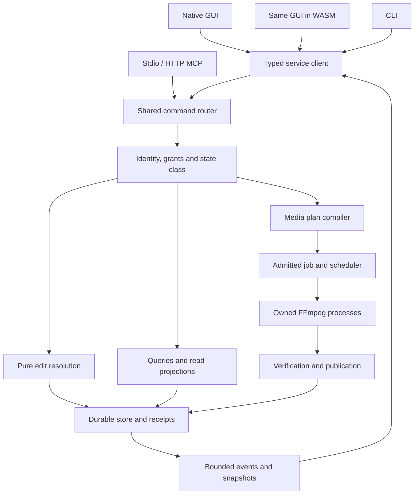

> Generated view of [Numera-Wiz-Implementation-Mandate-EN.md](../Numera-Wiz-Implementation-Mandate-EN.md), revision 7.0. Main SHA-256: `126c8aa8aa7f874802a09600040a1986cff650ad70b70f58f30a441d87fbef06`. Normative text is unchanged; fragment links point to the complete directive.

## 4. Engine ownership and durable state

### Selected replacement architecture

#### Process and transport ownership

Use these modes of the same public executable:

| Invocation | Selected behavior |
|---|---|
| `numera-wiz` | Start/attach owner, open native UI client. |
| `numera-wiz <domain command>` | Start/attach owner, execute typed request, print result; no GUI initialization. |
| `numera-wiz serve --open-browser` | Start/attach owner, enable public loopback listener, open paired browser UI, hold a service lease. |
| `numera-wiz bridge [--access-profile <name>]` | Standard stdio MCP adapter under the selected agent principal; stdout contains MCP framing only. Without a selection, use the discovery-only `agent` access profile. |
| `numera-wiz bridge --transport http --port 1578` | Enable `/mcp` on public loopback listener; keep explicit server lifetime. |
| Internal worker mode | Own locks, database, command service, jobs, FFmpeg children, and HTTP routers. Not a user-facing daemon installation. |

There is exactly one worker per canonical data root. It acquires the OS lock before opening redb. It starts an authenticated loopback Axum listener on an OS-assigned private port and writes an atomic runtime record containing instance ID, protocol/build identity, selected port, and a protected owner credential. The private port is implementation IPC, not the user-configured HTTP port. Native GUI/CLI/stdio adapters use this same router and generated DTOs. Local owner dispatch and scoped agent dispatch are distinct authorization contexts: the bridge's protected launch/bootstrap access never makes an incoming MCP request an owner request. The worker authenticates that request's scoped credential and checks its effective principal and grants. This deliberately chooses standard HTTP streaming instead of inventing a Windows named-pipe message protocol.

The public listener starts only for browser/direct-HTTP usage. Default is `127.0.0.1:1578`, configurable through CLI/config. A conflict produces an explicit error and does not silently increment the port. It does not prevent ordinary native GUI or CLI use through private IPC. Reject non-loopback binds in v1; remote deployment/TLS/OAuth hosting is a different scope. Two listeners reuse the same command service and bounded implementation, with different credentials/routes. Do not expose the owner credential through the public bootstrap.

The runtime record is user-only: Unix directory/file permissions or a Windows user-restricted ACL. Refuse an insecure root with an actionable explanation rather than pretending filesystem permissions exist. Authentication handles untrusted browser access and accidental cross-process access; it does not claim isolation from a compromised same-user account.

The worker's standard handles never inherit a bridge's stdio. Spawn it detached from the caller's console/session lifetime using platform APIs, with explicit null/log handles. It has no graphics/audio initialization. Retain it while an accepted job, authenticated native/browser editor-client lease, preview resource lease, active request/work lease, or explicit service lease is live. An active request/work lease spans admitted request handling and response-stream completion, including bounded probe/planning/import work, uploads/downloads and owned non-job tasks. Release it on completion, cancellation, timeout or disconnect according to the route's policy; bounded authentication/setup handling cannot retain the owner indefinitely. Idle HTTP keep-alive connections and an idle stdio adapter do not themselves retain the worker. An application event stream is tied to its authenticated client/service lease and must not outlive that lease merely by keeping a socket open.

Editor-client leases are independent of playback: an open idle browser editor must not lose its engine when the native launcher closes. Start with a 15-second client heartbeat and 90-second lease expiry; renewals identify the actual client and do not prolong expired authentication. Hidden tabs release playback demand while retaining a valid editor lease where their platform permits heartbeat delivery. A suspended/disconnected client recovers by reattaching and resynchronizing. Start the 15-second idle-exit grace only after every job and live lease, including active request/work leases, has drained; accepting new work cancels that grace. A GUI close exits the client; accepted jobs continue by default, with an explicit cancel option. Reopening attaches. Updates never move an active queue into a new owner process.

#### Owner attachment, transport restart and public listener lifetime

Before attaching, compare a small protected bootstrap identity record containing data-root UUID, owner instance epoch, application payload/build identity, API major and supported command/schema registry fingerprint. In v1, Numera native frontends/stdio adapters attach only to the same qualified application build and matching registry contract. A later cross-build compatibility range requires its own explicit evidence; matching an API-major number alone is insufficient. External MCP clients are not required to share the Numera binary identity: they use the advertised protocol/schema compatibility and scoped authentication contracts.

If a different build owns the root, return `OWNER_VERSION_CONFLICT` with redacted version/job/client status and an actionable wait/close/update path. Never start a second database writer, attach a new GUI to an incompatible old service, silently select a different data root or kill accepted work to make the conflict disappear. Native/browser assets are served from the active owner's own build. Cache keys include the web asset build; an old tab must reload/resynchronize after an owner change instead of mixing old schemas with new UI assets.

An idle stdio bridge may keep its client process alive while the owner exits according to the existing lease policy. On the next MCP request, the bridge resolves the same selected data root again, starts/attaches a compatible owner and obtains a new scoped private-transport credential for the same stored access profile/principal. It must not reuse an old port/epoch credential, become owner-authorized, select a new principal or implicitly widen grants. For a lost-response durable request, retain its original replay scope, key and structural request. A reconnect can retry that identity; an expired scope, revoked profile or uncertain receipt is reported under the existing contract rather than converted into a fresh mutation. Stdio framing stays continuous and contains no bootstrap diagnostics.

The public listener is a shared owner resource. The first explicit public-service launch selects the configured address/port; subsequent serve/HTTP-bridge clients may attach to that exact listener and hold independent service leases. A request for another port while it is in use returns `PUBLIC_LISTENER_CONFLICT` with the active nonsecret endpoint. It does not silently use the wrong port or create another undocumented listener. Paired browser editor/media leases retain the public routes they need after their launcher closes. A public port change requires draining/closing affected public sessions and invalidates their origin-bound credentials; unrelated private-IPC clients and accepted jobs follow their normal lifetime policy.

**D6-J02 — Owner/transport lifecycle journey (WP03):** leave a bridge idle until its owner exits, then issue discovery and a durable request; the bridge recovers under the same principal. Lose a mutation response across owner restart and verify receipt replay. Start two same-port public launchers, close one, continue using the browser, and reject a simultaneous different-port request. Start a second application build against a busy root and verify a usable conflict with no database or queue damage.

#### Public API and browser authentication

Keep only these transport categories:

- Application JSON requests: `POST /api/v1/commands`; discovery via `GET /api/v1/commands`.
- Bounded application events over a fetch-readable SSE response at `/api/v1/events`; do not rely on an EventSource API that cannot attach the selected bearer header.
- Streamed, separately limited asset upload/download and preview routes using opaque handles.
- Official SDK MCP at `/mcp`, plus the stdio bridge. MCP framing and application event IDs are separate contracts.
- Embedded hashed web assets and an unauthenticated minimal pairing bootstrap containing no project/media data.

Browser launch gives a cryptographically random, one-use, 60-second token in the URL fragment. The Rust web bootstrap removes the fragment immediately and exchanges the token. The engine returns a bearer session bound to instance ID, allowed origin, principal, grants, and expiry. Its maximum lifetime is 8 hours and idle limit 2 hours; explicit active requests renew idle time, background exports do not. The bearer is sent only to the exact paired origin with redirects disabled. Restrict Host exactly, reject unexpected/null Origins, and allow missing Origin only on appropriate authenticated non-browser paths. No permissive CORS, cookie authentication, token query parameters, or arbitrary path grants.

Hold the browser token in memory and optionally the tab's `sessionStorage` for reload. A new server epoch invalidates prior sessions. Session renewal cannot acquire broader filesystem rights. Browser duplication/new tabs create separate UI client IDs even if permitted to reuse an existing credential. Media is fetched with Authorization into MSE/image buffers; never set a raw local-file path or bearer query URL as `<video src>`.

Persist the data-root UUID and principal IDs independently of process epoch, token value and UI-client ID. An authenticated renewal or re-pairing to an existing principal preserves that principal and its replay scopes; a genuinely new principal cannot retrieve the old principal's receipts merely by presenting the same idempotency string. Token rotation/restart is not permission to reinterpret a retry as new work.

Bootstrap is a narrow declared exception, not an unauthenticated command bypass. Initial owner identity comes from protected local data-root initialization; one-use browser pairing exchanges its proof through the restricted pairing route; authenticated replay-scope and scoped-credential issuance require their specified current identity/owner authority without requiring the replay scope they create. The domain contract defines these bootstrap operations, quotas and the concrete access-profile setup. Ordinary grant/profile changes remain durable authorized mutations. Neither the private listener nor a caller-supplied profile/path field confers owner authority.

At job acceptance, atomically retain a purpose-limited execution authorization for the frozen plan, sources, outputs and device/network policy. It is derived from the accepting principal's grants and persists with the job. Browser bearer expiry, tab closure or owner restart does not revoke accepted work. Before each stage, revalidate source identities and this durable authorization, including explicit grant revocations. Explicit revocation prevents future stages and requests cancellation before the publication fence; after the fence it reports the publication state accurately instead of pretending an already published artifact was rolled back. It cannot authorize unrelated new work or expanded paths. New requests still require current session authentication and grants.

Use the official SDK for the selected supported protocol versions. The live official SDK release `rmcp-v3.6.0` exists and includes relevant transport fixes [official SDK release](https://github.com/modelcontextprotocol/rust-sdk/releases/tag/rmcp-v3.6.0); the current 2026-07-28 MCP specification also exists [official MCP specification](https://modelcontextprotocol.io/specification/2026-07-28). Pin the chosen SDK/protocol compatibility in CI rather than creating an independent MCP dialect. Keep per-command schemas and tool descriptors generated from the domain registry. A generic “run arbitrary FFmpeg text” tool does not satisfy parity. Document the initial direct-HTTP connection as a local preconfigured-bearer profile and qualify named clients that support explicit authorization headers. Do not call it universal OAuth discovery support. If the selected advertised client requires the specification's OAuth authorization flow, implement that official flow before advertising compatibility with that client.

#### Minimal responsibility boundaries

Use a small workspace, not a new framework for every concern:

| Crate | Responsibilities |
|---|---|
| `nw-domain` | Exact time/IDs, project/edit model, command params/results, schema versions, descriptor registry, pure validation. |
| `nw-engine` | Capability probing, FFmpeg plan compilation/supervision, resource scheduler, preview production. |
| `nw-store` | redb journal, receipts, job state, project leases/checkpoints, artifact/publication journal. |
| `nw-service` | Serialized command acceptance, grants, router, sessions, event/snapshot service. |
| `nw-ui` | Shared FilmCraft-derived layout, timeline/inspectors, UI state, actions and preview widget. No FFmpeg process spawning. |
| `nw-platform` | Native filesystem/console/process/audio/presentation adapters and WASM browser adapters under target-specific features. |
| App/bridge/qualification targets | Thin CLI/MCP/GUI dispatch and the CI-built owner-machine harness. |

These are logical boundaries and a feasible starting workspace; additional crates require a dependency-cycle, compilation, or ownership reason. Built-in filters are descriptor-plus-lowering implementations, without a dynamic plugin runtime. Browser dependency closure excludes redb, process spawning, FFmpeg libraries, server networking, and native audio backends. First-party processing/orchestration/UI remains Rust; generated web glue and CI/platform metadata are explicit exceptions. Bundled FFmpeg/native codec code is third-party, not miscounted as Rust.

### Complete implementation architecture and module contracts

This blueprint specifies the internal construction of the already selected application. The detailed process, state, protocol, media and platform rules in the following sections remain binding. The names below select concrete module ownership and dependency direction; they do not add a second service, another media engine or one crate per feature. Implement this architecture through WP01-WP12 and qualify it in GitHub CI. No interface sketch is evidence that the application has been compiled.

#### Composition root and target graph

The public application has one native composition root. It parses mode and portable-root options before initializing any window, audio output, media device or public listener. Mode dispatch chooses native GUI, a CLI request, stdio `bridge`, direct-HTTP `bridge`, browser `serve`, or the protected internal owner mode. Native GUI/CLI/bridge processes attach through the established owner-bootstrap contract; the owner alone opens the mutable store and owns media subprocesses. The same distributed executable contains these modes. The qualification harness is a CI-built testing artifact, not an extra ordinary application prerequisite.

The browser is a separately compiled WASM target from the same `nw-ui` crate, embedded as assets in each native package. Its composition root creates only presentation, local UI state and a service client. It does not construct the database, command handlers, FFmpeg compiler or process supervisor. This distinction is enforced by target dependency inspection and packaged launch tests, rather than assuming that a Rust codebase automatically produces a small WASM binary.

| Rust workspace unit | Allowed internal dependencies | Explicitly excluded responsibilities |
|---|---|---|
| `nw-domain` | Small serialization/validation/time/ID dependencies from the locked manifest | No database, process spawning, HTTP server, GUI, OS audio or media device initialization. |
| `nw-platform` | `nw-domain`; target-specific filesystem/process/console/client-transport/presentation adapters | No editing reducer, effect compiler, durable job state machine or second authorization policy. |
| `nw-store` | `nw-domain`; the selected native store and narrow filesystem publication primitives | No UI dispatch, FFmpeg invocation, arbitrary network fetch or independently scheduled jobs. |
| `nw-engine` | `nw-domain`, native platform ports; locked FFmpeg-specific helpers | No direct mutation of project heads/receipts, no GUI widgets, no browser application engine. |
| `nw-service` | `nw-domain`, `nw-store`, `nw-engine`, native `nw-platform` | No donor rendering/DSP pipeline or duplicated per-transport handler implementations. |
| `nw-ui` | `nw-domain`, presentation/client ports from `nw-platform`, the shared egui family | No `nw-service`, redb, native FFmpeg libraries or process supervisor in its WASM dependency closure. |
| Native app, WASM app, bridge adapters | The smallest target-appropriate composition of the above | No domain behavior hidden in a mode-specific CLI match arm or UI callback. |
| Rust `xtask` and qualification harness | Build/verification helpers and stable public contracts where required | No runtime dependency of ordinary installed use; no owner-local compiler bootstrap. |

Use target-specific dependencies and explicit feature sets. Rust Cargo feature unification must not accidentally pull native service/store/audio dependencies into WASM. Do not make a `full` default feature silently link every optional model, GPU library and renderer. Compile/package native and WASM targets in their qualified CI jobs, inspect the resulting dependency trees/imports and report the browser asset size separately. Keep one selected renderer in the ordinary package unless a demonstrated target requirement justifies another qualified variant.

The diagram shows logical dependencies. Native/private HTTP and public loopback remain separate authenticated routes; it does not collapse their credentials or create another listener. MCP adapters submit the same canonical requests under their effective principals. Object policy, publication rights and immutable receipts stay server-owned.

#### Concrete module ownership

Use the following initial module map. A path names a logical Rust module; implementer renames require a recorded one-to-one responsibility map. Do not duplicate a module because a second interface needs its behavior.

| Owner/module | Inputs and output responsibility | Governing invariant |
|---|---|---|
| `nw-domain::ids` | Project, sequence, clip, stream, principal, plan, job, artifact and session identifiers | IDs are typed lookup identities, never implicit authorization. |
| `nw-domain::time` | Rational source/clip/sequence/output time, frame/sample indices and checked maps | No floating-point timestamp accumulation or accidental cross-clock comparison. |
| `nw-domain::project` | Assets, bins, sequences, tracks, clips, effects, curves, captions, markers and nested references | Stable ownership, validated references, explicit schema/envelope version and bounded opaque extensions. |
| `nw-domain::edit` | Pure edit specifications, resolved patches, inverse operations and affected-resource summaries | One admitted atomic edit, exact interval/link/lock invariants, no partial client mutation. |
| `nw-domain::commands` | Canonical envelopes, state classes, typed params/results/errors and aliases | One field location and frozen default per command version on every surface. |
| `nw-domain::registry` | Capability/action descriptors, pure shortcut context resolver, default-binding data, parameter domains, requirements and canonical IDs | Complete compiled headless discovery with no UI dependency; no advertised inert control or interface-specific semantics. |
| `nw-domain::policy` | Command/object/source/device/network rights and resource budgets | Caller-controlled payloads cannot select their own effective principal. |
| `nw-domain::plan` | Render contract, stage graph, invocation templates, required rights, expected outputs and verification policy | Immutable reviewed meaning; execution does not silently replan. |
| `nw-domain::views` | Bounded project/viewport/job/availability projections and change summaries | Captured revision and authorization scope are explicit. |
| `nw-platform::files` | Native paths, open handles, identity checks, safe temporary files and atomic publication primitives | No ambient-current-directory or path-string authorization shortcut. |
| `nw-platform::process` | Native child creation, handle inheritance, process groups/job objects and termination | Explicit handles/environment, owned-child identity and no orphan descendants. |
| `nw-platform::client` | Typed request/events/media transport for native and WASM clients | Same DTO semantics, distinct target I/O, finite timeouts and cancellation. |
| `nw-platform::presentation` | Native texture/audio output and browser DOM/WebGL/MSE integration | Present FFmpeg output under the selected display/clock contract; no effect processing. |
| `nw-platform::console` | Windows GUI-subsystem attachment, redirected handles and UTF-8 diagnostics | Clean JSON/MCP stdout and correct parent-shell waiting/exit behavior. |
| `nw-store::projects` | Heads, operation journal, checkpoints, undo retention and project identity leases | Commit before acknowledgment; reconstruct acknowledged unsaved edits. |
| `nw-store::receipts` | Scoped idempotency digests, immutable outcomes, expiry and restricted reads | A forgotten/expired retry never becomes new execution. |
| `nw-store::jobs` | Accepted snapshots, stages, execution authorizations and terminal facts | Immutable terminal state; retry creates a new linked job. |
| `nw-store::artifacts` | Managed media ownership, output identities, cache indexes and retention references | Cache cleanup cannot delete retained source/job/recovery media. |
| `nw-store::publication` | Save/export intents, fences, claims and recovery reconciliation | No overwrite before admitted claim; publish only verified owned bytes. |
| `nw-store::migrations` | Version inspection, new generations, activation records and rollback evidence | Unsupported versions never initialize an empty replacement store. |
| `nw-engine::probe` | Reserved ffprobe invocation, bounded metadata/index results and observed format epochs | Unknown/incomplete results stay explicit; no uncontrolled first-probe references. |
| `nw-engine::capabilities` | Exact packaged profile, generated help, runtime devices and route availability | A filter name or GPU marketing name does not prove a runnable route. |
| `nw-engine::normalize` | Utility/editor intent to canonical streams, times, source interpretation and output objective | FFmWiz and MuxCls wizards do not own independent command builders. |
| `nw-engine::graph` | Typed media DAG, effect ordering, channel routing, temporal prefixes and dependencies | One graph contract for preview, analysis, utilities and export. |
| `nw-engine::lower` | Admitted graph to native FFmpeg options, filtergraphs, sidecars and stage dependencies | Media computation stays in FFmpeg; shell text is never executed. |
| `nw-engine::schedule` | Resource reservations, priority, active dependency windows and pressure responses | Bounded RAM/VRAM/scratch/process counts and visible admission failure. |
| `nw-engine::supervise` | Stage preparation, child I/O, progress, diagnostics, reconfiguration observation and cancellation | Drain outputs independently; classify facts before bounded log retention. |
| `nw-engine::preview` | Generation-aware native NUT and browser audition production; agent observations | Identifiable captured state, correct clocks and bounded future-frame handling. |
| `nw-engine::verify` | Expected stream/timing/content/metric/publication assertions | Process exit success alone never proves successful delivery. |
| `nw-service::owner` | Root lock, bootstrap identity, compatibility, listener and lease lifetime | One writer owner per canonical root; accepted work survives frontend closure. |
| `nw-service::auth` | Authentication, effective principal, object actions, source grants and revocation | Private launch authority never leaks through forwarded MCP requests. |
| `nw-service::dispatch` | State-class selection, validation, replay, edit commit and job acceptance | All transports converge before domain execution. |
| `nw-service::read_model` | Paged snapshots, contextual availability, reports and authorized event projections | No full-project download hidden behind a virtualized widget. |
| `nw-service::routes` | Private/public application HTTP, pairing, assets, media and official MCP adapters | Exact origin/route policy and bounded serializers; no private-token download link. |
| `nw-ui::workspace` | FilmCraft-derived docks, panels, themes, workspace preferences and responsive layout | Same Rust implementation in native and browser. |
| `nw-ui::actions` | Current UI context extraction, host-action dispatch, shortcut/remapping editor and bindings to shared descriptors | Consume `nw-domain::registry`; do not own definitions that headless discovery would omit or require importing the UI to obtain. |
| `nw-ui::timeline` | Virtualized presentation, hit testing, transient gestures and edit-preflight display | Commit through the service; stale drags never silently overwrite remote edits. |
| `nw-ui::inspectors` | Schema-driven properties/effects/streams and unavailable-state explanations | Units, defaults and validation come from the registry. |
| `nw-ui::utilities` | FFmWiz workflows and a named MuxCls cleanup/remux workspace | Utilities work without forcing users to build a timeline. |
| `nw-ui::jobs` | Plans, final commands, progress, results, cancellation/retry and logs | Show actual stage/publication truth, including partial multi-output failures. |

Subsystem tests use these responsibilities as seams, not as a reason to mock away every cross-boundary behavior. For example, a mux-selection unit test is necessary but does not replace a real packaged ffprobe/remux/verification fixture or its shared-interface journey.

#### Authoritative records and their lifetime

Distinguish authored project data, derived data, transient presentation state and execution facts. The following records are shared Rust DTOs or internal typed records with explicit serialization versions. Do not serialize arbitrary Rust memory layout.

| Record | Required fields or relationships | Owner and lifetime |
|---|---|---|
| `AssetRecord` | Stable asset ID; external/managed kind; byte identity; original display name; admitted streams; source interpretation; availability; retained references | Durable store. External paths are references, not embedded credentials; managed bytes have verified ownership. |
| `StreamRef` | Asset identity, selected probe/source revision, stable selected stream identity, media kind and observed physical index | Domain/plan. Reprobe changes are resolved explicitly; a later array position does not silently retarget an operation. |
| `ProjectHead` | Project UUID, schema, current revision, checkpoint/disk generation, compatibility state and lease identity | Store. Unsaved acknowledged edits remain journaled. |
| `SequenceRecord` | Settings, explicit time policy, ordered tracks, composition/mixer graph, markers/captions and nested dependencies | Authored project. Settings updates invalidate only the correct derived products and do not mutate accepted jobs. |
| `CommandDescriptor` | Canonical ID/version; params/result schema; state class; fixed aliases/defaults; required rights; host constraints; availability and documentation links | Compiled registry. Every active parameter has semantic use and conformance evidence. |
| `ResolvedEdit` | Expected head, affected closure, deterministic patch/inverse, resulting references and bounded report | Temporary domain computation, then one journal/receipt transaction. |
| `RenderContract` | Captured sources/revisions, time maps, stream outcomes, graph order, color/alpha/channel definitions, output cadence/extent and selected quality | Immutable plan input shared by utility/editor render paths. |
| `ExecutionPlan` | Canonical hash; required rights; captured dependencies; profile/runtime fingerprint; stage DAG; budgets; output claims; verification and allowed fallback | Retained planning/acceptance record with explicit expiry and object access. |
| `InvocationSpec` | Executable identity; argv vector; private working directory; owned sidecars; stdin/stdout/stderr profile; deadline; expected artifacts and diagnostics | A fully resolved leaf invocation prepared by the same compiler/supervisor for a job or admitted bounded query/preview. |
| `AcceptedJob` | Submitter, original reviewed plan/hash, immutable input snapshot, durable purpose authorization, state/stages, output claims and receipt | Durable through active work and declared history retention. |
| `ArtifactRecord` | Immutable bytes/digest/length/type, producing job/observation, authorized read purpose, publication identity or cache lease, expiry | Store plus owned filesystem object. A handle never permits reading a replacement at the same pathname. |
| `PreviewSession` | Client/target, project revision, render generation, origin/clock, transport and display contracts, queue budgets and lease | Bounded volatile session; restart requires explicit resynchronization. |
| `ObservationRecord` | Captured target/time, actual sampled interval, graph/source/display identity, encoding, artifact and byte budget | Bounded expiring result; no dependency on another client's playhead. |
| `ViewSnapshot` | Principal/policy scope, revision, projection/query, ordered cursor, event cursor and expiry | Bounded read lease; pages from different snapshots never merge. |
| `AccessProfile` | Stable principal, mode, explicit command set, object grants, path/device/network policy and policy revision | Owner-managed durable state; transport token rotation does not create a new principal. |

The `InvocationSpec` is not another public job protocol. Processing/export commands still create and submit the established `ExecutionPlan`. Explicit query/volatile operations such as bounded probing, exact-frame inspection and preview can own a bounded work/session lease and use the same leaf compiler/supervisor without inventing a durable export job or project edit. Before any actual FFmpeg/ffprobe child starts, emit its prepared invocation to the applicable authorized command inspector/log/event sink. Durable jobs retain their stage-prepared fact; volatile work retains bounded trace facts under its session/request identity. This preserves command visibility without journaling every playback frame as a project mutation.

#### Command service execution algorithm

Every adapter produces the canonical envelope before calling the command service. Follow this order, preserving the stated replay exception:

1. Enforce transport byte/depth/rate limits; authenticate its actual scoped credential; identify the data-root/owner epoch and stable principal. Decode the declared API/command version without invoking a handler.
2. Resolve the registry descriptor and fixed alias expansion, including retained replay-only metadata for retired command versions. Validate field placement and discriminator. Determine `query`, `bootstrap`, `volatile_session` or `durable_mutation` from the registered operation/variant, never from a caller's requested weaker durability. Retain the accepted version's structural-digest/alias/default interpretation through its unexpired replay scopes; this does not retain or reactivate an executable handler.
3. For durable work, verify replay-scope ownership/expiry, canonical structural digest and receipt-read permission. A matching receipt returns its recorded or explicitly restricted result before current target/revision validation, including when its execution version has since retired. A conflicting digest fails. An expired scope never executes. A retired version with no matching accepted receipt returns `COMMAND_VERSION_RETIRED`; it cannot create fresh work under replay-only metadata.
4. For new work, check the finite command allowlist, current object action, current source/output/device/network rights, target existence and command-specific resource/revision preconditions. Expand affected edit closures in the engine/domain, not from the visible UI subset.
5. Run expensive source resolution, planning or edit preflight outside a long-held database transaction. Retain bounded snapshots/leases. Before commitment, revalidate the exact relevant head, grant assumptions, input identities and publication target preconditions so the earlier computation cannot commit against changed facts.
6. Commit durable edits, accepted-job state, receipts and any reference changes in the appropriate single transaction. Materialize the visible resulting state from the committed result. Do not acknowledge success while only an in-memory widget/queue has changed.
7. Schedule accepted work under its immutable plan and durable authorization. Stage workers do not mutate project heads. Events expose committed state and prepared/observed execution facts under current authorized projections.
8. Serialize the typed result within its route budget; release request leases on completion/cancellation/disconnect under the selected policy. Lost responses can be retried using the same durable identity. They do not cause another media job.

Keep the command handler registry separate from transport formatting. CLI exit codes, application errors and MCP tool errors are adapters over the same typed result. A successful `jobs.inspect` reporting `state=failed` remains a successful query; an invalid edit or failed plan submission preserves its domain error. Stdio diagnostics never become protocol bytes. HTTP status and JSON-RPC lifecycle follow their own selected standards without changing operation semantics.

#### Planner, graph and execution boundaries

Normalize a wizard operation, timeline export or MuxCls cleanup intent into the same exact stream/output contract. A utility may use a minimal synthetic render description rather than creating a persistent editor project. It must still pass the same source identity, stream outcome, rights, profile, output collision and verification rules. No utility shells out through a private historical Python builder.

Planning has explicit phases: resolve the captured input set; probe/index only the information required; resolve logical stream correspondence and requested changes; construct the typed media DAG; propagate time/color/alpha/channel/format requirements; choose admitted CPU/GPU/copy routes; schedule finite dependency windows; lower to stage invocations and owned sidecars; calculate resource/scratch constraints; and freeze output/verification/fallback contracts. Each failure names its phase and unsupported resource/parameter rather than returning an opaque FFmpeg string error after partial work.

The typed graph distinguishes sources, interpretation, time maps, filters, compositions/transitions, mixer routes, analysis nodes, encoders, muxers and outputs. It carries pad media type, exact clock mapping, format/precision/alpha/channel requirements, temporal history/lookahead, resource cost and component requirements. Validate references, cycles, fanout and output reachability before lowering. A temporal node's upstream prefix is a graph dependency, not a recursive UI callback. Nested sequences compose checked maps and routing rather than flattening by uncontrolled duplication.

Copy eligibility is established from the complete resolved operation, including stream order, metadata, dispositions, chapters, attachments, container constraints and timestamp policy. Byte-for-byte file copy, packet-preserving remux and decoded/re-encoded render are distinct plan outcomes. Replacing a metadata field cannot be declared a no-op because the stream selection stayed the same. A copied output still has a verified publication and cancellation contract.

`nw-engine::lower` emits argv elements and typed filter/sidecar text. Validate escaping in the relevant grammar: shell escaping, filter-expression escaping, concat manifests, ASS/VGS text and native path encoding are different concerns. Only argv is passed to the OS. Sidecars live in the plan's owned namespace, with hashes and admitted secondary opens. No unreviewed raw option dictionary may override reserved input, output, mapping, protocol or supervision flags.

Analysis-dependent invocations retain typed stage templates and admissible result ranges. Validated measurements resolve the concrete next invocation, whose exact arguments and sidecars are frozen and shown before spawning. Random seeds, approximation/quality modes, chosen transfer paths and preapproved equivalent CPU fallback are part of the plan. A new device, changed semantic setting or unapproved fallback produces an explicit revised-plan path, not silently different output.

#### Concurrency, cancellation and resource ownership

Use the selected asynchronous native service runtime for routing, timers, child I/O and bounded streams. Blocking database/filesystem operations and CPU-heavy control/graph preparation use bounded workers. Native UI painting/input remains on its platform event loop. Browser UI work must yield to that event loop. Neither route-handler futures nor UI callbacks perform synchronous full-media reads or wait for an entire render on the presentation thread.

Serialize authoritative project/head and job-state transitions through `nw-service` and `nw-store` transactions. The design does not require one thread per clip, file or request. For independent planning/probing, use a bounded work queue and retain the captured revision. Queue capacity is admitted before allocating a large request graph or upload buffer. Saturation produces documented backpressure/resource errors, not silent dropping of a user's durable mutation.

The scheduler has interactive preview/observation demand, explicit user jobs, and background derived-artifact work. Preview may preempt or cancel stale preview generations; it cannot corrupt a durable export to improve scrubbing. Background thumbnails/proxies yield when interactive pressure rises. Use bounded fairness so continuous scrubbing cannot starve accepted jobs indefinitely. A job's constraints reserve CPU threads, decoder/encoder sessions, RAM/VRAM and scratch independently; one global “worker count” cannot represent these resources.

Every queue identifies its producer, consumer, maximum items/bytes, shutdown owner and full-queue behavior. Media queues charge actual payload bytes, socket buffering and retained decoded surfaces. Future timestamped frames follow the established clock-relative backpressure rule. Latest-seek replacement applies to obsolete preview generations, not arbitrary future frames in the active generation. Large artifacts, uploads and copied companion files stream through fixed buffers.

Cancellation has distinct request, preview-generation, stage and durable-job tokens. Disconnecting a client may cancel its bounded query/observation or detach from an accepted job according to the route contract. It does not cancel another client's accepted export. The supervisor first requests orderly child shutdown where its stdin profile permits it, then uses bounded escalation on the owned process group/job object. Probe input descriptors are never written as control pipes. Always drain or close streams, release leases/reservations and reconcile owned staging on exit.

GPU discovery, media acceleration and GUI rendering are separate. CPU-only media work never initializes a hardware media device. Auto chooses a qualified decode/filter/encode path for the actual format/graph/objective, accounting for upload/download and VRAM. A successfully created GUI/OpenGL adapter does not prove NVENC/NVDEC availability. Ordinary hosted CI establishes CPU and device-absent/failure behavior; the owner's matching CI-built harness establishes the actual GPU routes on the RTX 4070 Ti. No performance or capability result is inferred merely from Rust, vendor ID or a compiled feature flag.

#### Durable tables, filesystem artifacts and recovery

Retain the previously selected redb cache budget and one-owner rule. Use explicit versioned encodings and stable keys; never rely on Rust enum memory layout. A database transaction records metadata and references, not whole movie byte buffers. Large immutable checkpoint/report/sidecar objects may be stored as owned hashed files with durable reference records and recoverable promotion. Their publication must not create a reference to unfinished bytes.

| Logical table/record group | Key and contents | Write boundary and recovery role |
|---|---|---|
| `meta` | Root UUID, schema/store generation, activation and bounded owner metadata | Protected initialization/migration; an incompatible binary stops before writes. |
| `project_heads` | Project ID to current revision, checkpoint and disk-generation references | Same transaction as the admitted edit/receipt. |
| `project_journal` | Project/revision to versioned resolved operation, inverse and affected IDs | Reconstruct acknowledged unsaved edits; checkpointing bounds replay. |
| `project_checkpoints` | Project/revision/generation to validated serialized snapshot identity | Written through staged verified publication; retained generations protect their assets. |
| `access_profiles` and credential/replay metadata | Stable principal, explicit policy revision, revocation and protected keys | Owner-authorized changes; transport secrets stay outside public result projections. |
| `receipts` | Principal/scope/namespace/key to structural digest and immutable outcome | Atomically coupled to mutation acceptance; expiry/compaction cannot permit replay. |
| `plans` | Plan ID/hash, captured contract, required rights and audit identity | Frozen planning record; no mutation in place at submission. |
| `jobs` and `stages` | Accepted snapshot/authorization, state, invocation facts, progress and terminal result | State transitions commit before acknowledged facts; interrupted work reconciles on restart. |
| `artifacts` and retained references | Asset/artifact identity, producing owner, byte purpose, expiry and live/recovery references | Promotion/publication and reference changes are serialized; GC rechecks roots. |
| `save_journal` | Target preconditions, prior/new disk generation, saved revision and phase | Resolve whether rename occurred without deleting a valid older checkpoint. |
| `publication_journal` | Output claim, verified staging identity, fence and per-artifact publication fact | Resolve crashes/partial multi-output publication under the actual destination claim. |
| Rebuildable cache indexes | Probe/index/thumbnail/proxy/waveform keys, measured size and leases | May be rebuilt or evicted under policy; they are not the sole record of retained media. |

Restart first acquires the canonical owner lock, checks store/build compatibility and reconciles incomplete extraction/migration/save/publication records before resuming ordinary acceptance. It distinguishes queued accepted jobs from interrupted child execution and terminal jobs. It cannot infer a completed output from a matching filename or kill a reused PID. A retry captures a new job ID and current permissions while retaining linkage to the previous immutable terminal result.

Cross-data-root project writer and destination claims retain their independent namespace. A second root cannot bypass a live checkpoint or output claim simply because its own redb store is empty. Atomic no-replace publication is qualified per target filesystem. When several outputs cannot commit as one filesystem operation, the result records each actual published artifact and any failure rather than claiming all-or-nothing rollback that did not occur.

#### Presentation, browser and machine-interface adapters

The shared UI owns only bounded view caches, selection/focus, panel layout, transient gestures and renderer resources. Its widgets consume typed projections and availability. A drag can show a provisional overlay, but project state changes only after the service commits the exact expected revision. Agent edits appear through the same coherent change/snapshot mechanism. On disconnect, display the last coherent view with its stale status and prevent stale writes until reconciliation.

The native adapter provides file picking, OS drag/drop, texture upload, audio output and private service-client transport. Browser paths are upload/import handles or engine-authorized source references; browser JavaScript/WASM cannot claim a native filesystem grant by sending a pathname. Browser downloads expose only admitted authenticated artifact bytes. The common preview view contract, actual frame time and generation apply to native NUT, browser MSE and headless observations, while their declared transport encodings differ.

CLI commands are typed registry adapters. Designed convenience verbs and the universal request route resolve to the same canonical operations. A headless call never opens a dialog to obtain missing data. MCP tools/resources expose those operations, bounded discovery and media observations using the pinned official SDK/version profiles. The browser application API and MCP protocol are separate wire formats over the same service; the application's SSE cursor is not an MCP session ID or protocol resumption promise.

Every ordinary GUI capability has an explicit headless input independent of focus/playhead. Host-only actions such as opening a native dialog or requesting browser fullscreen declare a client/gesture requirement while exposing their underlying project/media operation separately. They do not justify hiding an export, edit, effect, metadata change or MuxCls workflow from CLI/MCP.

#### Extension and delivery contract

Adding a command/filter follows one registry-centered path: define typed semantics/defaults/units/state class and requirements; implement a pure handler or admitted FFmpeg lowering; attach resource/format/device admission; generate shared controls, CLI/MCP schemas and help; provide meaningful positive/negative/media/lifecycle fixtures; document source differences; and join actual evidence. Optional components have truthful discovery states and complete install/import profiles. No new handwritten JavaScript frontend, Python service or dynamically loaded donor DSP plugin is introduced to speed up one feature.

The release composition is application code, embedded same-build browser assets, a manifest-verified standard FFmpeg/ffprobe profile, small licensed required assets and notices. Extraction, repair, profile replacement and signature/provenance handling use the already selected owned-directory and stopped-update contract. The first launch remains offline for core functions. Native imports and optional driver dependencies are verified per Windows/Linux/macOS artifact. The implementation does not promise that a single universal binary runs unchanged on all operating systems.

Android is an explicit later adapter target: preserve source-handle, storage-grant, process/lifecycle, UI-layout and compute-policy boundaries so it can be implemented without rewriting project semantics. Do not advertise current Android support, impose Android constraints on the current desktop UI, or assume its background jobs, storage URIs, FFmpeg distribution and thermal behavior are already qualified.

**AR7-J01 — Architecture dependency and headless boot (WP02/WP03):** CI checks target dependency/import closure, boots CLI/MCP/worker without window/audio/media-GPU initialization, and boots the shared browser UI with no store/process engine in WASM. Assert the same registry fingerprint and source-specific rights at every adapter.

**AR7-J02 — One semantic pipeline across utilities and editing (WP03/WP05/WP07):** construct equivalent admitted stream/metadata/output intents through the FFmWiz utility, MuxCls workspace, universal CLI and both MCP transports. They reach the same normalization/lowering/verification handlers with the same declared result. Observe prepared invocations for durable jobs and bounded probe/preview work, without creating fake project revisions or leaking owner authority.

**AR7-J03 — Ownership and recovery across process boundaries (WP03/WP10/WP12):** fault-inject planning completion before commit, accepted job before spawn, slow media consumers, frontend disconnect, owner restart and publication boundaries. Assert bounded queues, receipt identity, retained snapshots, exact artifact ownership and immutable terminal facts. Lose a durable response, retire its command version in an admitted migration, and retrieve the accepted result through retained replay-only metadata; reject a fresh request for that retired version. Run ordinary cases in hosted CI; actual GPU variants use only the established owner harness.

### Persistence and lifecycle contract

#### Project writer lease and destination publication across portable installations

A data-root lock alone does not protect a project opened by another portable copy using a different root. Before writable open, acquire a data-root-independent, user-scoped project lease keyed by the stable project UUID; retain canonical path and OS file identity for diagnostics. Use a qualified Windows named mutex or secure user-runtime lock namespace, not a lock on the `.nwiz` inode that will be replaced during save. Keep this namespace stable across application copies and apply user-only permissions. A copied project retaining its UUID is read-only while another writer owns it; an explicit clone/Save As creates a new project UUID and acquires its own lease. Never merge two independent edit journals by last-writer-wins.

Compare persisted disk generation/hash before save and detect external changes. Offer explicit read-only/reload/save-copy conflict recovery. A process that deliberately ignores all locks and multi-user/network-filesystem collaborative editing are outside the initial locking guarantee. Do not advertise those as supported simultaneous editing. Crash recovery reacquires the actual OS lease before resuming writable state.

Different project UUIDs can still target the same save/export path. In addition to the project lease, acquire a short-lived destination-publication claim in the same secure, user-scoped, data-root-independent namespace. Key the directory entry by canonical parent-directory identity and basename under the qualified filesystem's case/normalization rules, including when the target does not yet exist. Resolve or reject symlink/reparse aliases under the path policy, reject source/output identity aliases, and never implement publication as an in-place write through an alias. Acquire all claims needed for one publication in deterministic order before the final target-identity/overwrite check; retain them through the publication decision, rename and durable result update. Do not retain these claims throughout a long render.

The final check compares the target against the identity/generation or explicit absence frozen in the accepted save/plan; a target changed by another owner is a conflict, not newly implied overwrite consent. Replacing an existing Numera checkpoint also requires its existing project-UUID writer lease: ordinary Save may reuse its own lease, but Save As/Save Copy/export must refuse a checkpoint held writable by an open project, including one in the same worker. Try additional existing-target project leases without blocking while holding destination claims; on contention return an explicit project-in-use conflict rather than deadlock with a writer's save. A new clone UUID never bypasses the destination checkpoint's writer exclusion. Revalidate target identity after acquiring the necessary leases and retain them through publication.

For no-overwrite, use a qualified atomic no-replace filesystem operation. An existence check followed by a replacing rename is invalid. If the selected filesystem cannot provide the admitted publication operation, fail explicitly instead of weakening that policy. Recovery reacquires destination claims and necessary project leases before reconciling or completing an intent and never overwrites an unrecognized replacement. These claims serialize cooperating Numera owners; they do not claim protection against an unrelated process that deliberately ignores them or races namespace changes.

#### Commands, durable project state, and save

Every command descriptor declares its query, bootstrap, durable-mutation or volatile-session contract as specified in the domain section; a source row labeled `session` does not decide durability. Durable mutations carry a command ID/version, idempotency key within a valid server-issued replay scope, typed parameters, and the appropriate resource precondition. Project edits use a project revision; saved settings/workspaces, access policy and job control use their own resource revisions/state guards. Use the durable command/idempotency rule specified in this mandate: after structural request validation/authentication and replay-scope validation, an existing receipt is checked before rejecting a stale revision or deleted target. Do not re-normalize an accepted old request using new defaults. Expired scopes cannot authorize fresh execution after receipt garbage collection. Volatile selection/view/playback controls use bounded session-generation/sequence acknowledgements without a durable project receipt; explicit preference/workspace saves and final gesture edits remain durable.

For a genuinely new edit, compute the deterministic operation and inverse against the expected head. In one durable redb transaction write: operation with frozen version/resolved IDs, resulting head revision, undo record, and receipt. Commit before acknowledging. Materialize the new in-memory view only from the committed result; replaying the durable journal reconstructs it. Periodic checkpoints bound journal replay; migrations materialize a new versioned checkpoint before retiring old reducers. In-memory undo/drafts and database cache have separate bounds.

Suggested durable tables are `meta`, `project_heads`, `project_journal`, `project_checkpoints`, `receipts`, `jobs`, `stages`, `artifacts`, `save_journal`, and `publication_journal`; cache indexes remain rebuildable. This makes accepted unsaved project edits durable without requiring a complete `.nwiz` rewrite for every drag. A UI gesture commits once, not on every pointer event.

Save captures an immutable project revision and allocates a new disk-generation UUID. Write a save-intent journal record containing previous file identity, expected previous disk generation or target absence, target revision and new generation. Serialize to a same-directory owned temporary file, validate and flush. Acquire the destination claim, recheck the recorded target precondition, publish using the selected replace/no-replace operation, and update the clean revision only after publication succeeds. On restart reacquire the claim and inspect the disk generation to distinguish “rename happened” from “rename did not happen.” Never delete the last valid project first. An intervening newer edit remains dirty after an older captured revision is saved; the result reports its saved project revision and disk generation without implying that save advanced the edit head.

#### Explicit update, migration and rollback

The initial update mechanism is an explicit verified replacement/import workflow, not an additional background updater service. Windows does not need to rewrite its currently executing public EXE. Download or import the next signed/checksummed artifact beside the old one; prepare maintenance, drain the old owner, close its frontends, retain the old artifact, replace it while stopped and start the selected artifact with the same data root. macOS updates replace the application bundle without putting mutable state inside it. Linux follows the same stopped-artifact replacement rule for its portable package.

Maintenance/drain prevents new durable edits/jobs from being accepted while allowing already accepted work to finish, or explicitly cancels it through the existing domain contract. It records the requested state so a retry does not create a second update action. The app shows which jobs/clients prevent completion. It does not migrate a live queue into a different owner process. No update stage may silently discard unsaved-but-acknowledged project edits.

Keep application version, domain/project schema version and durable-store generation/version distinct. Before a migration opens the existing store for incompatible writes, inspect its version envelope. An older binary encountering a newer unsupported store returns `STORE_VERSION_UNSUPPORTED`; it must not initialize an empty store or downgrade it. A `.nwiz` checkpoint's existing unknown-data rules remain separate from durable-store compatibility.

For a store-schema change, hold the data-root owner/maintenance lock and close the old store cleanly after recovery reconciliation. Verify sufficient space, produce a consistent immutable rollback copy or a complete new store generation, migrate into a separate generation, and validate record counts, IDs, project heads, receipt identity/expiry, access policy, terminal-job and publication facts. Preserve replay keys/receipts and the accepted command-version/alias/digest interpretation metadata needed by unexpired scopes. Retired versions remain replay-only as specified in the command-service algorithm; they cannot accept fresh execution. Do not treat a raw copy of an actively changing database as a consistent backup. Activate the new generation only after validation using a flushed, recoverable activation record. On interrupted migration, restart resolves that record and chooses one complete generation; it never merges half-migrated files.

Rollback has two different outcomes. Before the new version accepts any mutation, restoring the retained prior application/store generation is safe under the recorded activation protocol. After newer edits or jobs are acknowledged, a simple old-database restore would lose work: refuse automatic rollback. Use a qualified backward migration, or export/recover the newer projects and keep the newer generation available before the user explicitly chooses a data-losing restore. The interface states the affected revisions/jobs and preserves both generations until that decision is resolved. A binary rollback is not advertised as a lossless data rollback in that case.

Do not retain unlimited full backups. Keep the last validated pre-migration generation until the new generation has passed its adoption checks and the configured retention policy permits deletion; include backup bytes in the storage report. Cleanup cannot delete the only recoverable generation, managed media referenced by any retained generation, or profiles referenced by retained accepted-job/recovery facts. Retiring a generation and releasing its media/profile references is one serialized retention decision, revalidated before collection.

**D6-J03 — Upgrade/rollback journey (WP12):** old application with unsaved durable edits and an interrupted job; migrate; verify identity/history/grants; interrupt before and after activation; recover one coherent generation. Keep an asset referenced only by a retained prior generation, run eligible cleanup and prove a permitted rollback can still reopen that media. Roll back before a new edit and then attempt rollback after a new acknowledged edit. The first restores safely; the second refuses silent data loss. An unsupported older binary cannot reset the newer root.

#### One job state machine

Normal path: `queued -> preparing -> running -> verifying -> publishing -> succeeded`.

Before the publication fence, nonterminal work can enter `cancelling -> cancelled`. A real execution or verification failure enters `failed`. A detected owner crash with unfinished execution enters `interrupted` after recovery reconciliation. Terminal states are immutable. Retry creates a new job linked to the original. Multi-stage progress is represented by stage records, not additional job state names.

`queued` means acceptance and receipt are durable. `preparing` includes source/capability/grant checks and resource reservation. `running` includes measured analysis and render stages. `verifying` checks the staged output. After destination claims and final target checks succeed, `publishing` starts only after a durable fence transaction has won against cancellation. Waiting for a claim remains cancellable before that fence. A cancellation request after that fence reports too late; it does not rewrite the terminal result.

Write each publication intent before renaming while holding its destination claim. A qualified same-filesystem single-file replace/no-replace operation is the ordinary fast path. Multiple files use per-artifact journal entries and can finish as `failed` with accurately listed published artifacts if a later publication fails. A process exit code is never sufficient for success. Recovery reacquires the claims and checks actual file identities/generation hashes; it removes or overwrites only owned files under the recorded policy. Crash reconciliation must not signal a reused PID.

#### Events and snapshots

The event stream is advisory for views; committed project/job facts are authoritative. Retain a bounded ring and disconnect/reset slow clients. A snapshot ticket names an immutable revision and cursor plus a 30-second lease. While that ticket is active, retain its snapshot pages and necessary post-cursor events within a global capped budget. If the budget or lease expires, return `SNAPSHOT_EXPIRED`, discard the partial client snapshot, and restart. Never merge pages from different revisions or pretend a cursor can be resumed indefinitely. Snapshot expiry is an explicit recoverable outcome, not silent loss of intervening events.

#### Focused ownership and lifecycle acceptance

Hosted CI must establish these boundaries with separate fixtures:

- With no GUI/service lease, a valid probe or streamed artifact response lasting beyond the idle grace completes; cancellation/timeout/disconnect releases its work lease and permits later idle exit. An idle bridge or keep-alive connection alone does not prevent exit.
- Two data roots with different project UUIDs race Save As and export to one destination. Final identity checks under the shared claim produce one authorized winner and an explicit conflict for the stale request. A no-overwrite race against an absent target never replaces the winner's file. A new clone UUID cannot replace another project's live writable checkpoint, even when both projects use one worker.
- Crash injection before/after the publication fence and rename reacquires the actual project/destination claims, reconciles owned artifacts, and preserves an unrelated replacement. Cancellation while waiting for a destination claim remains effective.
- Repeated viewport/selection/seek controls do not create durable receipts or edit revisions; a committed edit and a saved workspace still survive restart with their own correct durable revision/receipt.

### Shared UI and preview implementation choice

Use the FilmCraft-aligned egui/eframe family as a seed, initially with the Glow feature and unnecessary native/web features disabled. This is a size-conscious selected starting configuration, not a benchmark claim. CPU FFmpeg processing is independent of whether OpenGL/WebGL presentation uses hardware. If CI demonstrates a renderer incompatibility, record one concrete alternate before widening the implementation; do not ship both render stacks automatically.

Both native and browser instantiate `nw-ui` with the same layout/theme/actions and service-backed read model. Native handles file pickers, OS audio, and decoded-frame presentation; browser handles Rust-driven DOM/WebGL/MSE APIs. A transport disconnect keeps the last coherent view visibly disconnected and disables stale mutations. It does not silently create a second local project engine.

For exact paused inspection, request an FFmpeg-produced frame for the selected project revision, render generation and time. For native continuous playback, select the bounded NUT rawvideo/PCM transport defined in this mandate’s FFmpeg execution section. One FFmpeg stdout carries the restricted NUT profile; stderr is independently drained. The worker parses NUT once, validates its headers/packet bounds, reconstructs timestamps, and sends already-decoded packet envelopes to the native client. Do not pass through arbitrary NUT inputs, add another codec stack, or assume Windows `pipe:3` exists.

Native private-HTTP media responses carry binary data, never base64 JSON. Use separate video/audio responses under one preview session/generation so a delayed texture consumer cannot make the transport buffer an unbounded audio backlog. Each response begins with the versioned session descriptor; each packet is a bounded length-prefixed JSON metadata header followed by a raw payload of the declared checked size. Metadata carries generation, packet sequence, rational PTS, duration, and the declared video/audio format; the header limit is 8 KiB. The video payload must equal checked `width * height * 4` for admitted packed RGBA. Audio payload must be divisible by the declared channels/sample width and respect the admitted packet sample limit. The native client rejects old generations before allocating/uploading textures and schedules both streams against the shared render origin/audio clock. Queue ownership and bounds remain explicit on both sides; HTTP socket buffers are included in resource observation. This framing is a narrow delivery envelope around FFmpeg-produced data, not another media container/decoder. The CI transport slice proves timing, truncation, slow-consumer, reconnect and cancellation behavior before general editor implementation.

Browser playback uses bounded H.264/AAC fragmented MP4 where negotiated, with explicit alternate profiles or still-only capability reporting for unsupported browsers. Browser decode is presentation; export and timeline rendering remain in local FFmpeg.

The browser preview adapter fetches fragments with bearer authorization, manages SourceBuffer backpressure/eviction, and presents the current decoded frame as a canvas texture. It reports effective preview quality and latency; it does not claim native raw-preview and browser encoded-preview pixels are identical. Timestamp/generation identity, project semantics, layout and controls must agree. Preview resolution may adapt to pressure; export semantics cannot be silently degraded. Browser hidden tabs relinquish active decode demand. Keep one active playback plus one pending latest seek initially and cancel stale generations.

Use FFmpeg-native filters and proper preset/parameter names. “Best command” means the best valid plan under explicit output, quality, stream-preservation, latency and resource constraints. Prefer packet copy where valid, avoid unnecessary encode/transfers/passes, and use measured GPU advantages. Never force GPU for a graph that is faster or more reliable on CPU. Effects requiring huge approximate donor-reproduction graphs are not automatically admitted merely because an expression language can theoretically simulate them.

