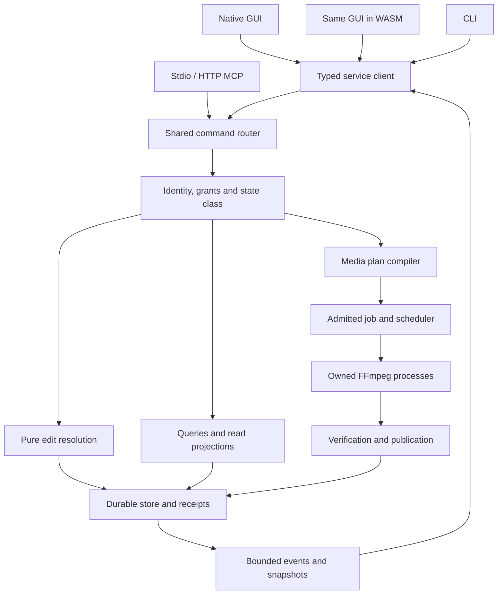

# Complete implementation architecture and module contracts

This blueprint specifies the internal construction of the already selected application. The detailed process, state, protocol, media and platform rules in the following sections remain binding. The names below select concrete module ownership and dependency direction; they do not add a second service, another media engine or one crate per feature. Implement this architecture through WP01-WP12 and qualify it in GitHub CI. No interface sketch is evidence that the application has been compiled.

## Composition root and target graph

The public application has one native composition root. It parses mode and portable-root options before initializing any window, audio output, media device or public listener. Mode dispatch chooses native GUI, a CLI request, stdio `bridge`, direct-HTTP `bridge`, browser `serve`, or the protected internal owner mode. Native GUI/CLI/bridge processes attach through the established owner-bootstrap contract; the owner alone opens the mutable store and owns media subprocesses. The same distributed executable contains these modes. The qualification harness is a CI-built testing artifact, not an extra ordinary application prerequisite.

The browser is a separately compiled WASM target from the same `nw-ui` crate, embedded as assets in each native package. Its composition root creates only presentation, local UI state and a service client. It does not construct the database, command handlers, FFmpeg compiler or process supervisor. This distinction is enforced by target dependency inspection and packaged launch tests, rather than assuming that a Rust codebase automatically produces a small WASM binary.

| Rust workspace unit | Allowed internal dependencies | Explicitly excluded responsibilities |
|---|---|---|
| `nw-domain` | Small serialization/validation/time/ID dependencies from the locked manifest | No database, process spawning, HTTP server, GUI, OS audio or media device initialization. |
| `nw-platform` | `nw-domain`; target-specific filesystem/process/console/client-transport/presentation adapters | No editing reducer, effect compiler, durable job state machine or second authorization policy. |
| `nw-store` | `nw-domain`; the selected native store and narrow filesystem publication primitives | No UI dispatch, FFmpeg invocation, arbitrary network fetch or independently scheduled jobs. |
| `nw-engine` | `nw-domain`, native platform ports; locked FFmpeg-specific helpers | No direct mutation of project heads/receipts, no GUI widgets, no browser application engine. |
| `nw-service` | `nw-domain`, `nw-store`, `nw-engine`, native `nw-platform` | No donor rendering/DSP pipeline or duplicated per-transport handler implementations. |
| `nw-ui` | `nw-domain`, presentation/client ports from `nw-platform`, the shared egui family | No `nw-service`, redb, native FFmpeg libraries or process supervisor in its WASM dependency closure. |
| Native app, WASM app, bridge adapters | The smallest target-appropriate composition of the above | No domain behavior hidden in a mode-specific CLI match arm or UI callback. |
| Rust `xtask` and qualification harness | Build/verification helpers and stable public contracts where required | No runtime dependency of ordinary installed use; no owner-local compiler bootstrap. |

Use target-specific dependencies and explicit feature sets. Rust Cargo feature unification must not accidentally pull native service/store/audio dependencies into WASM. Do not make a `full` default feature silently link every optional model, GPU library and renderer. Compile/package native and WASM targets in their qualified CI jobs, inspect the resulting dependency trees/imports and report the browser asset size separately. Keep one selected renderer in the ordinary package unless a demonstrated target requirement justifies another qualified variant.

The diagram shows logical dependencies. Native/private HTTP and public loopback remain separate authenticated routes; it does not collapse their credentials or create another listener. MCP adapters submit the same canonical requests under their effective principals. Object policy, publication rights and immutable receipts stay server-owned.

## Concrete module ownership

Use the following initial module map. A path names a logical Rust module; implementer renames require a recorded one-to-one responsibility map. Do not duplicate a module because a second interface needs its behavior.

| Owner/module | Inputs and output responsibility | Governing invariant |
|---|---|---|
| `nw-domain::ids` | Project, sequence, clip, stream, principal, plan, job, artifact and session identifiers | IDs are typed lookup identities, never implicit authorization. |
| `nw-domain::time` | Rational source/clip/sequence/output time, frame/sample indices and checked maps | No floating-point timestamp accumulation or accidental cross-clock comparison. |
| `nw-domain::project` | Assets, bins, sequences, tracks, clips, effects, curves, captions, markers and nested references | Stable ownership, validated references, explicit schema/envelope version and bounded opaque extensions. |
| `nw-domain::edit` | Pure edit specifications, resolved patches, inverse operations and affected-resource summaries | One admitted atomic edit, exact interval/link/lock invariants, no partial client mutation. |
| `nw-domain::commands` | Canonical envelopes, state classes, typed params/results/errors and aliases | One field location and frozen default per command version on every surface. |
| `nw-domain::registry` | Capability/action descriptors, pure shortcut context resolver, default-binding data, parameter domains, requirements and canonical IDs | Complete compiled headless discovery with no UI dependency; no advertised inert control or interface-specific semantics. |
| `nw-domain::policy` | Command/object/source/device/network rights and resource budgets | Caller-controlled payloads cannot select their own effective principal. |
| `nw-domain::plan` | Render contract, stage graph, invocation templates, required rights, expected outputs and verification policy | Immutable reviewed meaning; execution does not silently replan. |
| `nw-domain::views` | Bounded project/viewport/job/availability projections and change summaries | Captured revision and authorization scope are explicit. |
| `nw-platform::files` | Native paths, open handles, identity checks, safe temporary files and atomic publication primitives | No ambient-current-directory or path-string authorization shortcut. |
| `nw-platform::process` | Native child creation, handle inheritance, process groups/job objects and termination | Explicit handles/environment, owned-child identity and no orphan descendants. |
| `nw-platform::client` | Typed request/events/media transport for native and WASM clients | Same DTO semantics, distinct target I/O, finite timeouts and cancellation. |
| `nw-platform::presentation` | Native texture/audio output and browser DOM/WebGL/MSE integration | Present FFmpeg output under the selected display/clock contract; no effect processing. |
| `nw-platform::console` | Windows GUI-subsystem attachment, redirected handles and UTF-8 diagnostics | Clean JSON/MCP stdout and correct parent-shell waiting/exit behavior. |
| `nw-store::projects` | Heads, operation journal, checkpoints, undo retention and project identity leases | Commit before acknowledgment; reconstruct acknowledged unsaved edits. |
| `nw-store::receipts` | Scoped idempotency digests, immutable outcomes, expiry and restricted reads | A forgotten/expired retry never becomes new execution. |
| `nw-store::jobs` | Accepted snapshots, stages, execution authorizations and terminal facts | Immutable terminal state; retry creates a new linked job. |
| `nw-store::artifacts` | Managed media ownership, output identities, cache indexes and retention references | Cache cleanup cannot delete retained source/job/recovery media. |
| `nw-store::publication` | Save/export intents, fences, claims and recovery reconciliation | No overwrite before admitted claim; publish only verified owned bytes. |
| `nw-store::migrations` | Version inspection, new generations, activation records and rollback evidence | Unsupported versions never initialize an empty replacement store. |
| `nw-engine::probe` | Reserved ffprobe invocation, bounded metadata/index results and observed format epochs | Unknown/incomplete results stay explicit; no uncontrolled first-probe references. |
| `nw-engine::capabilities` | Exact packaged profile, generated help, runtime devices and route availability | A filter name or GPU marketing name does not prove a runnable route. |
| `nw-engine::normalize` | Utility/editor intent to canonical streams, times, source interpretation and output objective | FFmWiz and MuxCls wizards do not own independent command builders. |
| `nw-engine::graph` | Typed media DAG, effect ordering, channel routing, temporal prefixes and dependencies | One graph contract for preview, analysis, utilities and export. |
| `nw-engine::lower` | Admitted graph to native FFmpeg options, filtergraphs, sidecars and stage dependencies | Media computation stays in FFmpeg; shell text is never executed. |
| `nw-engine::schedule` | Resource reservations, priority, active dependency windows and pressure responses | Bounded RAM/VRAM/scratch/process counts and visible admission failure. |
| `nw-engine::supervise` | Stage preparation, child I/O, progress, diagnostics, reconfiguration observation and cancellation | Drain outputs independently; classify facts before bounded log retention. |
| `nw-engine::preview` | Generation-aware native NUT and browser audition production; agent observations | Identifiable captured state, correct clocks and bounded future-frame handling. |
| `nw-engine::verify` | Expected stream/timing/content/metric/publication assertions | Process exit success alone never proves successful delivery. |
| `nw-service::owner` | Root lock, bootstrap identity, compatibility, listener and lease lifetime | One writer owner per canonical root; accepted work survives frontend closure. |
| `nw-service::auth` | Authentication, effective principal, object actions, source grants and revocation | Private launch authority never leaks through forwarded MCP requests. |
| `nw-service::dispatch` | State-class selection, validation, replay, edit commit and job acceptance | All transports converge before domain execution. |
| `nw-service::read_model` | Paged snapshots, contextual availability, reports and authorized event projections | No full-project download hidden behind a virtualized widget. |
| `nw-service::routes` | Private/public application HTTP, pairing, assets, media and official MCP adapters | Exact origin/route policy and bounded serializers; no private-token download link. |
| `nw-ui::workspace` | FilmCraft-derived docks, panels, themes, workspace preferences and responsive layout | Same Rust implementation in native and browser. |
| `nw-ui::actions` | Current UI context extraction, host-action dispatch, shortcut/remapping editor and bindings to shared descriptors | Consume `nw-domain::registry`; do not own definitions that headless discovery would omit or require importing the UI to obtain. |
| `nw-ui::timeline` | Virtualized presentation, hit testing, transient gestures and edit-preflight display | Commit through the service; stale drags never silently overwrite remote edits. |
| `nw-ui::inspectors` | Schema-driven properties/effects/streams and unavailable-state explanations | Units, defaults and validation come from the registry. |
| `nw-ui::utilities` | FFmWiz workflows and a named MuxCls cleanup/remux workspace | Utilities work without forcing users to build a timeline. |
| `nw-ui::jobs` | Plans, final commands, progress, results, cancellation/retry and logs | Show actual stage/publication truth, including partial multi-output failures. |

Subsystem tests use these responsibilities as seams, not as a reason to mock away every cross-boundary behavior. For example, a mux-selection unit test is necessary but does not replace a real packaged ffprobe/remux/verification fixture or its shared-interface journey.

## Authoritative records and their lifetime

Distinguish authored project data, derived data, transient presentation state and execution facts. The following records are shared Rust DTOs or internal typed records with explicit serialization versions. Do not serialize arbitrary Rust memory layout.

| Record | Required fields or relationships | Owner and lifetime |
|---|---|---|
| `AssetRecord` | Stable asset ID; external/managed kind; byte identity; original display name; admitted streams; source interpretation; availability; retained references | Durable store. External paths are references, not embedded credentials; managed bytes have verified ownership. |
| `StreamRef` | Asset identity, selected probe/source revision, stable selected stream identity, media kind and observed physical index | Domain/plan. Reprobe changes are resolved explicitly; a later array position does not silently retarget an operation. |
| `ProjectHead` | Project UUID, schema, current revision, checkpoint/disk generation, compatibility state and lease identity | Store. Unsaved acknowledged edits remain journaled. |
| `SequenceRecord` | Settings, explicit time policy, ordered tracks, composition/mixer graph, markers/captions and nested dependencies | Authored project. Settings updates invalidate only the correct derived products and do not mutate accepted jobs. |
| `CommandDescriptor` | Canonical ID/version; params/result schema; state class; fixed aliases/defaults; required rights; host constraints; availability and documentation links | Compiled registry. Every active parameter has semantic use and conformance evidence. |
| `ResolvedEdit` | Expected head, affected closure, deterministic patch/inverse, resulting references and bounded report | Temporary domain computation, then one journal/receipt transaction. |
| `RenderContract` | Captured sources/revisions, time maps, stream outcomes, graph order, color/alpha/channel definitions, output cadence/extent and selected quality | Immutable plan input shared by utility/editor render paths. |
| `ExecutionPlan` | Canonical hash; required rights; captured dependencies; profile/runtime fingerprint; stage DAG; budgets; output claims; verification and allowed fallback | Retained planning/acceptance record with explicit expiry and object access. |
| `InvocationSpec` | Executable identity; argv vector; private working directory; owned sidecars; stdin/stdout/stderr profile; deadline; expected artifacts and diagnostics | A fully resolved leaf invocation prepared by the same compiler/supervisor for a job or admitted bounded query/preview. |
| `AcceptedJob` | Submitter, original reviewed plan/hash, immutable input snapshot, durable purpose authorization, state/stages, output claims and receipt | Durable through active work and declared history retention. |
| `ArtifactRecord` | Immutable bytes/digest/length/type, producing job/observation, authorized read purpose, publication identity or cache lease, expiry | Store plus owned filesystem object. A handle never permits reading a replacement at the same pathname. |
| `PreviewSession` | Client/target, project revision, render generation, origin/clock, transport and display contracts, queue budgets and lease | Bounded volatile session; restart requires explicit resynchronization. |
| `ObservationRecord` | Captured target/time, actual sampled interval, graph/source/display identity, encoding, artifact and byte budget | Bounded expiring result; no dependency on another client's playhead. |
| `ViewSnapshot` | Principal/policy scope, revision, projection/query, ordered cursor, event cursor and expiry | Bounded read lease; pages from different snapshots never merge. |
| `AccessProfile` | Stable principal, mode, explicit command set, object grants, path/device/network policy and policy revision | Owner-managed durable state; transport token rotation does not create a new principal. |

The `InvocationSpec` is not another public job protocol. Processing/export commands still create and submit the established `ExecutionPlan`. Explicit query/volatile operations such as bounded probing, exact-frame inspection and preview can own a bounded work/session lease and use the same leaf compiler/supervisor without inventing a durable export job or project edit. Before any actual FFmpeg/ffprobe child starts, emit its prepared invocation to the applicable authorized command inspector/log/event sink. Durable jobs retain their stage-prepared fact; volatile work retains bounded trace facts under its session/request identity. This preserves command visibility without journaling every playback frame as a project mutation.

## Command service execution algorithm

Every adapter produces the canonical envelope before calling the command service. Follow this order, preserving the stated replay exception:

1. Enforce transport byte/depth/rate limits; authenticate its actual scoped credential; identify the data-root/owner epoch and stable principal. Decode the declared API/command version without invoking a handler.
2. Resolve the registry descriptor and fixed alias expansion, including retained replay-only metadata for retired command versions. Validate field placement and discriminator. Determine `query`, `bootstrap`, `volatile_session` or `durable_mutation` from the registered operation/variant, never from a caller's requested weaker durability. Retain the accepted version's structural-digest/alias/default interpretation through its unexpired replay scopes; this does not retain or reactivate an executable handler.
3. For durable work, verify replay-scope ownership/expiry, canonical structural digest and receipt-read permission. A matching receipt returns its recorded or explicitly restricted result before current target/revision validation, including when its execution version has since retired. A conflicting digest fails. An expired scope never executes. A retired version with no matching accepted receipt returns `COMMAND_VERSION_RETIRED`; it cannot create fresh work under replay-only metadata.
4. For new work, check the finite command allowlist, current object action, current source/output/device/network rights, target existence and command-specific resource/revision preconditions. Expand affected edit closures in the engine/domain, not from the visible UI subset.
5. Run expensive source resolution, planning or edit preflight outside a long-held database transaction. Retain bounded snapshots/leases. Before commitment, revalidate the exact relevant head, grant assumptions, input identities and publication target preconditions so the earlier computation cannot commit against changed facts.
6. Commit durable edits, accepted-job state, receipts and any reference changes in the appropriate single transaction. Materialize the visible resulting state from the committed result. Do not acknowledge success while only an in-memory widget/queue has changed.
7. Schedule accepted work under its immutable plan and durable authorization. Stage workers do not mutate project heads. Events expose committed state and prepared/observed execution facts under current authorized projections.
8. Serialize the typed result within its route budget; release request leases on completion/cancellation/disconnect under the selected policy. Lost responses can be retried using the same durable identity. They do not cause another media job.

Keep the command handler registry separate from transport formatting. CLI exit codes, application errors and MCP tool errors are adapters over the same typed result. A successful `jobs.inspect` reporting `state=failed` remains a successful query; an invalid edit or failed plan submission preserves its domain error. Stdio diagnostics never become protocol bytes. HTTP status and JSON-RPC lifecycle follow their own selected standards without changing operation semantics.

## Planner, graph and execution boundaries

Normalize a wizard operation, timeline export or MuxCls cleanup intent into the same exact stream/output contract. A utility may use a minimal synthetic render description rather than creating a persistent editor project. It must still pass the same source identity, stream outcome, rights, profile, output collision and verification rules. No utility shells out through a private historical Python builder.

Planning has explicit phases: resolve the captured input set; probe/index only the information required; resolve logical stream correspondence and requested changes; construct the typed media DAG; propagate time/color/alpha/channel/format requirements; choose admitted CPU/GPU/copy routes; schedule finite dependency windows; lower to stage invocations and owned sidecars; calculate resource/scratch constraints; and freeze output/verification/fallback contracts. Each failure names its phase and unsupported resource/parameter rather than returning an opaque FFmpeg string error after partial work.

The typed graph distinguishes sources, interpretation, time maps, filters, compositions/transitions, mixer routes, analysis nodes, encoders, muxers and outputs. It carries pad media type, exact clock mapping, format/precision/alpha/channel requirements, temporal history/lookahead, resource cost and component requirements. Validate references, cycles, fanout and output reachability before lowering. A temporal node's upstream prefix is a graph dependency, not a recursive UI callback. Nested sequences compose checked maps and routing rather than flattening by uncontrolled duplication.

Copy eligibility is established from the complete resolved operation, including stream order, metadata, dispositions, chapters, attachments, container constraints and timestamp policy. Byte-for-byte file copy, packet-preserving remux and decoded/re-encoded render are distinct plan outcomes. Replacing a metadata field cannot be declared a no-op because the stream selection stayed the same. A copied output still has a verified publication and cancellation contract.

`nw-engine::lower` emits argv elements and typed filter/sidecar text. Validate escaping in the relevant grammar: shell escaping, filter-expression escaping, concat manifests, ASS/VGS text and native path encoding are different concerns. Only argv is passed to the OS. Sidecars live in the plan's owned namespace, with hashes and admitted secondary opens. No unreviewed raw option dictionary may override reserved input, output, mapping, protocol or supervision flags.

Analysis-dependent invocations retain typed stage templates and admissible result ranges. Validated measurements resolve the concrete next invocation, whose exact arguments and sidecars are frozen and shown before spawning. Random seeds, approximation/quality modes, chosen transfer paths and preapproved equivalent CPU fallback are part of the plan. A new device, changed semantic setting or unapproved fallback produces an explicit revised-plan path, not silently different output.

## Concurrency, cancellation and resource ownership

Use the selected asynchronous native service runtime for routing, timers, child I/O and bounded streams. Blocking database/filesystem operations and CPU-heavy control/graph preparation use bounded workers. Native UI painting/input remains on its platform event loop. Browser UI work must yield to that event loop. Neither route-handler futures nor UI callbacks perform synchronous full-media reads or wait for an entire render on the presentation thread.

Serialize authoritative project/head and job-state transitions through `nw-service` and `nw-store` transactions. The design does not require one thread per clip, file or request. For independent planning/probing, use a bounded work queue and retain the captured revision. Queue capacity is admitted before allocating a large request graph or upload buffer. Saturation produces documented backpressure/resource errors, not silent dropping of a user's durable mutation.

The scheduler has interactive preview/observation demand, explicit user jobs, and background derived-artifact work. Preview may preempt or cancel stale preview generations; it cannot corrupt a durable export to improve scrubbing. Background thumbnails/proxies yield when interactive pressure rises. Use bounded fairness so continuous scrubbing cannot starve accepted jobs indefinitely. A job's constraints reserve CPU threads, decoder/encoder sessions, RAM/VRAM and scratch independently; one global “worker count” cannot represent these resources.

Every queue identifies its producer, consumer, maximum items/bytes, shutdown owner and full-queue behavior. Media queues charge actual payload bytes, socket buffering and retained decoded surfaces. Future timestamped frames follow the established clock-relative backpressure rule. Latest-seek replacement applies to obsolete preview generations, not arbitrary future frames in the active generation. Large artifacts, uploads and copied companion files stream through fixed buffers.

Cancellation has distinct request, preview-generation, stage and durable-job tokens. Disconnecting a client may cancel its bounded query/observation or detach from an accepted job according to the route contract. It does not cancel another client's accepted export. The supervisor first requests orderly child shutdown where its stdin profile permits it, then uses bounded escalation on the owned process group/job object. Probe input descriptors are never written as control pipes. Always drain or close streams, release leases/reservations and reconcile owned staging on exit.

GPU discovery, media acceleration and GUI rendering are separate. CPU-only media work never initializes a hardware media device. Auto chooses a qualified decode/filter/encode path for the actual format/graph/objective, accounting for upload/download and VRAM. A successfully created GUI/OpenGL adapter does not prove NVENC/NVDEC availability. Ordinary hosted CI establishes CPU and device-absent/failure behavior; the owner's matching CI-built harness establishes the actual GPU routes on the RTX 4070 Ti. No performance or capability result is inferred merely from Rust, vendor ID or a compiled feature flag.

## Durable tables, filesystem artifacts and recovery

Retain the previously selected redb cache budget and one-owner rule. Use explicit versioned encodings and stable keys; never rely on Rust enum memory layout. A database transaction records metadata and references, not whole movie byte buffers. Large immutable checkpoint/report/sidecar objects may be stored as owned hashed files with durable reference records and recoverable promotion. Their publication must not create a reference to unfinished bytes.

| Logical table/record group | Key and contents | Write boundary and recovery role |
|---|---|---|
| `meta` | Root UUID, schema/store generation, activation and bounded owner metadata | Protected initialization/migration; an incompatible binary stops before writes. |
| `project_heads` | Project ID to current revision, checkpoint and disk-generation references | Same transaction as the admitted edit/receipt. |
| `project_journal` | Project/revision to versioned resolved operation, inverse and affected IDs | Reconstruct acknowledged unsaved edits; checkpointing bounds replay. |
| `project_checkpoints` | Project/revision/generation to validated serialized snapshot identity | Written through staged verified publication; retained generations protect their assets. |
| `access_profiles` and credential/replay metadata | Stable principal, explicit policy revision, revocation and protected keys | Owner-authorized changes; transport secrets stay outside public result projections. |
| `receipts` | Principal/scope/namespace/key to structural digest and immutable outcome | Atomically coupled to mutation acceptance; expiry/compaction cannot permit replay. |
| `plans` | Plan ID/hash, captured contract, required rights and audit identity | Frozen planning record; no mutation in place at submission. |
| `jobs` and `stages` | Accepted snapshot/authorization, state, invocation facts, progress and terminal result | State transitions commit before acknowledged facts; interrupted work reconciles on restart. |
| `artifacts` and retained references | Asset/artifact identity, producing owner, byte purpose, expiry and live/recovery references | Promotion/publication and reference changes are serialized; GC rechecks roots. |
| `save_journal` | Target preconditions, prior/new disk generation, saved revision and phase | Resolve whether rename occurred without deleting a valid older checkpoint. |
| `publication_journal` | Output claim, verified staging identity, fence and per-artifact publication fact | Resolve crashes/partial multi-output publication under the actual destination claim. |
| Rebuildable cache indexes | Probe/index/thumbnail/proxy/waveform keys, measured size and leases | May be rebuilt or evicted under policy; they are not the sole record of retained media. |

Restart first acquires the canonical owner lock, checks store/build compatibility and reconciles incomplete extraction/migration/save/publication records before resuming ordinary acceptance. It distinguishes queued accepted jobs from interrupted child execution and terminal jobs. It cannot infer a completed output from a matching filename or kill a reused PID. A retry captures a new job ID and current permissions while retaining linkage to the previous immutable terminal result.

Cross-data-root project writer and destination claims retain their independent namespace. A second root cannot bypass a live checkpoint or output claim simply because its own redb store is empty. Atomic no-replace publication is qualified per target filesystem. When several outputs cannot commit as one filesystem operation, the result records each actual published artifact and any failure rather than claiming all-or-nothing rollback that did not occur.

## Presentation, browser and machine-interface adapters

The shared UI owns only bounded view caches, selection/focus, panel layout, transient gestures and renderer resources. Its widgets consume typed projections and availability. A drag can show a provisional overlay, but project state changes only after the service commits the exact expected revision. Agent edits appear through the same coherent change/snapshot mechanism. On disconnect, display the last coherent view with its stale status and prevent stale writes until reconciliation.

The native adapter provides file picking, OS drag/drop, texture upload, audio output and private service-client transport. Browser paths are upload/import handles or engine-authorized source references; browser JavaScript/WASM cannot claim a native filesystem grant by sending a pathname. Browser downloads expose only admitted authenticated artifact bytes. The common preview view contract, actual frame time and generation apply to native NUT, browser MSE and headless observations, while their declared transport encodings differ.

CLI commands are typed registry adapters. Designed convenience verbs and the universal request route resolve to the same canonical operations. A headless call never opens a dialog to obtain missing data. MCP tools/resources expose those operations, bounded discovery and media observations using the pinned official SDK/version profiles. The browser application API and MCP protocol are separate wire formats over the same service; the application's SSE cursor is not an MCP session ID or protocol resumption promise.

Every ordinary GUI capability has an explicit headless input independent of focus/playhead. Host-only actions such as opening a native dialog or requesting browser fullscreen declare a client/gesture requirement while exposing their underlying project/media operation separately. They do not justify hiding an export, edit, effect, metadata change or MuxCls workflow from CLI/MCP.

## Extension and delivery contract

Adding a command/filter follows one registry-centered path: define typed semantics/defaults/units/state class and requirements; implement a pure handler or admitted FFmpeg lowering; attach resource/format/device admission; generate shared controls, CLI/MCP schemas and help; provide meaningful positive/negative/media/lifecycle fixtures; document source differences; and join actual evidence. Optional components have truthful discovery states and complete install/import profiles. No new handwritten JavaScript frontend, Python service or dynamically loaded donor DSP plugin is introduced to speed up one feature.

The release composition is application code, embedded same-build browser assets, a manifest-verified standard FFmpeg/ffprobe profile, small licensed required assets and notices. Extraction, repair, profile replacement and signature/provenance handling use the already selected owned-directory and stopped-update contract. The first launch remains offline for core functions. Native imports and optional driver dependencies are verified per Windows/Linux/macOS artifact. The implementation does not promise that a single universal binary runs unchanged on all operating systems.

Android is an explicit later adapter target: preserve source-handle, storage-grant, process/lifecycle, UI-layout and compute-policy boundaries so it can be implemented without rewriting project semantics. Do not advertise current Android support, impose Android constraints on the current desktop UI, or assume its background jobs, storage URIs, FFmpeg distribution and thermal behavior are already qualified.

**AR7-J01 — Architecture dependency and headless boot (WP02/WP03):** CI checks target dependency/import closure, boots CLI/MCP/worker without window/audio/media-GPU initialization, and boots the shared browser UI with no store/process engine in WASM. Assert the same registry fingerprint and source-specific rights at every adapter.

**AR7-J02 — One semantic pipeline across utilities and editing (WP03/WP05/WP07):** construct equivalent admitted stream/metadata/output intents through the FFmWiz utility, MuxCls workspace, universal CLI and both MCP transports. They reach the same normalization/lowering/verification handlers with the same declared result. Observe prepared invocations for durable jobs and bounded probe/preview work, without creating fake project revisions or leaking owner authority.

**AR7-J03 — Ownership and recovery across process boundaries (WP03/WP10/WP12):** fault-inject planning completion before commit, accepted job before spawn, slow media consumers, frontend disconnect, owner restart and publication boundaries. Assert bounded queues, receipt identity, retained snapshots, exact artifact ownership and immutable terminal facts. Lose a durable response, retire its command version in an admitted migration, and retrieve the accepted result through retained replay-only metadata; reject a fresh request for that retired version. Run ordinary cases in hosted CI; actual GPU variants use only the established owner harness.
